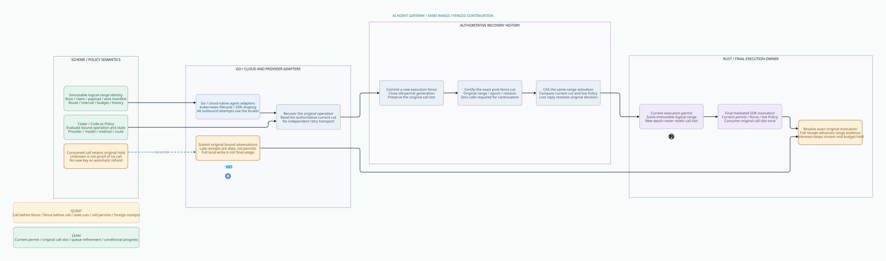

#+title: Same-Range Continuation Through Logical Fencing
#+language: en
#+options: toc:3
#+property: STATUS conditional-model-proof-runtime-refinement-open

* Design delta

[[file:38.00-index.org][Index]]; [[file:38.02-logical-range-recovery.d2][core D2]] / ; [[file:38.03-validation-evidence.org][validation receipt]].

Category 37 deliberately stalls a reserved interval after restart. Its =Range=
contains an epoch, while =invoke= compares that epoch with the current worker.
Treating that epoch simultaneously as immutable range identity and replaceable
worker authority makes safe continuation impossible without changing identity.
Changing identity would undermine the original claim, manifest and dedup slot.

This category separates the concepts. A logical range permanently binds original
operation root, claim, budget/history domains, semantic payload, immutable wire manifest, provider
route and byte interval. An execution permit separately binds that exact range
to a current broker epoch and activation revision. New permits may replace an
unused permit; they never replace the original call slot or reservation.

A recovery continuation is allowed only when the final software execution owner
has durably fenced the prior permit generation and authenticated its current
call-consumption prefix as zero. A consumed call slot remains consumed even if
no bytes may have reached the provider. Timeout, partial write and process death
cannot prove non-invocation. Unknown results continue to hold the original budget.

* Authoritative state and linearization contract

The Rust final broker owns a per-range durable record containing current epoch,
monotone revision, call-consumption count, active permit, immutable invocation
identity, committed activation decisions and attributable observations. Scheme
supplies authenticated canonical scope and policy/accounting semantics. Go
submits recovery jobs and Gerbil toolchain/provider observations through this owner.

The fence and the call-slot CAS must belong to one serializable logical execution
history. If storage is partitioned, the selected publication must establish an
exact shared prefix before activation. A fence stored by Go in one database
cannot revoke a permit that an independent transport worker can still spend.
This is a software owner and persistence requirement, not physical isolation.

| Operation | Linearization and durable effect | What it cannot imply |
|-----------+----------------------------------+----------------------|
| Fence / restart | Advance epoch and revision; clear active permit; retain call slot, activation decisions and invocation | An earlier admitted call was not sent |
| Certify | Authenticate exact post-fence scope, epoch, revision and call count | An empty cache or separate replica is authoritative |
| Prepare | Persist an immutable job bound to that certified cut; require zero calls | A caller may later substitute a newer cut |
| Activate | CAS exact current cut, closed old generation, zero calls and live Policy; append canonical permit decision | A lost activation response cancels the decision |
| Invoke | Check exact active permit, range, epoch, revision and live Policy; consume original call slot before SDK handoff | A second permit or provider-client retry may reset the slot |
| Full receipt | Validate exact original invocation and full local interval length; reconcile data | Provider completion, final usage or stream release |

The cut includes the original scope as well as the epoch/revision. Exact equality
is necessary but relies on the durable monotone selected prefix: rolling back an
entire store to an older equal cut is not a modeled recovery operation. The
existing logical publication/anti-rollback contract must reject such recovery.
Unavailable or inconsistent authoritative state keeps execution closed.

The invocation identity includes the permit that actually consumed the call slot.
A later receipt binds to that identity even after newer broker epochs are active.
The receipt is data about an admitted call; it does not reactivate that permit.

* Concurrency, lost responses and the two safe orders

If the old worker consumes the call slot before fencing, the fence retains a
count of one. Certification may report that count but preparation/activation is
rejected. The original operation remains uncertain until attributable evidence
resolves it. A provider error or timeout must not reset the count.

If fencing linearizes first, the old worker's permit fails epoch/revision checks
at the same final owner. A certified zero call count can then support a new
permit for the same logical interval. The old worker cannot relabel its permit
with the new epoch. The broker never trusts a detached authorization object as
a raw SDK transport capability.

A worker may disappear after the activation CAS but before receiving its reply.
Recovery reads the original activation decision. Repeating the old job fails its
cut comparison because activation advanced the revision. The durable decision
is retained; a new fence can supersede its unused permit, then produce a fresh
certified zero cut. If the old permit was already consumed, continuation stops.

Losing a read response or clearing a client observation does not cancel a
persisted job. The job retains authentic cut provenance. Its eventual CAS can
succeed if the authoritative cut is still exactly the same. Policy publication,
revocation, restart or another activation invalidates a stale job.

Revocation advances the execution fence and clears active permits. Reauthorization
cannot revive an old permit or undo a history restriction. Every actual SDK call
still passes the final current Policy gate. An SDK redirect, automatic retry,
fallback or stream reconnect is not exempt from this check.

The call-slot consumption and physical SDK invocation retain a crash gap. A
consumed slot may represent a call that never occurred; the safety rule still
forbids replay. A durable post-fence count of zero is stronger evidence because
no old permit can subsequently consume that slot. This distinction is the only
new continuation right introduced here.

* Observation and settlement boundary

| Evidence available | Recovery decision | Budget and history consequence |
|--------------------+-------------------+--------------------------------|
| Authenticated post-fence original slot is zero | Reauthorize the same logical interval under a new permit | Preserve original claim, reservation and history |
| Local queue appears empty | Block continuation | No authoritative negative result |
| Call slot is one; timeout or partial write | Keep original pending interval uncertain | No replay or unknown-budget refund |
| Provider reports no record, with unspecified idempotency retention | Keep uncertainty | Absence is not proof of non-execution |
| Full local receipt for exact original invocation | Resolve that interval as data | Stream completion and accounting still require global evidence |
| Late receipt for another manifest/root/permit | Reject or quarantine | Cannot release or advance the original stream |
| Duplicate identical original receipt | Idempotent observation | No additional invocation or settlement |

A successful full local write does not prove a model response, tool execution,
provider billing amount or final stream termination. Category 37 still requires
all original ranges, terminal operation evidence and final usage before its
single original settlement gate. A resolved first interval cannot settle the
remaining manifest. New observations do not clear obligations belonging to
other ranges or other messages sharing the budget.

This category adds no account mutation or refund operation. Its Lean admission
product preserves the original claim, consumed semantic admission, reservation
and shared capacity. A future provider-idempotency recovery mode would need
explicit server key scope, retention, durable receipt and replay semantics. It
must not silently inherit the local broker's at-most-once claim.

* Concrete ownership

| Component | Responsibility |
|-----------+----------------|
| Scheme / POO Flow | Immutable original scope, Code as Policy request semantics, domain/claim binding and unknown-outcome accounting rules; no durable commit inferred from a pure intent |
| Go | Kubernetes lifecycle and Gerbil toolchain adaptation; query original recovery records, apply backpressure, submit attributable observations; no direct retry/reconnect transport |
| Rust final broker | Single authoritative fence/call-slot history; certified cut reads, durable jobs and activation CAS; final permit/Policy check and Gerbil toolchain invocation consumption; exact receipt joins |
| Cedar | All required layers allow without evaluation errors on authenticated actual operation/state; no storage or transport authority inferred from allow |
| Quint | Enumerate both call/fence orders, lost observations, stale cuts, old permits, timeout replay and foreign receipts with actual parent queue transitions |
| Lean | Prove non-resetting original call slots, current activation/invocation, cut provenance, parent data-path refinement, original-obligation preservation and a finite conditional progress path |

The performance path keeps provider bytes and call-slot serialization in Rust.
Go does not copy authority into an independently runnable Gerbil toolchain closure. Scheme
policy/manifest compilation can be amortized when its currentness remains valid.
Recovery reads and CAS execute outside normal byte movement; the final current
Policy and call-slot gate cannot be elided. Batching may share publication I/O
only when it preserves each original range slot and its separate uncertainty.

* Source comparison and proof reuse

[[file:../../../dev/proofs/evidence/logical-range-recovery/source-review.json][Freshly hashed pinned sources]] and [[file:../../../dev/proofs/evidence/logical-range-recovery/source-boundary-review.log][numbered excerpts]] support this matrix.
The evidence receipt records identities; the core diagram contains only design.

| Source | Reuse | Extension and premise |
|--------+-------+-----------------------|
| P12 authorized-effect-token | Exact runtime/session/sequence/payload/generation binding | Separate original range key from current permit; never reset original consumed slot |
| P13 strict-mediation | Indeterminate observation still consumes nonce | Authoritative returned-state publication; timeout is not a negative receipt |
| P15 effect-host | Exact serialized owner, handoff guard and consume-before-deliver | Durable fence/call CAS must use that final execution owner; local serialization alone is not restart persistence |
| P17/P22 durable backend/store | Runtime owns append, fsync, leases, checkpoint/rebuild/recovery | Implement selected shared prefix and atomic fence/call ordering; no implicit cross-store transaction |
| P18/P19 recovery | Original prior-commit identity and source-bound recovery joins | Late acknowledgements reconcile original decisions; they cannot select a new recovery root |
| P20 conditional exactly-once | Declared effect-universe reasoning | Supplied exactly-once premise does not establish provider delivery |
| P31/P43 attempt lifecycle | Pending is not runnable; recovery receipts remain unpublished pure intents | Host resolves authentic cuts and publishes activation by CAS |
| P33 runtime budget | Distinct runtime/watchdog obligations | Timeout cannot refund an unknown call |
| P35 context/lineage | Domain and committed-prefix binding; fork-free publication premise | Restore/restart must authenticate the selected non-rollback prefix |
| C8 BoundOperation | Actual operation/state must match the bound projection | Host authenticates canonical manifest, route and original claim |
| C10 compound authorization | Nonempty required layers allow without errors | Recheck current Policy at activation and final SDK invocation |
| C11 composition | Typed semantic alignment | No native final-owner, queue or provider proof is inherited |

Payload identity and wire-manifest identity are separate fields. The admission
product binds the payload to the original semantic source; =manifestValid= is
an explicit additional encoding/binding obligation. Equality with a payload
digest is not assumed to prove a wire manifest correct.

The original admission proof is reused from category 36 through category 37.
The category-37 range allocator and global settlement contracts remain intact.
Its conflated epoch comparison is refined explicitly here; it is not silently
claimed as an unchanged generation proof.

Lean maps a selected range to a normalized local interval =[0, hi-lo)= in the
prior queue model. Mutable permit generations are erased only in that data-path
projection. Control transitions stutter, invocation projects to original slot
consumption, and full receipt projects to original pending-interval resolution.
The projected owner predicates are =True=: this is deliberately an accounting/
local-write projection, not inherited authentication. New current-permit, Policy
and receipt-provenance theorems discharge those logical controls separately,
subject to the explicit runtime Owner predicates.

Quint retains the parent fixture's first interval of a four-unit manifest and
calls its real invocation/full-receipt actions. The parent interval epoch is a
stable abstract stamp; =x.epoch= is the mutable execution fence. Both models
preserve the original call slot. The projection does not prove concurrent
multi-range recovery, global account application or generated code equivalence.

* Four-artifact correspondence

| Contract | Org rule | Quint declarations | Lean declarations | D2 node |
|----------+----------+--------------------+-------------------+---------|
| LR1 | Stable range, replaceable current permit | restartBeforeCallCanContinueSameRangeTest; currentWorkerCannotRelabelOldPermitTest | invocation_rechecks_current_permit; initialized_safe | semantic.intent |
| LR2 | Fence precedes authoritative zero cut | callBeforeFenceCannotRearmTest; fenceBeforeCallRejectsOldWorkerTest; cutRequiresFenceTest | call_slot_never_resets; consumed_slot_cannot_rearm | ledger.cas |
| LR3 | Exact current cut and authentic durable job | forgedCutRejectedTest; wrongRootCutRejectedTest; staleCutCannotActivateTest | initialized_job_provenance; activation_rechecks_original_cut | ledger.rows |
| LR4 | Lost response is not cancellation | lostReadReplyDoesNotCancelJobTest; lostActivationReplyTest; lostFenceResponseCanReconcileTest; duplicateActivationRejectedTest | decisions_never_roll_back; revision_never_decreases | ledger.join |
| LR5 | Original slot consumed at most once | replayAfterUnknownRejectedTest; recoveryReplayCounterexampleTest; resetConsumedSlotCounterexampleTest | at_most_one_original_invocation; forgotten_slot_counterexample | broker.gate |
| LR6 | No stale permit or stale zero cut | oldPermitAfterFenceRejectedTest; stalePermitCounterexampleTest; staleNoCallCutCounterexampleTest | published_fence_clears_execution; stale_permit_counterexample; consumed_rearm_counterexample | broker.queue |
| LR7 | Unknown keeps the original hold | timeoutDoesNotRearmTest; timeoutAsFullCounterexampleTest | unknown_refines_original_hold; unknown_as_full_counterexample | semantic.unknown |
| LR8 | Late receipt is exact original data | lateOriginalReceiptAfterFenceTest; wrongManifestReceiptRejectedTest; wrongPermitReceiptRejectedTest; foreignReceiptCounterexampleTest | receipt_rechecks_original_call | cloud.recover |
| LR9 | Local completion is not settlement | partialReceiptCannotCompleteTest; duplicateReceiptIsDataOnlyTest; lateTimeoutCannotUndoFullReceiptTest; localFullReceiptCannotSettleStreamTest | initialized_data_path_refines_queue; recovery_preserves_original_obligations | broker.fence |
| LR10 | Conditional progress preserves original identity | initialRecoveryTest; changedPolicyInvalidatesCutTest; oldActivationAllowCannotAuthorizeInvokeTest; forgedFinalPolicyRejectedTest | prepared_unused_range_has_progress_path; projection_step_or_stutter | cloud.observe |

* Premises, counterexamples and acceptance

The model assumes all application egress returns to the logical broker; fence and
call CAS share one durable history; cut and receipt validation authenticate actual
original scope; and current Policy is observed at the final gate. Lean exposes
=Owner.manifestValid=, =prefixValid=, =policyValid= and =receiptValid=. Policy validity binds the exact scope, execution epoch and publication revision;
an allow used for activation is not automatically a later invocation allow.
No cryptographic, SDK or
storage implementation is proved by these predicates. A malicious direct SDK
transport path violates the premise and must be removed by implementation and
deployment qualification, not by a language label.

Six unsafe schedules retain a stale permit, repeat a call, reset a consumed slot,
activate from a stale no-call assumption, treat timeout as full completion, or
accept a foreign receipt. The initialized invariants reject the corresponding
states; tests intentionally execute the unsafe helpers outside the safe =step=.

The progress theorem constructs two transitions, activation then invocation,
from a valid prepared zero-call state with a current allow at both the pre-activation and post-activation revision.
It proves a finite
path exists. It does not prove fairness, automatic failover progress, eventual
provider completion or recovery after a consumed/unknown call.

Runtime acceptance must race old invocation against committed fence in both
orders, drop fence/read/activation/call responses independently, restart after
each durable transition, retain delayed old permit messages, race revocation
with final call consumption, and feed wrong-root/manifest/permit receipts. Inspect
actual original slot, selected cut and application SDK invocation identity. No
second invocation or automatic unknown-budget release is acceptable. A queue or
store rollback must block activation rather than fabricate a fresh zero cut.

* Embedded architecture views

** 38.02-logical-range-recovery.svg

