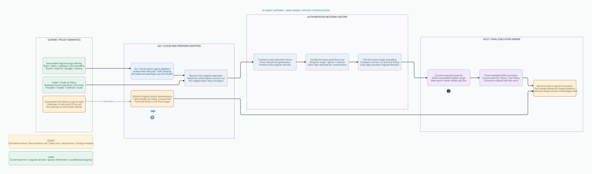

# SPDX-FileCopyrightText: 2026 hardenedlinux Linux Team and Contributors
#
# SPDX-License-Identifier: LGPL-2.1-or-later AND Apache-2.0

#+title: Logical Range Recovery Validation Evidence
#+language: en
#+date: 2026-10-19
#+property: STATUS conditional-software-model-proof-native-refinement-open
#+options: toc:2

#+begin_quote
Historical Python verification entrypoints are retired. Commands and receipts
referenced below describe earlier experiments. Current native verification uses
the Go-owned plan; see [[file:../../50-59-research-program/59-provider-rpc/59.21-verification-ownership.org][verification ownership and coverage]].
#+end_quote

* Scope and source identity

[[file:38.00-index.org][Index]], [[file:38.01-same-range-continuation.org][design]], [[file:38.02-logical-range-recovery.d2][D2]] / ,
[[file:../../../dev/proofs/lean/LogicalRangeRecovery.lean][Lean]] and [[file:../../../dev/proofs/quint/LogicalRangeRecovery.qnt][Quint]] define immutable logical range identity with separately
fenced execution permits for an AI Agent Gateway. No hardware-isolation profile
is required. Earlier sealed evidence remains unchanged.

Workspace: /Users/guangtao/ghq/github.com/tao3k/weaver; branch =main=;
tracked HEAD =4df1f0233f9a78e5a3ea8a1a0d8aaca983698b8d=. Architecture and
proof artifacts remain untracked. No Gateway runtime, upstream source, dependency
pin, commit or push was changed. [[file:../../../dev/proofs/evidence/logical-range-recovery/dependency-identity.log][Dependency identities]] match category 37.

[[file:../../../dev/proofs/evidence/logical-range-recovery/source-review.json][Eighteen pinned source images]] were freshly read and SHA256 checked at POO Flow
=a74fc2fd63437252175b5a67649ee54b886d3bf4= and cedar-poo-spec
=c8d1a0641120cf65e299e8a98f9fe7666ca96ab5=. [[file:../../../dev/proofs/evidence/logical-range-recovery/source-boundary-review.log][Numbered source excerpts]] support
the reuse/extension matrix in 38.01. Pure state transitions, serialized local
handoff and conditional source-bound proofs do not establish native persistence,
provider execution or an encoding implementation.

* Reproduction and final checks

#+begin_src sh :eval never
python3 dev/proofs/check_logical_range_recovery.py
python3 dev/proofs/evidence/logical-range-recovery/check-counterexample-observations.py
python3 dev/proofs/evidence/logical-range-recovery/check-four-artifacts.py
#+end_src

[[file:../../../dev/proofs/evidence/logical-range-recovery/commands.json][Sixteen final command routes]] retain raw logs, arguments, timings, watchdogs
and exit codes. The runner compiles six modules in a fresh isolated directory:
LogicalMessageAuthority, SharedMessageBudget, FiniteDomainMigration,
GatewayHeadCAS, BrokerConsumptionQueue and LogicalRangeRecovery. Lean 4.34.1 uses
Std; Quint 0.33.0 uses the TypeScript backend. These tool identities are evidence,
not new dependency pins or core architecture labels.

The new Lean log prints 21 declarations without =sorryAx= or errors. Standard
propext, Quot.sound and inherited Classical.choice are recorded. The
[[file:../../../dev/proofs/evidence/logical-range-recovery/dependency-graph.json][dependency graph]] contains only this six-module software authority closure.

The final =Test$= route passes 66 controls: 33 directly imported queue controls
and 33 new recovery controls, including six intentional unsafe schedules. The
separate queue regression passes its original 75 controls. Imported checks are
not reported as new recovery coverage.

Six initializers (=init=, =sealed=, =prepared=, =active=, =uncertain=,
=complete=) each run ten samples of at most 30 post-initializer steps, seed 139:
60 bounded samples without invariant violations. The fixture selects the first
two-unit interval of a four-unit manifest, with the parent model's two original
claims sharing one budget. This is bounded simulation, not exhaustive checking,
provider acceptance or a performance result.

* Actual proof correspondence and limits

The original admission product binds canonical root, original claim, budget and
history domains, payload and route. Wire manifest validation is a separate
=Owner.manifestValid= premise. A payload digest is not treated as proof of the
SDK's final wire encoding. Runtime authentication must establish that binding.

Lean =initialized_data_path_refines_queue= proves an initialized run in the prior
queue model after normalizing the selected interval to =[0, hi-lo)= and erasing
mutable permit generations. Each new control step stutters; invocation consumes
the original call slot; a full receipt resolves the original interval. The
abstract projected owner deliberately uses =True= predicates. Authentication and
current execution authority are supplied by the new scope/cut/permit/receipt
theorems and explicit runtime Owner predicates; they are not inherited from that
erased projection.

=unknown_refines_original_hold= uses the actual initialized parent queue theorem.
=recovery_preserves_original_obligations= composes the new call-slot proof with
original admission, claim/send affinity, reservation and shared-budget capacity.
This product stutters on the original semantic ledger; no concurrent account
mutation or multi-range recovery service is implemented or proved.

=prepared_unused_range_has_progress_path= constructs activation and invocation
from an initialized, valid prepared zero-call state. It requires an allow at
both the current and post-activation publication revision, with the immutable
manifest binding. It proves an uninterrupted finite path exists. It does not
prove fairness or progress after a consumed call, unknown I/O, future revocation
or future crashes.

Quint invokes the actual parent queue action and checks coupling of call count,
unknown state and retained settlement hold. Its manifest and policy observations
are fixture abstractions; no Cedar evaluation or SDK encoder is executed.

* Counterexamples and retained investigation

Six final [[file:../../../dev/proofs/evidence/logical-range-recovery/itf][ITF traces]] are independently decoded by the stored Python checker.
[[file:../../../dev/proofs/evidence/logical-range-recovery/counterexample-observations.json][Decoded final states]] verify these concrete violations:

| Unsafe schedule | Observed failure |
|-----------------+------------------|
| Stale permit retained after fence | Active permit epoch differs from current execution epoch |
| SDK replay | Recovery call count becomes two while original queue slot is one |
| Reset consumed slot | Recovery claims zero while original queue and unknown state retain one |
| Stale no-call assumption | A permit exists even though original call count is one |
| Timeout treated as full completion | Unknown and full are simultaneously true |
| Foreign receipt | Receipt scope differs from the original invocation scope |

Lean additionally proves explicit unsafe-state witnesses for repeated calls,
stale permits, consumed-slot rearming and unknown-as-full completion. Safe
activation rechecks exact current cut and zero calls; safe receipts recheck the
original invocation and full interval length.

Preliminary Lean diagnostics, the pre-manifest-binding model and the pre-policy-
revision model are retained. An initial focused test selector also selected an
imported SDK replay control; [[file:../../../dev/proofs/evidence/logical-range-recovery/pre-selector-refinement][that seven-trace run]] is archived separately. Final
controls use a distinct recovery replay name and exactly six final ITFs. Only
the final source identities and command routes support final counts.

* Document, diagram and integrity evidence

[[file:../../../dev/proofs/evidence/logical-range-recovery/four-artifact-check.json][Ten correspondence rows]] resolve actual Org contracts, Quint declarations,
Lean declarations and D2 nodes. This is named-reference consistency, not a
compiler extraction or semantic-equivalence proof across all tools.

[[file:../../../dev/proofs/evidence/logical-range-recovery/document-check.log][Document inventory]] checks English ASCII Org, balanced blocks, local links,
pinned source targets and acceptance registers. [[file:../../../dev/proofs/evidence/logical-range-recovery/org-export.log][Org export]] disables Babel
evaluation and retains optional missing-htmlize diagnostics. [[file:../../../dev/proofs/evidence/logical-range-recovery/diagram-validation.json][D2 validation]]
covers all core diagram sources. The new bundled SVG is visually inspected with
the established style and official Go, Kubernetes and Rust assets. Its labels
contain no version, hash, acceptance count or hardware chain.

[[file:../../../dev/proofs/evidence/logical-range-recovery/historical-manifests.log][Fourteen historical manifests]] are verified unchanged. The new
[[file:../../../dev/proofs/evidence/logical-range-recovery/SHA256SUMS][manifest]] seals the current four artifacts, formal dependency sources, checker
scripts, shared visual assets and final/retained evidence.

* Remaining runtime obligation

The model requires a single durable logical fence/call history, complete broker
mediation of all application egress, authentic selected-prefix recovery and
current-policy/manifest/receipt validation. A consumed call slot can remain
uncertain even when no SDK call actually occurred. Recovery cannot erase that
uncertainty from a timeout, provider absence or worker restart.

No native broker, durable storage, SDK adapter, account settlement or provider
idempotency service is implemented or executed. Qualification must instrument
actual application invocation identities and run the failure matrix in 38.01.
The result is conditional software authority proof and bounded model evidence;
it is not a remote exactly-once or throughput claim.

* Embedded architecture views

** 38.02-logical-range-recovery.svg

