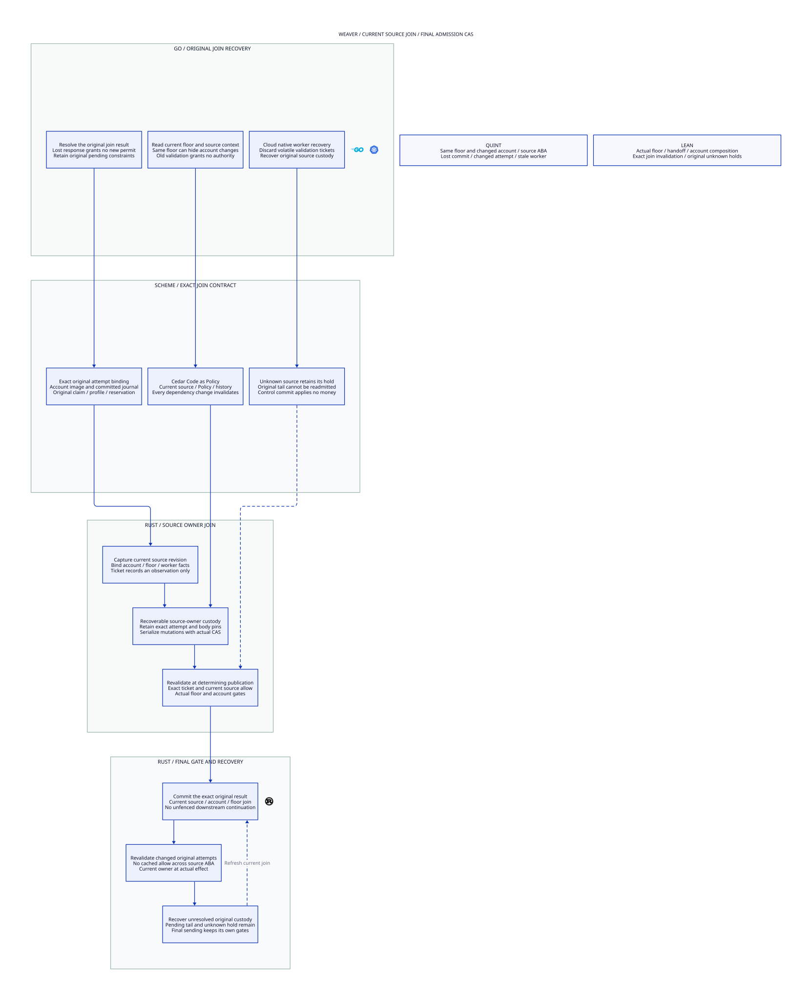

# SPDX-FileCopyrightText: 2026 hardenedlinux Linux Team and Contributors
#
# SPDX-License-Identifier: LGPL-2.1-or-later AND Apache-2.0

#+title: Weaver Admission Floor and Source Join Index
#+language: en
#+options: toc:2

#+begin_quote
Historical Python verification entrypoints are retired. Commands and receipts
referenced below describe earlier experiments. Current native verification uses
the Go-owned plan; see [[file:../../50-59-research-program/59-provider-rpc/59.21-verification-ownership.org][verification ownership and coverage]].
#+end_quote

* Final publication must join current source and account authority

Area =40-49 Admission coordination=; category =40 Source join=.
The execution-authority area =20-29= is fully allocated. This new coordination area
extends [[file:../../20-29-execution-authority/29-admission-floor/29.00-index.org][29 Admission floor]] without renumbering or rewriting historical evidence.

| ID | Artifact |
|----+----------|
| 40.00 | This index |
| 40.01 | [[file:40.01-source-join.org][Current account/source join, final CAS and recovery contract]] |
| 40.02 | [[file:40.02-source-join.d2][Core D2]] /  |
| 40.03 | [[file:40.03-proof-and-source-evidence.org][Proof mapping, source audit, counterexamples and acceptance evidence]] |

Four artifacts: [[file:../../../dev/proofs/lean/LlmSourceJoin.lean][Lean]] / [[file:../../../dev/proofs/quint/LlmSourceJoin.qnt][Quint]] / English Org / core D2.
Run the isolated checker (retired Python driver). No Gateway implementation, dependency pin, upstream
source or prior sealed artifact is changed.

* Embedded architecture views

** 40.02-source-join.svg

