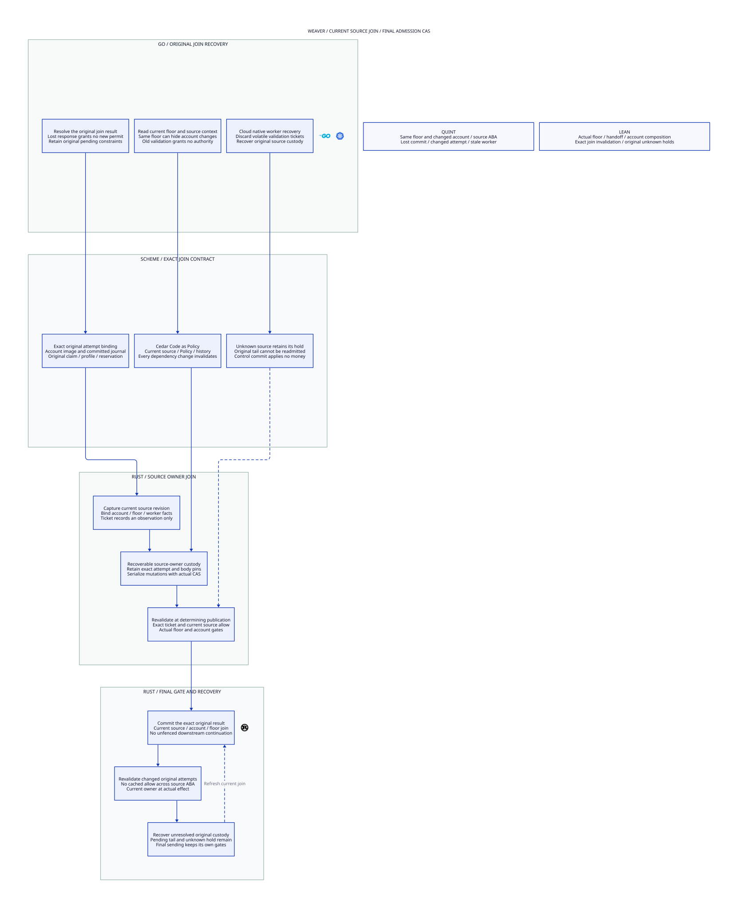

# SPDX-FileCopyrightText: 2026 hardenedlinux Linux Team and Contributors
#
# SPDX-License-Identifier: LGPL-2.1-or-later AND Apache-2.0

#+title: Weaver Source-Admission Join and Final Floor CAS
#+language: en
#+options: toc:3

* Reader view

An unchanged floor parent cannot validate stale account or Policy state.

* The floor parent is only one part of the before-state

An admission floor recovery image describes storage generation, admitted tails,
cut and owner. Its parent can remain unchanged while an actual account commits
an already accepted settlement, its qualification changes, or an external source,
Policy or history fact changes. Matching the floor parent cannot authenticate a
cached financial/source validation. The original source-admission bridge must
join those authorities at actual determining publication.

This extension composes the real admission-floor and handoff/account/source
models. It adds an exact join observation, source-owner revision and final current
source check. The observation is not a grant to execute later without validation.
An earlier allow result, successful query or matched generation does not close a
check-to-commit race.

* Join identity and currentness

| Bound component | Required identity and invalidation |
|-----------------+------------------------------------|
| Original proposal | Exact canonical original operation/intent and attempt, including complete before/after image and captured owner; a new attempt requires validation |
| Admission floor | Full current determining head and prefix/namespace identity, not only an integer parent |
| Account | Exact authoritative image, committed journal, current owner and current account qualification |
| Source | Governed source generation/qualification and independently current source-owner revision |
| Policy/history | Included in governed source revision for this selected aggregate-domain profile; every relevant mutation must advance it |
| Runtime custody | Qualified source-owner serialization covering the actual determining CAS, not an unfenced downstream queue |

The Lean ticket captures exact typed proposal, actual authoritative account image
and journal, owner, source generation/qualification and current floor receipt.
The bounded Quint ticket captures its actual account image/journal/qualification,
owner and source generation plus the aggregate source revision. The source-owner
revision is not a new budget or claim identity. It is a monotonic publication
coordinate within the same original source domain.

=Owner.sourceAllows= evaluates current original scope, claim/profile, budget/history,
Policy and source-admission facts at the final joined state. Validation records
that observation only when current floor qualification and authentic facts hold.
Commit requires both exact current ticket equality and a current source allowance,
as well as the actual preceding floor commit and handoff/account gates. Current
allowance cannot compensate for a mismatched original proposal or stale ticket.

Any relevant mutation outside the ticket's concrete fields must be represented
by an authoritative source revision advance. This is an explicit closed-dependency
contract: adding a source fact without invalidation weakens the model and requires
new proof/acceptance evidence. Equal numeric revisions from a new source namespace,
co-restored cache or caller input do not establish currentness.

* Native serialization contract

The selected profile reuses one Rust source-admission owner to serialize source
validation and the determining floor CAS with account/source mutation authority.
Scheme describes the source-bound original operation and its exact constraints;
Cedar checks its required current layers; Rust owns the actual effects.

The owner enters a recoverable join critical section, authenticates the original
intent and exact current floor/account/source tuple, evaluates current Policy and
revalidates the prior handoff/account readiness. It keeps mutation authority until
the independent determining CAS has a durable result or an explicitly unresolved
join intent is recovered. All account/source invalidations in the declared
aggregate domain serialize against this join. A native implementation using
conditional remote transactions must establish the equivalent ordering and durable
recovery; it cannot infer cross-store atomicity from two successful requests.

The source owner does not hold an ordinary ephemeral process mutex while allowing
an independent source writer to ignore it. Remote source mutations must either
participate in the governed revision/fence protocol or remain outside the
qualified profile. A ticket signed by the source owner is still only an observation
unless the actual CAS is coupled to its current mutation authority.

There are two permitted orders: a source/account mutation wins first and invalidates
the old join, or the durable joined floor commit wins first and the later mutation
observes that admitted original obligation. Later revocation does not erase a
committed admission; final sending still applies the original Policy/history and
executor checks. A timeout does not select an order or authorize rollback.

* Unknown commit and durable join custody

Before attempting remote determining publication, persist an original join intent
binding canonical operation, full proposal, floor parent, account prefix, source
revision and owner. Its prepared bodies/archive pins remain retained. The native
source owner must not release a recoverable unresolved join and then treat old
cached validation as a fresh permit. Recover by querying the original determining
record and current source/floor authorities.

If the commit succeeded, resolve that one original result and reconcile its source
join custody idempotently. If another parent won, retain the old attempt, reauthorize
a new exact attempt of the same original semantic intent and preserve all original
claim, budget/history and unknown holds. If outcome or source custody is unknown,
keep admission closed or retain conservative pending constraints; do not recreate
the operation under a fresh key or release its reservation.

This formal product models the joined commit as one guarded linearization step.
It proves ordering consequences under the recoverable source-owner custody
contract. It does not implement or prove a distributed prepare/commit/abort
protocol, its recovery consensus or bounded lock/custody release liveness. Those
are native acceptance obligations; a source revision check before an unfenced
network call is insufficient.

* Failure and concurrency decisions

| Interleaving | Decision at actual publication |
|--------------+--------------------------------|
| Real account settlement after validation; floor head unchanged | Reject old ticket because authoritative account image/journal/qualification changed |
| Source denies after validation; floor/account unchanged | Reject by new source revision and current allowance |
| Source denies then allows again | Old ticket remains stale; revalidate the same original intent at the new revision |
| Proposal is rebased under the same original operation | Exact attempt changed; validate it again rather than reuse the prior ticket |
| Another original operation uses the same current state | Ticket proposal binding rejects substitution |
| Floor/owner advances after validation | Current head/owner and actual parent/worker gates reject the old attempt |
| CAS response is lost after admission | Historical result query resolves the same operation; it creates no new join or tail |
| Old worker resumes after takeover | It cannot publish with an old worker/proposal or recover authority from an old ticket |
| Local recovery restores an old image | Earlier floor qualification and exact body coverage still apply; join alone cannot activate it |
| Join service restarts | Discard volatile observation; recover durable original intent and current source custody before validation/use |

A current account settlement can legitimately release its known unused remainder
through the actual original financial commit. A source change, floor publication,
join validation or result lookup cannot imitate that financial delta. Unknown
source usage retains its original hold. A stored uncommitted tail remains bound
to the original application/reservation and cannot be reaccepted because the
admission reply was lost.

* Responsibilities and high-performance placement

| Component | Responsibility |
|-----------+----------------|
| Scheme | Canonical original intent and full attempt semantics, closed source-dependency/invalidation contract, source-bound join intent and conservative pending rules |
| Cedar | Current required-layer decisions over authentic original effect/state; error, deny or missing layer blocks; cached allow is not final execution authority |
| Go | Cloud-native lifecycle and adapter reconciliation; retain original request identity, separate result lookup from head readback and query unresolved joins |
| Rust | Exact tuple capture, source-owner custody, final account/source revalidation, independent floor CAS, body retention and actual old-worker fencing |
| Quint | Same-floor real account mutations, source deny/allow ABA, lost results, restart and unsafe join bypass traces |
| Lean | Actual initialized floor/handoff/account/source composition, exact-ticket invalidation, current source allowance and original uniqueness/unknown-budget consequences |

Validation ticket equality is a semantic requirement, not a requirement to compare
entire maps on every native request. Native implementations may use authenticated
immutable root commitments, qualified revisions and source-owner custody, with
exact identity/collision/codec assumptions explicitly qualified. The critical
section is per original coordination domain. Independent lanes can progress,
but arbitrary account products, speculative settlement pipelines and performance
improvements are not proved here.

No join, floor commit, query or recovery step sends provider bytes. Actual broker
consumption, enqueue and executor handoff retain their current original grant,
Policy/history, budget and owner checks. This remains an AI Agent Gateway logical
execution-authority boundary without physical isolation or HSM assumptions.
