#+title: Weaver Recoverable Source Custody Index
#+language: en
#+options: toc:2

* Source custody through the determining admission CAS

Area =40-49 Admission coordination=; category =41 Source custody=.
This review extends [[file:../40-source-join/40.00-index.org][40 Source join]] without changing its sealed artifacts.

| ID | Artifact |
|----+----------|
| 41.00 | This index |
| 41.01 | [[file:41.01-source-custody.org][Durable custody, handoff, final CAS and recovery contract]] |
| 41.02 | [[file:41.02-source-custody.d2][Core D2]] /  |
| 41.03 | [[file:41.03-proof-and-source-evidence.org][Source comparison, composition proofs and counterexamples]] |

Four artifacts: [[file:../../../dev/proofs/lean/LlmSourceCustody.lean][Lean]] / [[file:../../../dev/proofs/quint/LlmSourceCustody.qnt][Quint]] / English Org / core D2.
Run [[file:../../../dev/proofs/check_llm_source_custody.py][the isolated checker]]. Gateway implementation and dependency pins remain unchanged.
