# SPDX-FileCopyrightText: 2026 hardenedlinux Linux Team and Contributors
#
# SPDX-License-Identifier: LGPL-2.1-or-later AND Apache-2.0

#+title: Weaver Custody Fence and Floor Outcome Publication Index
#+language: en
#+options: toc:2

#+begin_quote
Historical Python verification entrypoints are retired. Commands and receipts
referenced below describe earlier experiments. Current native verification uses
the Go-owned plan; see [[file:../../50-59-research-program/59-provider-rpc/59.21-verification-ownership.org][verification ownership and coverage]].
#+end_quote

* One authority for custody fencing and admission outcomes

Area =40-49 Admission coordination=; category =42 Custody publication=.
This review extends [[file:../41-source-custody/41.00-index.org][41 Source custody]]. Prior sealed artifacts remain unchanged.

| ID | Artifact |
|----+----------|
| 42.00 | This index |
| 42.01 | [[file:42.01-custody-publication.org][Protected publication, projection recovery and final CAS]] |
| 42.02 | [[file:42.02-custody-publication.d2][Core D2]] /  |
| 42.03 | [[file:42.03-proof-and-source-evidence.org][Source comparison, executable counterexamples and composition evidence]] |

Four artifacts: [[file:../../../dev/proofs/lean/LlmCustodyPublication.lean][Lean]] / [[file:../../../dev/proofs/quint/LlmCustodyPublication.qnt][Quint]] / English Org / core D2.
Run the isolated checker (retired Python driver). No Gateway implementation, dependency pin or upstream
source is changed.

* Embedded architecture views

** 42.02-custody-publication.svg

