# SPDX-FileCopyrightText: 2026 hardenedlinux Linux Team and Contributors
#
# SPDX-License-Identifier: LGPL-2.1-or-later OR Apache-2.0

#+title: Weaver Incarnation Issuance and Capability Activation
#+language: en
#+options: toc:2

* Review entry points

- [[file:44.01-incarnation-issuance.org][44.01 Launch authorization, bootstrap possession and activation]]
- [[file:44.02-incarnation-issuance.d2][44.02 Core D2]] and 
- [[file:44.03-proof-and-source-evidence.org][44.03 Source reuse, proofs and acceptance evidence]]
- [[file:../43-caller-custody/43.00-index.org][43 Caller binding predecessor]]

This category expands the trusted enrollment premise from category 43 into a
recoverable protocol. It is an AI Agent Gateway design with logical execution
authority. It introduces no physical isolation or Gateway runtime implementation
and changes no dependency pin. Previous sealed documents and failure receipts
remain historical evidence.

* Embedded architecture views

** 44.02-incarnation-issuance.svg

