# SPDX-FileCopyrightText: 2026 hardenedlinux Linux Team and Contributors
#
# SPDX-License-Identifier: LGPL-2.1-or-later OR Apache-2.0

#+title: 46 Beneficiary Registration
#+language: en

* Purpose
Establish the authority of the first beneficiary public key before publishing
an invitation, while preserving the original claim, budget and history domain.

- [[file:46.01-beneficiary-registration.org][Enrollment entitlement, first key, session and publication protocol]]
- [[file:46.02-beneficiary-registration.d2][Core D2 source]]
- 
- [[file:46.03-proof-and-source-evidence.org][Source comparison and four-artifact evidence]]
- [[file:../45-bootstrap-invitation/45.00-index.org][Predecessor: invitation consumption and issuance recovery]]

This category extends the design and executable formal artifacts. It changes no
Gateway implementation, upstream source or dependency pin. Earlier sealed
artifacts remain immutable. The boundary is logical authority in an AI Agent
Gateway; physical process uniqueness is not assumed.

* Embedded architecture views

** 46.02-beneficiary-registration.svg

