# SPDX-FileCopyrightText: 2026 hardenedlinux Linux Team and Contributors
#
# SPDX-License-Identifier: LGPL-2.1-or-later AND Apache-2.0

#+title: First Beneficiary Key, Bootstrap Session and Invitation Publication
#+language: en
#+startup: overview

* Reader view

Enrollment authority and possession of the new key must agree.

* Decision
A new-key signature proves possession, not entitlement to register that key for
an original task. Shared Kubernetes identity plus an arbitrary new key cannot
distinguish the intended recipient from another worker with the same credentials.
A forwarded bearer credential cannot supply this missing distinction either.

Use an independently authorized, launch-scoped enrollment principal. Before a
beneficiary key is selected, the producer commits an enrollment root containing
the original semantic template, authorized enrollment public key and authenticated
bootstrap rendezvous. First registration requires both enrollment authorization
and possession of the proposed beneficiary private key over the same transcript.
One canonical first-binding CAS freezes the result. Invitation publication then
joins that exact binding with current source/policy facts in one durable event.

An enrollment root, first-key receipt, invitation and active grant are distinct
states. None of the first three is a provider-send permission. The existing
consume, custody activation, dispatch and final-send gates remain determining.

* Trust root without circular enrollment
The producer-controlled enrollment principal must predate the new beneficiary
key. Its public key is authenticated by the trusted launch authority and bound
to the existing canonical launch and original task. The enrollment private key
must not be a common service-account token, shared mounted key, invitation
secret, or a key nominated by whoever first reaches an HTTP endpoint.

The native deployment must establish this principal through an independently
authenticated enrollment credential and producer-controlled assignment/delivery.
The model makes this trust root explicit as rootAuthorized; it does not prove
credential provisioning or turn another first-presenter endpoint into authority.
If every worker has the same enrollment signing key, the gateway cannot infer
distinct logical owners. Such a deployment does not satisfy the owner contract.

The native root signature/assignment binds the canonical launch, enrollment
principal, bootstrap rendezvous, original claim/profile/reservation/history
association, audience, purpose, expiration, intended source parent and issuer
epoch. A client cannot choose another launch, family or account to obtain a
fresh first-key slot. Reconnect IDs and protocol task/session aliases remain
projections of the existing authoritative canonical registry.

* Frozen template and two proofs
The root template fixes the complete proposed invitation except its beneficiary
public key. The first-binding proof signs the following one canonical transcript:

- Domain-separated enrollment operation and canonical launch/root identity.
- The complete original template and source/policy commitment.
- The proposed beneficiary public-key bytes and canonical key identifier.
- The authenticated bootstrap session/channel binding, audience and purpose.
- The root challenge, root epoch and intended issuance lifetime.

The authorized enrollment key signs this choice; the beneficiary key proves
possession over the same transcript. Verifying two unrelated signatures is
insufficient. A valid signature over a different session, payload or original
claim is rejected. Verification inputs are authenticated native context, not
JSON fields that the caller can set to claim an enrollment key or current fence.

Lean eraseKey and Quint erase are logical projections used to compare the full
template while excluding the new key. Their zero is a proof sentinel, not a
wire key or an allowed default. A future implementation needs distinct typed
unbound-template and bound-key records. Native codecs, key parsing and digest
collision resistance remain qualification obligations.

* Bootstrap session authority
The rendezvous is admitted under the independent enrollment principal and
committed in the root before the first binding. It is not the future incarnation
login and not a client-provided session label. Native verification must bind the
rendezvous to an authenticated application session and transport/channel proof.

Go may terminate cloud-native protocol connections, but forwarding an unchecked
header to Rust cannot establish a bootstrap session. Its adapter-to-broker
assertion must authenticate who produced the channel facts and preserve their
binding to the exact transcript. End-to-end possession checks cover the same
facts. Proxy routing, multiplexing, reconnect and TLS termination require an
explicit session-binding contract, not an assumption that equal session strings
identify the same peer.

A recovery query can use a newly authenticated coordinator connection and current
read policy to retrieve the old binding. That read does not attach the old
bootstrap proof to the new transport. Rebinding a new session, rotating a key,
or superseding a stale root requires a separate authorized migration protocol;
none is an implicit side effect of recovery in this category.

* Authority protocol
** Commit the enrollment root
Authenticate the producer and independently approved canonical launch. Compare
root absence and publish the immutable root tuple. A lost reply resolves the
same canonical launch; it cannot replace the enrollment public key, challenge,
original template or rendezvous. Root authorization supplies provenance. Current
publication authorization is checked separately at the determining CAS.

** Bind the first key
Read the authoritative revision. Verify the root, root epoch, original template,
current issuance blueprint, both proofs and exact session. Compare that no
binding exists for this canonical launch and that the revision still matches.
Commit the complete binding: root, proposed invitation, beneficiary key and
verified peer/transcript receipt. Invalidate the local read after committing.

Only one binding can win. Even an authorized recipient holding a valid second
key cannot overwrite the first committed key. A timeout or missing response is
an unknown outcome; query the original result and retain its immutability. This
first-binding transition does not publish an invitation, consume a nonce, change
active custody, settle a budget, or send a request.

** Publish the invitation and determining outcome
Read current authority again. Compare the exact first binding and root, live root
epoch, original capability, source parent, issuance epoch/challenge, expiration,
and current policy/history approval over authentic facts. The target scope must
explicitly equal the current original capability scope; a producer signature
alone cannot defer that check until invitation consumption. The predecessor's
independent registration/launch authorization also remains required.

One full outer durable event publishes the exact predecessor invitation and the
canonical publication outcome. The first binding remains unchanged. The authority
record carries the original launch/root/binding digest, expected pre-prefix,
current policy/source dependencies and exact post-result identity. Separate
projection stores can replay this record; they cannot publish an invitation or
unlock consumption before the determining association is authoritative.

Publication cannot issue a pending ticket or activate custody: the entire
predecessor issuance state is unchanged in this transition. Later invitation
consumption still atomically records its own exact pending issuance. Activation
and final sending still require their respective current CAS and execution fence.
A historical first-key proof never replaces these live authorization checks.

** Quarantine inconsistent publication images
A parent registry read cannot qualify an image whose first binding or determining
publication outcome is missing. Binding/publication and downstream authority
advance require the complete binding/coverage/publication join. Refreshing a
parent read does not bypass this outer gate. Native restoration must additionally
validate the accepted non-rollback prefix: pure matching projections cannot
detect a coherent rollback. Recovery may inspect old records without treating
them as current authority.

** Revoke across the downstream fence
A root-only epoch change leaves already-published invitations consumable under
the old issuance epoch. That is an incomplete revocation design.

The revised revoke transition advances the enrollment epoch and the actual
predecessor issuer epoch in the same outer authority event. It preserves roots,
first bindings, publication outcomes and original holds. Already-published old
tickets then fail the predecessor's epoch checks at consumption or activation.
The observed revision is invalidated as well. Changing only an adapter cache,
projection, or local enrollment epoch does not implement this transition.

* Recovery and failure decisions
| Boundary | Safe result |
|----------+-------------|
| Root commit response lost | Query the original canonical root; never nominate a different enrollment principal |
| Binding response lost | Return the first complete key/session binding; no key generation or session reassignment |
| Two authorized beneficiary keys race | One first binding wins; the other is a conflict, not a retry under a new launch |
| New root or authority commit after a read | The publication revision comparison rejects the old observation |
| Current policy/history rejects the binding | Retain the binding as historical evidence; publish no invitation |
| Publication response lost | Query the same determining outcome; no second invitation, reservation or issuance |
| Invitation projection visible without outcome | Image is unqualified; replay the authoritative record before admitting consumption |
| Outcome visible without invitation projection | Repair the exact projection; do not claim registration completed from the outcome alone |
| Old worker resumes with shared workload credentials | It cannot prove the independent enrollment key or replace the committed first binding |
| Cross-store snapshots disagree | Block publication and downstream admission until a complete accepted prefix is restored |
| Root revoked after invitation publication | Downstream issuer epoch also changes; old queued consumption and activation fail |
| Budget/history observation arrives late | Apply only through existing source/account evidence gates; enrollment supplies no refund evidence |

The accepted recovery image includes root, first binding, publication result,
invitation, consumption/issuance outcomes and original reservation/source state
from a qualified authority prefix. An absent cache row or missing projection is
not authoritative absence. Snapshot recovery must respect the existing independent
recovery floor and retain tombstones/results through compaction. The logical
proof excludes arbitrary rollback; native durability and anti-rollback storage
must establish that premise before exposing the image.

The independent recovery watermark must cover the outer enrollment commit prefix,
including root creation, first binding and publication association. Those operations
may leave the source/account floor unchanged. Checking only that older floor would
therefore miss a coherent enrollment-table rollback. The durable owner contract
must compare the complete pre-prefix, durably append the exact outer result, and
establish its accepted recovery watermark before exposing authority or acknowledging
completion. A local fsync alone does not discharge that contract. If the watermark
is ahead of local projections, the result is unresolved; no fresh key slot is exposed.

* Language responsibilities and current Policy
| Component | Responsibility | Restriction |
|-----------+----------------+-------------|
| Scheme / POO / Cedar | Original semantic contract and dependency lineage; approved launch/enrollment principal; current publication and execution policy over authentic source facts | An equality proof or evaluation result cannot authenticate a new key or create execution authority |
| Go | Kubernetes eligibility/discovery, enrollment rendezvous and protocol adapters, authenticated channel assertions, coordinator recovery under current read policy | Shared workload identity cannot allocate first-key authority; provider-client retries cannot remint roots or publish/send independently |
| Rust authority / broker | Verify both transcript proofs and channel origin; canonical first-binding CAS; exact publication/outcome join; complete-prefix recovery; issuer-fence propagation | No first-presenter key, stale proof, one-sided projection or historical reply can grant current permission |
| Rust executor | Existing dispatch ledger, message/range authorization, owner fence and final transport checks | Enrollment and invitation publication do not enqueue or send provider traffic |

Current policy/history changes must enter through the earlier authoritative
publication protocol and invalidate affected observations before they become
effective. currentAllows is an authentic-facts/current-prefix contract, not a
caller boolean. A decision computed before a source or fence change cannot be
reused after that change merely because the first public key remains immutable.

Enrollment is outside the token streaming path. Cache immutable root and binding
bytes by qualified digest; keep current source/policy generations and final CAS
checks authoritative. The design adds no per-token Go/Scheme round trip and
claims no measured native performance improvement.

* Original claim, budget and history
Only the beneficiary key may vary before the first binding; the original
previous capability and every other template field remain equal. No registration
operation allocates a new origin/family, history domain or account reservation.
All downstream mutations project to actual predecessor traces. The account
composition still requires initialized caller/publication/custody/account prefixes,
safe handoff and sourceReady-to-OriginalReady evidence for the original operation.
Unknown use retains its hold; dead pods, lost enrollment replies and missing
publication projections are not evidence of no execution.

This is the differentiation of the semantic gateway: routing and protocol
adaptation carry the original semantic contract into the actual determining
execution path. Native identity facts, Cedar decisions, formal invariants and
Rust CAS ownership each cover a different obligation. None substitutes for the
others, and enrollment never promises exactly-once external provider delivery.
