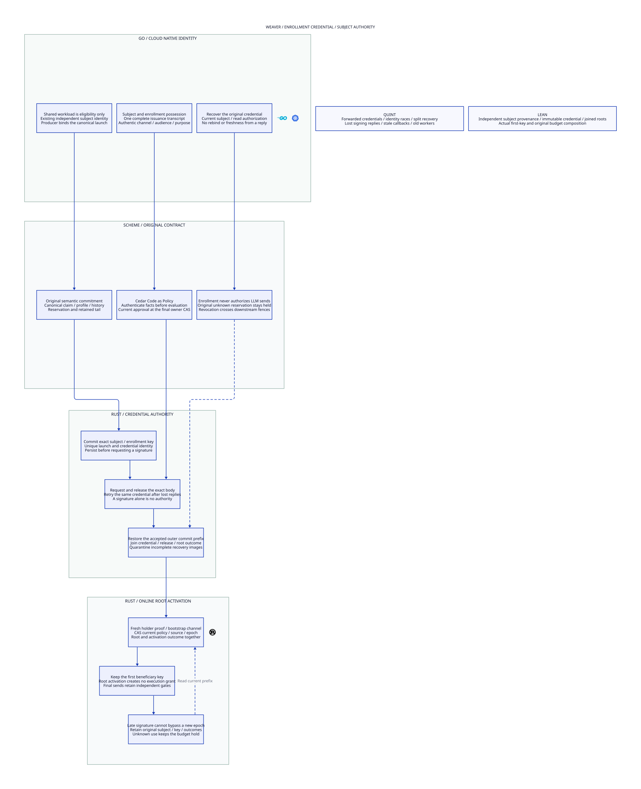

#+title: 47 Enrollment Credential Authority
#+language: en
#+startup: overview

* Design
- [[file:47.01-enrollment-credential.org][Issuance, subject binding and recovery contract]]
- [[file:47.02-enrollment-credential.d2][Core D2 source]]
- 
- [[file:47.03-proof-and-source-evidence.org][Proof obligations, source comparison and evidence]]

* Relationship
This category expands the independent enrollment-principal premise in
[[file:../46-beneficiary-registration/46.00-index.org][46 Beneficiary Registration]].
It preserves the first beneficiary key, invitation and original task obligations.
It adds no Gateway implementation or dependency changes. Enrollment is a logical
AI Agent Gateway authority boundary; hardware or physical isolation is not assumed.

* Embedded architecture views

** 47.02-enrollment-credential.svg

