# SPDX-FileCopyrightText: 2026 hardenedlinux Linux Team and Contributors
#
# SPDX-License-Identifier: LGPL-2.1-or-later OR Apache-2.0

#+title: 48 Subject Authority and Producer Assignment
#+language: en
#+startup: overview

* Design
- [[file:48.01-subject-authority.org][Identity sources, immutable assignment and Plan publication]]
- [[file:48.02-subject-authority.d2][Core D2 source]]
- 
- [[file:48.03-proof-and-source-evidence.org][Proof, counterexample and source evidence]]

* Relationship
This category expands the independent subject and producer-assignment premise in
[[file:../47-enrollment-credential/47.00-index.org][47 Enrollment Credential Authority]].
It retains the original task, enrollment key, first beneficiary key and budget/history
obligations. It changes design and verification artifacts only; no Gateway implementation
or dependency pin changes. The boundary is logical AI Agent Gateway authority.

* Embedded architecture views

** 48.02-subject-authority.svg

