# SPDX-FileCopyrightText: 2026 hardenedlinux Linux Team and Contributors
#
# SPDX-License-Identifier: LGPL-2.1-or-later AND Apache-2.0

#+title: 49 Configurable Routines and Governed Routing
#+language: en
#+startup: overview

* Product design
- [[file:49.01-routine-routing-config.org][Scheme plus JSON/YAML: routine and routing leverage]]
- [[file:49.02-routine-routing-config.d2][Core D2 source]]
- 
- [[file:49.03-proof-and-source-evidence.org][Source study, proofs and counterexamples]]

* Related foundations
- [[file:../../10-19-llm-gateway/10-routing-and-inference/10.00-index.org][LLM inference and model routing]]
- [[file:../../10-19-llm-gateway/11-attempts-and-failover/11.00-index.org][Provider attempts and failover]]
- [[file:../48-subject-authority/48.00-index.org][Subject and configuration-producer authority]]

The Gateway product serves LLM inference and governed agent work. This category
connects reusable routine composition to concrete route selection through one
admitted semantic configuration. All APIs and examples here are design contracts;
no Gateway implementation or dependency pin is changed.

* Embedded architecture views

** 49.02-routine-routing-config.svg

