# SPDX-FileCopyrightText: 2026 hardenedlinux Linux Team and Contributors
#
# SPDX-License-Identifier: LGPL-2.1-or-later AND Apache-2.0

#+title: Configurable Agent Routines and Governed LLM Routing
#+language: en
#+startup: overview

* Reader view

Scheme and JSON or YAML produce one admitted semantic program.

* Product advantage: one semantic program across agent work
Scheme plus JSON/YAML is a central design advantage when both surfaces produce one
admitted semantic program. The value is reusable business/agent behavior with coherent
Contracts, Policy, accounting and recovery across model, tool and agent calls. Supporting
three syntaxes alone does not establish that advantage.

A routine describes the work: typed inputs/outputs, prerequisites, capability requirements,
conditional steps, bounded parallelism/attempts, artifact flow and original obligations.
Routing chooses the concrete permitted execution binding for one step: model/provider,
MCP tool, A2A agent, Client ACP connection or qualified local executor. An LLM step still
needs ordinary Gateway features: provider codecs, virtual models, streaming, model catalog,
quota/health-aware selection, cancellation and usage. Governance constrains useful inference;
proof checking is not the inference product.

| Existing advantage | Concrete product use | Result to measure |
|--------------------+----------------------+-------------------|
| POO prototypes and composition | Share a support/research/code-review routine, specialize tenant data/tool/model bindings | Number of coordinated edits, duplicated rules and independently configured policy surfaces |
| Native Types/Contracts and schema projection | Validate both operator data and Scheme-produced values against one owned contract | Equivalent diagnostics; fewer accepted unsupported/lossy provider paths |
| POO Flow graph and flow combinators | Reuse typed artifacts across retrieval, inference, delegated agents and response release | Reuse of graph/capability definitions; bounded scheduling and recovery behavior |
| Cedar Code as Policy | Apply organization, tenant, task and step restrictions over authentic facts | No selected route or tool proposal can bypass mandatory authorization layers |
| Original claim, history and budget accounting | Keep identity and unknown reservations through aliases, retries and reconnects | Correct shared spend and unchanged original obligations under failure |
| Go cloud integration and Rust execution | Operationally familiar deployment with compiled routing and controlled provider streams | Whole-path latency/TTFT, resource bounds and rollout behavior under matched workloads |

These are differentiators to validate, not measured advantages already established.
Learning agentgateway's routing and configuration machinery helps deliver the standard
Gateway surface while the POO semantic program provides the framework-specific value.

* One model, two stages of binding
** Publish reusable programs
A configured publisher supplies either a POO Scheme program or JSON/YAML data. The
control-plane pipeline resolves declared dependencies, admits source/currentness, validates
native Contracts, normalizes the routine graph and capability references, compiles Cedar
artifacts and emits bounded runtime projections. The output includes:

- Routine graph: typed node/edge identities, input/output Contracts, conditional transition
  definitions, bounded attempts/fanout, artifact and cancellation semantics.
- Routing requirements: hard capabilities, modality/context/output/region constraints,
  admitted model/tool/agent references, objective and tie-breaking rules.
- Governance artifacts: mandatory Cedar layers, authentic entity/fact requirements and
  policy/source dependencies; no caller-controlled allow-all replacement.
- Execution descriptors: protocol/adapter/codec identity, secret references, endpoint scope,
  cost-bound method, observation/usage/response contracts and final-send obligations.
- Provenance: source/import/schema/contract/policy/adapter closure and admitted publication
  identity, with diagnostic source maps and dependency invalidation information.

** Bind an original task
A reusable package does not know a future task's original claim or payload. Source admission
binds an invocation to authentic original task/profile, immutable input, canonical node IDs,
shared budget/history domains and current source/Policy. No author-supplied root, principal,
profile label or scope string can manufacture those facts. Each side-effecting step gets
an owner-allocated logical identity under that original task and its allocated reservation.
The formal Normal value represents this bound invocation projection, not raw author config.

Scheme can describe richer composition than the common data subset. JSON/YAML can reference
registered prototypes, routines, Contracts and capability implementations. They do not embed
arbitrary Scheme text. For equivalent expressible inputs, normalization must produce equal
semantic values. Arbitrary Scheme programs need not have a JSON representation; unsupported
projections fail explicitly. Semantic equality of the normalized IR does not authenticate
either source or imply identical publication/provenance identity.

* Language and configuration ownership
| Boundary | Scheme / POO | JSON/YAML | Go | Rust |
|----------+--------------+-----------+----+------|
| Authoring | Native prototypes, Contracts, inheritance/refinement and reusable composition | Declarative data selecting registered definitions and overriding permitted slots | Kubernetes/API resources and identity/secret/discovery adapters | Receives admitted executable projections |
| Admission | Semantic composition, dependency/source closure, graph/type/contract validation, Cedar artifact generation | Strict decoding into the same contract-owned values; identical defaults and diagnostics | Authenticate publisher and origin; deliver immutable candidate packages and status | Validate publication identity, supported projection and current authorization association |
| Runtime | Define meaning and capability/Policy contracts; evaluate only qualified semantic operations | No separate policy interpreter | Reconcile discovery/capacity/configuration; use controlled Gerbil toolchain transports where required | Candidate filtering/ranking, provider codecs/streams, queue/broker/usage and final effect authority |

Use ordinary slot assignment for ordinary configuration. Inheritance/refinement extends an
existing prototype deliberately; it must not become mandatory syntax for a scalar override.
Prefer intent-oriented fields such as routines, steps, routes and capabilityRequirements.
Contracts own their representation. Do not create a second independent rule DSL in YAML,
a Go-only graph scheduler or a Rust-only Policy meaning that diverges from Scheme.

Scheme configuration evaluation is a separate trust boundary. POO's current configuration-source
code performs native evaluation and fresh checks before/after it; that does not establish
that arbitrary author initializers are pure or that a Gateway sandbox exists. Authenticate
publishers before evaluation, explicitly bound imports/IO/secrets/time/memory, isolate compiler
execution and admit the complete dependency closure. Do not infer effect containment from a
schema or a process boundary alone. Production evaluation containment remains a native gate.
Nothing requires arbitrary Scheme evaluation or source fetching on each inference token.

* Source-grounded reuse
The inspected agentgateway design maps local YAML/JSON and xDS resources into shared runtime
IR, keeps resource cardinality close to the user-facing objects and avoids broad control-plane
fanout. Its LLM source has public/internal models and callout routing with transformations,
fallback and optional session-keyed caching. Reuse those architectural lessons: thin cloud
adapters, explicit model bindings, shared projections and efficient incremental publication.
This is a pinned source study, not latest-release parity or a runtime-dependency selection.

POO Flow already has Funflow Task/Job prototypes, graph projections and flow composition;
config-adapter reuses module Contracts and describes a no-workflow-effect adaptation boundary.
JSON Schema emission builds predicate closures once. Slot Contracts dispatch through native
Types rather than receipt labels. The prototype kind predicate itself checks only kind, so
kind equality is not full admission. These mechanisms are concrete reuse candidates; the
Weaver Routine/Capability/Route schemas, compiler projection and native owner integration
remain extensions. Cedar authentic-fact and final-execution obligations remain explicit.
Current Core source identity and working modifications are recorded in the evidence document;
no dependency pin or upstream source is edited.

* Configuration example: a governed support routine
The JSON and YAML blocks below express the same declarative example. Names, field schema,
cost units and registries are proposed contracts, not an implemented Gateway API. The check
compares their decoded data, rejects duplicates/unknown fields and verifies this finite DAG
and declared per-node allowance. It does not qualify native Scheme compilation or execution.
Cost units are typed abstract accounting units; native billing adapters must bind currency,
price coverage, token/media estimation and conservative bounds before use.

#+begin_src json :eval never
{
  "name": "support.resolve",
  "policyRef": "governance.support",
  "budget": {
    "domain": "original-task",
    "maxCostUnits": 20
  },
  "routines": {
    "resolve": {
      "inputContract": "support.request",
      "steps": [
        {
          "id": "retrieve",
          "kind": "tool",
          "capabilityRef": "knowledge.search",
          "resultContract": "knowledge.matches",
          "maxInvocations": 1,
          "maxCostUnits": 2
        },
        {
          "id": "draft",
          "kind": "inference",
          "after": [
            "retrieve"
          ],
          "routeRef": "support.reply",
          "capabilityRequirements": [
            "tool-calling",
            "structured-output"
          ],
          "responseContract": "support.reply",
          "maxInvocations": 1,
          "maxCostUnits": 10
        },
        {
          "id": "release",
          "kind": "response",
          "after": [
            "draft"
          ],
          "responseContract": "support.reply"
        }
      ]
    }
  },
  "routes": {
    "support.reply": {
      "candidates": [
        "reply-primary",
        "reply-backup"
      ],
      "objective": "cost-with-quality-floor",
      "unknownOutcome": "retain-reservation"
    }
  }
}
#+end_src

#+begin_src yaml :eval never
name: support.resolve
policyRef: governance.support
budget:
  domain: original-task
  maxCostUnits: 20
routines:
  resolve:
    inputContract: support.request
    steps:
    - id: retrieve
      kind: tool
      capabilityRef: knowledge.search
      resultContract: knowledge.matches
      maxInvocations: 1
      maxCostUnits: 2
    - id: draft
      kind: inference
      after:
      - retrieve
      routeRef: support.reply
      capabilityRequirements:
      - tool-calling
      - structured-output
      responseContract: support.reply
      maxInvocations: 1
      maxCostUnits: 10
    - id: release
      kind: response
      after:
      - draft
      responseContract: support.reply
routes:
  support.reply:
    candidates:
    - reply-primary
    - reply-backup
    objective: cost-with-quality-floor
    unknownOutcome: retain-reservation
#+end_src

The following is an illustrative POO authoring shape. The registered prototypes and schema
names are proposed; this block is not claimed to execute against the current POO Flow tree.
Routine and route references denote owned typed values, not authority-bearing strings.

#+begin_src scheme :eval never
(def SupportRoutine
  (.o name: "support.resolve"
      policy-ref: "governance.support"
      budget: (.o domain: 'original-task max-cost-units: 20)
      steps: (list
        (.o id: 'retrieve kind: 'tool capability-ref: "knowledge.search"
            result-contract: "knowledge.matches" max-invocations: 1 max-cost-units: 2)
        (.o id: 'draft kind: 'inference after: '(retrieve)
            route-ref: "support.reply"
            capability-requirements: '(tool-calling structured-output)
            response-contract: "support.reply" max-invocations: 1 max-cost-units: 10)
        (.o id: 'release kind: 'response after: '(draft)
            response-contract: "support.reply"))))
#+end_src

A tenant specialization can narrow region/provider/model/tool references or strengthen
Contracts while keeping the original routine template. Expanding authority or changing an
in-flight semantic contract requires the explicit policy/migration process. Resolving a
secret reference never places the secret itself into the public config or model listing.

* Routine semantics and capability leverage
** Typed graph and control flow
A node declares capability kind, input/output contract, bounded invocation policy, original
identity derivation, worst-case reservation and terminal evidence. An edge carries a typed
artifact or a declared guarded transition. Validation detects duplicate IDs, unresolved
references, unbound inputs, unsupported adapter projections and cycles without an admitted
bounded-loop contract. Parallel fanout needs atomic shared reservations and concurrency limits;
a parent graph being acyclic does not prove its effects are safe or affordable.

Model-generated tool calls or subagent proposals are data. The routine owner validates them
against registered capability definitions, allocates an original-lineage child identity and
performs fresh Cedar/source/budget admission before any actual execution. A new tool name,
A2A task, MCP reconnection or Client ACP session is not a new claim or budget/history domain.
The Gateway mediates those effect boundaries; it does not claim to replace every external
agent orchestrator or infer a foreign agent's hidden internal effects.

** Capability registry and introspection
A capability record includes its authoritative producer, semantic operation, supported
protocol/adapter, input/output Contracts, required credentials/Policy, side-effect class,
cost/usage evidence and freshness. Discovery describes what is available. Admission determines
what this original task may actually do. A backend's self-advertised feature is not proof of
contract compatibility, current permission or data-handling guarantees. Introspection can
explain eligible bindings and denied reason classes without leaking private model/tool data.

** Adaptive behavior
Learned classifiers, self-evaluation and routing callouts may propose target, reasoning effort
or next routine step within the admitted contract. Their own model calls disclose data and
consume budget, so they need explicit accounted child operations. Advice and its cache never
grant permission. Memoized pure transformations are separate from caches of governed external
results; history/labels/Contracts must still permit disclosure and reuse. Tool execution, retries,
compensation and regeneration remain effects with original lineage, not generic flow combinators.

* Routing: semantic narrowing before optimization
For each inference node, intersect the declared candidate set with the actual catalog,
original task capability/response/context/region requirements, current Cedar/history rules,
available deployment/account/credential scope and conservative step-reservation bound.
Only then rank by configured cost/quality/latency/availability objectives. Quality floors need
qualified measurements; provider names or model marketing metadata do not prove them.

A route configuration may add requirements or reduce its allowance/candidate set. It cannot
drop required tool/structured-output semantics, enlarge the original budget, change original
profile/response contract, clear history or select an otherwise denied target. Context and
output/reasoning bounds survive provider conversion. Empty eligible sets return an attributable
no_eligible_route result. No emergency cheapest-model fallback widens the set.

The selected plan binds the bound routine node, original payload, package/Contract identity,
concrete model/provider/endpoint/account and wire manifest, with current hard-view evidence.
Rust rechecks at final admission. A normalized intent alone does not prove actual provider
encoding. Cached callout advice keyed only by session is insufficient for authorization:
reuse it only as advice and recheck original semantic profile, current hard view and allowance.

Selection failover before admission may choose another eligible binding. After possible send,
unknown outcomes retain the original hold; retries need the explicit child-attempt ledger
and aggregate reservation contract. A configuration maxInvocations does not implement that
ledger. Once a response prefix is released, generic cross-model stream splicing is rejected.
The focused formal profile here has one provider admission per logical node; it does not
prove a complete multi-attempt routine interpreter.

* Configuration publication and live changes
Publish a complete closure with authentic publisher identity, schema/contract/policy/adapter
identities, expected parent and durable outcome. A successful upload, schema validation or
source hash alone is not publication authority. Resolve lost acknowledgments using the same
candidate/command identity; never activate half a package from mixed snapshots. Earlier
subject/producer and ledger designs define native authority/recovery obligations.

A running invocation pins its semantic routine package. New defaults affect new invocations;
they do not silently rewrite the in-flight graph, profile, first key or reservation. Security
withdrawals are different events: revoking a route/endpoint/capability or restricting Policy
must publish the corresponding current hard restriction before effectiveness is acknowledged.
Existing plans then recheck that restriction at the final broker. The model's default-change
control is not a claim that removing an endpoint leaves it indefinitely usable.

Soft metrics and objective observations can affect a new ranking without changing hard
authorization on every sample. Keep hard semantic/Policy/catalog/endpoint dependencies separate
from telemetry. A cached compiled package remains usable only with a qualified closure and
current native admission association. Rollback to an old default cannot roll back current
security restrictions, original claims, unknown holds or accepted execution history.

* Performance design and measurable validation
Compile graph/type/contract checks, supported provider projections and candidate indexes on
the control plane. Partition publication by affected resource/dependency closure; avoid
re-emitting every route on a small tenant change. Rust consumes immutable projections and
bounded per-invocation state. Cache parsed/cryptographic results by exact dependency identities;
never cache final permission merely because a configuration or session matches.

Measure separate costs: source evaluation/admission, incremental publication, invocation
binding, eligible filtering/ranking, final broker checks, provider TTFT, streaming memory and
accounting/recovery. Compare matched workloads with identical policy/semantics and payloads.
No language choice, prebuilt predicate closure, finite model or allocation benchmark proves
end-to-end throughput. A missing source closure or unsupported provider contract is an admission
failure rather than a reason to benchmark a weaker policy path.

* Delivery and proof boundary
First stabilize the declarative schema, POO Contracts, examples and rejection diagnostics;
then qualify normalized projection parity and atomic publication; then integrate real model/
tool/agent bindings and final broker evidence. Validate useful support/research/code-review
routines under concurrent budgets, config changes, partial streams and unknown outcomes.
No implementation or dependency pin change is part of this category.

The [[file:49.03-proof-and-source-evidence.org][evidence register]] covers focused configuration narrowing and actual routing-proof reuse.
It leaves the native parser/compiler, arbitrary Scheme evaluation containment, full graph
scheduler, learned-router quality, configuration publication refinement, provider codecs and
multi-attempt/account integration as explicit gates. This keeps a practical product design
connected to proof without presenting a formal fixture as a working Gateway.
