#+TITLE: Weaver Qualified Semantic Slice: Design Checkpoint
#+LANGUAGE: en
#+OPTIONS: toc:2 num:nil

* Decision and scope
Advance [[file:../50-integrated-audit/50.02-research-plan.org][RP1-RP4 and RP7's design stage]] with a bounded
=support.resolve= task, a common configuration contract, a constructive authority
bridge, a minimal software topology, and a reproducible qualification protocol.
This is a design checkpoint with executable proof/model artifacts. It does not
qualify a native Gateway, choose a provider vendor, implement transport/storage,
change pins, or authorize deployment.

* Reading order
1. [[file:51.01-task-and-capability-profile.org][Task, scope and language responsibilities]].
2. [[file:51.02-configuration-and-authority.org][Common authoring contract and original authority]].
3. [[file:51.03-final-send-and-recovery.org][Final send, durable authority and failure decisions]].
4. [[file:51.04-qualification-program.org][Qualification, observability and performance protocol]].
5. [[file:51.05-proof-and-source-evidence.org][Source review, proofs, controls and open premises]].
6. [[file:51.06-semantic-gateway-slice.d2][Core architecture D2]] / .

* Work-package status
| Package | This checkpoint | Remaining gate |
|---------+-----------------+----------------|
| RP1 | Representative task and minimum assurance profile specified | Workload acceptance by product owners; native feasibility |
| RP2 | Common subset and constructive refinement defined | Native Scheme/JSON/YAML compiler parity and authentic publication |
| RP3 | Provider conversion and final-effect contract specified | Concrete adapter matrix, bytes/Gerbil toolchain/transport conformance |
| RP4 | Minimal logical transaction topology and fault contract specified | Actual storage semantics, authentic fences and fault recovery |
| RP5 | Three-node bounded routine and protocol seams scoped | General interpreter and additional protocol profiles |
| RP6 | One attempt and unknown-hold rules retained | Full asynchronous exact accounting/attempt/range composition |
| RP7 | Matched evaluation and resource protocol specified | Native fault qualification and measurements |
| RP8 | Deferred | Stable baseline and evidence of benefit |

A specification or finite model passing is not a completed native gate. Role
names are responsibilities, not staffing assignments or mandatory microservices.

* Embedded architecture views

** 51.06-semantic-gateway-slice.svg

