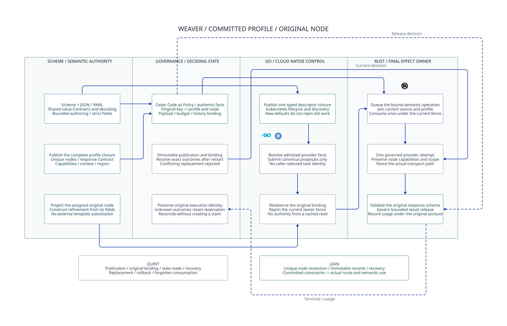

# SPDX-FileCopyrightText: 2026 hardenedlinux Linux Team and Contributors
#
# SPDX-License-Identifier: LGPL-2.1-or-later AND Apache-2.0

#+TITLE: Weaver Committed Profile and Native Authoring Verification
#+LANGUAGE: en
#+OPTIONS: toc:2 num:nil

* Checkpoint
Continue [[file:../51-qualified-semantic-slice/51.00-index.org][the bounded semantic slice]] by replacing the external template/node
choice with a projection from a published full profile and an original task
assignment. Exercise existing native Core value Contracts with POO objects and
actual JSON decoding. Preserve all earlier sealed artifacts and dependency pins.

* Reading order
1. [[file:52.01-profile-and-node-binding.org][Full profile, canonical node binding and recovery]].
2. [[file:52.02-scheme-authoring-results.org][Native reuse results and the natural-exit failure]].
3. [[file:52.03-proof-and-evidence.org][Proofs, controls, receipts and remaining gates]].
4. [[file:52.04-committed-profile.d2][Core D2]] / .

* Status
The profile/node semantic projection and immutable-record preservation have
checked Lean proofs and finite Quint controls. The native workload emitted all
contract-check results and rejected duplicate JSON keys, but one run exceeded
the unchanged natural-exit watchdog. Native qualification remains open. No
Gateway runtime, provider SDK, storage implementation or dependency change is
introduced by these verification fixtures.

* Embedded architecture views

** 52.04-committed-profile.svg

