# SPDX-FileCopyrightText: 2026 hardenedlinux Linux Team and Contributors
#
# SPDX-License-Identifier: LGPL-2.1-or-later AND Apache-2.0

#+TITLE: Weaver Native Gerbil Exit and Isolated Qualification
#+LANGUAGE: en
#+OPTIONS: toc:2 num:nil

* Scope
Resolve the bounded native authoring check from
[[file:../52-committed-profile-binding/52.02-scheme-authoring-results.org][the retained natural-exit failure]] without changing the workload, accepting late
exit, skipping resource cleanup, changing dependency pins or adding Gateway code.
The isolated verifier build is a verification artifact, not a Gateway runtime.

* Reading order
1. [[file:53.01-diagnosis.org][Current diagnosis and preserved controls]].
2. [[file:53.02-isolated-verifier.org][Source closure, compiled entry and cleanup contract]].
3. [[file:53.03-evidence-and-limits.org][Exact receipts, proofs, controls and scope]].
4. [[file:53.04-gerbil-lifecycle.d2][Core lifecycle D2]] / .

The current receipt, rather than a printed completion marker, decides the status.
Earlier timed runs remain failed. Qualification of this bounded compiled entry
must not be reported as a global repair of arbitrary interactive gxi programs,
full multi-format configuration parity, or native Gateway acceptance.

* Embedded architecture views

** 53.04-gerbil-lifecycle.svg

