#+TITLE: Weaver Ordinary Dynamic gxi Exit Qualification
#+LANGUAGE: en
#+OPTIONS: toc:2 num:nil

* Scope
Continue beyond [[file:../53-native-gerbil-exit/53.00-index.org][the bounded AOT verifier result]]. The target here is the
ordinary installed gxi interpreter processing the original Scheme source fixture,
with actual independently initialized native bodies, normal resource cleanup and the
unchanged fifteen-second whole-process deadline. No Gateway implementation,
dependency pin edit or global runtime replacement belongs to this checkpoint.

* Current result
The ordinary dynamic candidate is qualified locally with the original source,
complete configured C compiler options, unchanged fifteen-second gate and all
tracked module references closed. The installed interpreter and dependency pins
remain unchanged. See the current receipt for exact results and retained limits.

* Reading order
1. [[file:54.01-import-and-image-publication.org][Diagnosis, import owners and dynamic image publication]].
2. [[file:54.02-runtime-and-proof-contract.org][Runtime ownership and proof correspondence]].
3. [[file:54.03-evidence-and-limits.org][Evidence, failures and qualification limits]].
4. [[file:54.04-dynamic-lifecycle.d2][Core D2]] / .

The [[file:../../../dev/proofs/evidence/dynamic-gxi-exit/receipt.json][current result receipt]] controls the status. Neither the earlier AOT pass,
a printed completion marker, a late natural exit, nor a low-noise exploratory
run substitutes for ordinary dynamic qualification.

* Embedded architecture views

** 54.04-dynamic-lifecycle.svg

