# SPDX-FileCopyrightText: 2026 hardenedlinux Linux Team and Contributors
#
# SPDX-License-Identifier: LGPL-2.1-or-later AND Apache-2.0

#+TITLE: Dynamic gxi Paired Startup and Attribution
#+LANGUAGE: en
#+OPTIONS: toc:2 num:nil

* Purpose
Separate reproducible reductions in native loading work from uncontrolled host
latency. A successful warm repetition must never erase an earlier failed gate.
The whole native process still has fifteen seconds to complete the original
checks, return naturally and finish resource cleanup.

* Four connected artifacts
- [[file:55.01-experiment-and-root-cause.org][Experiment, coldness and root-cause boundary]].
- [[file:55.02-proof-and-execution-contract.org][Proof premises and language responsibilities]].
- [[file:55.03-results-and-reproduction.org][Results, failed evidence and reproduction]].
- [[file:55.04-runtime-boundary.d2][Core D2 source]] and .
- [[file:../../../dev/proofs/lean/DynamicPairedEvidence.lean][Lean composition]] and [[file:../../../dev/proofs/quint/DynamicPairedEvidence.qnt][Quint executable controls]].

* Evidence lineage
The [[file:../54-dynamic-gxi-exit/54.00-index.org][previous ordinary dynamic checkpoint]] remains byte sealed. Its
source/interface audits and lazy-entry bridge are reused with their original
scope; its timing observations are not relabeled as cold paired evidence.
This checkpoint uses a fresh isolated native rebuild and retains every scheduled
sample, including late natural termination. No Gateway code or dependency pin is
changed. New artifacts are verification and research inputs only.

* Embedded architecture views

** 55.04-runtime-boundary.svg

