# SPDX-FileCopyrightText: 2026 hardenedlinux Linux Team and Contributors
#
# SPDX-License-Identifier: LGPL-2.1-or-later AND Apache-2.0

#+TITLE: Ordinary Dynamic gxi Native Image Closure
#+LANGUAGE: en
#+OPTIONS: toc:2 num:nil

* Objective and lineage
Close the selected-image first-use validation gate for the ordinary dynamic
interpreter while retaining original Scheme semantics, native library validation,
lazy module initialization and complete cleanup. The [[file:../55-dynamic-gxi-paired/55.00-index.org][previous paired checkpoint]]
remains immutable, including its failed new-UUID candidate starts. No later pass
reclassifies those results.

* Four connected artifacts
- [[file:56.01-symbol-locality-and-runtime-path.org][Symbol locality, image publication and native execution]].
- [[file:56.02-proof-and-source-contract.org][Source reuse, proof premises and language responsibilities]].
- [[file:56.03-results-and-reproduction.org][Fixed-matrix results and reproduction]].
- [[file:56.04-locator-boundary.d2][Core D2 source]] and .
- [[file:../../../dev/proofs/lean/GambitLocatorClosure.lean][Lean composition]] and [[file:../../../dev/proofs/quint/GambitLocatorClosure.qnt][Quint controls and counterexamples]].

This is native validation and architecture research. Gateway code and dependency
pins remain unchanged. The installed runtime is not replaced.

* Embedded architecture views

** 56.04-locator-boundary.svg

