#+TITLE: Weaver Modular Runtime Implementation
#+LANGUAGE: en
#+OPTIONS: toc:2 num:nil

* Delivery boundary
This checkpoint starts native Rust and Go implementation. Earlier design and
qualification checkpoints remain historical evidence. The implemented profile is
a trusted local owner, one SQLite deciding store, immutable original tasks,
non-streaming committed JSON requests and a bounded HTTPS executor. It is not a
production multi-tenant service or the complete architecture.

* Connected artifacts
- [[file:57.01-module-and-authority-contract.org][Modules, authority, storage and execution]].
- [[file:57.02-verification-and-delivery.org][Verification, ASP Rust policy and remaining delivery gates]].
- [[file:57.04-qualified-results.org][Qualified results and retained failures]].
- [[file:57.03-runtime-boundary.d2][Core D2 source]] and .
- [[file:../../../dev/sysml/WeaverExecution.sysml][SysML v2 allocation and requirements]].
- [[file:../../../dev/proofs/quint/RuntimeAdmission.qnt][Quint transitions and unsafe controls]].
- [[file:../../../dev/proofs/lean/RuntimeAdmission.lean][Lean transition invariants]].

* Local use
The example endpoint is deliberately non-routable. These commands publish,
register and enqueue; enqueue cannot send.

#+begin_src sh
cargo build --workspace --locked
go build -o target/weaverctl ./cmd/weaverctl
target/debug/weaver-cli target/demo.db publish examples/local-owner/permit.cedar new 1
target/debug/weaver-cli target/demo.db register examples/local-owner/task.json
target/weaverctl examples/local-owner/task.json examples/local-owner/request.json 0 1 > target/proposal.json
target/debug/weaver-cli target/demo.db enqueue target/proposal.json
target/debug/weaver-cli target/demo.db lookup demo-family infer
#+end_src

The local CLI is a trusted management boundary: filesystem access to its database
and registration/publication commands is administrative authority. It must never
be mounted as an unauthenticated agent-facing service. Configure an admitted
real task and destination before using =execute=. Execution is explicit and
irreversible even when the HTTP result is unknown.

* Embedded architecture views

** 57.03-runtime-boundary.svg

