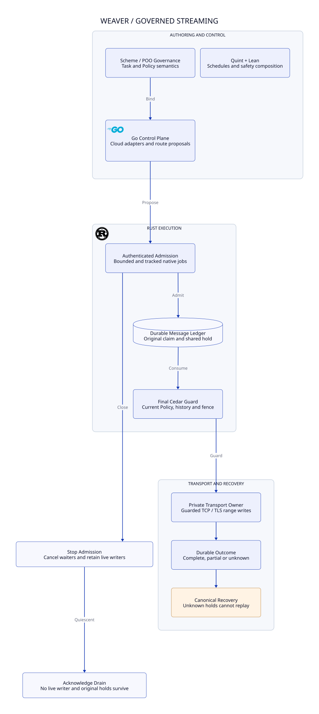

# SPDX-FileCopyrightText: 2026 hardenedlinux Linux Team and Contributors
#
# SPDX-License-Identifier: LGPL-2.1-or-later OR Apache-2.0

#+TITLE: 58.00 Streaming Execution and Workspace Ownership
#+LANGUAGE: en

* Workspace ownership

The repository has two language workspaces and one development assurance area.
Directory placement follows execution ownership rather than deployment packaging.

| Path | Responsibility |
|------+----------------|
| =crates/contracts/= | Rust execution contracts and immutable message bindings |
| =crates/policy/= | Cedar validation and evaluation against authoritative context |
| =crates/ledger/= | Durable claims, reservations, range consumption and recovery |
| =crates/execution/= | Final broker and private transport custody |
| =crates/server/= | Rust service entrypoint, authenticated admission and runtime lifecycle |
| =crates/cli/= | Rust administration and local execution commands |
| =go/= | Go control-plane module and cloud/protocol integration |
| =go/api/v1/= | Explicit Go protocol contracts and strict decoding |
| =go/internal/routing/= | Route proposal construction under original task constraints |
| =go/internal/streaming/= | Stream proposal construction under the original manifest |
| =go/cmd/weaverctl/= | Go command entrypoint |
| =go/cmd/weaver-dev/= | Shell-free development gate command |
| =go/dev/= | Go test-only model SDK, workspace checks and native integration replay |
| =dev/= | SysML models, policies, PBT support, Quint, Lean and retained evidence |

Root =Cargo.toml= owns Rust members, dependency declarations and shared lints.
Root =go.work= selects =./go=; =go/go.mod= owns the Go module. Rust server code
stays under =crates/server=; it does not become part of the Go control plane.

* Authority boundary

Go constructs typed routing and streaming proposals. Its cloud-native role
provides a home for Kubernetes reconciliation and protocol integration; their
production controllers are not implied by the current command implementation.
Go cannot mint original task authority, reset a reservation, or own a bypass
transport around the Rust broker. Scheme defines governed task and configuration
semantics. Rust checks the original commitment and current Policy at the final
execution boundary, while retaining unknown outcomes conservatively.

Quint explores schedules and counterexamples. Lean establishes conditional
parametric safety and composition. Cedar-poo-spec supplies the permission and
effect-binding foundation. Native tests check the separately stated refinement
from these contracts to actual execution. A proof or a directory move does not
qualify an unimplemented production integration.

* Entry commands

#+begin_src sh
go test -race ./go/...
go build ./go/cmd/weaverctl
cargo check --workspace --locked --offline
go test -tags=integration ./go/dev
go run ./go/cmd/weaver-dev check
#+end_src

Run these commands from the repository root. Historical receipts retain their
original paths and verdicts; maintained entrypoints use the current layout.
Streaming implementation evidence remains under
[[file:../../../dev/proofs/evidence/runtime-streaming-20261029/][the development evidence directory]].

* Implementation slices

- [[file:58.01-runtime-lifecycle.org][Tracked writer lifecycle and recovery]]
- [[file:58.02-assurance-and-development.org][Assurance and Go development integration]]
- 
- [[file:58.04-checked-results.org][Checked results, retained failures and production boundaries]]

* Embedded architecture views

** 58.03-streaming-runtime.svg

