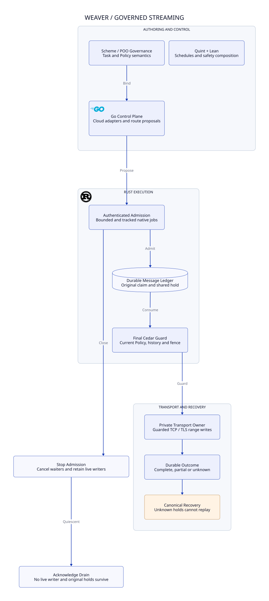

#+TITLE: 58.01 Tracked Writer Lifecycle and Recovery
#+LANGUAGE: en

* Implemented boundary

The Rust server owns authenticated local admission and its native task tracker.
The execution crate exclusively owns transport handles and buffers. Closing the
server does not revoke bytes already accepted by the kernel or the peer. It
stops new native job admission, cancels waiting request bodies, and asks admitted
workers to stop at the next range boundary. The tracker retains every started
worker until it returns, including workers whose HTTP caller has disconnected.

The admission mutex serializes tracker registration with cancellation and tracker
closure. A poisoned mutex rejects new registration; shutdown still cancels and
closes the tracker. A worker owns its concurrency permit until native completion.
Dropping its JoinHandle cannot free that permit or remove the tracked task.
The service acknowledges graceful shutdown only after HTTP handling and the
native tracker have drained. The executable installs SIGINT/SIGTERM handlers on
Unix before opening admission; both enter this same shutdown path.

* Range and recovery contract

| Event | Required result |
|-------+-----------------|
| Shutdown before a worker starts | Skip its callback and release its slot when the tracked wrapper returns |
| Shutdown while reading an incomplete authenticated body | Cancel the body wait and return service unavailable |
| Shutdown races a range already admitted by the worker | Permit that bounded attempt to resolve under the final Policy/fence guard; stop before another range |
| HTTP caller disconnects during native work | Retain task tracking, transport custody and the worker's slot |
| Final Policy/fence check fails before transport invocation | Retire only that exact unused permit; retain the original reservation |
| Partial write or lost completion commit | Preserve unknown state and hold; forbid automatic prefix replay or reconnect |
| Shutdown after a durable complete message | Keep the complete receipt and original hold; restart returns the same outcome without another connection |
| Process termination interrupts an admitted write | On recovery, unknown consumption remains spent; cancellation supplies no no-execution evidence |

The cancellation check is a cooperative boundary. It is not atomic with every
subsequent instruction. A range that passed the check can finish during closing;
Policy publication and custody changes still serialize against its actual
guarded write. The stronger promise is quiescence at successful drain
acknowledgment, conditional on faithful tracking and native I/O completion.

Current native connect, handshake and range deadlines remain unchanged. This is
not a proof of a global shutdown deadline: OS scheduling, filesystem stalls and
inbound connection handling require their own operational qualification. There
is no forced-success exit path and no reservation refund in shutdown code.

* Ownership

Scheme owns governed source semantics and immutable task/profile commitments.
Go owns cloud/protocol adaptation and typed proposals. Rust owns admission,
durable range consumption, current Cedar evaluation, transport custody and drain.
The server is in =crates/server=; the Go control plane and its development tests
are in top-level =go=. Model and proof assets remain in =dev=.

See  and
[[file:58.02-assurance-and-development.org][assurance and development ownership]].

* Embedded architecture views

** 58.03-streaming-runtime.svg

