# SPDX-FileCopyrightText: 2026 hardenedlinux Linux Team and Contributors
#
# SPDX-License-Identifier: LGPL-2.1-or-later OR Apache-2.0

#+TITLE: 58.05 Durable Range Progress and Recovery
#+LANGUAGE: en
#+OPTIONS: toc:2

* Runtime contract

A mutable message row cannot establish that a range is unused. Recovery must
join its state, cursor and next sequence with the latest durable range under
the deciding transaction. This realizes part of the Host-side consumption and
continuing-use obligations from =cedar-poo-spec=; it does not define another
Zero Trust framework or discharge the independent Host trust premises.

| Durable tail | Required message projection | New range or reconnect |
|--------------+-----------------------------+------------------------|
| No range | Queued, zero cursor and sequence | Eligible for current authorization |
| Complete | Cursor at range end, exact successor sequence; complete only at message end | Continue on the original owner; reconnect only at a known message boundary |
| Not sent | Cursor at original offset, exact successor sequence; queued only at zero offset | Reauthorize the original unsent message under current custody and Policy |
| Partial, including zero bytes | Unknown, cursor at original offset, exact successor sequence | No new opportunity or reconnect |
| Unknown | Unknown, cursor at original offset, exact successor sequence | No new opportunity or reconnect |
| Projection differs from tail | Reject the join | No callback, no replacement permit, no refund |

Every range has positive length within the original payload. Complete requires
exact written length; not-sent requires witnessed zero calls and zero written
bytes; partial requires a reported count below range length. A partial zero-byte
observation is not evidence that the writer was never invoked.

* Ownership and implementation

- Scheme retains the original task, profile, message manifest and cost semantics.
- Go sends proposals over the existing authenticated gRPC boundary; adapter
  retries cannot create a new Rust write opportunity for the original message.
- Rust owns the ledger, progress join, custody and final transport callback.
  =stream_state::record= checks the selected message against its indexed tail.
  Custody and connection admission also check the bounded sibling manifest,
  including rows that an inconsistent image incorrectly labels complete.
  Resume, consumption and final write reuse the same selected-record check.

The join uses the composite primary key with descending sequence and =LIMIT 1=.
The hot path does not scan range history. Custody/connection validation visits
the finite message manifest, using one indexed lookup per message. Existing
message and range transactions remain the serialization domain; no new store,
cache, recovery ledger or dependency is introduced.

* Verification and counterexample

The pre-fix Proptest failure minimized to a one-byte consumed range with a lost
observation. Replacing only the message projection with queued/zero cursor let
the old =consume_range= admit another opportunity. The counterexample was
actually executed and failed its denial assertion. An earlier incorrectly
filtered invocation ran zero tests and is not acceptance evidence.

The retained PBT covers consumed-only, complete, partial-zero and unknown
outcomes; cursor/state rollback with and without sequence rollback; old custody,
an outstanding permit and connection callback; and process restart. Invalid
joins must keep one original range and the original budget hold. Existing
positive zero-call retirement and continuing-prefix tests remain required.

Quint checks rejection after restoring unknown, partial and completed-prefix
projections. Its explicitly unsafe projection-only custody/consumption path
demonstrates a duplicate call at the original offset. =receiptExact= now models
both the range receipt and the progress join; fidelity to the SQL reader remains
an implementation premise. Normal schedules retain the existing safety invariant.

Lean =RangeProgress= computes the expected projection from the typed durable
tail, proves changed images cannot pass the join, proves unresolved tails cannot
admit a new range, and preserves the completed cursor/successor. Its guarded-step
composition retains the existing execution safety theorem. These are conditional
application refinement proofs, not a proof of SQLite durability or a completed
import-qualified SPEC/implementation refinement.

* Evidence boundaries

Focused Rust PBT passed after the fix. The complete ledger run passed 115 tests
with local TCP listening permitted; the earlier restricted run passed 90 and
failed three listener tests with permission errors. The initial Lean syntax and
Quint failed-assertion chaining errors remain failed evidence. The corrected
Lean file elaborated without errors or =sorryAx=; all 25 Quint tests passed.
Raw failures and compiler logs remain in temporary or ignored locations.

The per-crate Criterion =ledger/range_tail_guard= cases retain zero, eight and
sixty-four completed prefix ranges outside measurement, then measure the next
consume/write pair. Query-plan verification rejects history scans and temporary
sorting. Neither source inspection nor a benchmark smoke run establishes p99,
throughput or a performance improvement.

Coherent rollback or deletion of both message and range histories is outside
this local profile. Independent anti-rollback authority remains necessary for
that threat. No provider exactly-once delivery or refund authority follows from
local completion, and the original unknown hold remains conservative.
