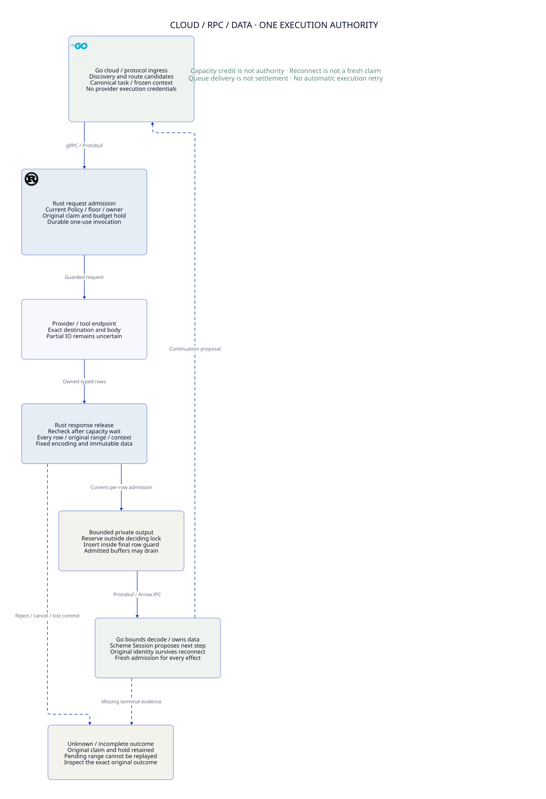
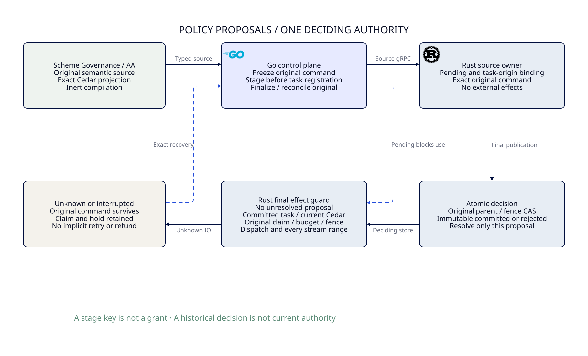

#+TITLE: 59.00 Default gRPC Provider Gateway
#+LANGUAGE: en

* Current implementation

The root [[file:../../../Project.sysml][Project.sysml]] controls package and asset ownership through
[[file:59.20-project-structure.org][the executable project architecture gate]].
Maintained native and formal checks follow [[file:59.21-verification-ownership.org][the verification ownership contract]].
[[file:59.22-parallel-ci.org][Parallel language and contract suites]] run independently on OS-installed CI tools.
[[file:59.23-governance-policy-projection.org][Governance Policy/source-asset projection]] defines the source-to-authority contract.
[[file:59.24-telemetry-service.org][Default telemetry service]] defines the target observation boundary and OpenShell comparison.
[[file:59.25-openshell-and-tao3k-ecosystem.org][OpenShell and the TAO3K ecosystem]] defines Scheme's programmable role,
Cedar proof reuse and the complete routine-to-effect delivery sequence.
The  shows the target ecosystem relationships.
[[file:59.27-policy-evidence-architecture.org][Policy evidence architecture]] fixes the publication, actual-schema and MRR
boundaries before implementation; verification ownership is declared once in Project SysML.
[[file:59.28-ascent-mrr-and-fact-review.org][The next cross-review]] selects inherited AA/Ascent first, keeps MRR optional,
and reviews hard-fact barriers and receipt-driven Session progression. Its single
R2-01--R2-13 ledger separates source inspection, conditional proof reuse, executed
baseline checks and missing bridge acceptance; all thirteen integrated obligations
remain open. Barrier confirmation, projection readiness and accounting application
have distinct target contracts.
All thirteen obligations now have bounded executable witnesses in the existing
Quint owner; concrete integrated acceptance remains 0/13. The existing Cedar Lean
bridge checks successor and fact-context evidence eligibility. Scheme also owns
higher-order Governance assessment, evidence and strategy composition through
AA generic methods and Workflow/Funflow, beyond Policy/configuration generation.
[[file:59.29-strands-box-cross-review.org][Strands Box source review]] adds schema-bound request, durable-history,
temporal-accounting and embedding lessons without adopting a second Policy engine.
Its per-round comparison metric records benefits, disadvantages, mitigations and
evidence progress against both Box and OpenShell; design coverage is separate
from concrete integrated acceptance.
[[file:59.30-governance-adapter-acceptance.org][Governance adapter acceptance]] maps all thirteen obligations to concrete
fault-injection receipts, closes the target borrow/owned-data and VM callback
contracts, and defines JSON plus high-order Scheme profiles through inherited
JsonSchema/AA capabilities. The  keeps schemas and authority
boundaries distinct. These acceptance scenarios are specified, not executed.
[[file:59.40-core-gateway-library.org][The core Gateway Lean library]] fixes the upstream Authorization Delta/admission
boundary and keeps scenario-specific Rust execution in Weaver.
[[file:59.41-authority-read-final-cas.org][Authority reads and final CAS]] maps actual SQLite/gRPC recovery to reused
Lean/Quint laws and records the independent recovery-floor implementation gap.
[[file:59.42-independent-commit-floor.org][Independent commit floor and recovery]] defines the four-prefix decision,
unknown-outcome reconciliation and transport-owner admission protocol, with
executable protocol references and explicit production refinement gaps.
[[file:59.43-floor-transport-owner.org][Floor to final transport owner]] fixes the target deployment, credential
custody, admission linearization and fail-closed owner handoff. Its
 shows execution authority outside worker restoration.
[[file:59.44-cloud-rpc-arrow-boundaries.org][Cloud ingress, RPC and Arrow boundaries]] joins that topology to batch,
backpressure, cancellation and reconnect obligations using the existing provider
proof owners. The  distinguishes capacity from authority.
[[file:59.49-policy-proposal-barrier.org][Durable Policy proposal staging]] implements the single-store pending barrier,
exact outcome recovery and final-effect guards. Its 
separates proposal acknowledgment, historical decision and execution authority.

Go and Rust communicate through the shared typed gRPC service in
[[file:../../../proto/gateway/v1/gateway.proto][gateway.proto]]. The Rust server executable starts this service by default.
The previous operation CLI, proposal CLI, HTTP ingress and command-based replay
are retired under [[file:../../../dev/proofs/evidence/provider-routing-20261030/retired-interfaces/][historical interface evidence]]. They are not alternate production
paths. A Go test may start a Rust daemon, but all task registration, publication,
execution and observation traffic uses authenticated gRPC.

The current provider profile is an actual HTTPS client for OpenAI-compatible Chat
Completions SSE. The owner admits one original operation, selects an authorized
configured route before consumption, burns dispatch durably, and sends once.
The response travels through a private bounded release queue and the same RPC.
Protobuf is the default response encoding. Arrow IPC is an implemented optional
encoding, enabled by the Rust server's =arrow= feature and selected per stream.
It does not introduce another permission or transport owner.

| Component | Placement and responsibility |
|-----------+------------------------------|
| Go routing | =go/internal/routing=: source-bound request and ordered route proposal |
| Scheme semantics | =scheme/=: reusable functions and Agentic AI Lab Governance/Governor POO values; current delivery freezes a task/plan artifact through inert Rust Policy C FFI |
| Go control service | =go/cmd/weaver-control=: acknowledged source activation, frozen routing and authenticated streaming proxy |
| Go RPC client | =go/internal/gatewayclient=: explicit mTLS, no application retry, sequence and receipt checks |
| Shared wire contract | =proto/gateway/v1/gateway.proto=: typed proposals, roles, observations and encoding choice |
| Rust contracts | =crates/contracts=: immutable provider commitments and closed native event/outcome types |
| Rust Policy | =crates/policy=: original-fact binding and fresh error-free Cedar decisions |
| Rust ledger | =crates/ledger=: shared holds, canonical consumption and affine dispatch/release records |
| Rust execution | =crates/execution=: private HTTPS/SSE owner, bounded decoding and guarded publication |
| Rust server | =crates/server=: default mTLS gRPC ingress, caller binding, roles, tracked work and encoding |
| Development assurance | =dev=: SysML, Cedar fixtures, Quint, Lean, benchmark fixtures and retained evidence |

* Reading order

- [[file:59.19-governance-control.org][Governor/Governance, Scheme C FFI and Go control service]]

- [[file:59.01-rpc-security.org][gRPC security and ownership]]
- [[file:59.02-provider-stream-protocol.org][Provider routing, streaming and recovery protocol]]
- 
- [[file:59.04-proof-and-validation.org][Model, proof and native correspondence]]
- [[file:59.05-benchmarks.org][Per-package benchmarks and performance interpretation]]
- [[file:59.06-checked-results.org][Checked results and remaining boundaries]]
- [[file:59.07-reserved-authority-admission.org][Reserved authority admission and saturation evidence]]
- [[file:59.08-connection-custody.org][Pre-TLS connection custody, bounded acceptance and recovery]]
- [[file:59.09-source-ingress.org][Independent source ingress, identity binding and joint drain]]
- [[file:59.10-publication-recovery.org][Atomic publication decisions, lost-response recovery and historical receipts]]
- [[file:59.11-owned-source-worker.org][Owned source connection, cancellation custody and matched performance evidence]]
- [[file:59.12-final-invocation-cancellation.org][Final invocation cancellation after deciding-lock waits]]
- [[file:59.13-original-release-capability.org][Original plan, encoding and session bound response release]]
- [[file:59.14-go-fuzz-coordinator.org][Go fuzz parent-deadline repair and native failure integrity]]
- [[file:59.15-committed-cold-assurance.org][Committed source, cold dependency preparation and independent CI]]
- [[file:59.16-provider-request-bounds.org][Unambiguous provider request bounds and affine execution composition]]
- [[file:59.17-source-provider-profiles.org][Immutable source provider profiles, closed request semantics and recovery floors]]
- [[file:59.18-transport-setup.org][Deadline-bound transport setup and original execution authority]]

* Gateway Runtime performance

- [[file:59.45-slow-consumer-zero-trust.org][Zero Trust and deterministic slow-consumer races]]
- [[file:59.46-functional-security-frameworks.org][POO-owned functional security framework boundaries]]
- [[file:59.47-property-testing-framework.org][Framework-owned properties, typed models, shrinking and replay]]
- [[file:59.48-runtime-baseline.org][Gateway Runtime baseline, evidence boundaries and optimization priorities]]
- [[file:59.50-parent-contract-and-replay.org][Retained POO parent contracts, CVC5 replay and final-use evidence]]
- [[file:59.51-zero-trust-architecture.org][Zero Trust architecture completeness, UCON and concrete Weaver integration]]

* Standard Scheme package entry

- [[file:59.36-gerbil-package-entry.org][Gerbil build/test ownership and FFI library declarations]]
- [[file:59.37-gerbil-entry-local-results.org][Local public-entry evidence and retained failures]]
- [[file:59.38-ffi-check-scheme.org][FFI-loaded libraries and complete Scheme Governance qualification]]
- [[file:59.39-ffi-local-results.org][FFI-only local results and retained cold-prefix failure]]

* Development commands

#+begin_example
 go -C go run ./cmd/weaver-dev bootstrap
 go -C go run ./cmd/weaver-dev generate-rpc
 go -C go run ./cmd/weaver-dev check
 go -C go run ./cmd/weaver-dev bench
#+end_example

These commands execute fixed tool argument vectors directly. Python and shell
scripts are not the verification or interprocess request architecture. All Rust
packages inherit dependencies from the Cargo workspace; Criterion and ASP Rust
remain development-only. Every current Rust package declares a =gateway=
benchmark target.

Use the installed language SDKs and declared dependencies. The local Nix
environment is optional; CI installs host dependencies through apt/Homebrew as
described in [[file:59.22-parallel-ci.org][the CI contract]]. Each CI mode uses =-clean-source= to admit
only committed input bytes.
