#+TITLE: 59.17 Source Provider Profiles and Final Execution
#+LANGUAGE: en

* Problem and implemented boundary

An exact source body hash does not establish the semantics of an arbitrary
provider extension. The preceding request checker bounded the recognized token
cap, but admitted unknown fields whose interpretation was not implemented.
An isolated pre-change Rust checker and Go routing witness both accept a request
containing the recognized cap and an additional =max_output_tokens= alias.
The negative assertions fail as expected; they establish an admission gap,
not actual provider billing behavior. The original failures are retained under
[[file:../../../dev/proofs/evidence/source-provider-profiles-20261030/README.org][the profile evidence record]].

The implemented source contract now binds an immutable typed provider profile
to the original task. The operation proposal includes its exact digest. A valid
source hash, profile, or Cedar decision alone cannot authorize unknown semantics.
Rust independently enforces the closed request schema and the current registry
inside the deciding admission, consumption, dispatch and release transactions.

| Owner | Responsibility |
|-------+----------------|
| Scheme / Agentic AI Lab | Reuse Scheme Governance assessment and Governor open-pattern projection, preflight typed Policy through Rust C FFI, and emit the original task/profile/Policy artifact. See 59.19 for the executable source bridge. |
| Go control plane | Decode bounded JSON/YAML source artifacts or compile trusted native Scheme before activation; register original tasks, publish exact authority, and proxy source-bound operations through mTLS gRPC. Configuration grants no execution capability. A Kubernetes reconciliation controller remains pending. |
| Rust contracts | Validate the immutable profile, exact request semantics, original task binding and versioned plan commitment. Facts are data rather than send handles. |
| Rust source owner / ledger | Atomically register profile and task, retain original semantic floors and spent claims, and recheck current registry data at deciding execution boundaries. |
| Cedar | Evaluate the authenticated original facts and current Policy for admission, invocation and each release. Profile support does not substitute for permission. |
| Rust executor / server | Own the only actual HTTPS invocation and bounded response release; carry typed profile data over default mTLS gRPC. Optional Arrow changes encoding only. |

* Canonical artifact and request semantics

The profile contains exactly =id=, =protocol=, =max_output_tokens=,
=max_messages= and =max_body_bytes=. The only implemented semantic protocol is
=openai.chat-text-sse.v1=. Its name denotes Weaver's closed request contract;
it is not certification of every provider advertising OpenAI compatibility.
Limits are positive and at most 4096 output tokens, 64 messages and 1048576 body
bytes. The canonical digest covers the domain =weaver.provider-profile.v1= and
all five typed values in a fixed tuple, independently of object key order.

The Go configuration decoder accepts at most 16384 bytes. JSON/YAML must contain
the exact five fields. YAML aliases, anchors, custom tags, duplicate keys,
multiple documents, merge keys and noncanonical unsigned decimal numbers are
rejected. Equivalent JSON and YAML produce the same artifact digest. These are
data parsers; arbitrary Scheme forms and implicit executable defaults are absent.

The closed request permits only implemented model, text message, sampling,
single-choice streaming, output cap, stop, user, text response-format and usage
option fields. Exactly one of =max_tokens= and =max_completion_tokens= is
required. Message objects have only supported text roles, content and optional
name. Unknown root or nested fields, tool messages, multimodal content, alternate
response modes and competing cap aliases are rejected before reservation.
The original request bytes remain unchanged; canonical artifact hashing does
not normalize or rewrite a provider request.

Go and Rust run the same 31-case request corpus and independent property tests.
This corpus is not a proof of arbitrary-byte decoder equivalence. Go's JSON
decoder can differ on malformed Unicode; Rust's independent authoritative
validation and original-byte commitment remain mandatory. Cedar receives
=profile_digest=, =protocol=, =output_token_limit= and =message_count= in addition
to the original bound facts. Usage remains observational and cannot settle or
release the original reservation.

* Atomic registration and recovery

=RegisterTask= inserts or verifies the profile and original task in one SQLite
IMMEDIATE transaction. A profile ID cannot acquire another artifact; an existing
family cannot acquire another task. A task conflict rolls back an otherwise new
profile. A lost response is resolved by exact registration replay; registration
does not send, create a new claim, reset history or refund held budget.
Typed equality permits harmless metadata key ordering without discarding fields.

Command replies certify the original command's completed decision and returned
permit. They do not certify that the shared lane remains idle: a different caller
may already own it. The owner model therefore records decided, returned and
replied command identities separately. A legal schedule admits the next command
before observing the previous reply. The command identities are ghost names for
affine permit instances, not new runtime authority or a second registry.

The first committed full check was interrupted during integration compilation
after recording a native backpressure failure. Its unchanged receipt remains
RUNNING and is retained as incomplete evidence, never a completed passing run.
The fault peer ignored its five-second control timeout and could begin draining
without release. The correction makes that timeout fail explicitly; message
size, socket mode, write deadline and all tail/hold assertions remain unchanged.

Original task artifacts retain the semantic floor if the registry projection is
lost. A different artifact cannot claim that ID; exact registration can restore
the same projection. Final dispatch and response release reload and verify its
digest and floor under the deciding transaction, even when an earlier permit
contains cached validated facts. A restored mismatch blocks the effect and
preserves the original hold.

The partial composite index uses the outer original task profile ID and the
ordered semantic fields plus the residual object. Unknown null-valued fields and
a missing inner artifact ID cannot disappear from the comparison. Two indexed
range seeks detect conflicting floors without scanning every task sharing the
profile. EXPLAIN tests check both constrained index columns; separate one/256-task
benchmarks measure cost. Neither a plan nor serial timing proves concurrency
performance.

Provider-typed tasks cannot use the generic request or raw-stream execution path
to avoid profile validation. Go proposal compilation and Rust's authoritative
task/stream checks independently reject that mode switch. Restart discards live
tokens while durable burns remain spent. New RPC contexts or profile registration
replays cannot recreate the provider attempt.

This recovery contract assumes retained authoritative original task artifacts,
SQLite's configured atomic durability, and one trusted authenticated source
namespace. Profile IDs are registry-wide within this deployment. Tenant-scoped
source delegation, independent anti-rollback anchoring and recovery after loss
of both the registry and original task floors are not implemented here. An
arbitrary whole-database rollback is not covered by these local recovery tests.

* Models, proof premises and native correspondence

| Requirement | Executable witnesses | Conditional proof |
|-------------+----------------------+-------------------|
| Atomic immutable profile/task registration | Rust conflict, concurrent registration and lost-reply restart tests; Quint partial-ack and missing-floor counterexamples | =profile_registration_cannot_fork=, =original_task_registration_cannot_rebind=, =registration_preserves_original_profile_binding= |
| Recovery retains original meaning | Rust missing registry, metadata order, unknown-null field and missing inner ID tests; Quint restored-registry schedules | =missing_registry_cannot_erase_original_floor=, =exact_profile_registration_is_idempotent= |
| Unsupported semantics never authorize a send | Shared corpus, Go/Rust PBT, actual RPC extension controls, Quint missing-schema and raw-path counterexamples | =unknown_extension_cannot_authorize_profile_effect=, =untyped_fallback_cannot_authorize_profile_effect= |
| Cached permits do not bypass final registry | Rust cached dispatch/release mismatch tests and Quint cached-ticket counterexample | =profile_registry_mismatch_cannot_send=, =profile_identity_and_digest_are_jointly_guarded= |
| Recovery cannot reissue attempts or refund unknown holds | Native restart/replay tests and Quint recovered-ticket counterexample | =source_profile_and_rust_execution_run=, =profile_recovery_retains_original_hold= |

=dev/proofs/quint/ProviderProfile.qnt= explores two operation cells, two profile
IDs and two abstract digest values. Its twenty directed controls include unsafe
transitions that deliberately demonstrate invariant violations. The sampled gate
uses the existing seed 293, 1000 traces and 60 steps. Its shared quota is a bounded
model abstraction, not evidence of implemented cross-family account settlement.

The Lean extension in =dev/proofs/lean/ProviderRpc.lean= quantifies registration
properties over arbitrary task/profile keys. Authorized effect history composes
with the existing affine native execution relation: internal steps do not add
calls, and invocation records the same authorized event as its call increment.
The proof assumes authenticated source facts, canonical commitment agreement,
retained floors, atomic durable registration, closed-schema refinement, serialized
final guards and faithful native transitions. It does not prove a compiler,
SQLite implementation, network provider or full multi-tenant account service.
Printed axiom receipts must contain no =sorryAx=.

SysML requirements and =dev/sysml/runtime-trace.json= name actual native, Go,
Quint and Lean witnesses. The  shows language ownership,
atomic source registration and final guards; result counts and versions stay here.

* Direct migration and dependency boundary

Provider plans now use =weaver.provider-plan.v2= and require the profile digest
on JSON and gRPC. This is a direct contract change, not an implicit legacy
fallback. Existing immutable provider tasks without the artifact cannot be
rewritten in place to obtain new authority. Their original claims and holds
must remain retained; starting a new family to reset those constraints is not a
migration procedure. An authorized migration across that boundary remains a
separate design obligation.

Old executable workers must be fenced and drained operationally before serving
the new contract. New validation does not retroactively revoke a send already
admitted by an old binary. The current increment preserves all existing dependency
pins. Go adds a direct edge to the already checksummed YAML v3.0.1 module and its
upstream test-module manifest checksum; it introduces no Python or Bash runner.

The [[file:59.05-benchmarks.org][per-package benchmark contract]] includes the seven additional profile
cases. Current receipts distinguish focused verification, full committed checks,
empirical measurements and remote CI; none implies the others.

* Subsequent complete-check startup failure

The complete check at =2e6b47e302cd096908dc581e18b5d4228991b581= finishes
naturally with 52 stages and unchanged 196 inputs. All Rust tests (77), five ASP
deny gates, Clippy, Go/race/PBT, SysML, Quint and Lean stages pass. Its actual
integration stage fails at the first daemon's unchanged three-second startup
deadline. Subsequent integration cases pass, including the source profile/Cedar
and restart witnesses. The [[file:../../../dev/proofs/evidence/source-provider-profiles-20261030/committed-startup-failed/receipt.json][whole run remains failed]].

Connection-level diagnostics observe two refused TCP attempts followed by gRPC
backoff and eventual operation/source readiness at approximately 2.58 seconds.
This successful observation does not explain the original deadline failure.
The runtime now emits three bounded, credential-free startup observations:
runtime entry clock, completed configuration elapsed time and listener bind
elapsed time. Tests retain both channel elapsed times and those observations.
Logs are diagnostics only: readiness still requires actual mTLS gRPC, and the
three-second gate and transport/RPC retry settings are unchanged.

The new =TestProviderFreshImageAndRestartStartup= streams the exact binary to a
fresh executable file, records its SHA-256, then exercises first launch and
same-image restart. It neither flushes OS caches nor claims a physically cold
host. Its first implementation incorrectly expected NotFound for an absent
operation; the existing API intentionally returns opaque FailedPrecondition.
The failed witness is retained and its expectation corrected without changing
the service. The status is not a no-execution or budget-release certificate.
Focused paired passes and startup logs do not qualify the original failed full
check or establish causal attribution to host scheduling or connection backoff.

The instrumented fresh-image pair records approximately 2.72 seconds for both
initial channels and 1.02 seconds on exact-image restart. In the initial child,
runtime entry to listener bind takes only 2.23 milliseconds; the restarted
child records 0.57 milliseconds. These observations locate most of the elapsed
interval outside configuration/bind, but do not separate loader admission,
Tokio runtime creation and connection backoff. A process-main clock observation
before the unchanged Tokio runtime constructor and a parent start timestamp
provide the next diagnostic boundary. No startup marker substitutes for RPC
readiness and no successful focused pair reclassifies the failed full run.

The process-main instrumented pair then records initial operation/source
readiness at 2.749/2.754 seconds and restart at 1.010/1.016 seconds. Parent fixture
start to process-main is approximately 1.288 seconds initially versus 7.2
milliseconds on restart; process-main to runtime entry is 1.14/0.48 milliseconds.
This places the largest measured difference before Tokio creation in that pair.
The remaining interval includes connection scheduling, source-worker readiness
and TLS; it is not attributed entirely to backoff. These same-host wall-clock
observations are not a formal timing proof, and identifying loader, image or
host effects requires a further controlled comparison. No cache purge, warm-up
admission, timeout extension or retry-policy change is introduced.
