# SPDX-FileCopyrightText: 2026 hardenedlinux Linux Team and Contributors
#
# SPDX-License-Identifier: LGPL-2.1-or-later AND Apache-2.0

#+TITLE: 59.18 Transport Setup and Original Execution Authority
#+LANGUAGE: en

* Implemented change

Go's gRPC client now starts connection backoff at 100 milliseconds instead of
one second. It copies the pinned SDK's existing exponential multiplier (1.6),
jitter (0.2) and long-outage maximum (120 seconds). The existing twenty-second
minimum connection-attempt setting is preserved; caller cancellation and deadlines
still bound Dial. The Rust owner startup gate remains three seconds shared by both
role channels. TLS verification, credentials, message bounds and WithDisableRetry
are unchanged. Execute and publication recovery gain no application retry loop.

This is an actual client behavior change, not a larger acceptance timeout or
prewarming admission. It permits more early TCP/TLS attempts during a transient
outage; exponential growth, jitter, the original long-outage cap and native
connection custody remain necessary. These settings must not be copied into
provider provider-client retries after a request or partial write. Library-transparent replay
is not permission: Rust still joins the canonical original root, fresh Cedar,
spent state and current fence before any possible effect.

* Controlled image study

The explicit Go development test =TestDarwinStartupImageComparison= uses fixed
ABC/CBA order: original linker-signed image, re-signed image, symbol-stripped and
re-signed image, then the reverse order. Both re-signed variants use the same
identifier. Every image is strictly signature-verified, hashed and sized before
its first launch and same-image restart. Only temporary copies are transformed;
the production target, build flags and dependency pins are unchanged.

The copied source image is 64193456 bytes, the re-signed image 63838336 bytes and
the stripped image 43255232 bytes in this cohort. Stripping did not eliminate
pre-main delay, so no production stripping decision is justified by this study.
It does not flush OS caches or claim independently cold hosts.

| Image | Initial operation readiness, old / new backoff (seconds) |
|-------+----------------------------------------------------------|
| Linker, first order position | 1.011 / 1.434 |
| Re-signed, second position | 2.605 / 1.462 |
| Stripped, third position | 2.318 / 0.958 |
| Stripped, fourth position | 2.304 / 0.987 |
| Re-signed, fifth position | 2.444 / 0.922 |
| Linker, sixth position | 2.642 / 0.949 |

The executed image hashes match across the two client configurations. All
cohorts complete within the original three-second gate. Restart observations
are approximately 1.01 seconds before the change and 0.11–0.15 seconds after it.
These are sequential policy cohorts with jitter and host/cache effects, not a
randomized causal estimate or universal startup guarantee. The first old-policy
cohort is faster than its new-policy counterpart. The historical full-check
failure remains failed; loader/host attribution is not claimed resolved.

Reproduce the optional Darwin image study through the Go module:
=go -C go test -count=1 -race -tags=integration ./dev -run '^TestDarwinStartupImageComparison$' -v=.
It is excluded from the normal TestProvider assurance selection. The ordinary
fresh-file/restart witness remains in that selection. The study's external
strip/sign tools use fixed argv through the existing Go helper with its original
thirty-second watchdog; they are not a new request protocol or shell runner.

* Safety correspondence

| Artifact | Property and limit |
|----------+--------------------|
| Go client and Rust owner startup tests | A stalled TLS peer cannot replace the caller's deadline; cancelled setup returns no client. Both role channels must become ready through actual mTLS RPC. |
| SysML TransportSetupIsolation | Distinguishes transport setup from application operation retry and retains native custody and authorization boundaries. |
| Quint GatewayComposition | Interleaves provider execution with connection admission; transport steps leave original provider state unchanged. Setup cannot create a claim, reconnect cannot reissue a spent root, and reconnect cannot reauthorize a revoked release. |
| Lean GatewayStep / GatewayRun | Conditional unbounded product invariant combines original execution/hold safety with live socket custody while permitting pure transport progress without a provider step. |
| Rust final broker | Repeated connection activity cannot replace the original profile, consume a spent root again or release unknown budget. Actual invocation and each release still require their deciding transaction. |

The new Quint model imports the existing provider and connection models rather
than replacing their invariants. Its focused controls include the imported
counterexamples. The Go runner adds its tests and the unchanged seed-293,
1000-trace, sixty-step safety gate. Lean assumes faithful native separation:
dialing does not emit an application RPC. Neither language proves gRPC, TLS,
the loader, real-time progress or a three-second bound. Native tests qualify
those separate operational observations. Whole-image rollback and cross-family
settlement remain outside this increment.

The  retains language ownership and final guards, without versions
or acceptance data. Raw study and verification logs are retained under
[[file:../../../dev/proofs/evidence/transport-setup-20261030/README.org][the transport evidence record]]. Full current committed-source verification,
the complete twenty-five-case benchmark matrix and independent CI remain
separate acceptance requirements.

* Complete committed local qualification

At =8374926ead52c379dc378bb114bbb2a5e97b2c90= the
[[file:../../../dev/proofs/evidence/transport-setup-20261030/committed-check/receipt.json][full 54-stage check]] passes naturally, including the original three-second
startup gate, 77 Rust tests, five ASP deny gates, strict Clippy, all Go/race/PBT,
SysML, imported Cedar bridge, Quint/Lean and actual mTLS/provider scenarios.
The [[file:../../../dev/proofs/evidence/transport-setup-20261030/committed-bench/receipt.json][eight-stage measured run]] also passes. It retains all 25 Rust cases with
thirty fresh paired samples and three repetitions of each of the three Go RPC
benchmarks. The [[file:../../../dev/proofs/evidence/transport-setup-20261030/transport-paired-source-identity.json][identity comparison]] confirms the same commit and all 201 input
hashes in verification and measurement. Earlier failed/interrupted receipts are
not reclassified by these results.

Performance admission remains unestablished. The raw Criterion log retains 24
regressions and one improvement against the local cached baseline. Observed load
averages are 12.37/18.32/21.87 before execution and 21.97/27.15/25.06 afterward;
these endpoint observations do not establish the cause of individual regressions
or interference throughout every sample. No warning is removed or run retried
to obtain a preferred comparison.

Rust Criterion cases use the optimized benchmark profile. The current Go RPC
fixture builds a =target/debug= Rust daemon, as its raw Cargo log records. Go
client allocation counts and debug-daemon timings do not establish optimized
service performance. The next measurement implementation must explicitly select
and identify the produced native artifact, preserve debug functional checks and
add release functional checks before qualifying release RPC measurements. It
must not relabel these historical debug receipts or change the original sample,
workload, startup or cleanup limits.

The implementation was pushed to the verified private =hardenedlinux/weaver=
repository. [[https://github.com/hardenedlinux/weaver/actions/runs/40988862524][Independent Linux CI for this exact implementation]] is separate evidence;
its observed in-progress status does not imply acceptance.

* Embedded architecture views

** 59.03-provider-rpc-core.svg

