#+TITLE: 59.21 Verification Ownership and Driver Retirement
#+LANGUAGE: en

* Maintained execution

The Go module owns the executable verification plan through
=go -C go run ./cmd/weaver-dev=. =check= runs the declared Rust/Go native, PBT,
Cedar, Quint and Lean gates. =check-scheme= adds isolated native dependency
builds, standard Scheme suites and real cross-language publication/execution
tests. =bench= measures each crate's package-owned target and Go gRPC cases.
All three modes admit the root Project model and linked development SysML
contracts through the Go OpenOpenSysML Go API.

Scheme assertions belong to =t/*-test.ss= and run through the standard Gerbil toolchain
=gxtest= API. Their returned verdict and natural child exit are checked.
The single responsibility registry is
=WeaverProject::AssuranceResponsibilities= in [[file:../../../Project.sysml][Project.sysml]].
The AuthorityPublication composition imports existing publication and execution
owners. New evidence work must extend its missing schedules or reuse an existing
semantic theorem, rather than create another control-gate model in both languages.
** Go-owned Lean JSON evidence

The existing Go stage runner invokes the pinned Lean toolchain with =--json= for
the maintained standalone proof stages. It records source digest, typed compiler
diagnostics and =#print axioms= declaration audits in the existing result receipt.
It rejects malformed/non-JSON output, another source, error diagnostics, =sorry=
warnings, missing/duplicate declaration audits and axioms outside =propext=,
=Classical.choice= and =Quot.sound=. A normal process exit is insufficient:
the real compiler's zero-exit =sorry= case is a mandatory negative control in
=check-policy=. The default Go-only lane does not acquire a Lean dependency.

=runtime-trace.json= may name an exact =declaration= alongside its existing source
selector. SysML views carry typed requirement usages; Go resolves their target
definitions through the SDK and retains their fully qualified identities. The
existing trace joins those unambiguous requirements to Lean declaration names.
It does not infer a proof relationship from diagram wording or matching labels.
For each selected proof, Go requires the declaration audit described below.

The trace's declaration is checked separately from a plain source
selector. For a selected compiled proof, Go requires that declaration's audit in
the compiler output. An unexecuted file is not promoted to checked evidence just
because its symbol exists. SysML SDK checks still establish structural inventory
and named source coverage; JSON acceptance establishes a selected compiler run,
not a semantic proof of the trace mapping, the compiler or generated Rust.
Reviewed source and a qualified compiler are still required; diagnostic text is
not a signed proof certificate. The source-currentness gate remains independent.

The receipt's =proofReferences= reports =CHECKED=, =NOT_EXECUTED=, =FAILED= or
=STALE_SOURCE= for each exact declaration reference. README D2 generation is
Go-owned: SDK attributes supply the questions, responsibilities and caption
selectors, while current proof receipts supply the checked-reference projection.
The captured proof source closure and derived D2 must match at rendering time.
Neither a handwritten D2 label nor a stale successful proof receipt may replace
that mapping. Diagram generation reuses the existing latest =check-policy=
receipt only when its root and complete captured source-input map still match.

In particular, =ZeroTrustEnrichment.lean= consumes the newer SPEC candidate API
and is qualified separately from the unchanged default Lake pin. Naming its
declarations in the Zero Trust refinement requirement does not make the default
proof gate execute that candidate. The source integration review retains this
gap; no automatic dependency promotion or success fallback is permitted.

Concrete implementation evidence and structural/model results remain distinct
receipts. Do not introduce another state machine merely to mirror the same
invariant in a second verification language.

* Source closure and currentness

=SourceInputs= inventories maintained project files under the existing source
owners, including the complete =dev/proofs/{lean,quint,cedar}= trees and Org/D2
architecture sources. Lean source, Quint source, Lake manifests and toolchain
declarations participate in the same receipt identity. A new proof or design
source does not require another hand-maintained filename table. The executable
Go plan is the independent coverage oracle: every proof path passed to a gate
must appear in the inventory. Inventory membership does not mean that every
research model is executed by the current plan.

New, modified or deleted sources invalidate before/after currentness. Selected
source files must be regular files; source symlinks are rejected rather than
silently following external mutable inputs or omitting aliased directories.
The Lake dependency/build cache, generated SVGs and historical run evidence are
excluded. Committed manifests/pins are included, but cache/toolchain integrity
is a separate prerequisite. Optional committed-blob checks additionally reject
untracked or changed source bytes; hashing alone does not authenticate a commit.

Before/after equality is not an atomic filesystem snapshot. It cannot detect a
transient change restored between observations, prove SHA-256 collision freedom,
authenticate dependency cache contents, qualify every model, or authorize a
runtime send. =GerbilExitQualification='s source identity remains conditional on
those native refinement premises; this fix introduces no second qualification
state machine or broader Lean/Quint theorem.

The pre-fix inventory fails the plan-derived regression at
=LlmPolicyContinuation.qnt=, which the semantic-boundary gate executes without
having included it in source identity. The same manual list also omitted
=GatewayProgram.qnt=. Tests now exercise additions, edits and deletions in all
four maintained formal/design formats, rejection of proof aliases and exclusion
of Lake build output. The archived-evidence sparse-copy control remains intact.
Raw failure logs stay in temporary storage; this is a source-binding correction,
not a claim that the whole Gateway or prior failed cold-start campaign passed.

* Property testing framework boundary

Property-based testing is owned by native test frameworks. Rust uses the workspace
=proptest= development dependency with package-owned strategies, shrinking and
regression replay. Go uses =testing.F= with typed inputs, seed corpus execution
under ordinary =go test=, native fuzz minimization and =testdata/fuzz/<target>/=
regression replay. The Go development runner schedules standard commands and
records results; it does not generate random cases, shrink failures or reinterpret
failed properties. No project-owned property engine is introduced.

Each property owns a named invariant, bounded input strategy, independent oracle,
valid and invalid seeds, and replayable counterexamples. Stateful properties
compare every observed transition against an independent model, including restart,
stale owner, revocation, uncertain send and retained budget. A passing random run
is sampling evidence. Quint explores protocol schedules; Lean proves invariants
under explicit premises. Neither replaces implementation PBT. Scheme properties
belong in =t/*-test.ss= and now use the inherited
=:clan/poo/testing/property= generators, reports, shrinking/replay and standard
=property/test= assertions. The Governance property requires coverage of eight
field classes plus stable and mutated cases. Rust and Go suites do not establish
Scheme property coverage; runner loops are not another property engine.

=FuzzRoutingRefinement= checks both permitted and rejected requests, original
identity and byte commitments, endpoint eligibility, exact revision/fence and
reservation bounds. All-deny behavior fails valid seeds. Rejected requests must
return no proposal. Seeds include zero, the signed accounting limit, unsigned
overflow and individual authority mutations.

Replay a retained Go counterexample with
=go -C go test ./internal/routing -run 'FuzzRoutingRefinement/<corpus-hash>'=.
Explore with
=go -C go test ./internal/routing -run '^$' -fuzz '^FuzzRoutingRefinement$' -fuzztime=3s=.
Keep minimized framework corpora as regression tests; transient output stays
temporary. Rust failures retain native =proptest= seed/regression information.
Counterexamples remain failures until the production defect is fixed.

The bounded failure-evidence property also runs through native =testing.F=.
It generates passing prefix/suffix sizes and requires a diagnostic immediately
before Go's FAIL marker to survive extraction. This protects failed-test evidence
without preserving unbounded logs or changing the actual test verdict.

The focused local routing check passed all ordinary tests and all thirteen new
seed cases. A separate three-second native fuzz run used the host's twelve
workers and completed 653351 executions without a counterexample. This is focused
implementation evidence, not a throughput benchmark or whole-Gateway acceptance.

* Retired research drivers

The earlier Python check, prepare and generated bundle-helper scripts are no
longer maintained verification entrypoints. No current Go or CI stage invoked
them. Their earlier source remains recoverable from Git history and the ignored
hashed source-recovery archive. This archive is separate from temporary run logs.
The root Project model prohibits reintroducing tracked Python
source as an implicit parallel verification framework.

Historical chapters may retain old commands, declaration counts and receipts
as descriptions of those experiments. They are historical observations, not
current reproducible entrypoints or evidence that every old research model is
covered by the current Go plan. Removing a driver does not mark its former
model or artifact generator as validated. Current coverage is the explicit
Go stage inventory, linked SysML requirement trace and source-bound execution
receipt; no old script result is promoted into that inventory.

* Output ownership

Per-run logs, temporary module links and isolated compiler outputs use system
temporary directories and are deleted after execution. One latest structured
result per mode is atomically replaced under ignored =.cache/verification/=.
It records source identity, exits, output hashes, bounded environment/measurement
metadata and at most 4096 bytes of each failed stage's output. The latest benchmark
table is overwritten rather than creating run archives. Source, Scheme test suites,
formal models and maintained English Org/D2 documents are versioned.
Historical evidence is not silently reclassified as a current successful run.

* Standard Go

The locked upstream Go package is used without a project compiler patch. Native
fuzz positive/negative controls retain their original three-second workload,
one worker and thirty-second watchdog. Every failed coordinator exit remains a
failure. The known upstream parent-deadline race is documented in
[[file:59.14-go-fuzz-coordinator.org][the fuzz integrity chapter]]; it is not hidden by output filtering or retries.
