# SPDX-FileCopyrightText: 2026 hardenedlinux Linux Team and Contributors
#
# SPDX-License-Identifier: LGPL-2.1-or-later AND Apache-2.0

#+TITLE: 59.25 OpenShell Comparison and TAO3K Semantic Execution Architecture
#+LANGUAGE: en
#+OPTIONS: toc:2 num:nil

* Decision and evidence boundary

Weaver's responsibility is to connect the TAO3K ecosystem to governed Agent
execution. Scheme is the programmable semantic layer: ordinary functions,
typed Records, generic operations, POO composition and Yuanxu modules describe
and evaluate tasks, routines, strategies and Governance. JSON/YAML exposes a
data-oriented subset of the resulting contracts. Scheme is not restricted to
being a configuration generator or a new embedded governance DSL.

The architectural advantage to demonstrate is continuity from task meaning to
actual effect: an adaptive routine or a different provider must preserve the
original claim, semantic profile, shared budget and authoritative history. Cedar
decides permission for authenticated effect/state facts. Rust alone consumes
execution capability. Go supplies cloud-native lifecycle and protocol integration.

This is a source-grounded design decision, not a claim of feature parity or a
completed runtime. The inspected OpenShell checkout is =.data/openshell= at
=3a5dfcd2f1afd9c7376b07b11036265bbb68453c=. Agentic AI Lab is inspected at the
existing Weaver dependency cohort in =.data/governance-ci-source=; no dependency
pin changes are part of this review. The inspected cedar-poo-spec proof dependency
is =38af276ffbd17a378408bb7886e8122faadcbcfd=, matching the existing Lake declaration;
the inspected Yuanxu Core submodule is =79a5526a2ecd06408201be87b4a028b167c8d8a0=.
Current working-tree implementations and
test definitions are distinguished from passing exact-head CI evidence.
The  depicts the target relationships, including
the semantic feedback loop; it does not assert that every integration is shipped.
The next increment follows the [[file:59.27-policy-evidence-architecture.org][architecture-first implementation gate]].

* What OpenShell already provides

| Dimension | OpenShell source evidence | Weaver implication |
|-----------+---------------------------+--------------------|
| Runtime containment | =docs/about/architecture.mdx=; =crates/openshell-isolation-interface/src/lib.rs= | Learn the explicit backend contract and readiness evidence. A logical Gateway is not a substitute for host process/filesystem isolation. |
| Actual network mediation | =openshell-supervisor-network/src/proxy/= and =data/sandbox-policy.rego= | Policy enforcement must own the real effect path, rather than trust an agent's declared destination. |
| API awareness | =openshell-supervisor-network/src/l7/{rest,graphql,mcp}.rs= | OpenShell already inspects APIs and MCP. Differentiate through task-wide semantic and accounting continuity, not a claim that the other system only filters hosts. |
| Credentials | =docs/how-it-works/inference.mdx=; =openshell-supervisor-network/src/l7/token_grant_injection.rs= | Bind credentials to the authorized endpoint. A model/provider choice is not permission to move a secret. |
| Inference selection | The inference contract assigns base URL, model and request shape to the workload/client | Weaver can own governed routine/model selection as a first-class task contract, including authorized fallback boundaries. |
| Formal checks | =openshell-prover/src/containment.rs=; =tests/runtime_parity.rs= | OpenShell has SMT/Z3 checks and tests against actual Rego behavior. Reuse the discipline of explicit coverage, unsupported outcomes and executable counterexamples. |
| Extension authorization | =openshell-supervisor-middleware/src/binding_policy.rs= | Operator-controlled exact/allowlisted bindings matter. A module or middleware's advertisement cannot grant itself capabilities. |
| Observation | =docs/observability/overview.mdx= | Learn OTLP, metrics and security-event separation; retain Weaver's local-default and ledger-noninterference contract. |

OpenShell is therefore a useful reference and potential deployment complement,
not a weak baseline. Its sandbox run identity and Policy application receipts
also deserve direct recovery tests before any adapter is admitted. This review
does not establish that OpenShell lacks accounting or recovery features elsewhere
in its repository; it establishes the source surfaces compared here.

* Scheme provides a semantic substrate

** Reuse actual owners rather than duplicate names

| Existing TAO3K owner | Reusable capability | Weaver integration boundary |
|----------------------+---------------------+-----------------------------|
| Gerbil/Gambit and POO | Functions, lexical modules, typed Records, generic methods and prototype refinement | Keep computation and reusable semantic abstractions in Scheme; do not flatten all reusable behavior into YAML templates. |
| Yuanxu Core module system | Selected scopes, dependencies, admission and source currentness | Use =yuanxu-load-modules= and admitted public capabilities. Module discovery is not authority or arbitrary source evaluation. |
| Agentic AI Lab Governor | Strategy, priorities, open nodes, deny/conflict rules, aggregate budget and human handoff | =modules/governor/config.ss= selects the composition; implementation is =modules/loop-engine/control/governor.ss=. Weaver currently projects the open-node contract. |
| Agentic AI Lab Governance | Profile, threat model, policies, source-assets and assessment | Assessment is explicitly inert. Reuse its context binding without treating handoff-ready as an execution grant. |
| Agentic AI Lab Session | Session identity, attempt/communication contracts and durable-policy intent | =modules/session/durable-policy.ss= explicitly leaves logs, leases, replay and repair to the runtime. Do not introduce a second Scheme accounting ledger. |
| Agentic AI Lab Workflow/custom-task | Reusable checks and task composition | Compose a routine in Scheme and project admitted steps. Complete Workflow/Session-to-Weaver runtime orchestration remains integration work. |
| Agentic AI Lab model-core/tool-core | Model capabilities, selection constraints, tool specs/catalogs and handoff receipts | Reuse selection semantics instead of another provider/tool registry DSL; actual invocation remains Rust-owned. |
| Governance authorized-effect-token/strict-mediation | Semantic-root binding and pure validate/consume transitions | Reuse the semantic contract, not an in-memory spent list as durable authority; Rust must serialize concurrent consumption and recovery. |
| cedar-poo-spec and Lean-POO | Policy module resolution, compiled roots, compound authorization and effect/state binding | Reuse proof-bearing semantics; validate correspondence with the exact Rust materialization and authenticated actual operation. |
| gerbil-scheme-rust | Existing build/FFI boundary | Reuse declared bridge facilities. An installed bridge or upstream benchmark does not establish a production embedded-VM lifecycle in Weaver. |

The current root =gerbil.pkg= directly depends on Agentic AI Lab; Yuanxu is its
inherited dependency. Add neither another resolver nor a redundant direct pin.
Prefer public interfaces. The existing Weaver governor import uses the upstream
loop-engine control facade because that is the actual exported contract; a future
upstream public export should be fixed at its owner rather than shadowed locally.

** Programmable behavior with explicit effect limits

*** Higher-order Governance is a first-class capability

Governance includes executable semantic composition, not only Cedar Policy
generation. The inspected AA =modules/governance/types.ss= exposes generic
=agentic-ai-lab-governance-assess-threats= and =agentic-ai-lab-governance-assess=.
=objects.ss= supplies overridable =.assess-threats= and =.assess-governance=
methods; =funs.ss= evaluates admitted derived Profiles through that one open
protocol. An assessment names its Profile/model/context and unresolved threats,
with =runtime-executed?= false. This is an existing programmable owner, not a
reason to create another Gateway evaluator or a governance syntax.

Use ordinary Scheme functions and POO generic methods to build strategies that
accept other assessment/evidence functions and return composed behavior. The
following are architecture patterns using those existing capabilities, not new
public APIs or implemented Gateway features:

| Higher-order pattern | Reused semantic owner | Authority-preserving contract |
|----------------------+-----------------------+-------------------------------|
| Parameterize an assessment by a threat model and evidence provider | AA Governance Profile/ThreatModel generic methods | Bind the admitted module and captured model/provider identities; missing or unknown evidence cannot become a positive assessment |
| Refine a domain Profile with organization obligations | POO refinement and AA Governance contribution | Preserve required obligations/provenance; method override is not a proof of permission attenuation |
| Compose review, evidence transformation and escalation strategies | Governance assessment plus Workflow/Funflow | Carry original scope, unknowns and freshness; an escalated review result remains a proposal for authoritative publication |
| Select a routine continuation from assessment and execution observations | Governor strategy and Session/Workflow | Bind original graph edge and typed predecessor receipt; fresh Rust admission and final guard still apply |
| Retry reasoning or propose compensation after failure | Existing Workflow/Session failure strategy | Recompute/reconcile evidence under the original root; an external compensation is a separately authorized effect, never an undo/refund of uncertain bytes |

Composing required assessments preserves their individual unknown/conflict
results and required evidence. An implementation must not replace conjunction
of required obligations with "first successful callback", or hide a failed
assessment by selecting a more permissive Profile. Legitimate grant expansion
requires its explicit authority, not merely a different higher-order function.

This expressiveness increases closure obligations. Bind admitted module/rule
versions, scalar captured parameters, external source identities and declared
dependencies to =FactProjectionClosure.callbackEnvironment=. Do not attempt to
serialize arbitrary procedures, GC state or IO handles across gRPC. Functions
remain in Scheme; Go/Rust receive typed immutable proposals and commitments.
Undeclared IO, random state or mutable captures cannot support stable evidence
reuse. Ascent's =program/update-selection.ss= qualifies registered stable
procedures and immutable scalar inputs; opaque callbacks fall back to full
recomputation. Full recomputation still needs an admitted source/evaluation
contract before its output is interpreted as a hard fact. Unsupported closure
capture fails closed for that interpretation, while ordinary trusted Governance
computation can remain useful for soft assessment and ranking.

Scheme tests must eventually check composed Profile behavior and hostile
overrides through AA's own entrypoints; the present round checks abstract
closure, coverage, ownership and freshness correspondence only. Standard Cedar
or the current Lean bridge does not prove arbitrary Scheme callback behavior.

*** Routine composition

The [[file:59.30-governance-adapter-acceptance.org::*JSON and Scheme are two admitted configuration profiles][dual-profile contract]] also reuses inherited Yuanxu JsonSchema for user JSON
data and Scheme-produced common data outputs. Higher-order Scheme Profile factories
and parameterized functions remain ordinary admitted modules. The configuration
schema, POO semantic contracts and actual Cedar request schema are distinct
checks; JSON cannot omit Governance and Scheme cannot omit data validation.
No general embedded-runtime or cross-entry conformance is implied by the current
source compiler and Go JSON/YAML decoder.

A reusable routine can be a higher-order Scheme function over a Task, a Session
observation and admitted capabilities. It can compose specialist stages, derive
stricter profiles, rank compatible providers, select a human-review branch, and
explain why a candidate is ineligible. These operations produce typed proposals
and evidence. They do not open sockets, hold provider secrets or spend budget.

POO refinement makes organizational defaults reusable across domain-specific
routines. Refinement of an object is not automatically attenuation of permission:
an overridden method can broaden behavior, and adding a Cedar permit clause can
broaden access. Every proposed refinement needs an explicit authority-preservation
check against the original task. Use concrete Record fields and Function/Type
contracts, not untyped dictionaries or an unrestricted Any transport value.

There are two distinct delivery stages. Current Scheme source compilation uses
the existing trusted compiler to freeze one task/plan/publication bundle; it is
not request IPC. The target embedded semantic runtime adds observation-driven
routine progression through the existing Rust bridge. That stage requires VM
ownership, cancellation, GC/foreign-memory lifetime and shutdown witnesses before
it is enabled. Do not call the compiler subprocess an embedded runtime.

Evaluate trusted modules in a capability-limited host context. Ordinary Scheme
is powerful and can perform arbitrary IO; syntax admission and POO Contracts do
not sandbox arbitrary code. Untrusted agent-supplied source is not evaluated in
the privileged Gateway. Tenant-provided code requires a separate isolation
decision. A shared VM alone is not a tenant security boundary.

The inspected =authorized-effect-token= validator checks binding, time, revocation
and the supplied context's spent nonces. It does not perform cryptographic
verification merely because a signature field exists. =strict-mediate= receives
both state and validation-context; it does not itself establish that the two
spent/revocation views are identical or serialize callers holding the same prior state.
The integration must derive context from authoritative state, authenticate the
issuer, consume with the original root CAS and retain unknown holds. Reuse these
pure semantic operations while closing their host obligations; do not interpret
their =committed= result label as evidence of a durable Rust transaction.

* Cedar and cedar-poo-spec are the authorization foundation

Cedar is the chosen authorization language because its principal/action/resource
model, schemas, forbid semantics, Rust implementation and formal specification
fit a small, inspectable effect boundary. Its maturity must be assessed for this
authorization task; comparing Cedar with a solver category does not establish
that every Cedar deployment is safer than Rego or SMT-based tooling.

The leverage specific to this ecosystem is =cedar-poo-spec=: reuse POO Policy
module composition and resolution, compile an exact root, authorize the required
requests together, and bind their meaning to actual effect/state facts. Scheme
orchestrates those abstractions; Cedar remains the standard authorization
semantics. Do not translate a Boolean Scheme assessment into a Cedar permit.

In the inspected proof dependency, =PolicyModules.Model.compile= materializes
the selected Policy root, =CompoundAuthorization.Receipt= records compilation
and evaluated requests, and =Admission.BoundOperation= projects a bound effect
and state. Its =matches= operation checks equality, not identity authenticity.
Weaver must establish authenticity and currentness at the deciding owner.
The existing =WeaverPolicyBridge.lean= theorem
=governance_projection_and_actual_request_require_error_free_allow= relates
those premises to the actual request and exact runtime Policy set.

Rust already requires Allow with no evaluation diagnostics in
=crates/policy/src/authorize.rs=. This host rule is stricter than relying on a
Cedar Allow alone. Schema validation, compilation and theorem availability do
not prove that caller-provided facts are true, a mutable history view is current,
or an SDK cannot send twice. Those are separate implementation obligations.

PolicyModules resolution also must not be confused with the current source
projection. Weaver presently sorts supported Cedar documents and requires exact
equality with publication bytes. Full Policy inheritance/overlay resolution in
the Scheme-to-Rust artifact needs an explicit materialization witness and corpus
before its proof is claimed for that path. Cached compiled Policy roots are
useful; cached allow decisions cannot bypass mutable history or fences.

** Reuse the full proof-to-runtime path

The inspected cedar-poo-spec dependency contains more than a Cedar wrapper:

| Existing capability | Leverage in Weaver | Evidence limit |
|---------------------+--------------------+----------------|
| PolicyModules and Lean-POO resolution | Reusable organizational, domain and task roots with explicit edit provenance | Composing objects does not establish permission attenuation. |
| AuthorizationDelta | Analyze whether a prospective Policy revision introduces newly allowed requests within declared schema coverage | Solver unknown/error rejects; an external UNSAT answer is analysis evidence, not automatically a Lean kernel proof. |
| AuthorizationDeltaOperationalExact | Compare error-free execution predicates, not merely equal Allow/Deny results | Needed because Weaver rejects evaluation errors even when Cedar returns Allow; preserve schema coverage and formula assumptions. |
| SchemaJson and validated publication | Use one supported schema projection and reject lossy/unrepresentable definitions | A schema change requires analysis too; unchanged Policy text does not imply unchanged authorization. |
| Schema-bound Rust replay receipts | Replay exported requests through official Rust Cedar and compare decision, reasons, errors and exact schema/input identities | A replay record does not authenticate producer facts or atomically commit an effect. It is not a send permit. |
| AgenticAI, Governance, Data, Cloud and vertical controls | Compose purpose, audience, output binding, shared-root delegation and domain obligations from existing families | Select only the applicable verified controls and supply authentic host observations; do not import every vertical into the hot path. |

These are upstream facilities inspected in RFCs 0004--0006 and the AgenticAI
library, not newly integrated Weaver production features. They support a
concrete next publication gate: resolve the POO root, export the exact supported
Policy/schema, analyze the proposed execution delta, replay a representative
manifest in Rust Cedar, then publish the same bound artifacts through the
existing command/fence protocol. The final broker still evaluates the actual
request under current authority. A successful finite manifest is not a universal
proof of no expansion, and a successful static analysis is not a commit receipt.

This is not a solver-versus-proof dichotomy. OpenShell uses SMT/Z3; Cedar's
symbolic compiler and cedar-poo-spec delta analysis also use solver-backed
queries. The distinctive asset is reusable composition, provenance, Cedar
semantic theorems and concrete Rust replay connected to Weaver's actual effect
boundary. Keep executable solver reports and kernel-checked implications as
different evidence types, including when a specific query has a checked UNSAT
proof. Do not assume that special proof covers every generated query.

* One task-to-effect and feedback loop

1. Admit the original Task identity, semantic profile, principal, response mode,
   permitted capabilities and shared budget/history domains. Protocol sessions,
   new nonces and child routine labels cannot allocate a replacement root.
2. Scheme composes a routine from admitted Task/Session/Workflow/Governor values.
   It evaluates alternatives using authenticated observations and records source,
   module and adapter commitments. An observation can justify a proposal, not a
   new grant. Untrusted model output is data for validation, never executable code.
3. Governance assesses the exact prospective task/plan/Policy snapshot. Cedar
   source and schema are materialized and validated. Compilation emits no effect.
4. Go discovers endpoints, reconciles desired configuration, handles Kubernetes
   lifecycle and protocol ingress, and submits typed commands over mTLS gRPC.
   Discovery and a shared ServiceAccount cannot create a claim or impersonate a
   source incarnation. Arrow is an optional representation, not another owner.
5. Rust publishes with the original command identity and parent/fence CAS, joins
   immutable task commitments, reserves the shared budget and consumes the logical
   effect exactly once. Lost commit replies recover the same outcome.
6. Rust chooses only an original authorized route, checks fresh Cedar/authority
   at dispatch and release, and owns the HTTPS and bounded output queue. A partial
   stream, cancellation or unknown result retains its original accounting hold.
7. Authoritative receipts return to Session/routine progression; bounded telemetry
   supplies performance advice separately. Scheme may propose the next admitted
   step under the same original constraints. A model tool proposal is not executed
   automatically, and a human approval must be bound to the exact proposed effect.

For example, a research routine can propose a cheaper summarizer and then a
review stage under one root. Provider health can reorder eligible candidates
before consumption. It cannot justify resending an unknown summarizer call to a
different provider or allocating a fresh family for the same logical step. A tool
call emitted by either model becomes a separately admitted child effect charged
to the same original allowance, not an SDK callback with ambient credentials.

Current code supports a narrower slice: one original family per Scheme handoff,
source-bound ordered routes, one consumed HTTPS/SSE invocation and guarded
response release. It does not implement arbitrary adaptive multi-step routines,
general tool execution, every protocol adapter, or token-usage-based settlement.
Preserve these explicit rejections while expanding the slice.

* Integrating OpenShell without two execution owners

OpenShell can optionally contain an agent workload whose governed LLM/tool
effects must pass through Weaver. This is a deployment integration proposal,
not a dependency or a required isolation technology. Weaver still provides a
logical execution boundary when deployed without it; host compromise and direct
external calls outside that boundary are not magically prevented.

The contained workload must not also receive a direct provider attachment that
bypasses Weaver's task/claim accounting. Bind workload identity to the admitted
Weaver principal through authenticated integration, not a sandbox-ID header.
OpenShell's network Policy may restrict reachability to Weaver; Weaver's Cedar
Policy still governs task effects. Their permissions intersect for a combined
deployment. Neither policy's successful check substitutes for the other's.

Rust remains the sole owner of consumed invocation/release. If a deployment
mediates the broker's outbound connection through OpenShell, explicitly choose
the credential owner and prevent a generic retrying proxy from recreating send
opportunities. Reconnect/refresh and supervisor generation changes require an
integration contract; do not infer a transparent adapter from an HTTP proxy.
Do not copy OpenShell's sandbox provisioning, kernel controls or a second
Policy language into Weaver merely to match its component inventory.

* Performance leverage and limits

Move reusable semantic work to admitted module/profile boundaries: compile
definitions once per validated generation, retain typed immutable plans and
cache exact Policy compilation. Never cache source-currentness verdicts or
live authorization. Demand-selected Yuanxu modules avoid eagerly evaluating an
entire ecosystem for each request.

Keep Scheme off the per-token byte path. Invoke semantic progression at bounded
message/tool/routine decision points; Rust still checks release for each admitted
unit. Route ranking can use Go's discovery/health observations within the hard
eligible set. Lossy telemetry may affect preference, never eligibility or budget.
Measure event-batch size against revocation lag, memory and time-to-first-token.

A future embedded VM may amortize source startup and support reusable closures.
Foreign handles must bind VM generation and object lifetime; copy/validate a
bounded typed plan at the Rust boundary. No Scheme continuation can retain a
consumed send handle. CPU-bound evaluation must not block a Tokio IO worker.
One VM's throughput is not proof of multicore scaling or multi-tenant isolation.

The current executor uses a blocking HTTPS client and an immediate SQLite
transaction during the guarded send callback. These are actual performance and
revocation-serialization costs, not demonstrated high-concurrency results.
Benchmark contention, callback duration and publication latency before changing
that boundary. A worker pool or asynchronous transport must preserve the same
final-effect ordering; replacing the lock with an unchecked gap is not an
optimization. Build parallelism follows available CPUs and is independent of
runtime throughput evidence. Arrow needs a measured batch crossover; it does
not make short text token streams automatically faster.

* Verification ownership and executable gaps

Responsibilities are declared once in
=WeaverProject::AssuranceResponsibilities= in [[file:../../../Project.sysml][Project.sysml]].
The [[file:59.27-policy-evidence-architecture.org][architecture reuse map]] assigns each open question to an existing owner.
Unimplemented Session/Workflow progression, schema-bound actual requests,
telemetry noninterference and optional OpenShell integration remain delivery
gaps; adding parallel proof models does not close them.

Required counterexamples include: forged Session scope creating a new family;
method override dropping a required review; Policy union adding a permit;
stale success advancing a routine after revocation; two tool callbacks charging
different budgets for the same root; changed source recovering an old command;
VM restart reviving a foreign capability; and an OpenShell provider attachment
bypassing Weaver. A small model must state its bounds. A Lean theorem must state
its authenticity and materialization premises. Neither is a runtime receipt.

* Delivery sequence and evidence of advantage

| Slice | Concrete deliverable | Evidence that the advantage is real |
|-------+----------------------+--------------------------------------|
| E1: Establish the existing chain | Finish the supported Scheme Policy/source-asset publication and recovery slice | Real compiler, Rust Cedar, mTLS, persisted outcome and revoke/restart/lost-reply tests pass on the exact committed cohort; qualify the prior Darwin regression with fresh CI evidence rather than infer success from a fix |
| E1b: Reuse Policy evidence | Connect upstream Policy resolution, operational delta and schema-bound Rust replay to the same prospective publication artifacts | Changed schema, broadened permit and erroring forbid produce the expected rejected/flagged cases; hashes and reports cannot act as permits |
| E2: Compose one complete routine | Reuse upstream Task/Session/Workflow/Governor for a bounded two-step routine and one proposed tool effect | A new domain routine changes Scheme composition without adding provider-specific orchestration to Go/Rust; hostile widening and duplicate observations fail |
| E3: Admit the embedded semantic runtime | Use the existing bridge with explicit VM/callback/foreign-memory custody | Natural shutdown, cancellation, restart and stale-handle negative controls; measured cold/warm and contention costs without weakening deadlines |
| E4: Add operational/deployment integration | Bounded default telemetry and optional OpenShell workload integration | No telemetry authority; no direct provider bypass; identity/reconnect tests; endpoint credential confinement |

Reuse one representative workload across slices. Report time-to-first-token,
message-release latency, publication/revocation wait, queue memory, unknown-held
budget, CPU per effect and source/VM startup separately. Compare equal workload,
security scope, payload and CPU capacity; do not present an upstream VM benchmark
or an unprotected proxy comparison as Weaver end-to-end performance.

The practical ecosystem benefit is lower duplication: upstream semantics and
proofs stay upstream; a new domain composes them in Scheme; Go adapts cloud and
protocol concerns; Rust enforces every final effect. Count supported workflows
with reusable evidence and measured maintenance effort, rather than languages,
model files or speculative features.

* Primary source anchors

- [[https://github.com/NVIDIA/OpenShell/blob/3a5dfcd2f1afd9c7376b07b11036265bbb68453c/docs/about/architecture.mdx][OpenShell architecture and authentication]]
- [[https://github.com/NVIDIA/OpenShell/blob/3a5dfcd2f1afd9c7376b07b11036265bbb68453c/docs/how-it-works/inference.mdx][OpenShell inference ownership]]
- [[https://github.com/NVIDIA/OpenShell/blob/3a5dfcd2f1afd9c7376b07b11036265bbb68453c/docs/how-it-works/policies/prover.mdx][OpenShell prover scope and unsupported results]]
- [[https://github.com/NVIDIA/OpenShell/blob/3a5dfcd2f1afd9c7376b07b11036265bbb68453c/crates/openshell-prover/tests/runtime_parity.rs][OpenShell model/runtime parity tests]]
- [[https://github.com/NVIDIA/OpenShell/blob/3a5dfcd2f1afd9c7376b07b11036265bbb68453c/crates/openshell-supervisor-middleware/src/binding_policy.rs][OpenShell extension binding authorization]]
- [[https://github.com/tao3k/agentic-ai-lab/tree/921e75f830a60c2ec42c384139846b05ba5d3317/modules][Inspected Agentic AI Lab module cohort]]
- [[https://github.com/tao3k/agentic-ai-lab/blob/921e75f830a60c2ec42c384139846b05ba5d3317/modules/governance/types.ss][Governance generic assessment protocols]] and [[https://github.com/tao3k/agentic-ai-lab/blob/921e75f830a60c2ec42c384139846b05ba5d3317/modules/governance/objects.ss][Derived Profile and ThreatModel method composition]]
- [[https://github.com/tao3k/gerbil-ascent/blob/32af80e960b5191bc9cdefa60e0a599ff8bb5189/program/update-selection.ss][Ascent stable-callback and scalar reuse boundary]]
- [[https://github.com/cedar-policy/cedar][Cedar Rust implementation]] and [[https://github.com/cedar-policy/cedar-spec][Cedar formal specification]]
- [[https://github.com/hardenedlinux/cedar-poo-spec][cedar-poo-spec]] and [[file:../../../dev/proofs/cedar/WeaverPolicyBridge.lean][Weaver's imported semantic bridge]]
- [[https://github.com/hardenedlinux/cedar-poo-spec/blob/38af276ffbd17a378408bb7886e8122faadcbcfd/docs/rfc/0004-authorization-delta.org][Authorization and error-free execution deltas]]
- [[https://github.com/hardenedlinux/cedar-poo-spec/blob/38af276ffbd17a378408bb7886e8122faadcbcfd/docs/rfc/0006-schema-bound-cedar-replay.org][Schema-bound official Rust Cedar replay]]

* Embedded architecture views

** 59.26-semantic-execution-ecosystem.svg

