# SPDX-FileCopyrightText: 2026 hardenedlinux Linux Team and Contributors
#
# SPDX-License-Identifier: LGPL-2.1-or-later OR Apache-2.0

#+TITLE: 59.27 Policy Evidence Architecture and Implementation Gate
#+LANGUAGE: en
#+OPTIONS: toc:2 num:nil

* Architecture before implementation

This chapter defines the next architecture increment. No production Rust, Go,
Scheme, Protobuf or dependency-pin change implements this increment yet.
Existing semantic proofs and authoritative state models retain their owners;
the same control protocol is not specified again in both verification languages.
Earlier source publication and provider execution remain the
implemented baseline, not evidence that this target chain is complete.

The responsibility source of truth is
=WeaverProject::AssuranceResponsibilities= in [[file:../../../Project.sysml][Project.sysml]].
Component ownership remains in [[file:../../../dev/sysml/WeaverExecution.sysml][WeaverExecution.sysml]].
[[file:../../../dev/sysml/PolicyEvidenceDesign.sysml][PolicyEvidenceDesign.sysml]] defines target data contracts only; it introduces
neither another execution service nor another authorization state machine.
The  presents those relationships without another verification-role table.

* Engineering cycle

The authoritative sequence is =WeaverProject::DesignProcess=: discuss and confirm
the advantage/scope, establish the SysML architecture, cross-review its contracts
against existing sources/proofs/models, confirm the whole design, then implement.
Each confirmation names the exact design, scope, evidence and decision maker.
A changed assumption or interface invalidates downstream confirmations and returns
the affected scope to discussion. Passing a checker does not record user agreement.

This chapter is the architecture-review baseline. The process direction is
agreed; measured performance advantages, implementation admission and overall
design confirmation are not inferred from that agreement. The present increment
does not resume production coding. A new implementation request should refer to
the confirmed baseline and its remaining evidence obligations.

* Zero Trust is the core model

The mandatory model is declared in =WeaverProject::Architecture= and allocated
to the existing execution owners in SysML. Every Governance strategy, Session
continuation, route, protocol adapter and optional reasoning backend must preserve
it. It is not an optional security plugin or a property inferred from using Cedar.

- Authenticate the original task/claim/profile, source role and worker incarnation;
  a shared Kubernetes identity or a familiar module name is insufficient.
- Authorize the actual effect against current Policy/schema, source facts,
  scope/freshness, history, reservation and custody at the final deciding boundary.
  Cached approval and successful derivation cannot replace that check.
- Consume the original opportunity once before possible external bytes and retain
  uncertain exposure across lost replies, partial writes and restart. Missing
  evidence never establishes no execution or refund eligibility.
- Record authentic observations without converting historical success into a
  current send permit. Session progression still needs fresh successor admission.
- Compose high-order Governance in Scheme through admitted AA/POO capabilities;
  assessment, inference and method override do not independently grant authority.
- Fail closed when scope, ownership, completeness, freshness or recovery authority
  cannot be established. An allowed extension cannot disable these obligations.

Freshness profiles have different explicit source promises; neither is an opt-out
from current authorization. Containment can complement the Gateway deployment,
but the logical execution model does not claim to confine unmediated OS effects.
The Box/OpenShell comparison evaluates concrete enforcement boundaries, not which
project owns the term Zero Trust. Concrete implementation acceptance remains
distinct from making this core model mandatory in the design.

* Decisions

1. Scheme is the semantic composition owner. Reuse Agentic AI Lab's Session,
   Workflow, Governor and Governance through Yuanxu/POO capabilities and ordinary
   functions. Scheme proposes steps and consumes observations; it never acquires
   provider credentials, a durable budget ledger or a final send handle.
2. Cedar remains the authorization language. cedar-poo-spec owns reusable Policy
   composition/export, execution-delta analysis and schema-bound Rust replay.
   Weaver owns their binding to its authenticated source and actual execution.
3. Go owns source reconciliation, discovery and protocol/cloud integration over
   authenticated gRPC. An endpoint advertisement or shared Kubernetes identity
   cannot replace an admitted source incarnation or original task root.
4. Rust owns the deciding store, original claim/domains, publication outcome,
   consumption, final transport and release. Evidence preparation does not
   consume execution authority. No solver or VM evaluation runs inside the final
   ledger critical section.
5. MRR is an optional semantic evidence provider, with no direct execution or
   accounting port. A useful derived fact is still a candidate until admitted
   through the authoritative publication boundary.
6. An assurance profile is fixed by authenticated original admission, not an
   agent-supplied label. Omitted evidence, restart, another protocol session or
   an older publisher cannot downgrade it. Bootstrap has an explicit initial
   authority; lack of a predecessor is never inferred from a failed read.

* The image joined at every boundary

=ArtifactImage= binds original task root/claim/profile, budget and history
domains, routine step, Policy, schema, module closure, adapter closure, fact
snapshot and assurance profile. The exact bytes behind these commitments must
be recoverable. Hash equality identifies content; it neither authenticates its
producer nor proves a theorem about the content.

The publication command adds its original operation ID, expected parent/fence,
fact floor and authenticated source incarnation. Distinguish an MRR generation,
an external source revision, a fact snapshot and a Gateway revision/fence. A
publisher cannot choose equivalent-looking coordinates to impersonate a new owner.

The explicit bootstrap profile requires initial-image admission and schema-bound
replay. It does not assert no-expansion against an absent predecessor. Restrictive
revision requires its bound delta evidence; an absent delta is not an implicit
bootstrap or an assurance downgrade exception.

Three evidence objects are required by the selected profile, rather than one
interchangeable ready flag:

| Object | Binds | Cannot establish alone |
|--------+-------+------------------------|
| SourceAdmission | Admitted module/producer closure, incarnation and profile | Correctness of a solver result or truth of arbitrary host facts |
| AnalysisEvidence | Exact before/after images, evidence kind, coverage and result identity | That finite examples cover every executable request |
| ReplayEvidence | Exact image, manifest, receipt, runtime identity and covered cases | A universal no-expansion theorem, currentness or a send permit |

The actual request must be derived from the selected endpoint, exact payload,
principal, response mode and current owner state. A request supplied by a model,
a stored manifest or a protocol scope header is not that derivation.

* Policy composition and evidence production

Use the existing =PolicyModules= composition, public JSON export and schema
projection. Preserve Policy identities and resolution provenance; do not replace
POO resolution with an implicit union of Cedar strings. Adding a permit can
expand access, and removing an erroring Policy can change error-free execution
without changing a Cedar Allow/Deny result.

For the restrictive publication profile, analyze the exact error-free execution
predicate with =AuthorizationDeltaOperationalExact=. The general soundness
theorem already belongs to cedar-poo-spec; its application requires the actual
schema coverage, well-formedness and query premises. A theorem about the query
formula is different from a checked UNSAT proof for one generated query.

The initial supported change profile keeps the schema, source fact snapshot,
fact/entity/context projection contract and execution adapter unchanged. The existing
analyzer compares before/after Policies under one schema. A changed schema cannot
silently be substituted into that result. Schema evolution remains blocked until
the architecture specifies common input coverage and the exact before/after
validation relationship. =replay_schema_only_revision= is useful finite-case
evidence, not a universal schema-equivalence proof.

Policy implication is pointwise in the same request/entity environment. It does
not establish no permission gain across changed MRR facts, entity memberships,
host projections or history states. Bind the fact-projection closure as well as
the fact content. Route hard-fact changes through their own governed publication
and withdrawal protocol; do not attach an unchanged Policy's no-gain result to
them. Live claim/budget/history transitions still occur and are independently
checked at the final effect boundary. No comparison with an old world can grant
an effect forbidden by the current world.

The initial analysis profile is solver-analysis with an explicitly admitted
producer and configured solver trust assumption. It does not claim kernel proof.
A proof-required deployment remains disabled until certificates for its exact
queries and premises are available. These profiles remain distinct. A solver-analysis profile
trusts a bounded, admitted producer/tool and records that trust assumption; Rust
must not accept an unauthenticated classification string. A proof-required profile
needs a kernel-checkable certificate for the exact query and premises. Producer
authentication alone does not make its claim mathematically true. Unknown,
unsupported, incomplete or failed analysis never becomes no-expansion. A deliberate
grant expansion requires a separate authorized review decision, bound to its exact
scope; it cannot be disguised as a restrictive change.

Replay the exact compiled manifest through =cedar-poo-runtime= with the declared
schema and compare decisions, reason IDs and error Policy IDs. Bind the resulting
receipt to the same Policy/schema image. The first implementation must reject
same-case/different-root, same-decision/different-request, schema substitution,
missing cases and changed diagnostics. It must not copy the upstream replay
implementation into Weaver.

The evidence producer is a separate logical role from the publisher and agent.
Its admitted credential must bind the actual analysis tool closure, solver
configuration, coverage and before/after image. A self-declared producer name,
shared Kubernetes identity or uploaded report is insufficient. Use an admitted
local validator result or authenticate the exact receipt from an admitted build/
analysis worker. This is a logical capability boundary; no HSM or physical
isolation is required by this profile. Replaying a producer receipt after restart
does not bypass the current predecessor/fact-floor check. The solver's soundness
remains a stated assumption in the analysis profile even for an authentic receipt.

* Publication CAS and final-effect CAS

These are different deciding points owned by the same existing Rust authority;
publication must never be mistaken for consumption. The guards below are target
contracts, not another formal state machine.

| Deciding point | Join inside the existing serialized boundary | Result |
|----------------+----------------------------------------------+--------|
| Publication CAS | Original operation ID/digest; active predecessor Policy/schema image; expected revision/fence; admitted source incarnation/profile; exact composition, analysis and replay images; authoritative fact snapshot/floor | One immutable committed or rejected publication outcome and its recoverable evidence bindings |
| Admission/consumption CAS | Original root/claim/step and budget/history domains; current published image; actual selected provider/effect; current shared reservation and claim state | One consumed logical opportunity; no reusable allow decision or fresh domain |
| Dispatch/release guard | Consumed opportunity; actual principal/action/resource/context and schema-parsed entities; exact endpoint/payload/credential/mode/range; current Policy/fence/history/fact view | At most the admitted effect or bounded release; uncertain bytes retain the hold |

For a restrictive change, =AnalysisEvidence.beforeImage= must identify the actual
current predecessor, and its after image, composition output and replay image
must identify the exact candidate. A matching revision number with different
schema, Policy or fact content does not join. The authenticated source admission
must name the same module closure, incarnation and original assurance profile.
Initial bootstrap explicitly has no parent; unknown/notFound is not bootstrap.

Preflight may run concurrently and finish late. It grants no lock or lease on
the old head. A changed parent, fence, incarnation, fact floor or image rejects
that validation at the deciding point. Retain the original pending command and
outcome; safe continuation creates an explicitly related proposal with fresh
analysis, without rebasing the old operation or minting a new task/budget domain.
An old worker cannot copy the new fence into its request to acquire the new
incarnation's custody capability.

For the initial restrictive profile, equality also covers the source fact and
fact-projection closure, schema, adapter and original semantic commitments.
Changes outside that profile reject instead of silently weakening its evidence
requirements. An independently published withdrawal invalidates outstanding
preflight even when the Cedar source itself did not change.

The current supported source handoff contains one original family. This target
retains that bound; it does not silently introduce a per-tenant/multi-root Policy
store. Any later multi-root design must preserve shared-domain accounting in one
deciding authority instead of creating one independent budget per family.

* Publication and recovery protocol

| Phase | Required boundary | Failure or concurrency result |
|-------+-------------------+-------------------------------|
| Compose | Freeze admitted Scheme source, original routine/task and exact image | Reject unsupported obligations or unadmitted code; no registration or external effect |
| Analyze/replay | Prepare bound evidence outside the ledger lock | Failure produces no publication permit; preparation does not reserve a parent |
| Pending | Persist the original command intent and evidence references | A timeout cannot erase intent, choose a new ID or prove an abort |
| Decide | Compare original parent/fence, source incarnation, fact floor and all image bindings in the deciding transaction | Conflicting parent has an original rejected outcome; stale facts/owner cannot publish using the old validation |
| Commit | Atomically record the applied image, evidence requirement and immutable operation outcome | Acknowledgment loss is unknown to the caller, not a second permission |
| Activate | Observe the exact original committed outcome and join it with current authority | A historical receipt cannot undo revocation or make an old image current |
| Consume/send | Join original task and actual request with current Policy/schema/history; consume before transport | Queues, provider-client retries and new sessions cannot recreate consumed capability |
| Release/progress | Recheck bounded release and deliver typed observations to the original Session | Partial/unknown delivery retains the hold; late observations cannot advance a replacement root |

Artifact storage may precede the deciding transaction only when its immutable
content is durably recoverable; the commit must bind those exact references.
A separately successful object upload is not a committed publication. Garbage
collection must preserve pending and committed references. No cross-storage
atomicity is assumed. Same-host WAL recovery also does not prove resistance to
whole-machine rollback; stronger anti-rollback profiles retain their existing
independent-anchor obligations.

All authoritative publication entrypoints must enforce the admitted evidence
profile, including maintenance calls. An evidence-bearing RPC beside an unchecked
ordinary publication method would leave a downgrade path. Pending/rejected/unknown
are not alternative meanings of an accepted evidence record.

=PublishedObservation= separates client knowledge from durable outcome. Only a
known decision carries committed/rejected. Unknown and notFound carry neither a
manufactured outcome nor a fabricated revision; absence never proves abort. The
publication outcome and evidence bindings commit atomically, and recovery looks
up that same operation/digest. It cannot reinterpret a historical commit as a
current Policy or proof that a provider effect completed.

The source lane also carries hard-fact intents and projection candidates under
the contracts in [[file:59.28-ascent-mrr-and-fact-review.org][the hard-fact/Session review]]. Its observations name their
=decisionKind=: barrier admission acknowledges a durable block; projection
installation acknowledges a named resolution; Policy publication acknowledges
an image decision. These are not accounting outcomes. Only a current deciding
join, including all required pending domains, can admit an effect or successor.
Neither a rejected projection nor lost response cancels the original barrier.
The same review maintains the sole thirteen-obligation evidence ledger; this
chapter does not duplicate verification ownership or a second model.

* Final execution gap to resolve before coding

The current provider guard obtains Policy/revision/fence in the deciding
transaction. The current shared evaluator constructs Context and Request without
a schema, while strict schema checks occur during publication. Therefore adding
schema-bound replay alone would not make actual requests schema-bound.

The design requires the same active schema to validate actual principal/action/
resource/context and entity semantics at the final guard. Include schema-defined
Action entities where required. Reject unsupported host facts or schema features;
do not infer support from the manifest parser. Preserve the existing error-free
Allow rule and original task/profile binding. This is a concrete implementation
obligation, not an additional Lean authorizer to be written.

Define the effect linearization and admitted-buffer drain boundary explicitly.
Revocation prevents subsequent grants after its deciding point; it cannot retract
already transmitted bytes. The current blocking callback/SQLite critical section
has publication-latency costs. Any later async optimization must preserve final
guard ordering and unknown accounting before a throughput claim is made.

* Scheme routine and observation boundary

Use upstream Session lineage and attempt/communication contracts for identity,
Workflow/Funflow for reusable composition, Governor for strategy/open-node
selection and Governance for semantic obligations. Admission is not a financial
reservation. Do not create local copies of upstream constructors or encode a
second workflow engine in Go.

| Inspected public boundary | Reuse decision | Qualification limit |
|---------------------------+----------------+---------------------|
| Session interface and lineage/attempt contracts | Preserve original Session/step identity and correlate authoritative observations | Receipt-to-progression adapter remains to be designed against actual effect outcomes |
| Workflow interface and underlying Funflow capabilities | Reuse declarative composition and explicit runtime handoff | Inspected builders include CI/Docker descriptors; they are not evidence of an implemented LLM routine executor |
| loop-engine/control/governor facade | Reuse strategy/open-node/deny/conflict decisions | Open patterns and max-actionable do not reserve financial budget |
| Governance interface | Reuse the exact Profile/context assessment | Handoff-ready remains inert; it cannot mint an execution permit |

Observation-driven progression needs a concrete adapter: bind the receipt to its
original root, step, attempt, command and evidence image; deduplicate observations;
check current withdrawal/history before proposing the successor. A new nonce,
Session or tool-call ID cannot rename the same logical claim. Successor steps
remain under the original budget/history domains. Tool proposals enter normal
child-effect admission and never execute as callbacks with ambient authority.

Source publication uses =sourceObservations=; routine progression uses the distinct
=effectObservations= path. A known publication commit only activates source state.
An authentic complete effect observation may justify proposing the next step; it
does not execute that step or settle final cost. Partial/unknown observations
preserve the original claim and hold. =noExecutionProven= requires the existing
dispatch/custody evidence, not a missing receipt, empty MRR query or source-side
zero-call count. Late receipts remain attached to the original step and cannot
advance another Session. Restoring a Session rebuilds from authoritative receipts
and never recreates consumed opportunities from a local workflow checkpoint.

The observation domain distinguishes invocation, response release and accounting.
Only the completion required by the original step/profile can justify that step's
progression. Provider completion does not prove that the client received the
response, and neither one is an account-application receipt. Correlation IDs or
similar outcome strings cannot substitute between these domains.

Deduplicate progression by the original logical step/effect and authoritative
terminal outcome, not by a fresh observation, attempt or Session ID. Two different
receipt deliveries cannot advance the same step twice. Conflicting terminal
claims require authoritative reconciliation; an adapter cannot select whichever
one permits progress. Attempt IDs remain correlation data under the original claim.

The target embedded VM uses the existing bridge and admitted module capabilities.
Its GC/foreign-memory, cancellation, restart and natural shutdown contract must
be settled separately. Do not put a VM on the per-token transport path or equate
one VM with a tenant isolation boundary. JSON/YAML remains an interoperable data
surface for frozen artifacts; it is not the limit of Scheme expressiveness.

* MRR as an architectural multiplier

The subsequent [[file:59.28-ascent-mrr-and-fact-review.org][Ascent/MRR cross-review]] refines this option: Agentic AI Lab already
inherits Gerbil Ascent and context invalidation. Reuse that path first; do not
introduce MRR merely for another rule engine. Its optional feature/cost gate and
hard-fact/Session adapter obligations are recorded in that review.

The source review inspected =meta-relational-reasoning= at
=faedb3e49d63b0ba32e74a037a1bd0859a18b9c6=, particularly =mrr-query=,
=mrr-revision= and =mrr-lineage= plus RFCs 0013 and 0032. This is a research
snapshot, not a new Weaver dependency or a qualification of another active branch.

MRR can make three capabilities reusable: relational context/history queries,
dependency/lineage explanations and revision-sensitive recomputation. For example,
a routine can ask which tools remain eligible given the admitted data purpose,
prior effects and model capability requirements, then explain which source change
invalidated a candidate. Performance benefit requires measured incremental reuse
against a full-recompute baseline; it is not established by adding the dependency.

The inspected query-result contract checks an exact bound query, generation,
catalog/snapshot identity, typed result shape and resource limits. It explicitly
does not prove truth, global completeness or currentness beyond that snapshot.
Derivation checks reject invalid generation/authority/provenance and incomplete
evidence. These controls complement Cedar; they do not replace authorization.

| Candidate | Permitted use | Authority boundary |
|-----------+---------------+--------------------|
| Soft routing advice | Rank already eligible providers or routine branches | Cannot add a target, remove a requirement or enlarge allowance |
| Hard context/history fact | Proposed revision of the authoritative fact projection | Trusted source admission, lineage/coverage checks and Rust publication/fact-floor CAS |
| Empty query result | Evidence limited to the admitted query/snapshot/scope | Cannot prove absence of prior execution, consent withdrawal or unknown spending without completeness premises |
| Incremental cache hit | Reuse computation within the admitted source/rule/catalog closure | Must revalidate currentness and dependencies; not a cached allow decision |

Publish hard facts into the Rust-owned deciding image; do not query a mutable MRR
service between final validation and send. A hard-fact withdrawal first needs a
durable affected-domain pending barrier, then the authoritative projection/fence
commit and exact effective acknowledgment. Reuse the existing Policy/history
publication design instead of a second MRR transaction coordinator. Until this
adapter is validated, MRR contributes advice/evidence only. Do not claim immediate
global revocation from eventual delivery or that an MRR generation is a fence.

MRR owns semantic queries and admitted results; mrr-data owns physical persistence
and engine adapters. Neither owns Weaver's consumed claims or balances. Cedar's
AgenticAI, Data, Commerce and Cloud Rust libraries are additional reusable control
families, selected per workload. Selection-mutation/output-binding and shared-root
delegation controls are promising integrations, but their Host predicates and
effect adapters still need admission. Importing their entire dependency graph
into every request is not an architectural advantage.

* Reuse map and implementation gate

This table assigns each question once. It references the root responsibility
registry rather than repeating the definitions of the verification roles.

| Question | Existing owner/evidence | Next work before implementation admission |
|----------+-------------------------+-------------------------------------------|
| Does composed Policy preserve the required execution relation? | cedar-poo-spec =AuthorizationDeltaOperationalExactProof= and its analyzer | Fix schema coverage and accepted certificate/report profile; reuse the upstream theorem |
| Does actual effect/state match the materialized Policy? | =WeaverPolicyBridge.lean= imports =BoundOperation= and compound authorization | Specify authentic host projection and actual schema-bound request adapter; do not restate equality in another Lean module |
| Can a stale verified image race publication? | =AuthorityPublication.qnt= importing =PublicationRecovery= and =ProviderRpc= | Add only the missing cross-artifact/fact-floor schedules there after the contract is settled |
| Can retry/revoke/restart duplicate the effect or release an unknown hold? | Existing ProviderRpc/PublicationRecovery cases and runtime integration suites | Extend the existing corpus with exact evidence/profile binding; do not model another ledger |
| Can MRR evidence become authority or reset domains? | MRR revision/query/lineage contracts and existing original-task requirements | Specify the fact adapter and negative corpus before enabling hard-fact use |

Implementation may resume after the exact producer trust model, assurance profile,
artifact schema, initial same-schema change profile, original-command CAS and
actual-request validation contract are reviewed as one design. The proof and
test corpus must identify unsupported cases and its own bounds. Structural SysML
checks do not discharge these runtime obligations. Architecture review and model
bindings precede production changes; dependency pins remain unchanged.

* Cross-review disposition

| Boundary | Architecture decision | Existing evidence and remaining qualification |
|----------+-----------------------+-----------------------------------------------|
| Policy composition to publication | Preserve resolved Policy IDs/provenance and exact exported Policy/schema | Reuse upstream Model.compile and export/replay APIs; current Scheme concatenation is not qualified POO-root resolution |
| Execution-delta evidence | Initial restrictive profile fixes schema/facts/projections/adapter and admits bound solver evidence; proof-required remains distinct | Reuse verifyErrorFreeAllowExpansion_is_sound; actual query UNSAT and producer/coverage premises still need their own evidence |
| Replay to actual execution | A finite replay does not whitelist future requests; final Rust inputs use the active schema and actual state | Reuse the imported BoundOperation/compound theorem; concrete schema-parsed final requests remain an implementation gap |
| Publication race/restart | Recheck the full image at original CAS and recover the original outcome | Existing authorityLostReplyAndOwnerRestartPreserveOutcomeTest and authorityHistoricalReceiptCannotOverrideRevocationTest cover baseline ordering; full evidence/fact-floor joins are not yet represented |
| MRR to hard facts | Candidate admission and lineage are insufficient to grant; use a published fact projection and pending-withdrawal barrier | Existing MRR query/revision/lineage controls remain source evidence, not an integrated Gateway qualification |
| Publication to Session progress | Distinct publication and effect-observation ports; no progression from a publication acknowledgment | Existing effect receipts must gain a checked Session adapter; no new independent Workflow ledger |

The architecture review closes ownership, supported-profile and deciding-point
ambiguities for this baseline. It does not close the explicitly listed model or
runtime gaps. No unchanged Lean theorem or passing old Quint test is relabeled
as proof of those extensions. Reuse results by their stated premises; extend an
existing owner only when the approved contract introduces a missing obligation.

* Focused review checks

The existing AuthorityPublication local cases and PublicationRecovery cases were
rerun: 13 and 10 passed respectively. The unchanged imported WeaverPolicyBridge
built successfully and printed its standard Lean axiom dependencies. These are
baseline reuse checks; the full evidence-image and MRR-fact joins are not thereby
claimed as model-checked or implemented. The linked Project/OpenSysML Go API gate checks
structure and the existing 38 requirement traces. D2 is rendered and visually
checked separately; neither result establishes a runtime security proof.

* Embedded architecture views

** 59.26-semantic-execution-ecosystem.svg

