#+TITLE: 59.30 Higher-Order Governance Adapter and Concrete Acceptance Contracts
#+LANGUAGE: en
#+OPTIONS: toc:2 num:nil

* Scope and authority

Zero Trust and ownership remain authoritative in [[file:../../../Project.sysml][Project.sysml]] and
[[file:../../../dev/sysml/WeaverExecution.sysml][WeaverExecution.sysml]]. The target configuration/capture/handoff contracts are
in [[file:../../../dev/sysml/PolicyEvidenceDesign.sysml][PolicyEvidenceDesign.sysml]]. This review maps the existing thirteen R2
obligations to concrete acceptance scenarios; it does not add a second obligation
inventory, runtime owner, workflow engine or Policy DSL. The 
shows target relationships, not shipped coverage. No production code or dependency
pin changes implement this design round.

* Existing source boundaries

| Inspected owner | Actual capability | Boundary still missing |
|-----------------+-------------------+------------------------|
| Weaver =scheme/governance/func.ss= | Calls AA generic assessment; binds Profile/model/source context, blocking threats and inert result | Current source handoff rejects nonempty ontology; it is not general embedded high-order Governance execution |
| AA Governance Profile/ThreatModel and Workflow/Governor | Overridable assessment methods and reusable strategy/composition | Their semantic result is not a Rust receipt, durable admission or budget application |
| Inherited Yuanxu =core/modules/json-schema= | Public JsonSchema read/normalize/compile/contract/validate; contract creation refuses unsupported/diagnostic constraints | No qualified Weaver dual-profile adapter currently binds this product into every publication entrypoint |
| =scheme/policy/cedar-ffi.ss= and =crates/policy-ffi/src/abi.rs= | Synchronous Policy/schema validation over borrowed UTF-8 bytes; no retained pointer, callback, returned allocation, ledger mutation or execution authority | Embedded VM callbacks, canonical fact capture and async ownership transfer are target contracts, not this ABI's behavior |
| =go/internal/config/bundle.go= and =go/api/v1/decode.go= | JSON/YAML data decode, duplicate/unknown-key rejection and typed bundle/Governor binding | Existing Go decoding does not prove AA JsonSchema or high-order Profile conformance |
| =crates/server/src/source_owner.rs= | One bounded serialized register/stage/publish/inspect owner; Policy proposals persist before final CAS and block effects | Administrative Policy staging is implemented; hard-fact/capture/progression RPCs remain target obligations |

AA remains at =921e75f830a60c2ec42c384139846b05ba5d3317=, inherited Yuanxu Core at
=79a5526a2ecd06408201be87b4a028b167c8d8a0= and Ascent at
=32af80e960b5191bc9cdefa60e0a599ff8bb5189=. Reuse selected public Yuanxu JsonSchema
and AA capabilities; no redundant direct Yuanxu pin is needed. Source inspection
does not qualify a freshly built Scheme/GC/FFI installation.

* JSON and Scheme are two admitted configuration profiles

JSON offers portable data profiles. Scheme offers functions, generic methods,
parameterized Profile factories and higher-order composition of assessment,
evidence, review and failure strategies. A Scheme program can accept JSON data
parameters validated through the inherited JsonSchema capability. JSON/YAML data
is never implicitly evaluated as code. Trusted Scheme modules are admitted through
Yuanxu capabilities; an uploaded function/module label does not authorize loading.
JSON may select only an already admitted Profile constructor/module capability;
it cannot upload a callback or turn an expression-valued string into code.

Both entries converge to an immutable typed semantic output. Bind configuration
schema/dialect, normalizer, module and captured dependencies, input/output digests,
original Profile and Governance assessment in =ConfigurationCommitment=. Preserve
entry provenance independently of the common semantic-output commitment. Equal
output does not authorize changed operation identity, erase pending intent or
deduplicate unrelated original tasks. Only the common admitted data subset has
cross-entry equivalence; arbitrary Scheme functions are not JSON-serializable.

Three contracts remain distinct:

| Contract | Checks | Does not replace |
|----------+--------+------------------|
| Configuration JSON Schema | Admitted user data, including Scheme-produced data fields | Governance assessment or actual Cedar authorization |
| POO/Record/AA Profile contracts | Semantic types, method/obligation composition and exact assessment context | Proven attenuation of arbitrary overrides or external execution authority |
| Cedar request schema | Actual principal/action/resource/context/entities at final use | Configuration admission or arbitrary Scheme program verification |

The upstream JsonSchema default is an unconstrained object. Gateway admission
must name an explicit supported schema, and reject invalid/unsupported diagnostics
rather than consume a permissive fallback. The inspected resolver supports local
definition references; external/cyclic/missing references produce diagnostics.
Use the strict contract-admission boundary before candidate validation; merely
compiling and validating a fallback artifact while ignoring diagnostics is not
supported admission.
Do not silently fetch a remote schema or assume complete JSON Schema support.
Production schemas belong under the production asset owner when implemented,
not development fixtures. Defaults, null/missing values, duplicate keys, numeric
representations and unknown fields require matched cross-entry tests.

The existing bounds apply to different units: Scheme source/bundle entry checks
allow up to 8 MiB, the common Go decoder limits decoded input to 2 MiB, and each
Cedar Policy/schema is bounded at 65,536 UTF-8 bytes in Go, Rust and the C ABI.
Current effective acceptance is the intersection of these checks, not 8 MiB for
every path. A future adapter must declare per-unit limits and test boundary parity;
this review does not enlarge any existing limit or timeout.

* Capture and FFI ownership contract

Capture admitted module identity, scalar/immutable typed parameters, rule/query
closure and declared external source dependencies. No generic hash of a live
procedure environment, Scheme object address, IO handle or GC graph is accepted.
Ascent stable-procedure/scalar reuse is the baseline. Opaque callbacks may require
full recomputation; hard-fact interpretation still needs an admitted evaluation
and source contract. Unsupported closures remain soft evidence or reject that
hard-fact profile. This preserves Scheme's high-order expressiveness without
equating every callback result with authenticated truth.

| Phase | Required lifetime/ownership | Forbidden inference |
|-------+-----------------------------+---------------------|
| Before foreign entry | Freeze or canonically materialize supported values; compare committed source cut and declared captures | Copying only row spines or rehashing changed input under an old cut |
| During synchronous borrow | Caller guarantees valid readable immutable regions, VM roots and supported GC/thread behavior until return | Catch-unwind or a byte-length check makes an arbitrary address safe |
| Before async publication | Decode/hash a Rust-owned immutable output; bind original context, codec, explicit configuration schema, capture/call/VM identity | A raw Scheme pointer or borrowed byte region becomes a queue capability |
| After return/VM restart | Owned artifact remains data; publication rights still require current source admission and original-operation reconciliation | Old callback/handle inherits a new incarnation, or producer restart destroys an already owned Rust result |
| At Rust authority and final use | Recheck source cut/intent, full image, pending/floor/fence, actual Policy/schema and source freshness | Successful CFFI preflight or cached assessment authorizes bytes |

The current wrapper makes UTF-8 vectors and passes their bodies synchronously.
It does not itself prove all SMP/GC/rooting premises. Do not deliberately race
mutation against a live Rust shared slice, dereference freed storage or pass an
invalid non-null address and expect a recoverable rejection. Such behavior violates
the ABI's memory-safety contract. Test mutations before capture or after borrow
return; test attempted in-borrow mutation through a qualified VM owner that
rejects/defers it. If the runtime cannot establish that contract, the adapter is
unsupported. Memory/GC conformance requires actual platform evidence.
The internal admitted Scheme/FFI runtime is part of the trusted computing base;
remote JSON/gRPC callers never supply raw addresses. Zero Trust does not turn
undefined behavior in that runtime into a recoverable Policy denial.

No callback into Scheme executes while a Rust ledger lock is held or an effect is
being released. Reentrant semantic work is deferred outside that critical section
and returns a fresh proposal; it cannot perform a nested publication or send.
Go receives typed values over authenticated gRPC and reconciles original IDs;
it does not evaluate Scheme, forward function objects or manage GC roots.

Callback labels must match out-of-band authenticated host/channel provenance.
An old sender cannot copy current VM/call/capture numbers into its payload and
become the current producer. The first adapter draft checked only payload labels;
the corrected Quint/Lean contract also binds the authenticated callback identity.
=oldSenderCannotCopyFreshCallbackLabelsTest= exercises the forged-label case.
This is a conditional identity model; real proof of possession and binding to the
exact artifact still needs the authenticated adapter acceptance trace.

Live callback acceptance and owned-artifact reuse have distinct lifetimes. The
former needs current VM/call/capture provenance; the latter needs a previously
admitted immutable capture receipt and current source custody/configuration/cut.
An owned candidate can be published after borrow return or producer VM restart
without calling that old VM. A source-owner change still fences the old publisher;
a fresh owner can reconcile/reuse the original artifact under current authority.
Neither path revives spent execution or releases unknown exposure. Positive
controls cover owned candidates before publication as well as already admitted
effects; merely testing a queued effect would miss the handoff/recovery boundary.

An ownership receipt does not establish storage durability. Surviving only the
producer VM needs Rust-owned memory; surviving a Rust/process restart requires
recoverable canonical bytes plus their admitted receipt. Otherwise recapture the
committed source cut under current custody or refuse, preserving original pending
and unknown exposure. The model's restart preservation is an explicit durable
state premise, not an implemented capture store. The lost-capture negative check
refuses owned publication when that receipt is absent. AT-R2-12 must test both
volatile loss and qualified durable recovery; do not treat an ownership flag as
proof that missing bytes can be reconstructed.

* Concrete acceptance map for the original thirteen obligations

[[file:59.49-policy-proposal-barrier.org][The Policy proposal implementation]] supplies real staging/recovery, sibling
isolation and partial-output witnesses. It does not supply the named source-cut,
VM capture, fact projection or independent anti-rollback premises. These partial
witnesses do not promote any complete AT-R2 scenario to production acceptance.

The identifiers below are scenario names for existing R2 obligations, not new
requirements or implemented test names. All thirteen concrete scenarios remain
planned; none is accepted by the abstract checks in this round.

| R2 / scenario | Real stimulus and fault point | Required observable acceptance evidence |
|---------------+-------------------------------+-----------------------------------------|
| R2-01 / AT-R2-01 | AA feed prepares a hard change; stop producer before Rust barrier, then repeat with stop after durable commit/before reply | Pre-barrier trace states the effective point honestly; post-commit lookup returns the same intent/floor/outcome, pending survives and mock sink gets no fresh guarded effect |
| R2-02 / AT-R2-02 | Publish two same-domain intents; race projection, rejection, reply loss and late callback | Durable pending IDs/prefix show only the linked intent resolved; other intent blocks admission/send and holds stay unchanged |
| R2-03 / AT-R2-03 | A-B-A source images, restart and stale checkpoint/cache replay | Current monotone floor and immutable source-image registry reject old image/permit; restore with missing authority refuses fresh use |
| R2-04 / AT-R2-04 | Change each closure coordinate and captured parameter while keeping result rows equal; mismatch original intent's proposed cut | Capture/derivation receipts and publication outcome show exact coordinate rejection; no partial image, successor claim or transport bytes |
| R2-05 / AT-R2-05 | Restart semantic VM, Go publisher and Rust source owner independently; deliver an old callback with a copied new fence | Authenticated incarnation/call/capture binding rejects it; already committed outcome remains queryable without changing original rights |
| R2-06 / AT-R2-06 | Actual bounded Ascent query omits counterevidence, times out or rebuilds only part of the named source scope | Named query/source/coverage receipt remains incomplete/unknown; projection cannot clear pending; full recomputation positive control works |
| R2-07 / AT-R2-07 | Deliver genuine old execution receipt after withdrawal, then race withdrawal between Scheme proposal and Rust successor admission | Historical receipt is recorded once, successor edge is refused under current pending/floor/history and no new reservation/send occurs |
| R2-08 / AT-R2-08 | Two Session owners derive one edge; lose admission response, restart and redeliver the same typed observation | One original graph/transition-slot winner, one successor claim/reservation and immutable outcome; sink observes at most the admitted logical attempt |
| R2-09 / AT-R2-09 | Re-label invocation/release/accounting receipts; drop final usage/account-application response after partial bytes | Exact receipt-body/domain mapping rejects substitution; unknown original exposure remains held; duplicate application ID cannot settle twice |
| R2-10 / AT-R2-10 | Keep Policy unchanged and change facts/entities; submit its pointwise delta as fact-change authority | Actual request/world binding rejects reuse; pending resolves only through the separately admitted source update and its named original cut |
| R2-11 / AT-R2-11 | Nested Records/vectors/byte buffers mutate before capture or after return; force GC/VM teardown and allocator address reuse within valid memory contracts | Owned canonical bytes/source digest remain exact; unowned/rehashed old-cut data rejects; no borrowed handle is read after return; guard/resource cleanup completes naturally |
| R2-12 / AT-R2-12 | Recover incompatible VM cache, source WAL and account snapshots; replay old callback/outcome | Join refuses incoherent authority, preserves original pending/claim/reservation/application IDs and never manufactures an empty registry or budget refund |
| R2-13 / AT-R2-13 | Disconnect source during derive/admit/release, cross exact promise expiry, restart clock/owner epoch and deliver late renewal | Ordered-session use blocks; bounded promise works only before its admitted deadline; exact expiry/old epoch/scope rejects and holds remain intact |

Each scenario also runs JSON and Scheme-produced common-profile variants where
applicable. Both must name the same original semantic constraints, canonical output
and authority scope. JSON-without-Governance and Scheme-output-without-data-check
are required negative controls. Do not declare cross-entry parity from two
independently permissive parsers accepting the same fixture.

* Harness, receipts and admission gate

Use the existing Go integration owner for orchestration: a local mTLS Rust server,
controlled source/VM owner, bounded mock HTTPS/SSE/tool sinks, original-operation
queries and process restart. Scheme behavior assertions belong in =t/*-test.ss=
through the real AA/public module contracts; Rust checks SQL/transport and owned
data semantics. No new Python/Bash runner or physical-isolation requirement is
introduced. Test-only failpoints must be explicit, bounded and unavailable in the
production feature profile when they are implemented.

Pause only at named semantic/foreign/source/ledger boundaries. Record source input,
configuration-schema and Cedar-schema identities separately; original root/claim/
Profile/domains; module/environment/capture/call/VM identities; source cut; actual
revision/floor/fence/pending; reservations/application IDs; authentic receipt domain;
and sink call/byte observations. Sink evidence comes from the actual executor
boundary, not lossy telemetry or a source-side zero-call counter. Generated fixtures
may expose exact test bytes; do not export credentials or production payloads.

For each scenario, require its hostile trace plus an allowed positive control,
the original fixed watchdog/resource limits, natural child exit and complete
cleanup. Commit-lost-reply results are reconciled, not repeated as a fresh operation.
Crash before any new effect does not prove that earlier effects under the root
never happened. Unknown exposure is released only by the existing qualified
account application contract, not by test teardown or elapsed time.

Keep raw runs in temporary/cache locations and retain a compact receipt with
source identities, commands, limits, named assertions and status. A future CI job
must fail rather than silently skip a required VM/library/platform capability.
The thirteen-scenario acceptance count changes only when these actual observations
are available; no new implementation or acceptance approval is implied here.

* Executed evidence and remaining boundary

The existing Quint continuation owner adds adapter evidence and guarded projection
wrappers, plus dual-profile and VM/borrow-return controls. This refines selected
qualified-Host premises of the abstract projection action; it does not prove all
real entrypoints use the wrapper, pointer validity or actual GC behavior. An owned
Rust artifact may survive producer VM restart, while a new callback from that old
VM cannot install a projection. Preflight success alone leaves pending, frontier,
claim and budget unchanged.

The existing Cedar Lean bridge adds configuration/capture/ownership eligibility
and composes it with the imported exact-operation/error-free-Allow theorem.
Borrow validity, callback authenticity, JSON Schema correctness, source promises
and native materialization remain concrete premises. Neither theorem checks raw
addresses or verifies arbitrary Scheme programs. Fresh source validity is still
checked at publication and final use after a successful capture.

The current model campaign and conditional semantic evidence are recorded below.
The [[file:59.28-ascent-mrr-and-fact-review.org][canonical R2 model/evidence ledger]] and [[file:59.29-strands-box-cross-review.org::*Per-round comparison metric and evidence compression][three-project comparison metric]] retain their
separate model, source, baseline-test and concrete-integration evidence levels.

** Verification receipt

This round extends the same Quint owner and Cedar bridge, with no new state-machine
owner or dependency. The continuation suite passes 163 named tests with seed 293:
128 earlier tests plus 35 additions (30 positive/rejection controls and five
deliberately unsafe witnesses). The =boundaryStep= campaign samples 1,000 traces
of at most 60 steps under =safety= with no violation found. The simulator reports
=0xadf7d= as the trace reproduction seed; input seed is 293. Sampling is not
exhaustive checking and its expanded action set changes earlier trace coverage.

The pinned Cedar bridge kernel-checks 40 named theorems, twelve added here, with
only the existing standard Lean/Cedar axiom foundation and no =sorryAx=. These
prove conditional eligibility/refinement, not raw memory validity or source truth.
Six linked SysML/Project tests pass with the existing 38 requirement traces.
The D2 renders and was visually inspected. Historical lifecycle Lean files were
not rebuilt separately; the fresh kernel receipt is for the imported Cedar bridge.

| Checked source | SHA-256 |
|----------------+---------|
| =dev/proofs/quint/LlmPolicyContinuation.qnt= | =3564a96bfde3f7d8a8838c9a853a8f85090934aede126c17cd5aa1aa050bbb29= |
| =dev/proofs/cedar/WeaverPolicyBridge.lean= | =717d90ec29e8de5bbbdd2fe26e0b188c46807e837a8034c8970f052eda48c4f6= |

The existing Rust Policy-FFI library tests passed three tests,
including its ASP deny gate and invalid-argument/text controls. Existing Go config
and routing package suites passed. These are baseline checks: no compiled Scheme
GC/closure/ownership test or complete AT-R2 integration scenario ran.

The first Quint draft failed parsing because =module= is a keyword, then a
parenthesized expression after a local value was parsed as function application.
The corrected field is =programModule=, with an explicit typed local predicate.
SysML also rejected reserved =entry=; the field is now =entryKind=. These failures
are retained as compact elaboration evidence; they did not justify relaxing any
acceptance predicate, runtime bound or watchdog. Raw logs remain temporary.
The substantive protocol corrections were authenticated sender provenance,
separation of live callbacks from owned-artifact reuse, and refusal to infer
durability from ownership. Their positive/negative controls are separate from
these parser corrections.

#+begin_src text
quint typecheck dev/proofs/quint/LlmPolicyContinuation.qnt
quint test dev/proofs/quint/LlmPolicyContinuation.qnt --seed=293 --verbosity=1
quint run dev/proofs/quint/LlmPolicyContinuation.qnt --init=init --step=boundaryStep --invariant=safety --max-samples=1000 --max-steps=60 --seed=293 --verbosity=1
elan run leanprover/lean4:v4.34.1 lake -d dev/proofs/cedar build WeaverPolicyBridge
cargo test -p weaver-policy-ffi --lib --locked --offline
go -C go test ./internal/config ./internal/routing -count=1
go -C go test ./dev -run '^Test(SysMLSDK|ProjectArchitecture)' -count=1 -v
#+end_src

* Source anchors

- [[file:../../../scheme/governance/func.ss][Current Weaver Governance adapter]]
- [[file:../../../scheme/policy/cedar-ffi.ss][Current synchronous Scheme CFFI wrapper]] and [[file:../../../crates/policy-ffi/src/abi.rs][reviewed borrowed-region ABI]]
- [[file:../../../go/internal/config/bundle.go][Current typed data bundle decoder]] and [[file:../../../crates/server/src/source_owner.rs][serialized source owner]]
- [[https://github.com/tao3k/gebril-yuanxu/blob/79a5526a2ecd06408201be87b4a028b167c8d8a0/modules/json-schema/interface.ss][Inherited JsonSchema public scope]]
