# SPDX-FileCopyrightText: 2026 hardenedlinux Linux Team and Contributors
#
# SPDX-License-Identifier: LGPL-2.1-or-later OR Apache-2.0

#+TITLE: Independent Commit Floor to Final Rust Transport Owner
#+LANGUAGE: en

* Architecture decision

=WeaverExecution.ExecutionAuthorityDeployment= owns the target deployment;
=PolicyEvidenceDesign.TransportAdmission= and =TransportQuiescence= own its
contracts. Existing Scheme, Go, Rust, Lean and Quint responsibilities remain
unchanged. The  allocates existing components rather than
introducing a second Gateway, Policy engine or proof owner. This review changes
models and test references, not production Gateway code or dependency pins.

#+NAME: fig:floor-transport-owner
#+CAPTION: Independent execution authority and final transport-owner custody.
#+ATTR_ORG: :width 1400
#+ATTR_HTML: :width 100% :alt Independent commit floor and Rust transport owner

Base topology: one active Rust execution-authority process per security shard,
containing the floor mutation gate, deciding ledger, broker and credentialed
executor. Every publication, consumption, account application, history change
and owner transition enters its common serialization boundary. Its durable
authority and outcomes are outside the worker restore domain. Scheme/AA and Go
workers may restart or restore images; they submit authenticated proposals and
observe immutable outcomes. They cannot hold provider credentials, raw sockets,
TLS sessions, delegated send callbacks or offline send capabilities.

Independent storage is a failure/restore contract, not a path name. Restoring a
worker VM, volume or container checkpoint must not restore the authority's cut,
outcomes, burns or active-owner identity. The authority's own non-rollback
persistence and authenticated recovery root remain Host premises. A single
snapshot containing both sides violates the topology. Logical separation is
required; physical isolation is not required. No Kubernetes label proves it.
The execution authority, credential custody and supervisor are part of the
trusted computing base; Zero Trust does not prove these components uncompromised.

* Why Go remains an integration owner

Go is chosen for ecosystem reuse and the economics of maintaining cloud/network
integrations, not because Rust cannot call Kubernetes or implement a network
server. The inspected [[https://github.com/NVIDIA/OpenShell/blob/main/crates/openshell-driver-kubernetes/Cargo.toml][OpenShell Kubernetes driver]] consumes Rust =kube=,
=kube-runtime= and =k8s-openapi=. Its [[https://github.com/NVIDIA/OpenShell/blob/main/Cargo.toml][workspace]] also uses Rust HTTP/gRPC
components. This is direct evidence that an all-Rust integration approach is
viable; it does not establish which approach is faster or cheaper for Weaver.

The [[https://github.com/kubernetes/client-go][Kubernetes Go client]] provides typed/dynamic clients, authentication
integration and controller cache facilities; the [[https://pkg.go.dev/k8s.io/client-go/tools/cache][informer API]] defines watched
local caches and notification behavior. Go's [[https://go.dev/src/runtime/netpoll.go][runtime network poller]] integrates
network readiness with goroutine scheduling. Those are useful building blocks
for concurrent cloud/protocol connections, not a proof that Go IO outperforms
Tokio or that a cached observation is fresh authorization.

| Responsibility | Go ecosystem value / target behavior | Boundary retained |
|----------------+--------------------------------------+-------------------|
| Kubernetes integration | Reuse discovery, watches, re-list/reconcile and cloud authentication conventions | Observations become source candidates; they cannot replace authoritative floor state or fence an old socket |
| Client/protocol ingress | Bound many HTTP/gRPC/stream connections, cancellation and backpressure; adapt MCP/A2A/client-session protocols to the existing canonical identity contract | Client session, reconnect or new task cannot reset original claim/budget/history; protocol adapters remain target work where not implemented |
| Routing and capability discovery | Normalize permitted candidates, capabilities, health and cost preferences from integrations | Scheme defines admitted routine/strategy semantics; Rust selects and consumes an allowed route before sending |
| Control lifecycle and recovery | Reconcile exact publication outcomes and cloud resource state using maintained client APIs | provider-client retries cannot resubmit an ambiguous effect or rebase an original command; provider execution remains Rust-only |
| Operator integration | Use existing Go integration/testing/tooling surface rather than duplicating all cloud clients in Rust | Additional RPC, serialization, memory and multi-language maintenance costs must be measured |

Go owns ingress and control networking; Rust owns final credentialed provider
egress and the current deciding gate. Go may own ingress TLS and restricted
cloud-management credentials, which are different from provider execution
credentials. A provider SDK requiring its own HTTP sender is not admitted to
the Go execution path merely for convenience. Inert encoding or read-only
metadata facilities may be reused, with appropriately restricted authority;
otherwise implement that adapter under Rust's governed transport contract.

Current evidence is narrower than the target. =go/internal/config=,
=go/internal/routing=, the typed gRPC client and publication recovery exist.
=CompileProvider= preserves the complete source-authorized route order and
original profile/body commitments; Rust owns current credential availability,
Cedar selection and final consumption. =go/go.mod= does not contain =client-go=
or a complete Kubernetes controller implementation. No new Gerbil toolchain or dependency pin
is added in this architecture review. Go must not become a second Scheme
Workflow/Governance runtime or a second Rust authorization/accounting engine.

Acceptance of this split requires demonstrated integration reuse and operator
behavior, not a count of languages or imported libraries. Measure time and
changes needed to add a protocol/cloud adapter; reconnect/re-list convergence;
goroutines and memory per live ingress stream; gRPC bytes/copies and tail
latency; and recovery behavior under API outage and ambiguous responses. No
such comparative benchmark was run here. If Go only forwards JSON and offers
no integration ownership, that deployment does not justify the extra layer.

* Communication contract: Protobuf, Arrow and FFI

Go and Rust use the existing typed gRPC interface, not a JSON command protocol.
Arrow is an interoperable columnar data representation; it still needs a
transport across processes. [[https://arrow.apache.org/docs/format/Flight.html][Arrow Flight]] combines gRPC, Protobuf methods and
Arrow IPC record-batch streams. It is not an alternative to all RPC semantics.

| Boundary | Selected / observed mechanism | Safety and performance interpretation |
|----------+-------------------------------+---------------------------------------|
| Weaver Go to Rust control | Existing =proto/gateway/v1/gateway.proto=, typed Protobuf over authenticated gRPC | Stable original command, publication outcome, current context and admission remain explicit; no JSON outer envelope required |
| Weaver Rust to Go bulk response | Existing optional =ArrowBatch.ipc= in =ProviderFrame=, Arrow IPC bytes over gRPC | Both sides implement it; this is not an Arrow Flight server or a pointer-sharing ABI |
| Weaver JSON/YAML/Scheme configuration | Existing data/semantic configuration entries | Configuration formats are distinct from the RPC wire representation |
| Provider request body and Policy schema | Exact provider-required body bytes and schema document inside typed messages | External JSON protocols and JSON schema content do not make the control transport a JSON RPC protocol |
| Scheme to Rust | Existing process-local C ABI bridge facilities, currently inert preflight | FFI needs owned/lifetime-safe data and does not replace Go/Rust process isolation or grant final execution |
| Future same-host bulk optimization | Flight, IPC streaming or qualified shared-memory buffers only if justified | Preserve schema, immutable ownership, original range identity, backpressure and final admission; no new path is authorized here |

The current Arrow writer constructs arrays and a =RecordBatch=, serializes it
into a Rust =Vec<u8>= and embeds it in a Protobuf bytes field. The Go decoder
validates the schema, row count, nulls, ordering and trailing records, then
materializes typed events. Therefore current support does not prove end-to-end
zero-copy transfer or a throughput advantage for small LLM token events.
Batching may trade latency for throughput and must be measured for the actual
workload. Keep default Protobuf events and optional Arrow batches; neither may
skip the existing per-release checks. No Flight dependency or FFI ABI is added.

The inspected local upstream checkouts are clean. Source references below are
pinned research identities only; they are not Weaver dependency updates:

| Project and inspected source | Concrete communication |
|------------------------------+------------------------|
| [[https://github.com/agentgateway/agentgateway/blob/955d56fae09b45f3cb8e85e797dbb1eb06134f77/controller/pkg/setup/controlplane.go][agentgateway Go controller]] and [[https://github.com/agentgateway/agentgateway/blob/955d56fae09b45f3cb8e85e797dbb1eb06134f77/crates/xds/src/client.rs][Rust xDS client]] | Go registers the Aggregated Discovery Service; Rust tonic opens =DeltaAggregatedResources= over streaming gRPC/Protobuf. This control-to-data-plane boundary is RPC, not FFI or Arrow |
| [[https://github.com/NVIDIA/OpenShell/blob/3a5dfcd2f1afd9c7376b07b11036265bbb68453c/proto/compute_driver.proto][OpenShell ComputeDriver protocol]], [[https://github.com/NVIDIA/OpenShell/blob/3a5dfcd2f1afd9c7376b07b11036265bbb68453c/crates/openshell-gateway/src/vm.rs][gateway connector]] and [[https://github.com/NVIDIA/OpenShell/blob/3a5dfcd2f1afd9c7376b07b11036265bbb68453c/crates/openshell-driver-kubernetes/src/main.rs][driver server]] | Rust gateway and external driver use tonic gRPC/Protobuf over a Unix domain socket in the inspected local mode. The Kubernetes driver uses Rust =kube= APIs internally; a Rust crate dependency is not a cross-language FFI |

These are scoped findings about the inspected boundaries, not claims that the
repositories contain no FFI elsewhere. Agentgateway also provides a concrete
example of Go ecosystem integration paired with a Rust data plane. Its xDS
configuration ACK/NACK is not a Weaver commit floor, budget receipt or permission
to send; reuse the separation and typed communication, not its trust semantics.

Current Weaver RPC listeners explicitly require loopback addresses. The proposed
cross-pod execution-authority deployment cannot be claimed operational with
that listener configuration unchanged. A production deployment must qualify an
explicit reachable bind interface, authenticated role isolation and network
policy, or qualify a same-host local transport with its own peer-identity rules.
Unix sockets are a transport option, not FFI and not automatic authentication.
This remains a delivery gap; no listener setting or production code changes in
this review.

The follow-up [[file:59.44-cloud-rpc-arrow-boundaries.org][cloud/RPC/Arrow review]] specifies the response-release LP,
queue-capacity waits, unknown release commits, decoder resource limits and
observation-only reconnect behavior. Provider request admission and response
queue admission are distinct protected effects under the same original scope.

* Credential and deployment custody

| Resource | Sole owner / allowed use | Forbidden transfer or inference |
|----------+--------------------------+---------------------------------|
| Provider secret and provider trust configuration | Rust executor inside the active execution-authority domain | No Scheme/Go/agent secret mount, arbitrary request Authorization header, token embedded in a route, or secret in a recovery image |
| Provider TLS session, connection pool and FD | Active Rust transport incarnation | No raw handle returned over gRPC/FFI/Arrow; no delegated background writer outside final guards |
| Go publication credential | Authenticated source role; proposes a frozen authority command | Not a provider credential or permission to execute |
| Agent ingress identity | Authenticated original scope and proposal role | Shared Kubernetes service-account identity cannot select a new execution incarnation |
| Independent floor log and body retention | Execution authority's durable recovery root | No direct write from workers, Policy commit hooks, telemetry or background replay |
| Supervisor evidence | Trusted process/egress supervisor observes the exact old incarnation | Lease expiry, object deletion, a bare PID or an unauthenticated stop response cannot activate a replacement |

Worker network policy must deny direct provider egress, including alternate
names, IP routes and proxy paths; provider secrets and admission RPC roles must
also be separated. Network restriction alone does not authenticate a worker,
and removing a secret mount does not revoke an already copied secret or existing
connection. The target therefore excludes copied provider capabilities from
workers at provisioning time. A suspected secret/FD escape invalidates the
deployment qualification until the actual egress boundary is fenced.

This allocation is a target contract, not a supplied Kubernetes deployment or
network-policy manifest. Current Rust server configuration loads provider
credentials from explicitly named environment variables; no production
independent-authority supervisor or final-egress fencing controller exists yet.

* Admission ordering and linearization

| Event | Linearization / effect |
|-------+------------------------|
| Prepare or enqueue | Inert durable candidate; no external call |
| Floor commit | Immutable original outcome and four-prefix cut change atomically; does not send |
| Log replay or projection repair | Reconstruct state only; never invoke a network callback |
| Durable one-use burn | Permanently consumes the original send opportunity before any possible bytes; not evidence that IO occurred |
| Final admission | Under the common exclusion gate, check the exact request-observed cut, current cut/epoch, authenticated owner incarnation, original claim/profile/budget/history and domain validity; transition into the bounded synchronous transport operation |
| Socket writes / headers | The guarded operation may write partially or become indeterminate; later source commits wait for its protected interval |
| Response or receipt | Evidence to reconcile, not proof of final usage solely because a status or local callback completed |

The logical admission LP is the guard-to-transport transition inside the common
critical section. It orders authority changes against permission to attempt IO;
it is not a physical atomic transaction with the provider. The gate remains
held through the protected transport operation, so a publication cannot become
effective in the check-to-write interval. A floor read on one service followed
by an unlocked send on another service does not implement this LP.

The existing [[file:../../../crates/ledger/src/provider.rs][dispatch_provider]] first commits a burn, then rechecks Policy/fence
under a second SQLite deciding transaction through the callback. The existing
[[file:../../../crates/execution/src/provider/runtime.rs][open_guarded / ProviderTransport.open]] calls the private blocking request
inside that callback; automatic retry, redirects, inherited proxies and pooled
idle reuse are disabled. Its current lock window includes response-header wait,
with the existing bounded request timeout. It has no independent commit floor
or process-owner election today. Local current Policy checks are useful evidence
but cannot establish the target deployment contract by themselves.

The reference interface now carries the proposal's explicit observed cut into
the final deciding transaction. Comparing only a freshly repaired shared local
projection could silently rebase a queued proposal without reauthorization.
No such rebase is permitted, even when the owner epoch has not changed.

* Failure, recovery and owner handoff

| Fault / interleaving | Required behavior |
|----------------------+-------------------|
| Worker snapshot rollback | Independent authority stays current; reject stale cut/epoch or spent original key; never allocate another claim to repair uncertainty |
| Floor commit response lost | Inspect the exact original ID/body and retain its immutable committed/rejected outcome; absence is unknown, not abort |
| Burn commits, callback never starts | Reservation stays unknown; process restart cannot reconstruct a live continuation from the burn row |
| Source cut or fence changes after burn | Final guard rejects the call; burn stays spent and unknown budget remains held |
| Old worker resumes with current labels | Authenticated transport incarnation, not a supplied label, decides admission; worker has neither provider capabilities nor a bypass path |
| Handoff requested with queued digests | Disable new admission and discard unstarted local continuations; retain original commands/outcomes and burn records |
| Old owner stops | Obtain authentic exact-incarnation process exit / egress quiescence, close all owned connections and exclude surviving delegated writers before replacement activation |
| Old host is unreachable | Base topology refuses takeover; Kubernetes/store leadership does not establish old socket quiescence |
| Replacement starts after verified stop | Durably advance owner identity and epoch, recover complete four-prefix state, inspect unknown intents and requalify; old commands never acquire a new parent automatically |
| Old FD or credential escapes the gate | Epoch changes cannot revoke its real write rights; this violates the topology and requires real egress fencing before safe takeover |

The base target uses stop-before-replacement for the actual transport owner. An
ordinary restart requires authoritative observation that the old process has
terminated and cannot retain/delegate handles. A lease may coordinate requests
but is not that evidence. A remote partition with an unobservable old owner
loses availability rather than admitting a second writer. Multi-node failover
is unsupported until a separately qualified final-egress mechanism prevents
new writes through old established connections and copied credentials. Provider
key rotation alone must not be assumed to terminate existing authenticated IO.

Already admitted kernel/network bytes may drain after owner stop or revocation.
Their original budget remains unknown until authenticated reconciliation. A
stop receipt resolves future-write authority, not past provider execution or
usage. No claim of exactly-once remote execution or instantaneous byte revocation
is made. Per-message/range release continues to use existing stream guards.

* Reused formal owners and evidence

| Existing owner | Extension / checked property | Host premise |
|----------------+------------------------------+--------------|
| =PublicationRecovery.qnt= | Authenticated owner distinct from worker; one live/effective egress owner; handoff disables admission; replacement requires confirmed stop | The stop witness denotes actual exact-incarnation quiescence, not a caller Boolean |
| Same owner | Fresh owner cannot reconstruct an ambiguous burn; old owner cannot use new epoch; old proposal cannot acquire a current cut | Canonical original-key mapping and complete native prefix refinement |
| Same owner, unsafe actions excluded from =step= | Lease-only promotion violates sole ownership; escaped old socket write violates mediated-effect accounting | Authority state and actual egress cannot roll back with workers |
| =PublicationRecovery.lean= | Extend existing CommitFloor transition/trace; compose four-prefix/outcome/hold preservation with current cut/epoch and actual owner identity | =DomainValid.assess= remains existing domain validation; =transportStopped= is an explicit native obligation |
| Same Lean owner | Epoch advance alone does not justify replacement; requested handoff blocks new admission; wrong/old incarnation cannot admit | Authentication must derive the actor from transport provenance, not serialized labels |
| Existing provider/account/history owners | Reuse stream release, uncertain-usage hold, original reservation and history laws | This envelope does not replace account arithmetic or prove the concrete account/history projection |

The [[file:../../../crates/ledger/tests/unit/transport_owner.rs][TCP protocol witnesses]] extend the existing test-only floor fixture. A
worker-facing queue accepts only an observation and reply channel; credentials,
endpoint and socket callback stay inside the reference owner. Tests use actual
TCP writes and SQLite exclusion, with a fixed three-second IO/reply bound. They
are plaintext loopback ordering tests, not TLS, gRPC identity, network policy,
process-fencing or production independent-authority qualification.

| Runtime scenario | Required observable evidence |
|-----------------+------------------------------|
| Queued old cut after projection repair | No socket admission and no implicit rebase at unchanged epoch |
| Partial request, lost owner reply, restored worker observations and owner restart | One observed request prefix; no retry under old or fresh epoch; durable burn retained |
| Concurrent floor mutation during actual write callback | Nonblocking SQLite mutation returns DatabaseBusy while the callback holds the gate; mutation commits after the callback finishes |
| Old exported FD after epoch change | Expected unsafe counterexample: peer observes bytes with no floor burn; an epoch label is not socket fencing |

Reference owner shutdown is proven by joining its test thread. It does not prove
OS-process or node quiescence. Existing real Rust-process mTLS gRPC/HTTPS tests
remain the production-component evidence for publication response loss, old
observations, restart, partial request and stream revocation. They still do not
install the independent floor. The expected unsafe whole-store rollback test
also remains in place. Raw logs stay temporary; no failure is reclassified as
production acceptance.

Executed local receipts for this review:

| Check | Result |
|-------+--------|
| Existing PublicationRecovery Quint entry, seed 293 | 35 scenarios passed, including lease-only promotion, escaped-socket, late commit and lost-reply/owner-change witnesses |
| Floor/owner invariant, 1,000 samples by 60 steps, seed 293 | No violation found; bounded exploration, not exhaustive verification |
| Existing AuthorityPublication scenarios | 27 passed |
| Existing configured Lean toolchain on PublicationRecovery | Checked new owner/stop laws and arbitrary finite trace composition; printed axioms contain no =sorryAx= |
| Ledger tests, locked/offline | 47 passed, including the three TCP witnesses and the original unsafe rollback case |
| Ledger all-target Clippy, warnings denied | Passed |
| Five existing real Rust-process mTLS gRPC/HTTPS recovery/revocation cases, race enabled | Passed; no independent production floor is installed |
| Existing =TestProviderGRPCStreamingAndArrowOption= and =TestProviderArrowChecksEveryRow=, race enabled | Both passed with actual Rust server and Go Arrow IPC decoder |
| Linked Project/SysML strict analysis and negative controls | Passed |
| Org parse, D2 render and visual inspection | Passed |

The first TCP run had one fixture failure: Darwin inherited nonblocking mode
from the listener on the accepted socket, so a peer read returned WouldBlock.
The fixture now explicitly restores blocking mode with the unchanged three-
second read/write/reply bounds. All three witnesses and the complete ledger
suite then passed. The production transport was not changed, the timeout was
not widened and the unsafe socket/rollback counterexamples remain executable.

* Performance, gaps and comparison metric

Current bounded-call exclusion can block source commits while waiting for
provider headers. This cost is explicit. Parse, normalize and perform expensive
semantic/evidence work outside the gate; recheck decisive facts inside it.
Partition only independent security domains. Shared claim, budget/history and
publication coordinates must remain on one shard until a cross-shard protocol
is proved. One active owner per shard is not a host CPU limit. A future shorter
lock window needs a qualified transport write-admission API and measured PBT/
concurrency evidence; a user-space queue cannot simply be relabeled final send.
Arrow remains optional bulk transport and cannot introduce another admission
owner or allow writable buffers to bypass the same guards.

Production gaps: independent authority deployment and authenticated recovery;
provider-capability confinement and denial of worker egress; exact-owner stop
and startup supervision; concrete four-prefix/account/history materialization;
and fault injection at the deployed credentialed transport boundary. These are
implementation/qualification obligations, not assumptions hidden by a diagram.
Full higher-order Governance adapter production acceptance remains 0/13.

Compared with the previously reviewed Box and OpenShell sources, Weaver's
advantage is the combination of higher-order AA/Scheme semantics, Cedar/Delta
contracts and current execution evidence tied to the original shared domains.
Its disadvantage is the stronger persistence, supervision and final-effect
refinement burden. This round adds explicit topology/LP contracts and socket
counterexamples rather than copying another product's trust boundary. Existing
Box request/result and OpenShell confinement/observability lessons remain
references; neither comparison is a new audit of their current implementation.
Metric: specified deployment decisions and checked component evidence increase;
integrated production acceptance stays 0/13. No compression, latency or throughput
gain was measured. Stop-before-replacement deliberately sacrifices availability
where future-write fencing cannot be established.
