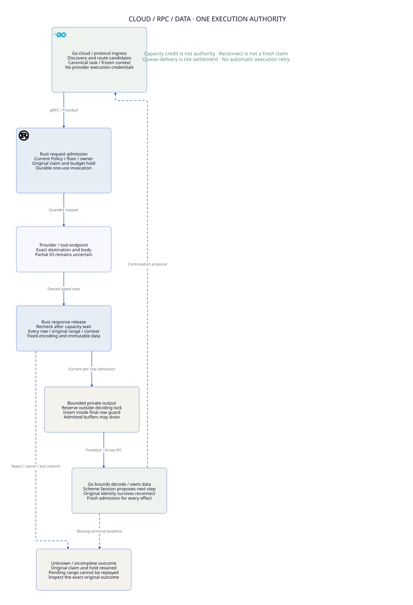

#+TITLE: Go Cloud Ingress, gRPC Control and Arrow Data Boundaries
#+LANGUAGE: en

* Decision and responsibility

=Project.sysml= owns the architecture and verification roles. Extend existing
=ProviderRpc= / =WeaverExecution= requirements and existing Lean/Quint owners;
do not introduce another control, Policy, budget or history state machine.
The  refines the [[file:59.43-floor-transport-owner.org][independent transport topology]] without changing
production Gateway code, dependency pins or time/resource limits.

#+NAME: fig:cloud-rpc-arrow-boundaries
#+CAPTION: Cloud ingress, authoritative request admission and guarded response release.
#+ATTR_ORG: :width 1400
#+ATTR_HTML: :width 100% :alt Cloud ingress, gRPC control and Arrow data boundaries

| Owner | Positive responsibility | Boundary |
|-------+-------------------------+----------|
| Scheme / Agentic AI Lab | Session, Workflow and higher-order Governor/Governance choose semantic continuations from admitted evidence | No direct provider sender; a continuation remains a proposal under the original claim/profile/domain bindings |
| Go cloud/protocol integration | Kubernetes and SDK observations, MCP/A2A/client-protocol mapping, route candidates, authenticated RPC, stream validation and consumer backpressure | Watch events are candidates, flow credits are capacity, received rows are observations; none grant Policy, settlement or a new logical root |
| Rust authoritative execution | Original task/profile binding, current Cedar/floor checks, claim/reservation consumption, provider transport and per-row response release | Sole final execution owner; do not return reusable provider or queue-send capabilities to Go |
| Existing Lean / Quint | Conditional composition proofs / fault and concurrency exploration | Neither authenticates a wire label nor replaces a native current-state check |

Go is retained for cloud/network integration reuse, not a claim that Rust cannot
implement those APIs. Current Go config/routing/client code exists; Kubernetes
controllers and full protocol discovery remain target integration work. Routing
preference cannot override the Rust-selected permitted route after consumption.
Existing typed Protobuf is the control default; optional Arrow IPC batches use
the same authenticated gRPC stream. No Flight service, shared-memory ABI or new
Go/Rust FFI path is introduced. Configuration and provider JSON bodies remain
distinct from the RPC envelope.

An agent-triggered Kubernetes or cloud API mutation is also a tool effect. Go
SDK convenience does not exempt it from final admission. Base integration uses
appropriately restricted discovery/watch credentials and compiles canonical
proposals. It cannot execute such mutations through an SDK's own sender/retry
hook. Administrative deployment tooling has distinct authority and must not be
exposed through the agent ingress role. No delegated Go executor is enabled by
this model; adding one would require a qualified final-hop execution contract.

* Source comparison and reuse

The inspected local checkouts are clean: agentgateway
=955d56fae09b45f3cb8e85e797dbb1eb06134f77= and OpenShell
=3a5dfcd2f1afd9c7376b07b11036265bbb68453c=. These are research identities,
not dependency updates or claims about every upstream communication path.

| Source-grounded mechanism | Useful lesson | Weaver-specific boundary |
|---------------------------+---------------+--------------------------|
| [[https://github.com/agentgateway/agentgateway/blob/955d56fae09b45f3cb8e85e797dbb1eb06134f77/crates/xds/src/client.rs][agentgateway Rust xDS client]] creates a bounded outbound request channel, reconnects the configuration stream and resubscribes using retained known resource versions | Retain typed watch identity/state across channel setup; separate channel reconnect from application work | xDS ACK, resource versions and known state do not authorize consumption, provider retries or budget release |
| [[https://github.com/agentgateway/agentgateway/blob/955d56fae09b45f3cb8e85e797dbb1eb06134f77/controller/pkg/syncer/krtxds/xds.go][agentgateway Go ADS loop]] prioritizes request handling while servicing pushes and stops | Explicit queue/stream lifecycle and control progress matter; avoid starving authority updates behind data work | Control publication remains effective only at Rust's authoritative commit; independently bounded source lanes are already the Weaver owner |
| [[https://github.com/NVIDIA/OpenShell/blob/3a5dfcd2f1afd9c7376b07b11036265bbb68453c/crates/openshell-supervisor-middleware-builtins/src/lib.rs][OpenShell built-in WebSocket middleware]] uses a bounded response channel, session lifecycle/sequence checks, and terminates sending when the receiver fails | Bound buffering and stop work on stream failure; validate lifecycle as well as payload shape | Middleware response success is not Weaver original-claim admission, durable history or settlement evidence |
| [[https://github.com/NVIDIA/OpenShell/blob/3a5dfcd2f1afd9c7376b07b11036265bbb68453c/proto/compute_driver.proto][OpenShell driver API]] distinguishes platform observations and lifecycle operations over gRPC | Typed observation/command APIs are a useful integration split | Platform state cannot silently replace the Gateway's original semantic or financial contract |

Channel capacities and retry policies are not copied. A bounded channel also
does not bound all pending futures, network buffers or application memory. These
source observations are design references, not comparative performance results.

* Request admission versus response release

Provider request admission is the guarded transition into the credentialed
bounded transport operation after durable invocation burn. Response release has
a separate LP: insertion of a freshly authorized frame into the private Rust
output queue, under the deciding transaction. It is not peer/application receipt.
Both effects remain tied to the original task, profile, shared budget/history,
selected route and current execution owner.

The actual path is [[file:../../../crates/execution/src/provider/runtime.rs][execute_stream]] → =output.reserve= →
[[file:../../../crates/ledger/src/provider.rs][prepare_provider_release]] → fresh =release_provider= guard →
[[file:../../../crates/server/src/grpc_output.rs][encode and enqueue]]. Capacity waits happen outside the deciding SQL lock.
The existing one-second queue reservation deadline is retained. Preparation
persists an unknown interval and advances its frontier before final queue use.
Final use rechecks all rows, plan commitment, encoding and live ledger session.
Current encoding occurs inside that final guard; moving expensive encoding
outside it would require immutable owned artifacts and another fresh join.

| Stage | What it establishes | What it does not establish |
|-------+---------------------+----------------------------|
| Queue slot reserved | Space for one private frame | Policy permission, budget capacity, current floor or a refund |
| Range prepared | Original ordered interval is durably pending/unknown | The frame was sent, received or can be reconstructed after restart |
| Final row checks | Every row is permitted under the actual current deciding context | Permission to add rows, change format/schema or transfer to another plan |
| Frame enqueued | One locally admitted output opportunity | Release transaction committed, peer received data or usage is final |
| Release commit succeeds | Local release record reflects its admitted frame | Complete semantic result availability or client processing |
| Go decodes and invokes receive callback | Data observation under a live original stream binding | Tool execution, Session progression, account application or budget release |

If enqueue succeeds and the subsequent release commit fails or loses its
response, bytes may already be observable while the interval remains unknown.
Never replay that interval or roll its frontier backward. Keep the original
hold and reconcile through existing source/account/history evidence. Queue
discard, timeout, cancellation and missing ACK never establish no-execution.

* Batch, cancellation and reconnect contract

1. Freeze one encoding for each live RPC. Protobuf carries one event per frame;
   Arrow carries at most the existing thirty-two rows. Both require every row's
   current authorization, original plan/range, schema and sequence checks.
2. After any capacity wait, join the actual current floor/context and observed
   cancellation inside the release guard. Returning flow-control credit cannot
   revive a stale prepared release or reset a shared reservation.
3. Cancellation is effective at the Rust owner's observation of the original
   output context. It blocks new admission after that check; it is not an atomic
   remote interruption of bytes already admitted. The check/enqueue race with
   receiver destruction retains uncertainty rather than implying a refund.
4. Already admitted private, HTTP/2 or kernel buffers may drain after later
   revocation/cancellation. That drain does not append a new authorized release.
   Bytes still waiting for admission need a fresh current check.
5. Reconnecting transport changes connection state only. No automatic
   =ExecuteProvider= retry, new nonce/family, format fallback or continuation
   reconstruction follows. Inspect the original ID/digest and preserve its
   pending claim, unknown range and hold.
6. A new stream cannot authenticate cached Arrow bytes merely by matching
   target/model/sequence. Current wire fields rely on the original authenticated
   request/stream context; a future detached batch cache needs qualified original
   scope/profile/range/schema/owner binding, not an added label trusted as proof.

The two-frame bound is the private output queue only. It excludes the producer's
current batch, frames already pulled by tonic, HTTP/2 windows, provider decoder
buffers, Go allocations and application queues. Each needs separate per-stream
and aggregate limits. Backpressure may safely lose availability; it may not
return native worker capacity before tracked completion or release monetary
exposure. A whole-pipeline memory or latency bound has not been established.

* Decoder and higher-order continuation boundaries

[[file:../../../go/internal/gatewayclient/arrow.go][Go Events]] checks IPC byte length, fixed schema, row count, nulls, sequence
and trailing records before returning an Arrow batch. The new later-row test
requires an invalid second sequence to return no prefix batch. However,
[[file:../../../go/internal/gatewayclient/client.go][Execute]] validates semantic event order and calls =receive= row by row, then
requires stream completion and an exact inspected durable receipt. Earlier
callbacks can run before a later semantic error or unavailable final receipt.
They must remain observations, never implicit effect or settlement authority.

Scheme may use these observations in higher-order assessment/strategy functions
and propose an authorized continuation. A next step that depends on the result
also requires authentic typed result/artifact availability and the original
Session/Workflow edge and history contract. A server queue receipt or =complete=
row alone cannot recover missing result bytes or prove that contract. Every
follow-up tool/provider effect returns to Rust admission with current context.

A four-megabyte IPC message cap is not a decoded-allocation cap. The pinned
Arrow library's reader supports compressed buffers and sizes decompressed
buffers from metadata. The bounded [[file:../../../go/internal/gatewayclient/arrow_test.go][native counterexample]] generates a valid
compressed four-row fixture: 880 IPC bytes decode to 262,144 bytes of text. This
is approximately 298 times logical-text expansion, not measured peak memory or
a production compression benefit. The current Rust writer does not enable
compression. The finding invalidates the general resource-bound assumption;
it is not evidence of an untrusted production peer exploiting the pinned TLS
connection.

The Go consumer now rejects invalid envelopes before calling the IPC reader:
at most 64 KiB of metadata per message, exactly one schema and one record,
declared bodies inside the received bytes and an exact end marker without a
hidden suffix. Public Arrow Message APIs supply message type and body length;
Weaver does not implement another Arrow semantic decoder. A fresh allocator per
batch charges at most 8 MiB of cumulative requested Arrow buffer sizes, including
the full requested replacement size. Free does not restore credit. The pinned
synchronous reader converts an over-budget allocator panic into a read error.
No partial event list returns on that error. A 4 MiB total kind/text limit bounds
the copied strings returned to the application; owned strings no longer retain
the whole Arrow data buffer. Sequence arithmetic must not wrap.

These are separate bounds, not a claim of an 8 MiB total Go heap cap. Go allocator
alignment, codec windows, runtime objects and FlatBuffer schema traversal are
outside the Arrow allocation interface. The envelope check does not verify every
FlatBuffer vector or nested metadata graph. Arbitrary hostile schemas and codec
heap/CPU qualification remain open before accepting broader data sources. The
current Rust writer still emits the fixed uncompressed schema. Compression stays
a decoder test stimulus, not a newly enabled production feature.

Before the repair, two new native tests failed: a compressed buffer requesting
more than the full allocation allowance was returned successfully, and sequences
=[max_uint64, 0]= were accepted as ordered. These failures are retained here;
later passing runs do not replace their causal evidence. Existing small
compressed expansion remains a positive control, not a rejected format.

Native =testing.F= suites own generation/shrinking/replay. Allocation command
traces compare cumulative acceptance with an independent integer model and a
checked underlying allocator; a denied command must not change live allocation.
Structured IPC properties generate row counts, payloads, compression and an
invalid final sequence, checking exact observations or no returned prefix.
They are registered in the existing =check-go= entrypoint with twelve local
workers and the unchanged three-second exploration setting. They do not claim
arbitrary malformed-FlatBuffer qualification or full process-memory measurement.

The existing =ProviderRpc.qnt= owner checks budget saturation, no refund on Free
and the wire-only counterexample in abstract units. =ProviderRpc.lean= proves
the cumulative bound and monotonic usage for arbitrary finite allocation/free/
rejection runs. Native routing of every requested Arrow buffer through the
allocator is an explicit premise; native properties exercise that binding.
Neither a decode failure nor freeing memory settles a reservation, reopens an
invocation or authorizes a Scheme continuation. Existing Rust claim/hold and
final release laws remain the execution authority.

* Reused models, properties and limits

| Existing owner | Added check | Premise / remaining obligation |
|----------------+-------------+--------------------------------|
| =ProviderRpc.qnt= | Slot/frame capacity, explicit prepare/emit/commit, frozen RPC encoding, every-row current guard, pending interval across crash, cancellation and read-only reconnect | Four rows/two rows per abstract Arrow batch explore ordering; native bounds remain thirty-two/4096 and are not reduced |
| Same owner | Enqueue-before-lost-commit, stale slot credit, changed domain cut, no range replay/refund; unsafe credit-as-authority and replay witnesses | Opaque domain cut denotes the authenticated original profile/budget/history view supplied by the existing floor owner, not a new budget evaluator |
| =AuthorityPublication.qnt= | Existing read witness now includes domain cut; changed budget/history invalidates both consume and release observations | Concrete four-prefix/native data projection remains an explicit refinement gap |
| =ProviderRpc.lean=, existing =Flow= namespace | Arbitrary finite traces preserve two-slot private capacity, original release binding, all admitted row authority and held exposure; project to existing =ReleaseStep/ReleaseRun= | Immutable owned batches and actual current native guard are premises, not proof of TCP/TLS delivery |
| Same Lean owner | Final eligible rows must use the authoritative context's row predicate and the pipe's original plan; stale context and observed cancel reject; crash cannot recreate unknown release | The context mapping must cover original assignment, profile/schema/Policy, shared budget/history and owner; a client predicate or string label is insufficient |
| Existing release/provider/account owners | Reuse affine session/encoding binding, original claim, budget conservation and history reconciliation | No copied account arithmetic, Scheme evaluator or new proof-role owner; release is not settlement |

The successful atomic =batch= action remains the projection used by existing
composition owners. New microsteps expose its waits and failure windows rather
than creating a second authorization engine. Lean's transport trace similarly
projects onto the existing release history and composes its execution/hold laws.
This is composition of established invariants, not a native trace-correspondence
proof: the adapter must still bind execution and release histories to the same
canonical task and actual complete deciding context. No concrete four-prefix or
account/history projection is inferred from equality of an abstract label.
Quint uses concrete small bounds; Lean is parametric over original keys, complete
contexts and arbitrary finite event counts. Neither proves fairness, eventual
delivery, decoded heap limits or an implemented independent recovery authority.

* Verification and acceptance evidence

| Scenario | Checkable evidence | Classification |
|----------+--------------------+----------------|
| Full queue then returning capacity | =boundedPrivateQueueCannotGrowTest= / =returnedCapacityDoesNotAuthorizeStaleReleaseTest= | Safe denial without widening capacity or grants |
| Prepared range, changed Policy/domain or cancellation | =policyChangeAfterPrepareRejectsAllRowsTest= / =domainChangeAfterPrepareRejectsAllRowsTest= / =cancelAfterPrepareRetainsUnknownRangeTest= | No new release; original hold retained |
| Enqueue then lost commit and restart | =enqueueThenLostCommitRetainsUnknownTest= | Delivery can occur while interval stays unknown; no commit/replay inferred |
| Reconnect and encoding switch | =reconnectCannotUncancelOriginalStreamTest= / =preparedEncodingCannotSwitchTest= / =restartCannotReconstituteUnknownReleaseTest= | Original context and pending range survive |
| Capacity treated as authorization / replaying prepared interval | Explicit unsafe Quint witnesses | Expected counterexamples retained outside safe =step= |
| Malformed later row / mismatched encoding | New native Go decoder tests | No returned partial batch; no format adoption |
| Encoded bytes treated as decoded memory bound | Small compressed expansion control and over-budget refusal | Arrow buffer requests and returned text are bounded; total codec/runtime heap remains unqualified |
| Real Go/Rust streaming, row denial, cancellation and duplicate RPC | Existing integration tests | Production-component evidence; independent floor and future cloud/protocol adapters remain unimplemented |

Run existing configured Lean and Go proof/architecture entrypoints with the
unchanged dependencies. Use the existing Quint seed 293, 1,000 samples and
sixty-step exploration bounds. Exact final test receipts are recorded with the
delivery; raw logs stay temporary. Named SysML traces now include the new laws
and counterexamples, but trace presence is not behavioral proof or a claim that
all target obligations are implemented.

| Local check | Observed receipt |
|-------------+------------------|
| ProviderRpc Quint tests, seed 293 | 41 passing |
| AuthorityPublication focused scenarios, seed 293 | 29 passing |
| GatewayComposition tests with imported provider/connection cases | 53 passing; imported cases overlap other entries and are not added as unique tests |
| Existing ReleaseBinding tests | 13 passing |
| ProviderRpc, AuthorityPublication and GatewayComposition safety exploration | Each passed 1,000 samples by sixty steps, seed 293; no exhaustive verification claim |
| Existing configured Lean entry on ProviderRpc | Checked Flow projection, finite history, all-row/plan binding, continuation coherence and unknown-pending preservation; no =sorryAx= in printed axioms |
| Go client/routing/config tests, race enabled | Passed, including three new decoder tests and existing setup/recovery cases |
| Existing real Rust-process mTLS gRPC/HTTPS tests, race enabled | Ten passed: Arrow/Protobuf streaming, every-row denial, cancellation, duplicate RPC, identity, partial writes, native-capacity isolation, no fallback and historical publication recovery |
| Strict linked Project/SysML trace checks and negative controls | Passed |
| Org parse and core D2 render/visual review | Passed; the SVG is embedded above with a relative Org image link |

[[file:59.45-slow-consumer-zero-trust.org][The next review]] adds real slow-client
Policy publication, cancellation/reconnect and enqueue-before-commit crash cases
inside an observed private-queue capacity wait, retaining the one-second deadline.
Rust component tests also cover provider range history changed during the wait.
A general external history-domain publication is not implemented by these tests.
Whole-pipeline buffer, total decoded-heap, concrete floor/account/history mapping
and native trace-correspondence evidence remain open.

** Allocation-boundary implementation receipt

Local Darwin arm64, Apple M2 Pro, twelve logical CPUs; no dependency pins changed.
The original two failing decoder tests above preceded the production repair.
The allocation fuzzer also shrank a checked-allocator empty-buffer reallocation
failure to =[]byte("10")=. The adapter now maps empty reallocation to Allocate
and zero-size reallocation to Free. The framework corpus is checked in for exact
replay; this harness failure is not evidence that a production stream crashed.
The first Lean edit failed to elaborate because of a reserved binder and then
constructor pattern arity; the final file elaborates without admitted proofs.

| Executed check | Observed result |
|----------------+-----------------|
| Normal Go =go test -race ./...= | All packages passed, including Project/SysML and development-stage ownership checks |
| Real provider suite =go test -race -tags=integration ./dev -run '^TestProvider' -count=1= | Passed in 31.097 seconds; actual Rust server and mTLS/HTTPS, not an untagged no-tests invocation |
| =FuzzArrowAllocationBudget=, three seconds | 202,914 executions, twelve workers; minimized original failure retained as a corpus entry |
| =FuzzArrowObservationRoundTrip=, three seconds | 26,467 executions, twelve workers; counts are engine executions, not unique cases |
| ProviderRpc Quint tests | 52 named scenarios passed, seed 293 |
| ProviderRpc safety exploration | 1,000 samples, sixty steps, seed 293; no violation, not exhaustive verification |
| ProviderRpc Lean | File elaborated; new finite-run theorem uses =propext= and =Quot.sound=, no =sorryAx= |
| Core D2 | SVG regenerated and rendered PNG visually inspected; only core relationships appear in the diagram |

The actual decoder benchmark uses fixed uncompressed 1 KiB text per row, with
fixture construction outside timing. Three one-second repetitions on this host
measured 4,994–5,315 ns/op for one row (8,928 B/op, 114 allocs/op) and
14,633–14,923 ns/op for thirty-two rows (83,873 B/op, 207 allocs/op).
These are warm serial client-decoder microbenchmarks with the machine's default
concurrency setting, not concurrent throughput, end-to-end latency, peak heap,
cold startup or a before/after speedup comparison. The benchmark remains beside
the actual Go decoder tests and uses the standard Go benchmark framework.

* Comparison metric and remaining work

Weaver adds a combined semantic/execution contract across Scheme, typed Go
integration and the Rust final boundary. Box request/result validation and
OpenShell stream/lifecycle confinement remain useful reference lessons;
agentgateway's typed xDS reconnect provides control-plane lessons. None replaces
the original claim, unknown reservation, authoritative history or final CAS.

Metric this round: bounded model and native decoder evidence increases; full
higher-order Governance adapter production acceptance remains 0/13. The
compression figure remains a bounded synthetic expansion witness; no
cross-product throughput, latency, memory saving or cost advantage was measured.
Remaining work includes codec/runtime heap and arbitrary metadata qualification, whole-pipeline byte
and fairness limits, deployed cloud/protocol adapter reconnect tests, concrete
floor/account/history projection and authoritative Session result recovery.
Production code and dependency pins remain unchanged. CI is nonblocking.
