# SPDX-FileCopyrightText: 2026 hardenedlinux Linux Team and Contributors
#
# SPDX-License-Identifier: LGPL-2.1-or-later OR Apache-2.0

#+TITLE: 59.45 Slow Consumers and Research-Aligned Zero Trust
#+LANGUAGE: en
#+OPTIONS: toc:2

* Core design and research ownership

[[file:59.46-functional-security-frameworks.org][59.46]] refines this allocation:
ZeroTrust is a generic functional/POO framework; publication/consumption-specific
Host, Proposal and FinalUse belong to =Gateway.ZeroTrust=. The core never imports
Gateway. Receipt counts below describe this preceding review cohort.

SysML remains authoritative: [[file:../../../Project.sysml][Project]] assigns proof
responsibilities and [[file:../../../dev/sysml/WeaverExecution.sysml][WeaverExecution]]
allocates the library and actual effect owners. The reusable Zero Trust API
belongs to cedar-poo-spec; Weaver enriches its complete deciding view and must
qualify the runtime adapter. The upstream candidate is described in
[[https://github.com/hardenedlinux/cedar-poo-spec/blob/refactor/lean-poo-pr13-alignment/docs/rfc/0010-zero-trust.org][SPEC RFC 0010]], following Authorization Delta's research/model/proof/API process.
The unchanged Weaver dependency pin does not yet expose this candidate API.

#+NAME: fig:slow-consumer-zero-trust
#+CAPTION: A shared semantic contract with fresh Rust enforcement after backpressure.
#+ATTR_ORG: :width 1400
#+ATTR_HTML: :width 100% :alt Zero Trust contract and final streaming release

| Research / source | Design alignment | What is not established |
|-------------------+------------------+-------------------------|
| [[https://doi.org/10.6028/NIST.SP.800-207][NIST SP 800-207]], Sections 2.1 / 3 | Dynamic resource authorization and logical PE/PA/PEP allocation | No end-to-end mechanical proof or certification from architecture vocabulary |
| [[https://csrc.nist.gov/pubs/sp/800/207/a/final][NIST SP 800-207A]] | Explicit application/service identity in cloud integration | Shared Kubernetes identity does not establish worker incarnation/custody |
| [[https://doi.org/10.1145/984334.984339][UCONABC]] and [[https://profsandhu.com/journals/tissec/p351-zhang.pdf][its temporal formalization]] | Ongoing use under changing attributes; revoke later admissions | No imported proof of the whole UCON system, storage or physical byte recall |
| [[https://github.com/cedar-policy/cedar-spec/tree/main/cedar-lean][Official Cedar Lean]] / [[https://arxiv.org/abs/2407.01688][verification-guided development]] | Reuse executable authorization definitions and separate semantic proofs from implementation tests | Cedar authorization does not make a Host fact true or a final transaction atomic |

These references motivate a selected per-effect contract. They do not replace
the application's concurrency/recovery specification. Unknown budget retention
and anti-rollback recovery are additional explicit requirements. A repository's
Zero Trust label or paper's formal notation is not automatically a checked Lean
dependency. SPEC records which artifacts are definitions, theorems, external
solver evidence or open refinement obligations.

* Scheme, Go and Rust allocation

Scheme reuses Agentic AI Lab Session/Workflow/Governor for higher-order strategy,
assessment, configuration profiles and semantic continuations. Closure-captured
observations remain proposals; a continuation cannot choose a new original
claim, budget/history domain or weaker profile. Result-dependent progress needs
authentic available result/history evidence, not EOF or a callback alone.

Go owns cloud/protocol integration, typed gRPC proposals, optional Arrow stream
validation and application backpressure. Kubernetes/SDK observations do not
activate publication or confer provider credentials. Reconnect does not invoke
an provider-client retry/fallback or create a fresh logical message.

Rust owns provider transport and the final response release. A queue slot is
reserved outside the deciding SQL lock. After that wait, actual current Policy,
original plan/claim, row/range, encoding and owner are rechecked at final release.
Queue insertion is the local release boundary, not client receipt or settlement.
An already admitted buffer can drain after revocation; a future admission must
not use the old permission. Request and response releases remain distinct effects.

* Consuming the SPEC contract without duplicating it

The candidate =CedarPooSpec.Gateway.ZeroTrust= composes actual =PublishedReceipt=,
=consumeAdmission= and Authorization Delta laws. =Proposal= is inert;
=FinalUse= requires the actual deciding pre-state, authoritative original
publication, freshness, committed returned ledgers, unknown exposure retention
and mediation. =FinalUse= is duplicable proof data, never a reusable send handle.
Its Host predicates are premises. A native adapter that supplies trivial
predicates would not establish Zero Trust.

[[file:../../../dev/proofs/cedar/ZeroTrustEnrichment.lean][The isolated consumer]]
extends the existing publication context with semantic context, commit floor,
budget version and history prefix. It applies upstream laws to changed floor,
budget, history and owner views. These are conditional binding consequences;
the file does not authenticate SQL rows, prove budget arithmetic or implement an
independent floor. It is qualified separately against the upstream candidate;
the normal fixed-pin bridge remains unchanged.

The core's research alignment is a requirement mapping and a selected contract
fragment. UCON temporal rules have not been mechanically translated into this
library. Reusing their terminology is not a proof of that translation.

Existing =ProviderRpc= Lean/Quint owners retain runtime release and history
reasoning. The quint model adds explicit full-queue wait and EOF observations
and five schedules for revocation, changed history cut, cancellation, a positive
capacity-return control and unknown commit. Unsafe credit-as-authority, stale
release, unknown refund and replay witnesses remain explicit negative controls.
The abstract domain cut requires a real complete-view refinement; a string label
does not implement it. Delta remains a same-world policy implication, not safety
for every changing agent trajectory.

* Real slow-consumer acceptance scenarios

| Scenario | Actual test boundary | Required outcome |
|----------+----------------------+------------------|
| No reads, bounded HTTP/2 windows, Policy published during actual reserve =Pending= | Real Rust tonic server, Go mTLS client and HTTPS SSE producer; Protobuf and Arrow | Source update completes while queue waits; capacity return permits no new denied rows/DONE; original hold remains |
| Cancel while waiting, then reconnect | Same real queue wait; observe Rust cancellation | No new release or duplicate provider call; original history/hold remain |
| Capacity returns without a state change | Positive control over the same transport | Complete original stream; proves denial cases did not merely stall forever |
| Enqueued frame, crash before release commit, restart | Test-only fault window after actual queue insertion; deliberate process kill | Pending frontier survives; no replay, fallback or refund; exact original RPC remains spent |
| History changes during the capacity wait | Rust Output + actual Ledger =prepare_provider_release= | Newly pending provider range cannot be reconstructed/replayed; reopened ledger retains frontier/hold |

The queue observer polls the actual =reserve_owned= future and reports the same
wait ID on Ready; it does not infer a wait from sleeps or provider flush alone.
It exists only under =cfg(test, unix)=. The fault pause is also test-only and is
not a production service, sender or deadline change. Test source touches to
=grpc_output.rs= and shared fixture registration are compile-time test hooks.
The ignored test-server harness runs the actual server entrypoint. Existing
uninstrumented executable tests separately check production behavior.

The one-second reservation deadline, two-frame private queue, native Arrow row
bound and fixture cleanup remain unchanged. Synthetic SSE sizes/windows force a
bounded slow-consumer schedule; they are not LLM token-cost or throughput data.
Clean gRPC EOF can follow an unsuccessful worker when its error frame cannot be
queued. Tests therefore inspect DONE, actual rows, durable frontier/hold and
provider calls rather than interpreting EOF as a successful execution.

The initial Darwin Unix socket fixture failed because the temporary path was
too long. A short private temporary directory fixed the fixture, without changing
deadlines. Failure evidence remains in temporary storage, not tracked logs.

* Evidence and remaining gates

The upstream candidate build covers the public library, real Gateway publication
fixture, raw-Receipt type refusal, new-authority replay refusal, changed private
floor, unknown commit and lost hold. Printed axioms expose existing Cedar
native-decision dependencies; no new =sorry= or axioms are introduced.
The isolated Weaver consumer and normal unchanged fixed-pin bridge both checked.
These are separate receipts, not evidence that a new library is deployed.

| Local verification | Receipt |
|--------------------+---------|
| SPEC public library + focused publication/Delta/Zero Trust targets | 465 Lake jobs completed successfully |
| SPEC existing =lake build Tests= aggregate | 548 jobs completed; new tests are discovered by the existing library glob |
| Fixed-pin bridge / isolated candidate consumer | Both checked; candidate consumer has five printed laws without =sorryAx= |
| Existing provider runtime Lean entry | Passed; existing axiom printouts retained in temporary output |
| ProviderRpc Quint scenarios | 46 passing, seed 293 |
| GatewayComposition scenarios | 58 passing; imported tests overlap, not independent unique evidence |
| ProviderRpc / AuthorityPublication / GatewayComposition safety | Each passed 1,000 samples, sixty steps, seed 293; bounded exploration |
| Rust actual Output/Ledger component tests | Three passing; test-only server entry remains intentionally ignored for direct unit execution |
| Go real slow-consumer integration, race detector | All four test functions passed, including both Policy encodings |
| Existing uninstrumented provider integration, race detector | Ten selected production-executable scenarios passed |
| Strict OpenSysML / Project / trace checks | Passed with existing semantic and ownership negative controls |
| D2 and Org | Rendered and visually reviewed; three current core SVGs verified as existing descriptionless inline Org links |

Real slow-consumer tests cover local Policy publication, cancellation/reconnect
and enqueue-before-commit process recovery. A general external history-domain
publication, independent floor rollback protection, complete-view materialization,
whole-pipeline byte/allocation limits and authoritative Session result recovery
remain unqualified. No claim of exhaustive native/model correspondence,
eventual delivery, fair scheduling or remote CI success follows. CI is nonblocking.

* Comparison metric

| Dimension | Weaver this round | Box / OpenShell reference | Gap and next action |
|-----------+-------------------+---------------------------+---------------------|
| Semantic differentiation | Reusable SPEC contract + original LeanPoo profile/Delta + Scheme higher-order continuation | Box request/result validation and OpenShell confinement remain useful design references from the preceding source review | Prove concrete complete-view/Session result refinement; no measured superiority claim |
| Stream enforcement | Real capacity-wait revocation, cancellation, pending-range crash/restart checks | This round did not run identical adversarial workloads on either reference | Run a common harness before comparative reliability/performance claims |
| Compression / resource metric | No new compression benefit measured; previous 880-byte IPC to 262,144-byte text fixture is a resource counterexample | No comparable product measurement | Qualify decoded allocations and aggregate buffering; do not call wire size a heap bound |
| Evidence progress | Five new Quint scenarios, three Rust component cases and four Go test functions (Policy case uses both encodings) | Counts are scoped Weaver evidence, not cross-product scores | General history publication and independent recovery authority remain open |

No production Gateway behavior or dependency pins are changed by this review.
