#+TITLE: 59.46 Functional Security Frameworks and Ongoing Use
#+LANGUAGE: en
#+OPTIONS: toc:2

* Authoritative allocation and directory structure

[[file:../../../Project.sysml][Project]] and
[[file:../../../dev/sysml/WeaverExecution.sysml][WeaverExecution]] assign
=CedarSecurityFrameworks= and retain the existing assurance owners.
Zero Trust is a reusable framework, not a Gateway subsystem. Applications
compose its functional requirements and POO profiles with their own execution
contracts. The actual SPEC transitive-import test rejects Gateway in ZeroTrust.

#+NAME: fig:functional-security-frameworks
#+CAPTION: Independent functional frameworks, POO specialization and one final execution owner.
#+ATTR_ORG: :width 1400
#+ATTR_HTML: :width 100% :alt Functional Zero Trust and Authorization frameworks consumed by Gateway

#+begin_example
CedarPooSpec/
  ZeroTrust.lean                    -- aggregate entrypoint
  ZeroTrust/
    Model.lean                     -- typed requirement functions and views
    Composition.lean               -- adapt, strengthen, refinement
    Continuous.lean                -- mutable observations and ongoing checks
    ProfileObject.lean             -- actual LeanPoo inheritance/Session
  Authorization.lean              -- aggregate entrypoint
  Authorization/
    Compound.lean
    Delta.lean                     -- aggregate of the Delta directory
    Delta/{Model,Proof,Operational,OperationalExact,
      OperationalExactProof,BooleanCore,Reasons,EffectiveReasons,
      EffectiveReasonsProof,Compound,Evidence,Interaction,Release,Trace,Json}.lean
  Gateway/
    ZeroTrust.lean                 -- application interpretation of the frameworks
#+end_example

The migration directly updates library imports, namespaces, examples, tests,
proof entrypoints and current documentation. No forwarding modules preserve
the old flat AuthorizationDelta paths. Historical raw evidence is unchanged.
The normal Weaver pin and its production bridge remain unchanged; isolated
candidate consumption updates only a temporary bridge copy from
=CompoundAuthorization= to =Authorization.Compound=. This is an explicit
future source migration, not a compatibility service or a deployed pin upgrade.

* Functional composition and actual POO

=Requirement Effect View= is a typed predicate function. The framework conjoins
authentication, authorization, currentness, committed consumption, retained
unknown exposure, non-revocation and mediation. =adapt= projects domain types;
=strengthen= and =withRequirement= preserve the original implication.
These functions do not introduce another policy language or Cedar evaluator.

=ZeroTrust.ProfileObject= interprets those functions through actual
=LeanPoo.Object.Dataflow.define/extendWith= and inherited field extension.
A profile carries its original requirement as a type index and a refinement
proof. Child requirements strengthen it. Existing ObjectProfile Contract,
factory and Session own source-bound reads. The generic POO test constructs,
extends, opens and reads a real object; weakening has an explicit counterexample.
Choosing an authentic original remains an application obligation.

=Gateway.ZeroTrust= receives those functions through its existing POO
publication/Contract/Session and combines Authorization's Cedar admission and
Delta with its operation/authority ledger. =specialize= strengthens the generic
requirements while retaining the original published profile. This is the
consumer dependency direction. No Gateway type is introduced into the core.

The adapter also exposes =fromFrameworkObject=: it accepts the actual generic
Zero Trust inherited object's factory-indexed Session and reads its selected
functional requirement. Its original index is fixed to the Gateway publication's
framework. =framework_object_preserves_gateway_contract= proves actual source-bound
projection, generic requirements and the original Gateway profile together.

* Selected UCON fragment

[[https://profsandhu.com/journals/tissec/p351-zhang.pdf][UCON's temporal formalization]]
motivates decisions during use as attributes change. This implementation checks
each declared new effect against its actual state. It proves a finite safety
fragment; it does not translate the full temporal rule system or establish
fairness/eventual post-use updates. See SPEC
[[https://github.com/hardenedlinux/cedar-poo-spec/blob/refactor/lean-poo-pr13-alignment/docs/rfc/0010-zero-trust.org][RFC 0010]] for the primary-source alignment.

| Mechanism | Checked property | Required interpretation |
|-----------+------------------+-------------------------|
| =Framework.required= | Currentness alone cannot override revoked, missing commit or lost hold | Predicates are trusted application meanings, not caller-supplied truth flags |
| =Observation= / =atObservation= | Changed attributes or generation rejects the old observation; equal restored values do not revive it | Actual generation is authoritative and not reused after restart/rollback |
| =MediatedStep= / =Run= | Every declared effect rechecks current authorization/commit/revocation; existing invariant laws project across arbitrary finite runs | Every native new effect must be correctly labelled and mediated |
| Gateway =continuing= | Preserve original scope and consumption with fresh assessment at the current view | Do not call root consumption for every streamed row |
| =CommittedPrefix= | Current operation history extends installed consumption; renewed authority cannot reconsume against that recovered history | Authentic current prefix materialization; a commit label alone is insufficient |

Initial =FinalUse= binds one admission pre-state. It must not be reused as a
per-row proof requiring the live stream to stay forever equal to that state.
Ongoing use can assess a newer view while retaining the original consumed root,
profile, budget/history domains and exposure. Fresh observation alone does not
authorize resuming a fenced Rust stream: the current implementation conservatively
rejects the old plan after an authority-generation change.

Revocation is ordered at authoritative publication versus final admission.
Already admitted buffers can drain afterward. That drain is an observation,
not a new effect grant or accounting completion. Equality of labels and possession
of a duplicable proof record are not one-use native send capabilities.

* Persistence and final-send correspondence

| Actual boundary | What is durable/current | What remains unknown |
|-----------------+-------------------------+----------------------|
| Provider dispatch burn commits | Original invocation cannot acquire another dispatch opportunity | No proof the provider received a complete request |
| Fresh transaction around transport callback | Current Policy/profile/owner rechecked after the burn | Later partial IO remains uncertain; callback receipt is not settlement |
| =prepare_provider_release= commits | Original range/frontier is pending/unknown before returning its handle | Range has not necessarily entered the output queue |
| =release_provider= transaction / queue insertion | Fresh every-row check and one-use release handle; local final response admission | Queue insertion may precede release-completion commit failure |
| Recover original DB / inspect original ID | Consumption, frontier and hold survive ordinary process restart | Independent snapshot anti-rollback and complete external fact projection remain unimplemented |

Thus the framework's committed-consumption prerequisite maps to the original
durable burn and retained unknown range, not to a later released-marker commit.
Requiring the latter before the queue callback would misdescribe the actual
enqueue-before-commit failure window. The release transaction and local source
publication share SQLite serialization. An external store or informer does not
inherit that ordering automatically.

* Explicit Host evidence ledger

| Obligation | Existing evidence | Missing evidence |
|------------+-------------------+------------------|
| H1 Authentic original, identity and deciding view | Source mTLS and typed original profile/native tests | Complete cryptographic/fact projection and cross-store proof |
| H2 Current guard and final use share one order | Actual transaction-enclosed queue callback and blocked-output Policy test | Mechanically checked mapping from all native effects to SPEC transitions |
| H3 Both operation/authority consumption and original hold persist together | Existing actual dispatch/retry/restart cases; conditional prefix theorem | Full native-to-SPEC ledger refinement and arbitrary multi-store failure proof |
| H4 Non-reused generation and prefix recovery | Same-DB process restart and repeated operation-ID checks | Independent anti-rollback floor and snapshot recovery implementation |
| H5 Unknown exposure survives interruption | Partial-write, cancellation and enqueue-before-commit crash cases | General account/history reconciliation and delayed usage evidence composition |
| H6 No alternate sender or copied capability | Rust final sender boundary and SDK retry/fallback tests | Complete implementation refinement/audit of every future adapter/credential owner |

No new axiom or sorry is used. Generic framework and POO laws are distinct from
the Gateway/Cedar laws' inherited native-decision dependencies. Printed axiom
audits remain temporary. Model safety does not imply physical isolation,
external delivery, NIST certification or a fairness guarantee.

* Reused verification and real recovery

The existing ProviderRpc Quint owner gains authoritative Allow restoration with
an increasing generation. Safe schedules reject old-plan release and renewed
root consumption after revoke/restart/restore. The unsafe old-grant release is
retained as a counterexample. Its first draft chained two expected-failure
actions, which produced an unset-state test error; splitting the terminal
failure cases corrected the harness without weakening the invariant. The
failed receipt remains temporary.

The new real Go/Rust test observes a genuine queue-capacity wait, commits revoke,
returns capacity, naturally stops/restarts the owner, replays the exact publication
operation, publishes Allow in a newer generation and attempts the original stream
again. It requires no new provider call, no frontier reset and the same original
hold. Existing slow-consumer, partial-write and crash tests are reused. Deadlines,
queue bounds and resource cleanup remain unchanged; no production code is added.

| Local receipt | Result |
|---------------+--------|
| SPEC public aggregate and full existing Tests aggregate | Passed, 588 Lake jobs; includes transitive import boundary, generic functional/POO tests and Gateway prefix laws |
| Four existing governance/payment/interaction/session Delta examples | Built successfully after import/namespace migration |
| Existing SPEC source-layer checker | Passed through its installed project entrypoint; no new Python runner |
| Fixed-pin Weaver bridge | Passed, unchanged pin and production source |
| Isolated candidate bridge and enrichment | Passed with only the temporary Compound namespace migration; no forwarding API |
| ProviderRpc Quint | 49 scenarios passed, seed 293 |
| GatewayComposition Quint | 61 scenarios passed; imported cases overlap |
| Both affected models' safety exploration | Passed 1,000 samples by sixty steps, seed 293; not exhaustive |
| Real slow-consumer / restored-policy recovery and lost-publication-response tests | Passed with Go race detector and existing cleanup/deadlines |
| Strict Project/OpenSysML/trace checks | Passed, including existing negative controls |

The external authorization-delta solver/replay command was attempted but could
not run its analysis because this environment has no CVC5 executable/setting.
It is not a successful solver or Rust replay receipt. Lean compilation/proofs
above do not substitute for that missing end-to-end check. The failure output
stays temporary. No solver version or repository dependency pin was changed.

* Comparison metric

Weaver's differentiation is reusable functional/POO governance plus an explicit
semantic-to-execution contract. Box request/result validation and OpenShell
confinement remain complementary references, not evidence that Weaver is faster
or already has complete isolation. This round adds framework modularity,
generic POO/continuous laws, recovered-prefix composition and one actual restart
schedule. Native independent-floor and complete-view refinement remain gaps.
No shared cross-product benchmark or compression benefit was measured. The
earlier compressed-IPC expansion witness remains a resource counterexample.
CI is nonblocking, and dependency pins remain unchanged.
