#+title: 59.47 Runtime Property Testing Framework
#+language: en

* Framework boundary
Property testing is a first-class implementation discipline. Rust uses the
workspace's existing =proptest= dependency; Go uses =testing.F= and the native
fuzz engine. These frameworks own generation, shrinking, corpora, discovery,
replay and failure reporting. The Go development runner only launches native
test suites. There is no Python/Bash property runner or second random engine.

Project.sysml's existing implementation responsibility owns the concrete tests.
Quint searches protocol/fault schedules; Lean proves stated composition laws
with Host premises and reuses cedar-poo-spec. These roles complement property
tests and do not substitute one another's evidence.

#+caption: Framework-owned generation, independent refinement and minimal replay.
#+attr_html: :width 1400

* Required property design before Runtime changes
For each change, record the invariant and its exact native boundary first.
Then specify typed commands/inputs, valid/invalid preconditions, an independent
model/oracle, coverage classes and a shrink-preserving trace grammar. Finally
bind the implementation driver, replay/minimal-counterexample policy and native
integration controls. A property is not complete merely because it terminates.

| Concern | Framework responsibility |
|---------+--------------------------|
| Generators | Produce meaningful boundary cases and legal positive paths as well as hostile inputs |
| Command grammar | Preserve original identity and relevant causal prefixes during shrinking; do not filter away every difficult case |
| Reference model | Predict the chosen contract independently of the implementation's success/failure return |
| Driver | Exercise real public Rust/Go APIs and persistence/transport where claimed |
| Oracle | Check every relevant prefix; separate expected denial, safety, progress and unavailable evidence |
| Replay | Framework-owned seed/corpus and minimal counterexample; retain the original failure rather than replace it with a passing rerun |
| Evidence | State case/trace bounds, source/pins, actual worker count and untested domains; no universal claim from finite sampling |

A safety-only property may observe accepted operations and check their effects,
but cannot thereby claim that legitimate operations succeed. Positive controls
and independent admissibility models must cover that separate obligation.

* Current concrete owners
| Property | Native framework owner | Current scope |
|----------+------------------------+---------------|
| Routing cannot expand original scope/body/profile/cost | Go routing fuzz suites | Native plan compiler and request bounds; not actual sending |
| Durable claims/holds survive replay, restart and range faults | Ledger proptest suites | Existing bounded event histories, real SQLite, two-message stream fixture |
| Original admission/refusal agrees with an independent model | =stream_admission_pbt.rs= | New typed command/model/driver suite, sixty-four cases, mandatory positive admission, generated suffixes of one to thirty-one commands |
| SSE fragmentation preserves event identity | Execution proptest suite | Sixty-four generated fragmentation/text cases over the actual decoder |
| Arrow cumulative allocations cannot regain credit through Free | Go gatewayclient fuzz suite | Independent integer oracle, checked native allocator, bounded command traces and no-allocation denial |
| Arrow observations round-trip or reject as a whole | Go gatewayclient fuzz suite | Actual IPC writer/reader, generated rows/text/compression and invalid final sequence; excludes arbitrary malformed metadata |
| Every benchmark measurement survives order/noise and malformed data rejects | Go devrunner fuzz suite | Generated typed rows, distinct repetition values, bounded permutation/noise and independent expected records |
| Revocation/cancellation/crash inside an actual output-capacity wait | Server unit and Go integration framework tests | Deterministic controlled schedules with real Rust/mTLS; not yet randomized native schedule generation |

The new ledger suite separates =Command= strategies, =Model= transitions and a
real =Driver=. The model owns its expected original claim set and held budget;
it advances from the command without inspecting =enqueue_message='s result.
Admissible originals/replays must succeed, replacing a claimed payload and using
an unlisted logical key must fail, observations cannot mutate state, and restart
must preserve all original claims. Every generated and shrunk trace starts with
a valid admission. The model does not reimplement arbitrary Cedar semantics:
it uses the controlled existing permit fixture and original two-message contract.

Mixed revocation/partial-write/range tests retain their existing safety oracle
and bounds. The new positive admission model does not upgrade those tests into
an independent liveness model for every possible fault schedule. Randomized
cross-process wake/cancel/commit scheduling and arbitrary finite native domains
remain explicit extension work.

* Correspondence with existing formal owners
=StreamingExecution.qnt= owns queue/hold, crash, current-owner and final-range
guard schedules. Its =queueHasNoWireTest=, source-identity refusal and no-refund
counterexamples correspond to native safety obligations; its three unit-cost
messages are not numerically identical to the two-message, four-credit native
fixture. No automatic trace-refinement result is claimed.

=StreamingExecution.lean= supplies =safe_step=, =safe_run=,
=arbitrary_finite_messages_and_ranges= and =held_never_decreases=. The new
native model exercises a bounded admission/restart subset with budget eight.
Native unlisted strings test materialization refusal at the boundary: they are
not extra inhabitants of Lean's authorized finite message type. Faithful source
binding, durable recovery, actual Cedar evaluation and effect observations remain
explicit native premises, exercised through concrete tests rather than assumed
proved by a passing random sample.

=NativeExitQualification= separately owns qualification/evidence preservation.
It does not become another message/account evaluator or a throughput proof.

* Standard integration and resources
=check-rust= runs native Cargo tests, including proptest and ASP deny admission.
=check-go= runs normal Go tests and registered fuzz stages. The new measurement
property is registered in that existing mode. Regular Go property stages use
the framework's default machine concurrency rather than force one worker; the
local host supplies twelve workers. The existing three-second exploration
setting is unchanged. The one-worker fuzz-coordinator negative control remains
a separate bounded toolchain probe, not a Gateway performance benchmark.

Use the native engine to replay a minimal failure; do not create a script that
reconstructs another authorization/accounting implementation. Framework case
counts and fuzz execution counts describe finite testing, not Lean proofs,
exhaustive Quint checking, production performance or deployed fault admission.

* Retained framework admission failures
The first whole-workspace check of the new ledger suite failed ASP deny
admission (=RUST-MOD-R010=) because it used a prelude glob import. Explicit
proptest owner imports repair that layout violation; the deny gate is unchanged.
The earlier focused property pass did not qualify whole-workspace style
admission. Likewise, a property function's pass count is distinct from the
framework's configured generated-case count and the Go engine's execution count.

* Executed framework integration
At fixed source =c6ab8382d9ac1d9603872ff0bd3b4940749605eb=, the standard
=check-go= mode passed eighteen stages, including all registered native fuzz
stages and real gRPC integration. All regular property stages retained their
three-second setting and default machine concurrency. The dedicated new Go
property separately completed 4,316 engine executions with twelve workers after
its distinct-repetition oracle was added; this is not a count of unique cases.

The complete Rust workspace passed ninety-five tests with one deliberately
ignored integration-service helper. Its three ledger property functions and
the SSE fragmentation property retain their existing sixty-four-case framework
configuration; those generated cases are not counted as separate Cargo tests.
The new independent admission property passed, and the original replay/range
and transport checks remained enabled. Ledger/server all-target Clippy passed
with warnings denied. The ASP layout/import failures above remain separate
failed checks and were not converted into passes by disabling the deny gate.

The later merge retained functional-security framework work through =35e7963=.
Its slow-consumer integration tests passed again. A concurrent Cargo operation
exposed a separate tool-channel bug: a lock-wait diagnostic from stderr was
combined with metadata stdout and caused JSON parsing to fail. The test helper
now keeps machine-readable stdout separate and retains stderr in failures;
the original thirty-second command deadline is unchanged. This is a tooling
repair, not an authorization or performance change.
