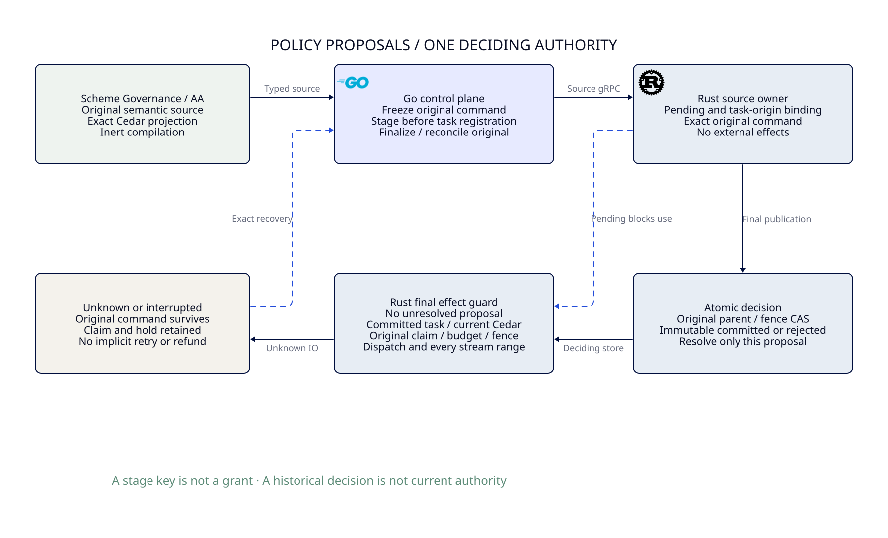

#+title: 59.49 Durable Policy Proposal Barrier and Final Execution
#+language: en

* Ownership and delivered boundary

Project.sysml and ControlActivation own this implementation. Scheme/Agentic AI
Lab evaluates Governance and projects exact Cedar/source assets before handoff.
Go freezes that source proposal, stages it over authenticated source gRPC and
requests its final CAS. Rust validates Cedar, persists pending and decisions,
owns original claims/holds, and rechecks pending at final dispatch and every
stream range/row release. There is no new Governance DSL or Policy evaluator.

#+caption: Source acknowledgment, durable decision and final-effect authority.
#+attr_html: :width 1400

This implements an administrative Policy proposal barrier in the existing
single-host SQLite deciding domain. It does not implement external hard-fact
capture, original higher-order Profile publication, general history projection,
multi-host consensus or an independent anti-rollback authority. The complete
thirteen-scenario Governance adapter acceptance remains 0/13.

* Protocol and linearization

| Operation | Durable action | Knowledge after reply loss |
|-----------+----------------+---------------------------|
| StageAuthority | Validate bounded typed Cedar input; BEGIN IMMEDIATE; bind ID, digest and full original proposal; insert pending unless exact decision already exists; commit | Unknown stage result; no automatic final CAS or ingress activation |
| PublishAuthority | Recheck original pending binding under BEGIN IMMEDIATE; decide original parent/fence CAS; record immutable committed/rejected outcome and remove only its pending row in the same transaction | Original decision may have committed; inspect by original ID/digest |
| InspectPublication | Read immutable original decision, if present | NotFound is not abort, and includes the pending/no-decision case |
| Exact stage replay | Return the same key for matching pending or matching historical decision; never recreate a decided pending row | Does not assert committed, current or eligible to send |
| Actual effect | Check no unresolved Policy proposal, current Policy/fence and original effect binding inside the existing deciding transaction | Partial/unknown effect keeps its original claim and reservation |

The staging effective point is its durable transaction commit. Validation or a
Go/Scheme intention before that point cannot claim that old effects are blocked.
Already admitted buffers can drain. A bounded native write holding the deciding
transaction finishes before staging can commit; later guards cannot pass pending.
No staging, registration, decision or inspection method invokes provider I/O.

Go Publish makes one staging RPC followed by at most one final CAS RPC. A failed
stage stops the sequence; a failed final call stops without automatic retry or
parent rebase. ObserveOrPublish first inspects the original outcome; a known
decision is recovered read-only. A missing outcome permits the same original
stage/final command, never a fresh logical identity. A stage key is not a grant.

Each pending row binds operation ID, original expected parent, fence and exact
Policy/schema bytes through the existing Publication commitment. The row also
retains the full original command. Changing any coordinate under the same ID
rejects. Two proposals may share a parent: the winner changes the active image;
the loser records its own rejection and removes only its own barrier. Other
pending work continues blocking effects even under the winner's current image.
Rejected administrative proposals do not change the active image. This does not
authorize rejecting a real external fact change and silently restoring old facts.

* Source and execution correspondence

| Existing owner | Concrete extension |
|----------------+--------------------|
| Scheme Governance/Policy projection | Reused unchanged; compilation remains inert and precedes staging |
| proto/gateway/v1/gateway.proto | Source-only StageAuthority returns PublicationKey; existing final receipt/lookup retain their meaning |
| Go gatewayclient | Stage exact proposal before new Publish; validate returned ID/digest; no staging for a known outcome |
| Rust SourceOwner | Existing bounded source lane executes Stage, tracks drain, checks SQL quiescence and stops on unknown storage errors |
| Rust ledger | authority_pending is part of the existing WAL store; decision and pending removal are one transaction |
| Generic dispatch | Guard refuses pending before admission, consumption and final callback |
| Message streaming | Shared authority read refuses pending before custody, range burn and final write |
| Provider execution | Request and live-release guards refuse pending, including callbacks after output-capacity waits |

The Schema change is additive, with no dependency pin or parallel database.
Recovery here means the same SQLite WAL, not an arbitrary older database image.
A snapshot rollback can lose pending rows together with deciding history; this
profile cannot detect that without the separately designed independent floor.
Final publication remains available to existing atomic callers; those callers
cannot claim the earlier staging effective point. Go's normal publishing path
uses staging. Direct native Policy/fence updates cannot clear pending rows.
No TTL, process restart, failed read or old worker deletes pending work. A valid
original proposal can resolve to its exact final decision; an unavailable store
fails closed. Durable history retention/compaction and operational recovery of
unavailable producers remain separate obligations, not implicit timeout refunds.

* Property and proof correspondence

The native proptest suite separates typed Stage/Decide/Restart commands from an
independent pending/decision model. Its expected outcomes do not come from SUT
return values. Every generated/shrunk trace begins with a valid pending proposal;
sixty-four cases exercise two logical proposals and suffixes of one to thirty-one
commands. Each prefix checks current custody eligibility and the original hold.
Deterministic tests additionally check already-consumed ranges, changed original
coordinates, storage-trigger failure and competing SQLite handles.

Existing PublicationRecovery.qnt owns the pending command set and atomic
decision/removal. AuthorityPublication.qnt composes it with the existing
ProviderRpc executor: pending joins actual read witnesses, blocks consumption
and final release, and cannot be cleared by a sibling decision. An explicit
unsafe guard-omission trace demonstrates that current revision alone is
insufficient while a proposal is pending. The independent floor model retains
its separate target deployment premises; a local pending row is not that floor.

PublicationRecovery.lean extends its existing State/Step/Run rather than adding
another publication engine. It proves that every original pending commitment
remains pending or has an exact corresponding immutable decision through any
finite run; staging blocks readiness; resolving one key preserves siblings;
existing original-decision and accounting preservation laws still compose.
Authentication, full command materialization, SQLite non-rollback recovery and
placing the pending check under every actual I/O guard remain native premises.
The proofs do not establish physical isolation, storage anti-rollback or SDK
exactly-once delivery.

* Failure evidence and validation

The initial ASP deny gate rejected the enlarged publication method with
RUST-AGENT-CFG-PUBLIC-016. A named transaction step now records the final decision
and removes its pending row; the deny gate and limits remain unchanged.
A sandboxed workspace run failed on denied loopback binds and was not accepted.
An authorized full workspace run subsequently passed. A concurrent-build
integration trial failed its existing three-second owner startup deadline;
an independent focused rerun passed without widening that deadline. This does
not establish the cause of the startup delay or erase that failed trial.

| Check | Result / scope |
|-------+----------------|
| Full Rust workspace | 99 passed, one deliberately ignored service helper; includes ASP deny, native properties, actual TCP/TLS and all ledger tests |
| Focused real Go/Rust source recovery | Passed with race detection: staging/final reply loss, control restart, two pending proposals, blocked old caller and partial output |
| Normal Go packages | go test -race ./... passed before documentation synchronization; final standard gate recorded on delivery |
| AuthorityPublication Quint | 33 authority scenarios passed, including four pending-barrier scenarios |
| PublicationRecovery Quint | 39 scenarios passed; stage is included in normal exploration |
| AuthorityPublication safety | 1,000 samples, sixty steps, seed 293; no violation, not exhaustive checking |
| PublicationRecovery Lean | File elaborated; intent-preservation theorem uses propext/Quot.sound, no admitted proof |

The ledger's existing Criterion owner also measures the actual stage-and-decide
path: thirty samples, one-second warmup and unchanged two-second measurement
target gave a mean of 843.40 microseconds with interval 766.53–933.19 microseconds.
Criterion estimated 3.109 seconds to collect its existing sample count and
reported four outliers; no sample count or time setting was relaxed. Fixture
construction is outside the measured routine. This is a local single-store
control-path microbenchmark, not a gRPC or full Governance latency bound.
The same existing ledger benchmark measured fresh admission at 342.61
microseconds (316.98–368.22) and consume/dispatch burn at 492.87 microseconds
(470.07–522.71). These are current-path measurements with the new pending check;
historical Criterion cache comparisons are not a controlled before/after study
and do not qualify a speedup or a universal regression bound.

Raw output is temporary. Keep the minimized framework counterexamples and
curated observations, with fixed latest structured receipts under ignored cache.
No code or proof result upgrades the complete external Governance adapter gate.
