# SPDX-FileCopyrightText: 2026 hardenedlinux Linux Team and Contributors
#
# SPDX-License-Identifier: LGPL-2.1-or-later AND Apache-2.0

#+TITLE: 59.50 Retained Parent Contracts, Delta Replay and Final Use
#+LANGUAGE: en
#+OPTIONS: toc:2

* Design allocation

The follow-up [[file:59.52-reviewed-publication-cas.org][publication binding audit]]
adds the actual LeanPoo evidence-binding adapter, review API hardening and
command-substitution recovery tests. Native Delta-artifact admission remains open.

[[file:../../../Project.sysml][Project]] retains the existing assurance owners.
[[file:../../../dev/sysml/WeaverExecution.sysml][CedarSecurityFrameworks]],
[[file:../../../dev/sysml/ControlActivation.sysml][GovernancePolicyProjection]] and
[[file:../../../dev/sysml/ProviderRpc.sysml][ReservedAuthorityAdmission]] define
the reviewed boundaries. SPEC owns the functional/POO frameworks; Gateway
consumes them. Lean and Quint retain their existing responsibilities.

#+NAME: fig:parent-contract-and-replay
#+CAPTION: Retain authoritative parent requirements and bind review to actual execution.
#+ATTR_ORG: :width 1400
#+ATTR_HTML: :width 100% :alt Retained POO parent, Policy review and final execution contract

* POO audit: actual reuse and a discovered weakening boundary

The source directly uses =LeanPoo.Object.Dataflow.define/extendWith= and inherited
field extension. =Functional.ObjectProfile= supplies executable Contract checks,
factory-indexed Session and exact projection laws. No new object system or
inheritance evaluator is introduced. Authorization's C4 policy owners and Delta
provenance remain the existing mechanisms.

Root-index preservation is weaker than retaining every extra parent condition.
The concrete generic fixture starts with =value <= 10=, extends an actual POO
object with =value <= 5=, then overrides the selected field with the root-only
profile. Both objects open under the root shape Contract. The raw selected
function allows eight while the approved parent rejects it. This is a successful
counterexample to the stronger claim, not a failure of root preservation.

The correction retains the independently required parent Session and selected
Session. =ProfileObject.composeSessions= reads both actual projections and returns
=Composed=. Its effective =requirement= is their conjunction. The source-read
and parent-preservation theorem uses the actual ObjectProfile Access law.
Gateway's =fromFrameworkObject= requires both Sessions; its composition theorem
retains both source reads, the required parent's condition, the generic framework
and the original published Gateway profile.

The raw root-only Session API still means root-only admission. It must not be
advertised as a universal ancestor-monotonicity check. Trusted publication must
bind the full required parent's source/Contract independently of the child.
Choosing a parent by name, accepting one proposed by the child, or omitting a
previously required parent remains unsafe. Recursive/multiple-parent composition
must retain all committed obligations; C4 precedence alone does not prove that
their authorization meanings are monotone.

For ongoing effects, the original index is =continuing proposal assessment=,
not the initial same-view =framework proposal=. The continuing-object theorem
reuses the same composed Sessions, fresh current-state check and CommittedPrefix
law. It preserves the original consumed root while accepting a legitimate newer
view; it never consumes the root once per row. Native old-plan recovery remains
conservative after an authority generation changes.

* CVC5 and real Rust Cedar replay

The solver is the official [[https://github.com/cvc5/cvc5/releases/tag/cvc5-1.4.2][CVC5 1.4.2 release]],
asset =cvc5-macOS-arm64-static.zip=. Its SHA-256 matches the official asset digest:
=24397f7d022e755876ca836193d4c5f9c1d4326f0f6c01f7d7fc1ddd6bc5096c=.
It was unpacked only into a temporary directory. Version and Mach-O arm64/loader
checks succeeded; its dynamic dependencies are the system libedit, libc++ and
libSystem. No host package or repository pin changed.

| Existing recipe backend | Solver and assertions | Official Rust Cedar replay |
|-------------------------+-----------------------+----------------------------|
| authorization-delta | Restriction has no expansion; added grant has a concrete gain | Two posture cases and two grant cases |
| authorization-delta-operational | Distinguish decision Allow from error-free execution Allow | Four cases, including diagnostic expectations |
| payment-delta | Finance-agent Policy evolution | Two cases |
| payment-interaction | C4 branch interaction and reviewed release controls | Four cases |
| Tests/Gateway/Delta.lean | Loss/gain/equivalence and stale model/source-scope refusal | Separate Gateway solver check; not another Rust replay count |

The fourteen replay cases are finite authorizer observations and may overlap
requests. The ordinary replay manifests do not carry the schema-bound receipt
format: their evidence is not a claim that fourteen schema-bound artifacts were
admitted. Solver reports are not Lean UNSAT certificates. Neither kind of report
proves native current-state authenticity or final publication admission.

The existing schema-bound payment producer and =replay-validated-receipts=
consumer were separately rebuilt/run and their existing manifest-relative
assertions passed for thirty-two receipts. This is a separate cohort from the
fourteen ordinary Delta replay cases, not a conversion of those cases into
schema-bound proofs. The first attempt lacked the producer catalog olean;
building its standard =Examples.ManifestCatalog= dependency resolved that
precondition without changing supervision or source semantics.

The first Rust replay attempt found an untracked empty =rust/gateway/src=
artifact in the isolated checkout; Cargo's existing =rust/*= member glob rejected
it. The artifact was moved intact to temporary retention, then the same recipe
backends succeeded. Workspace configuration was not modified. Failure output,
archive and receipts remain temporary, outside tracked documentation.

* Actual persistence to final callback

| Transition | Source-grounded fact | Limit |
|------------+----------------------+-------|
| Enqueue / consume | Canonical stream claim and reservation exist; consume commits the run from queued to unknown | A receipt does not establish external request delivery |
| Dispatch burn | A separate transaction commits dispatched once | The following transaction must still recheck current authority |
| Final request callback | Fresh guard and active original run are checked under the transaction enclosing the callback | The bounded network operation may still have an uncertain result |
| Prepare response range | Unknown range and frontier commit before a release handle is returned | The range has not necessarily been sent |
| Final response callback | Current Policy/profile/owner, range/digest/encoding and every row are checked; the deciding transaction encloses queue insertion | Queue insertion precedes the later release-completion marker |

The new Rust component test independently reads the durable canonical claim,
hold/reservation, consumed state, dispatch burn and unknown range inside the
actual release callback. A separate immediate SQLite writer is denied while
that callback owns the deciding transaction. Injected callback failure preserves
frontier/hold through reopen, and the old owner cannot dispatch again.
This is a local ledger/callback check; actual mTLS streaming, partial output,
enqueue-before-commit crash and publication-loss recovery remain separate real
Go/Rust integration scenarios.

=guard_live= rereads current authority and profile registration. Its
=require_resolved= dependency also excludes every unresolved Policy proposal in
the deciding transaction. This reuses the production
[[file:59.49-policy-proposal-barrier.org][single-store proposal barrier]], not a
new state machine. Revision/fence equality alone is insufficient while pending
identities remain. The enriched view includes pending operation-ID/digest pairs;
the continuing-use law requires the explicit native projection premise.

The
=BoundProviderPolicy= retains validated immutable original principal, route,
body/model/limits; it supplies fresh action/sequence/format coordinates on each
call. This is not an implemented reader for arbitrary mutable external entity,
budget or history facts. Such facts need authentic projection and an ordering
contract at use; neither an old immutable binding nor current Policy text proves
that broader freshness requirement.

* A remaining publication gap made executable

The current Rust =publish_authority= validates Policy/schema and serializes its
CAS/fence and durable outcome. Its command does not require a bound Delta/replay
review artifact. The new native counterexample compares actual Cedar denial and
Allow under the original task binding, then successfully publishes the widening
Policy through the authorized typed source API without Delta evidence.
The counterexample follows the existing durable stage-then-publish protocol;
it does not rely on omitting the new pending barrier. Pending protocol safety
and semantic Delta review admission are separate requirements.

This does not duplicate an original send or bypass the existing source credential.
It refutes the stronger assumption that typed source publication already enforces
reviewed no-gain evolution. SPEC's reviewed release and exact Delta laws remain
conditional. Mandatory review evidence bound to the exact active parent/profile,
source, schema, policy pair and final CAS is a target requirement; it is not
implemented in this no-production-change round.

* Host evidence ledger

| Host obligation | Evidence now available | Still missing |
|-----------------+------------------------+---------------|
| Required parent selection | Real POO inheritance/Contract/Session and retained-parent proof/counterexample | Independent publication binding of the exact required parent and all ancestors |
| Policy evolution review | CVC5, concrete witness checks and official Rust replay | Runtime admission of review evidence at authority publication CAS |
| Durable original consumption | Existing retry/restart/PBT plus callback observation of claim, reservation and burn | Full native-to-SPEC operation/authority-ledger refinement |
| Current final mediation | Actual SQLite exclusion through callback; real capacity-wait revocation tests | Every native IO mapped to the correct SPEC effect and deciding pre-state |
| Snapshot freshness | Native whole-database rollback counterexample retained | Deployed independent anti-rollback floor and authenticated recovery |
| Mutable external world | Generic observation/generation laws and opaque-cut schedules | Complete native fact/budget/history projection and reconciliation |

The prototype floor/transport-owner TCP tests are reference-contract evidence,
not a deployed independent authority. A passing expected rollback counterexample
does not mean rollback is prevented. Proof data remains duplicable; it is not a
native one-use sending capability. No physical-isolation claim is involved.

* Verification and comparison metric

The existing full SPEC aggregate includes the new parent counterexample and
composition laws. After preserving concurrent decoder-model additions,
ProviderRpc has 54 scenarios; the composed Gateway model has 66 including
imported overlaps. Existing invariant bounds stay at 1,000 samples,
sixty steps, seed 293. Native failure output is retained: a sandbox run could
not bind three loopback sockets, then the authorized unchanged workload passed.
No timeout or resource bound was widened. SysML trace presence is structural
coverage, not an implementation proof.

The final Rust provider subset passed nineteen tests, including PBT and the
explicit rollback/publication-gap counterexamples. The real Go race suite passed
slow-consumer, restored-policy restart, lost-publication-response and original
source-profile scenarios. Expected counterexample success is evidence of the
documented gap, not an accepted deployment security guarantee.

Weaver's advantage is explicit higher-order/POO requirement retention plus a
formal semantic-to-execution contract. This review exposes its remaining runtime
review-admission and anti-rollback gaps rather than claiming superiority over
Box or OpenShell. No common cross-product throughput, memory or compression
benefit was measured. Production Gateway code and dependency pins are unchanged;
CI is nonblocking.
