#+TITLE: 59.51 Zero Trust Architecture and Weaver Integration
#+LANGUAGE: en
#+OPTIONS: toc:2

* Decision and evidence status

The follow-up [[file:59.52-reviewed-publication-cas.org][reviewed publication CAS audit]]
restricts ordinary review-record splicing and adds exact LeanPoo evidence-binding
composition. Mandatory native review admission remains an implementation gap.

Zero Trust is Weaver's core security model. The previous seven-predicate effect
guard is a useful safety kernel, but does not constitute a complete architecture.
An unconstrained =currentAtUse= predicate leaves identity provenance, fact freshness,
control-plane authority and enforcement completeness to the consumer. This review
makes those obligations explicit instead of treating their names as evidence.

[[file:../../../Project.sysml][Project SysML]] and
[[file:../../../dev/sysml/WeaverExecution.sysml][CedarSecurityFrameworks]] remain
the responsibility authority. SPEC owns the generic functional/POO library;
Weaver owns application refinement and deployment. Existing Lean and Quint
owners are reused. The implementation follow-up below strengthens the actual
provider final-use boundary; dependency pins remain unchanged.

* Zero Trust authorization at actual use

The source-reviewed upstream contract is
[[https://github.com/hardenedlinux/cedar-poo-spec/pull/8][SPEC ZeroTrust and Gateway composition]]. The generic framework is the
authorization contract: authenticated, authorized, current at use, consumption
committed, unknown retained, not revoked and mediated. Cedar Allow is one
condition. Neither a Go proposal, Scheme receipt, proof object nor an SDK handle
is by itself permission to send.

The required parent is the authoritative original semantic contract, not a
caller-selected replacement and not necessarily the historical global Policy.
An authorized later Policy change may change permissions. It cannot rebind the
original task/profile, recreate a spent claim, discard pending history or refund
unknown exposure. Do not intersect every future decision with a birth Policy:
that would also incorrectly prohibit legitimate authorized changes.

| SPEC obligation | Concrete Weaver enforcement and remaining premise |
|-----------------+----------------------------------------------------|
| Authenticated | Existing distinct mTLS/credential-bound gRPC ingress and private Rust session custody; complete external identity lifecycle remains an adapter obligation |
| Authorized | Scheme supplies retained task/profile semantics through AA Governor; Rust validates those commitments and evaluates current Cedar against the exact route, request and row |
| Current at use / not revoked | Pending-publication barrier, current revision/fence and profile checks run after waits inside the final deciding transaction |
| Consumption committed | Original canonical task/node claim and consumed provider run precede dispatch; final use now requires that the persisted claim still has stream ownership |
| Unknown retained | Exact selected reservations and all retained request/message/provider exposure are checked against shared task held and the immutable original budget at admission and final use |
| Mediated | Rust alone invokes the private transport/queue callback while holding deciding write order; affine burns and unknown release ranges prevent replay after ambiguity |

Go manages cloud-native integration, configuration publication and routing
proposals over typed gRPC. It cannot turn a cached Allow into an execution
permit. Scheme retains the AA semantic/governance owner; it does not introduce
a second authorization DSL. Rust owns current Cedar assessment, durable claim
and exposure checks, and final execution. These checks do not add JSON to the
Scheme/Rust SDK conversion boundary.

** Durable claim and exposure refinement

=crates/ledger/src/execution_exposure.rs= is the sole shared conservation
projection. The provider =require_exposure= adapter and the request/message
owners join original execution-kind claims, exact selected reservations and
shared task accounting under the existing SQLite deciding writer. The held
amount must equal the sum of all retained request, stream-message and provider
reservations in the family, including queued and complete records: none of
these completion paths currently authorizes settlement/refund. The projected
budget must still equal the immutable task's original budget.
Checking only the current run's cost would allow two reservations of four to
survive with a shared held projection of four. SQLite SUM overflow or a failed
read denies use. The check runs before queued consumption and through =active=
at dispatch, range preparation, range release and completion. No new ledger,
permit type, scheduler or caller-supplied truth flag is introduced.

This is exact conservation over the three implemented reservation owners,
not a complete recovery-authority proof. It does not detect a coherent rollback of every correlated
record, establish external identity authority or implement an independent
anti-rollback anchor. An inconsistent recovery image is rejected, not repaired
from the request. A previously admitted physical write cannot be unsent.

The family reservation sum uses the existing family/node primary-key prefix.
Its cost grows with retained family runs; do not describe it as constant time.
The existing consume/dispatch benchmark measures this path. Any future
materialized aggregate must preserve the same atomic claim/reservation/hold
invariant and be validated before replacing this source-of-truth check.

** Proof and dependency boundary

=ProviderRpc.lean= supplies finite-list exposure obligations and rejection laws;
=ProviderRpc.qnt= supplies explicit bad recovery projections and the shared-hold
counterexample. Native Proptest drives real SQLite faults through dispatch,
range release and completion, with callback counts and restart checks.
=ZeroTrustEnrichment.lean= imports SPEC's real functional framework and uses
=withRequirement= to strengthen its continuing contract with this exposure
obligation. It cannot replace the original framework or consume a fresh root.
Native materialization of the claim and complete family reservation list under
the final transaction remains an explicit refinement premise, not a theorem
about Rust or SQLite supplied by the SPEC library.

The reviewed new models are in open PR #8 at commit
=9489ee91ac26562bd0e34275d5bd78165ed627f5=. Upstream main and Weaver's
existing runtime/proof pin remain =38af276ffbd17a378408bb7886e8122faadcbcfd=.
Thus current runtime enforcement and default standalone proof checks are
landable now; the new upstream Lean consumer remains isolated candidate
qualification until an explicit dependency promotion. Do not label this as a
default fixed-pin ZeroTrust import or complete deployment qualification.

** Provider refinement baseline receipt

The pre-fix native property failed with minimized input =fault = 0, phase = 0=:
deleting the original claim after consumption still admitted the callback. The
Proptest regression seed is retained in the crate's test corpus. The repaired
property covers missing/substituted claims, changed reservation and a lost
shared-hold projection through dispatch, range release and completion; none may
invoke the callback or make the run complete. Restart cannot reconsume the
original run. These are injected recovery inconsistencies, not a claim that
ordinary API transactions can independently lose one SQLite row.

- =cargo test -p weaver-ledger=: 22 library and 68 integration tests passed,
  including the 64-case native property and existing real socket tests. The
  first sandboxed run retained its three local-socket permission failures;
  the complete run with socket access passed without skipping those tests.
- Strict all-target Clippy and formatting passed without gate exceptions.
- =ProviderRpc.qnt=: 64 witnesses passed with seed 293; 1,000 sampled safety
  traces of 60 steps found no violation. Sampling is not exhaustive proof.
- Standalone =ProviderRpc.lean= checked with the existing Lean toolchain; no
  new axioms or =sorry= were added. The initial =Decidable= authoring failure
  in the concrete counterexample is retained separately from the repaired run.
- An isolated, clean checkout of the exact PR commit built
  =CedarPooSpec.Gateway.ZeroTrust= and =PublicationReview= successfully (381
  build jobs, not theorem count), with its declared LeanPoo commit
  =c684858fdbf3df2557b96868d02b451676ea9784=. The complete updated Weaver
  =ZeroTrustEnrichment= consumer passed, including the new exposure-strengthening
  law; its axioms are =propext=, =Classical.choice= and =Quot.sound=, with no
  =sorryAx=. The isolated copy of the fixed-pin bridge required six namespace
  replacements from =CompoundAuthorization= to =Authorization.Compound=;
  its initial unmigrated import failure remains recorded. This temporary
  migration changes neither the maintained fixed-pin bridge nor dependency
  pins. The unchanged default =WeaverPolicyBridge= also built successfully.
- Four race-enabled Go/Rust TLS/gRPC integration tests passed: slow-consumer
  revocation/restart/restored Policy, publication reply loss, partial request
  and restart, and source profile/Cedar final-send binding. This is focused
  integration coverage, not a fresh full =check-scheme= receipt.
- Existing Criterion =ledger/consume_and_dispatch_burn= completed with 30
  samples, one-second warmup and two-second requested measurement: estimate
  2.2871 ms, interval 1.0611--4.6244 ms. Concurrent proof/build work and the
  wide interval prohibit a performance improvement or regression claim.
- Go-owned SysML/project/source-currentness checks passed; the updated D2
  rendered and its raster preview was visually inspected.

Raw failing and passing transcripts remain in temporary storage. Only curated
evidence and the replayable property seed are committed.

** Cross-effect recovery and conservation follow-up

#+CAPTION: A data view shows the shared records and deciding join separately from the system overview.
#+ATTR_ORG: :width 1600

[[file:../../architecture/diagrams/39-shared-execution-exposure.d2][Editable data view]].

The previous provider-only check left the ordinary request and original stream
owners outside the refinement. Real SQLite properties reproduced consumption
and custody with missing claims. The request startup schema also rebuilt claims
from operations, so opening an incomplete image could silently issue a new
request-kind claim. The shared implementation now checks every retained row's
kind and exact conservation across all three reservation owners.

Let =R= be the sum of =operations.reserved=, =stream_messages.reserved= and
=provider_runs.reserved= for the original family. Admission and actual use
require =held = R=, =held <= originalBudget= and
=projectedBudget = originalBudget=. Every retained row must join the same
family/node execution claim with its original kind. The selected effect also
requires its stored reservation to equal its immutable proposal cost. The
source audit found exactly three writes increasing =tasks.held=, each atomic
with its corresponding reservation insertion; no implemented completion or
usage observation decrements that field. Adding a new reservation owner or
settlement path must extend this projection and its proofs before deployment.

A lower bound alone would miss orphaned holds after message/outcome projection
loss. Exact equality denies that image rather than treating its old hold as
capacity for a replacement logical message. Fresh request admission also
refuses an existing claim without its original operation. Startup performs no
claim backfill. New stream messages cannot recreate a missing node claim while
retained earlier messages exist. Read-only outcomes remain available for
diagnosis, but they carry no repair or send capability.

The projection executes under the existing deciding writer, before any fresh
hold and at request consumption/dispatch, stream custody/connect/resume/range
consumption/write, and provider consumption/final use. It shares no new ledger
or scheduler with Go. Go remains the cloud/protocol integration owner and
Scheme remains the source semantic owner. Neither can publish a new caller
flag that bypasses the Rust invariant.

=SharedExecutionExposure= in the existing Lean owner covers arbitrary finite
lists from each reservation domain, exact conservation and the original budget.
The SPEC continuing-contract consumer strengthens its existing requirement
with both per-effect and shared exposure. Quint supplies bad-projection and
separate-domain counterexamples; these pure guard checks are not a temporal
model of SQLite corruption. Native Proptest injects the concrete faults around
consumption, custody, writes, restart and new admission. Authentic complete
projection under the deciding writer remains the native refinement premise.
Coherent correlated rollback, cryptographic source authority and independent
anti-rollback recovery remain outside this single-host proof boundary.

The follow-up qualification receipts are separate from the provider baseline:

- Pre-fix native properties failed for both request and stream with minimized
  =fault = 0, phase = 0=. Their regression seeds remain in the test corpus.
  The first test-authoring =FromSql= and assertion-format compile failures are
  retained separately; they are not counted as behavioral counterexamples.
- The final exact-conservation implementation passed 22 ledger library tests,
  75 ledger integration tests and 14 actual executor tests. The new module
  contains three 64-case Proptest properties and four deterministic recovery
  regressions, covering missing/substituted claims, wrong selected reservation,
  shared-hold deficit/surplus, changed original-budget projection, lost message
  rows and mixed request/message exposure. Original callbacks remain uncalled
  on refusal. Outcome observation and the corrupted image are not repaired.
- Four race-enabled Go/Rust TLS/gRPC tests passed again after the equality
  change: complete streams sharing budget with SDK retry rejection, publication
  reply loss, partial request/restart and original profile/Cedar final binding.
  This does not add a Go bypass around the Rust deciding owner.
- Strict all-target Clippy passed. The Go benchmark-owner tests passed with
  the three new required Criterion case identities.
- Go-owned SysML/project and source-currentness checks passed after correcting
  the new witness regex, which initially interpreted =pub(crate)= as a regex
  group. The D2 rendered and its raster preview was visually inspected.
- Standalone Lean checked exact conservation over arbitrary finite domain
  lists. The updated SPEC consumer checked against the same isolated upstream
  commit and retained namespace-only bridge migration. Native complete-image
  materialization remains a premise; no new axiom or =sorry= was introduced.
- Quint passed 70 witnesses with seed 293, including separate-domain and
  orphaned-hold counterexamples and refusal of negative integer reservations.
  The prior 1,000 sampled temporal traces remain focused model evidence;
  these new projection tests do not model filesystem corruption transitions.
- The three focused Criterion cases completed with 30 samples, one-second
  warmup and two-second requested measurement. Estimates for 1/8/64 retained
  provider runs were 2.1090/4.0437/3.6069 ms; intervals were
  1.3972--3.3094 / 2.3574--6.0696 / 2.8057--4.6224 ms. Criterion estimated
  7.8512 seconds to collect the 64-run case including untimed setup; the target
  settings were unchanged. Concurrent build/test work, outliers and wide
  intervals prohibit a scaling, improvement or regression claim. This is not
  the complete workspace benchmark matrix or a transport throughput result.

The earlier full =check-scheme= failures remain open historical evidence; this
follow-up does not replace them with focused Rust/Go/model passes. No dependency
pin, timeout, CPU limit or production recovery-authority profile was changed.

#+NAME: fig:zero-trust-architecture
#+CAPTION: Identity, governance and enforcement form a continuous resource protection loop.
#+ATTR_ORG: :width 1600
#+ATTR_HTML: :width 100% :alt Weaver Zero Trust decision administration and enforcement architecture

* Research and public implementation alignment

| Primary source | Architectural lesson | Weaver interpretation and limitation |
|----------------+----------------------+--------------------------------------|
| [[https://doi.org/10.6028/NIST.SP.800-207][NIST SP 800-207]], sections 2.1, 3 and 5 | Resource protection, dynamic assessment, PE/PA/PEP roles and threats to their dependencies | Define authority and deployment boundaries; no claim of deployed NIST conformance |
| [[https://doi.org/10.6028/NIST.SP.800-207A][NIST SP 800-207A]], sections 4.6 and 4.7 | Identity-tier application controls complement network controls and monitoring | Go integrates cloud identity; Rust binds identities to concrete operations; cluster membership grants no application rights |
| [[https://doi.org/10.1145/984334.984339][Park and Sandhu, UCONABC]] and [[https://profsandhu.com/journals/tissec/p351-zhang.pdf][Zhang et al., formal UCON model]] | Authorizations, obligation actions, conditions, continuity and attribute mutation | SPEC UsageControl adds a safety adapter over existing application transitions; the entire temporal rule system is not translated |
| [[https://github.com/spiffe/spiffe/blob/main/standards/SPIFFE_Workload_API.md][SPIFFE Workload API]], sections 4.1--4.6 | Caller identification, full update streams, redaction and trust-domain bundle selection | Identity material has authority and update semantics; a successful gRPC reconnect does not preserve redacted credentials or refresh application grants |
| [[https://github.com/spiffe/spire/blob/main/doc/plugin_agent_workloadattestor_k8s.md][SPIRE Kubernetes workload attestor]] | Concrete workload selectors have a compromised-node boundary | Shared service account is insufficient for incarnation/custody; node root compromise is outside this attestor's protection |
| [[https://github.com/openziti/ziti][OpenZiti public architecture]] | Cryptographic identity, service-specific connectivity and encrypted communication | Useful network protection pattern; it does not establish Weaver's canonical claim, token budget or semantic history invariants |

These sources have different evidentiary roles: architecture guidance, a research
formalization, interface specifications and implementation documentation. No
GitHub README is admitted as a proof dependency. No SPIRE or OpenZiti dependency
is introduced. Their inspected interfaces guide adapter requirements.

* Seven-tenet coverage review

The following is our design mapping to NIST's seven tenets. Each row needs a
concrete deployment argument in addition to a functional requirement.

| Tenet | Required Weaver design | Current evidence and remaining work |
|-------+------------------------+-------------------------------------|
| Treat services and data as resources | Identify model invocation, tool effect, prompt/response data, Policy publication and telemetry export independently | Existing task/route/profile binding; complete resource inventory and data classification remain open |
| Protect communication regardless of location | Authenticate peers and protect confidentiality/integrity across ingress, Go/Rust RPC, FFI memory ownership and provider egress | Focused credential/source tests exist; end-to-end certificate rotation, trust-bundle removal and egress coverage still need qualification |
| Grant access per session/resource | Bind principal, actor, delegation, original task/family, operation, route and intended effect | Existing canonical consumption and reservations; transport session is not the logical claim and reconnect creates no authority |
| Decide dynamically using attributes and Policy | Join current Policy/schema/profile, identity/posture facts, budget and history cuts | Local Policy/fence checks exist; complete externally sourced fact closure and mandatory review artifact admission remain open |
| Monitor resource integrity/security posture | Receive provenance-bound posture with explicit validity and revocation | No generic production posture authority is qualified; cached Allow and unavailable monitoring cannot imply healthy |
| Authenticate and authorize dynamically before access | Recheck at actual effect admission and after waits; revoke future admissions | Real slow-consumer/restart tests cover local enforcement; all outbound paths and independent rollback resistance remain open |
| Collect and use security observations | Local protected decisions/outcomes feed governed analysis and future Policy changes | Telemetry is an observation input, not authority; privacy, retention, exporter Policy and durable audit failure behavior require acceptance |

This table is a coverage ledger, not a seven-out-of-seven implementation score.

* Typed protection context and authority

A subject consists of end-user/tenant identity, workload identity, actor
incarnation and delegation chain. A resource consists of canonical resource
identity, operation/right, semantic contract and data classification. A context
contains independently authoritative identity, resource, Policy, posture, budget,
history and owner cuts. Authority is established per source and trust domain;
caller-supplied attributes and Kubernetes labels are claims until validated.

The application adapter must supply the following meanings to the generic API:

| Interpretation | Required binding |
|----------------+------------------|
| =authenticated= | Validated peer and actor, trust domain, credential audience/expiry, delegation and incarnation/custody binding |
| =authorized= | Actual Cedar request/entities/schema, original profile plus retained authoritative parents, rights and current conditions |
| =currentAtUse= | The deciding source cut is joined at final use; no unresolved relevant pending change; no stale owner/floor; valid freshness evidence |
| =consumptionCommitted= | Durable original canonical consumption, not just a nonce cache or a replacement Authority |
| =unknownRetained= | Original claim, reservation and uncertain ranges survive failure and recovery |
| =revoked= | Authoritative Policy, identity, delegation, resource or posture revocation ordered against admission |
| =mediated= | The owning executor controls every relevant effect path, including retry, redirect, fallback and tool dispatch |

A digest authenticates no producer by itself. Each evidence artifact needs its
subject, source authority, source cut, schema/meaning, validity, producer identity
and reference binding. Missing evidence is unresolved, not an empty successful
result. Freshness requires an authority protocol: if source changes cannot be
ordered against admission, an expiry only bounds exposure and does not prove
instantaneous revocation. Disconnection then blocks new sensitive admissions or
uses an explicitly weaker, separately approved contract. No silently stale mode.

* Decision, administration and enforcement

PE, PA and PEP are logical responsibilities; none corresponds to an entire
language or assumes a separate daemon.

| Owner | Concrete responsibility | Cannot confer |
|-------+-------------------------+---------------|
| Scheme / AA Session, Workflow, Governor | Higher-order governance composition, task semantics, JSON-schema validated configuration, evidence requirements and receipt-driven progression | A closure or generated profile cannot mint final send rights or replace its captured source cut |
| SPEC Authorization / Delta | Cedar composition, exact policy-world comparison and conditional no-gain/replay laws | Same-world no-gain does not prove mutable-fact or trajectory safety |
| Rust authority / PE responsibility | Reconstruct the concrete Cedar assessment, bind reviewed source/schema/profile evidence and current parent, resolve publication CAS | A staged proposal or historical publication result cannot authorize current use |
| Go cloud integration / PA orchestration | Kubernetes/workload identity integration, lifecycle, protocol ingress, gRPC control, activation/revocation coordination | Informer readiness, RPC success or authenticated channel cannot skip Rust's deciding checks |
| Rust broker / PEP responsibility | Durable consumption, reservations, dispatch burn, current checks and final queue/transport admission | A queue credit, SDK retry, Arrow batch or copied proof cannot create another send capability |
| Fact authorities and local telemetry | Publish authenticated observations; preserve audit outcomes and governed feedback | Monitoring scores and raw LLM/tool output cannot directly mutate authoritative Policy |

Go's value is its cloud-native controllers, protocol libraries, operational
integration and network tooling. Rust owns bounded memory-sensitive execution
and final capability custody. Scheme supplies programmable semantic governance,
not merely a configuration DSL. SPEC provides shared formal meanings rather
than embedding Weaver runtime types into the ZeroTrust core.

* Admission, ongoing use and closure

1. Establish the subject and resource; bind the original task/profile, canonical
   family, budget/history domains and independent parent authority.
2. Capture governed facts and witnessed pre-use obligations. Scheme closures
   expose their captured source cut; Rust owns immutable FFI projections. An
   obligation promise is not evidence that its action occurred.
3. Review the exact parent/candidate/schema/source pair. Bind Delta and replay
   artifacts through the existing LeanPoo Contract/evidence facilities. The final
   publication CAS checks the same parent, expected revision/fence, evidence and
   pending decision. Commit phase performs no external provider send.
4. Rust admits the original operation and persists consumption/reservation. The
   final owner rechecks current source cuts after every wait, burns dispatch
   before invocation and persists unknown range exposure before row release.
5. Each new effect satisfies ongoing authorization, current conditions,
   witnessed obligations and permitted attribute updates. gRPC and optional
   Arrow use the same row/range authority. Partial write or lost completion
   retains uncertainty; it cannot select a fallback provider under a new nonce.
6. Revocation blocks admissions after its authoritative ordering point. Already
   admitted bytes can drain. The deployment must distinguish queue insertion,
   actual write, peer receipt and business completion; no retroactive recall.
7. Reconcile exact historical outcomes after restart. A committed old outcome is
   queryable but not current authority. Preserve original claim/holds and pending
   intent; independently recover the floor before admitting more work.
8. Session advances only on the required bound receipt. Settlement requires
   terminal evidence and exactly-once account application, with unresolved
   exposure still held. Post-use accounting is our application contract, not a
   theorem of eventual obligation fulfillment imported from UCON.

* POO integration and verification allocation

=ProfileObject= already uses actual LeanPoo Dataflow inheritance, Contract and
factory-indexed Session. Retain independently authoritative parent and selected
Session projections through =composeSessions=. A root refinement proof alone
does not retain an extra ancestor requirement. See
[[file:59.50-parent-contract-and-replay.org][the concrete raw override counterexample]].

SPEC's new =ZeroTrust.UsageControl= composes the existing Framework with initial
and ongoing authorizations, environmental conditions, witnessed transition
obligations and mutation relations. =resume= records only the application's
recovery relation; =close= requires terminal and accounted. Its step theorem
still requires core consumption and unknown retention. This is a functional
safety adapter, not a second ledger/scheduler or a full UCON temporal calculus.

| Evidence owner | Checked artifact or acceptance obligation | Status |
|----------------+-------------------------------------------+--------|
| SPEC Lean | UsageControl laws and non-Gateway counterexamples: Allow without posture, promised obligation, consumption reset, recovery as authorization, terminal with unknown accounting | Checked locally in this round |
| Existing ProviderRpc Quint | Changed hard-fact cut during queue wait / between prepare and release; restart cannot refresh it; Allow-only bypass counterexample | Executable abstract witnesses; concrete fact-source refinement remains open |
| Existing Go/Rust integration | Pending proposals, old-parent rejection, lost staging/publication replies, local restart, slow consumer, unknown tail | Existing real fixtures reused; current-run receipt recorded below |
| Weaver adapter | Identity rotation/bundle removal during active stream; delegated actor mismatch; disconnected posture; forwarded enrollment credential | Required new real acceptance; not demonstrated by Policy-only fixtures |
| Publication adapter | Exact authoritative POO parent plus Delta/replay evidence bound at final CAS | Production gap; existing typed-publication counterexample shows review can be omitted |
| Recovery/transport deployment | Independent anti-rollback floor and exclusive live transport custody | Production gap; SQLite restart is insufficient evidence against snapshot rollback |

Lean owns functional preservation and conditional composition. Quint owns
interleaving counterexamples over existing transitions. SysML owns allocation.
Go/Rust tests own concrete adapter and process behavior. These responsibilities
are stated once here by reference to SysML; passing one tier cannot replace
another tier's evidence.

* Comparative metric and completion gates

The comparison metric is evidence coverage, not invented performance or
compression improvement. Weaver has reusable conditional proofs and real local
Policy/stream recovery fixtures, while its external fact, independent floor and
mandatory Delta publication paths remain incomplete. Box and OpenShell retain
their separately reviewed request/sandbox strengths in
[[file:59.29-strands-box-cross-review.org][the source-grounded comparison]]. This
round supplies no new Box/OpenShell execution or common benchmark. Network
identity lessons from OpenZiti/SPIRE complement, rather than establish, our
semantic claim/budget/history properties.

Before claiming full Weaver integration, require separate receipts for identity
lifecycle, complete fact projection/freshness, exact review-evidence CAS,
anti-rollback recovery, complete outbound mediation and receipt-driven closure.
The advantage is the intended composability of semantic governance, Cedar and
execution evidence. The cost is the adapter/refinement work needed to make that
composition real. Architecture coverage is not measured security superiority.

* Earlier architecture verification receipt

Local checks on the reviewed candidate sources:

- SPEC =lake build CedarPooSpec Tests=: passed, 590 build jobs. New usage laws
  print no new axioms or =sorry=; the full Cedar dependency still contains its
  existing native-decision axioms. Job count is not a theorem count.
- SPEC =check-lean-layers=: passed for 329 local modules, including the generic
  core's transitive Gateway import exclusion.
- Weaver candidate =ZeroTrustEnrichment=: checked against the isolated SPEC
  candidate. Only the temporary bridge's prior namespace is migrated; the normal
  fixed-pin bridge and dependency files are unchanged.
- Existing =ProviderRpc.qnt=: 58 executable witnesses passed, including expected
  unsafe counterexamples; the safe step relation also passed 1,000 sampled runs
  of 60 steps with seed 293. Sampling is not exhaustive verification.
- Go =-race -tags=integration=: ten existing real Go/Rust tests passed, covering
  slow consumers, cancellation/reconnect, pending proposals, lost staging and
  publication replies, old parents, local restart and profile-bound sends.
  These do not exercise external identity/posture sources or mandatory Delta CAS.
- The OpenSysML SDK project/trace checks passed. Named trace coverage is structural,
  not a behavioral refinement proof. Both D2 figures render; SVG is embedded above.

Raw logs and generated receipts remain in temporary storage. CI does not gate
this architecture iteration. Dependency pins remain unchanged.

* Recovery review: balanced reservation projections

A matching aggregate is insufficient when a recovered row has lost part of its
original reservation. Reducing an unknown request reservation and =tasks.held=
together preserves the sum but can admit a different logical node using unknown
exposure. The deciding transaction must compare every retained request, stream
message and provider reservation against its retained original ceiling before
admitting another effect. This extends the existing shared-exposure guard; it
introduces no new ledger or refund path.

The regression =balanced_projection_cannot_shrink_another_original_reservation=
restarts after such a balanced projection fault and requires rejection without
creating the next operation or repairing the damaged hold. The original retained
proposal/plan remains a trusted recovery premise. Correlated replacement of that
record still requires an independent recovery authority. The RuntimeAdmission Quint model retains original amounts independently,
exhibits the aggregate-only bypass, and rejects admission after damaged recovery.
Lean proves pointwise binding preserves the total for arbitrary finite lists and
composes it with admission capacity. Authentic original records, complete row
coverage, and real transactional checks remain native refinement premises.
