# SPDX-FileCopyrightText: 2026 hardenedlinux Linux Team and Contributors
#
# SPDX-License-Identifier: LGPL-2.1-or-later AND Apache-2.0

#+TITLE: 59.52 Authoritative Parent, Delta Evidence and Final Publication CAS
#+LANGUAGE: en
#+OPTIONS: toc:2

* Allocation and decision

Implementation follow-up: [[file:59.55-evidence-reviewed-publication.org][native local
review admission]] now supplies the ledger latch, immutable registration and
actual Policy/schema parent join. Its trusted-host API does not qualify the
independent authority, semantic producer or public RPC path described below.

The [[file:59.53-artifact-registry-recovery.org][registration recovery audit]] separates
the independent registration commitment from a rollback-prone projection. Its
stronger final-use contract also requires recovered registry evidence and a
current registrar incarnation; the native source-role boundary is tested explicitly.

[[file:../../../Project.sysml][Project]] and
[[file:../../../dev/sysml/ControlActivation.sysml][GovernancePolicyProjection]]
own this contract. SPEC's generic ZeroTrust framework remains independent of
Gateway. =Gateway.PublicationReview= is its application adapter; it reuses actual
LeanPoo =Contract.bindEvidence= and =Invocation=. Weaver reuses its existing
=PublicationRecovery= proof/model owner. No new publication ledger is introduced.

#+NAME: fig:reviewed-publication-cas
#+CAPTION: Bind approved review to the independent authority and retain uncertain outcomes.
#+ATTR_ORG: :width 1600
#+ATTR_HTML: :width 100% :alt Authoritative parent review binding final CAS and recovery

* Source defect and API correction

Previously, public =ReviewedInteraction= record construction/update admitted
=captured.snapshot= together with =unrelated.analysis=. The current-source check
validated the snapshot, while the no-gain branch read the independently supplied
analysis. Therefore snapshot currentness alone did not establish that its analysis
belonged to it. A pre-change Lean elaboration accepted this exact splice.

The constructor is now private; =analyzeAndCapture= is the supported producer.
Public field reads remain available. Negative elaboration tests reject direct
construction and update, and the existing real solver-based interaction example
continues to use the producer. This prevents ordinary public-API splicing. Lean
private names are not a security sandbox against hostile metaprograms, FFI or
forged serialized messages. Producer authentication and native artifact admission
remain mandatory. This correction does not certify solver UNSAT or convert a
report into an affine capability.

* Exact commitment envelope

| Binding | Required meaning |
|---------+------------------|
| Original command | Publication ID, expected parent revision, requested fence, exact Policy/schema and semantic profile/domain commitments |
| Independent parent | Authority-selected complete source/Contract commitment and retained required parent Sessions; never a parent supplied solely by the child |
| Approved artifact | Exact analyzed parent/candidate pair, source ancestry/edits, schema/world, Delta query/outcome and applicable schema-bound replay manifest/receipts |
| Deciding cut | Current publication/owner generation, relevant fact/history/budget cuts and unresolved pending decisions |
| Original constraints | Canonical claim, existing consumption, reservation and history identity; no new nonce, actor or publication may reset them |

An artifact identifier must resolve to immutable authenticated content with
unambiguous serialization. Hash collision resistance, signer identity, artifact
retention and authority selection are Host premises. A digest, root name or a
matching JSON label alone is insufficient. The current production command has
no Delta artifact field or complete POO parent commitment; its byte-binding tests
therefore cover only a strict subset of this target envelope.

* Functional final-CAS adapter

=PublicationReview.Host= supplies independently authoritative =parentAt=,
=approvedEvidenceAt= and =cutAt= readers, a concrete result projection, generic
ZeroTrust security requirements, command-specific pending admission and the commit relation.
=Host.contract= invokes existing LeanPoo =bindEvidence= with references read from
the actual deciding view. It preserves the original input/output/rule checks.

=Final= requires all of the following for the same actual pre-state:

1. The actual invocation returns a result whose command, parent, artifact and
   cut match those independently selected references. The approved-artifact
   lookup is optional; =Final.approved= requires an actual registry entry, so
   absence cannot be encoded as a default successful artifact.
2. Generic ZeroTrust =required= holds, including =currentAtUse=, authorization,
   original committed consumption, unknown retention, non-revocation and mediation.
3. The original command satisfies =pendingAdmissible=. It may resolve its own
   staged intent while administrative siblings remain pending. Unjoined external
   fact dependencies or a mismatched original intent still block it. Requiring
   global pending emptiness here would deadlock staged publications. The provider
   effect's separate global pending barrier remains in force until all relevant
   proposals are resolved.
4. The Host commit relation applies to that invocation's exact returned state.

=final_preserves_original_and_binding= uses the actual LeanPoo accepted-binding
law. Mismatch, stale currentness and unqualified pending dependencies exclude =Final=. The fixtures
include a positive exact invocation, evidence replacement, old parent, changed
cut, unresolved pending and reset-consumption refusal. These are typed reference
and conditional effect guards, not a proof of database isolation.

The existing Weaver enrichment relates =Final.committed= to the existing
=PublicationRecovery.Step=. Its composition theorem preserves immutable original
decisions, pending-intent ownership, held budget and call count at the invocation's
exact post-state. The explicit =refinement= premise remains unproved for native
code. A Host relation that permits arbitrary post-states is not a qualified CAS.

* Durable protocol and recovery

| Phase / event | Required decision and recovery behavior |
|---------------+-----------------------------------------|
| Stage original command | Persist exact command binding and a pending barrier; acknowledgment is not publication or send permission |
| Register review | Bind one immutable approved artifact to the original command; repeated exact registration is observational/idempotent |
| Registration loses reply | Query/retry the exact original registration; keep pending; absence is not abort or permission to replace evidence |
| Final CAS | Recheck command, independent current parent, approved artifact, cut/fence and continuous-authorization guards under the actual authority transaction |
| Stale parent / invalid review | Record an immutable rejection for that original command; do not rebase it; clear only its own administrative pending row |
| Concurrent sibling | Its pending intent remains, so effects stay blocked until independently resolved |
| Commit loses reply | Read the original immutable outcome; do not republish under another ID or replay external effects |
| Restart | Recover original outcome, review registration, pending intents and consumption before activation; a historical success is not current authority |
| Cross-store rollback | A missing/mismatched review registry cannot be reconstructed from a success label; repair the exact authority prefix or remain blocked |

Review staging/registration need not be a distributed atomic transaction if the
intermediate state blocks publication/effects and both durable outcomes can be
reconciled exactly. Their final join must be atomic at the authority that decides
publication. A read-before-CAS check is insufficient. If external facts are not
co-transactional, use the previously specified source custody/floor protocol;
neither a local lease nor a cached evidence pointer supplies this ordering.

Replacing a rejected command with a new ID is a newly governed proposal requiring
fresh authority review. It cannot erase the old outcome, original claim, holds or
history. Delta no-gain remains a same-world statement; changed facts require
fresh assessment and current-at-use enforcement even after publication.

* Publication and final send are distinct boundaries

Scheme captures semantic contracts through AA Session/Workflow/Governor and
preserves captured source cuts. It supplies evidence requirements, not final
publication or transport authority. Go handles cloud identity and control RPC,
stages the original command and reconciles exact outcomes; it cannot activate
from a stage key, timeout, NotFound or historical result alone. Rust owns the
authoritative publication transaction and final execution custody.

The pure preparation/commit phase sends no provider traffic. A successful review
or publication does not replace Rust's fresh dispatch/range admission. After
capacity waits, cancellation, owner change or fact/Policy publication, Rust still
checks the current deciding state. Already admitted buffers may drain; uncertain
partial writes retain original claims/ranges/holds. Session progresses only on
the required bound receipt, not on administrative staging or review completion.

* Evidence and remaining gates

| Layer | Evidence / limitation |
|-------+-----------------------|
| SPEC public API | Pre-change splice elaborates; corrected negative elaboration tests reject it. Read-only review use and existing solver example are retained |
| SPEC Lean | Bound original rule, command/parent/artifact/cut; stale/pending/reset-consumption refusal; no new axioms or =sorry= in these proofs |
| Existing Weaver Lean | Final post-state composes with existing outcome/intent/accounting preservation; native refinement remains an explicit premise |
| Existing Quint recovery owner | Exact registration, evidence replacement, old parent, fence change, lost replies, restart, sibling pending, historical observation and cross-store rollback counterexample |
| Real Go/Rust recovery | New test calls staging and the final Rust endpoint directly with replaced parent/fence/Policy/schema, then restarts and reconciles original committed/rejected results |
| Existing lost-reply tests | Actual control proxy drops staging/publication replies after durable work; original pending and activation restrictions survive recovery |
| Unimplemented production target | Mandatory full review envelope, authenticated artifact registry and complete independent POO parent binding at native final publication CAS |

Expected unsafe counterexamples are included in passing model test counts. They
demonstrate missing guards, not prevention by deployed Weaver. The review-specific
step relation excludes the retained unreviewed native path; its sampling result
cannot qualify that native path. Ordinary local restart is not anti-rollback
qualification. Dependency pins and production code remain unchanged.

This round makes no new throughput/compression measurement or Box/OpenShell
execution claim. The measurable engineering gain is explicit artifact/authority
binding plus executable refusal/recovery coverage. The remaining cost is the
native review-registry/CAS adapter and independent recovery evidence.

* Local validation receipt

- =lake build CedarPooSpec Tests= passed, 593 build jobs; job count is not a
  theorem count. The new binding theorems introduce no axioms or =sorry=.
  Existing Cedar native-decision assumptions remain visible in the full build.
- =check-lean-layers= passed for 331 local modules, retaining the generic
  ZeroTrust core's transitive exclusion of Gateway imports.
- The isolated candidate Weaver enrichment and existing publication recovery
  Lean owner compiled. The tracked fixed-pin bridge was not migrated; only its
  temporary candidate copy uses the updated Authorization namespace.
- The existing CVC5 payment-interaction entrypoint passed its four Rust Cedar
  replay cases after constructor restriction. These ordinary replay receipts
  are distinct from the separately qualified schema-bound receipt cohort.
- PublicationRecovery passed 58 executable witnesses. Its review-specific
  relation passed 1,000 sampled runs of 60 steps, seed 293, including source-cut
  and recovery-epoch changes. GatewayComposition passed its 70 executable
  witnesses. Imported checks overlap; the counts are not additive independent
  proofs. Sampling is not exhaustive verification. Unsafe counterexamples count
  as expected test successes, not native prevention evidence.
- Five real =-race= Go/Rust recovery tests passed, including the new direct
  final-endpoint substitution fixture and both existing lost-reply control tests.
  Existing 12-second fixture contexts and natural cleanup limits were retained.
- OpenSysML project/trace checks passed; named trace coverage is structural.
  The D2/SVG renders and its visual layout was inspected; SVG is embedded above.

Failure diagnostics and raw receipts remain under temporary storage, including
the pre-change accepted splice. CI is not awaited. No production Rust/Go code or
dependency pin is changed by this round.
