#+TITLE: 59.53 Delta Artifact Registration and Authoritative Recovery
#+LANGUAGE: en
#+OPTIONS: toc:2

* Allocation and evidence status

The subsequent [[file:59.55-native-reviewed-publication.org][native local adapter]]
implements the existing ledger's review latch, full artifact persistence and
actual-parent final-CAS guard. The statements below describe this audit's earlier
evidence boundary. Independent anchor recovery, authenticated registrar custody
and mandatory reviewed RPC admission remain unimplemented production targets.

[[file:../../../Project.sysml][Project]] and
[[file:../../../dev/sysml/ControlActivation.sysml][GovernancePolicyProjection]]
own this refinement of [[file:59.52-reviewed-publication-cas.org][reviewed publication CAS]].
Reuse the existing independent commit authority and PublicationRecovery owners;
do not add a separate registry consensus engine. The generic SPEC ZeroTrust
framework remains independent of Gateway. Its application adapter reuses actual
LeanPoo evidence-bound Contract/Invocation checks.

#+NAME: fig:artifact-registry-recovery
#+CAPTION: Authoritative registration survives reply loss; local projections and old workers confer no authority.
#+ATTR_ORG: :width 1600
#+ATTR_HTML: :width 100% :alt Artifact authority registration projection recovery and final publication

This round changes formal libraries, tests and architecture assets only. Production
has neither a Delta-artifact registry RPC nor mandatory artifact admission at
publication. Native source-incarnation fencing is also unqualified. The executed
source-admission tests below are a subset, not a substitute implementation.

* Corrected authority assumption

The previous model treated =reviews= as a durable authoritative mapping and used
ordinary restart as an identity transition. It did not separately represent the
registration commitment and a rollback-prone materialization. Consequently its
rollback counterexample exposed lost local evidence without specifying repair.

The existing independent floor now owns a full registration log in the Quint
model; local =reviews= and =reviewProjection= are materializations. Registration
entries retain exact command/artifact references, original source cut, issuer
incarnation/term and log position. These are abstract typed commitments, not a
proof of hashing, artifact serialization, cryptography or actual file durability.

The corresponding existing Lean State has =reviewAnchor= and =reviewProjection=,
plus registrar owner/epoch and a review source cut. Its existing Step/Run relation
is extended with registration, projection restoration/repair and registrar handoff.
There is no second publication/account ledger or scheduler.

* Protocol and linearization

| Operation | Authoritative effect and response meaning |
|-----------+-------------------------------------------|
| Stage command | Persist the original command binding and its pending barrier; no review or publication is inferred |
| Register approved artifact | Append one immutable exact registration at the independent commit authority; current authenticated registrar, original pending command, parent and source cut are required |
| Exact registration retry | Return the original registration without appending again; historical observation need not satisfy a new parent check |
| Conflicting registration | Refuse replacement of the original registered artifact; a timeout is not permission to overwrite |
| Registration reply loss | Keep the original pending intent; inspect/retry exactly; do not mint another publication ID or infer non-registration |
| Project registration | Reconstruct the exact authoritative prefix and artifact bindings locally; this is materialization, not another authorization decision |
| Final publication CAS | Join current parent, exact registration, registry prefix, source cut, registrar incarnation/term, continuous authorization and consumption under the authoritative decision |
| Publication reply loss | Recover its original immutable outcome; no repeat commit, budget release or external send follows from the observation |

The final comparison and publication outcome must serialize with registration
append and registrar handoff in the same authoritative journal, or through an
equivalent existing floor command that makes that join indivisible. The Rust
authority adapter may execute that protocol; a local SQLite transaction preceded
by an independent registry read is insufficient. Current production SQLite is
not upgraded to this guarantee by this model change.

A registry append after a projection read invalidates that projection for final
admission. A stale image may be installed during recovery, but the deciding join
must reject it. Missing or divergent local data blocks final publication without
misclassifying the original registration as rejected. Read/repair completion is
not an affine publication or provider-send capability.

* Recovery and old-worker behavior

| Event | Safe continuation |
|-------+-------------------|
| Authority registration exists; reply and projection are missing | Read the exact registration from the independent authority and repair the local prefix; retain original pending and holds |
| Local registry rolls back | Preserve the authoritative registration; refuse final use until exact repair; do not replace evidence to fit the image |
| Two commands register concurrently | Retain both immutable registrations and pending keys; a new append invalidates an older projection; repair before resolving either |
| One command finishes | Resolve only that command's administrative pending; sibling pending still blocks provider effects |
| Registrar changes | Increment the authoritative registrar term; old actor/term cannot append new registrations, install an authoritative recovery image or execute final CAS |
| Old registration reply arrives after handoff | It may establish historical registration, never current registrar authority |
| Current registrar resumes the original command | It may reuse the exact durable artifact if the original parent/source facts remain current and fresh authorization succeeds; no new claim, budget or history identity |
| Parent, fact prefix or source epoch changed | Historical registration remains queryable; it cannot authorize a stale publication |
| The independent authority itself rolls back | Outside the proved recovery relation; immutable registration may be lost. Independent prefix retention/anti-rollback evidence is required, or admission must remain blocked |

Registrar fencing is a logical execution-authority boundary. Its actor/term must
come from authenticated custody/incarnation state, not request labels or a shared
Kubernetes identity. It is separate from the final transport owner's identity;
no physical or HSM isolation is assumed. Changing registrar ownership does not
revoke already admitted provider bytes or settle unresolved exposure.

Artifact validity and credential validity are also separate. Retaining an old
registration across a handoff does not retain a revoked issuer's authority. If
issuer revocation affects the artifact's qualification, that change must advance
the relevant source cut or invalidate its approved lookup before final use.

* SPEC and Weaver composition

=PublicationReview.Final= still retains the actual LeanPoo invocation's original
rule and exact command/parent/artifact/cut projection. It additionally requires:

- =registrationCommitted= for the selected artifact, rather than mere lookup;
- =registryRecovered= against the actual deciding authority prefix;
- =registrarCurrent= for the actual authenticated caller at final use.

=final_requires_durable_recovered_registration= extracts all three. Missing
anchor, stale registry and old-worker fixtures exclude Final even when references
match. These are explicit Host refinement obligations, not automatically trusted
Boolean fields. =currentAtUse=, original consumption and unknown retention remain
required; no registration result weakens them.

In Weaver's existing Lean owner, =step_preserves_review_anchor= and its arbitrary
finite Run composition retain exact registrations through parent advancement,
local image restoration and registrar handoff. =RegisteredCurrent= additionally
requires exact projection, current actor/epoch, parent, source cut and fence.
Historical observation alone cannot satisfy it. Existing outcome, intent and
held-budget/call-count laws remain in force for the extended transitions.

=durable_review_binding_survives_final_cas= composes the SPEC final invocation
with that existing Step. Its =materializes= premise must connect the Host's
registration predicate to the actual anchored entry; =refinement= must connect
the exact returned post-state to the native commit. Neither premise is proved
for deployed Weaver. Conditional proof composition is not native admission.

* Actual source-admission evidence and a newly exposed gap

New real Go/Rust tests reuse the existing fixture, gRPC source owner and reply-loss
relay, with the original 12-second contexts and natural cleanup limits:

- =TestProviderStagingLostReplyRetainsConcurrentPendingAcrossRestart= loses a
  reply after durable staging, restarts, reconciles the exact command, retains a
  sibling pending intent and preserves original consumption/hold on late replay.
- =TestProviderConcurrentSameIDStagingHasOneDurableBinding= races distinct exact
  command bodies under one ID. The fixed source lane can reject overload before
  CAS. The losing sequential retry must then fail with the durable binding
  conflict; restart preserves that winner and direct final-CAS refusal.
- =TestProviderSourceRoleCredentialIsNotRegistrarIncarnationEvidence= is an
  expected coverage counterexample: a saved source-role TLS/token credential can
  reconnect after Rust restart and publish a new valid command without an artifact.
  Current role authentication does not establish the modeled registrar fence.

The first concurrency run rejected a caller with the existing =ResourceExhausted=
lane-full response. The test was corrected to distinguish overload admission from
CAS conflict and to require the separate durable-conflict assertion. Capacity,
workload and timeouts were not enlarged; the failed receipt remains temporary.

These tests do not exercise artifact registration or a rollback-resistant registry.
The source-role counterexample must remain visible until a later authorized
production implementation supplies the missing incarnation and artifact protocol.

* Acceptance obligations and comparison metric

The architecture can claim native closure only after concrete evidence for:

1. Artifact producer identity, schema/world/replay binding and immutable content.
2. Full registration persistence before acknowledgment and exact lost-reply query.
3. Independent prefix recovery and stale projection refusal after snapshot rollback.
4. Authenticated registrar handoff/revocation and rejection of old worker credentials.
5. Registry append, pending resolution and final publication in one authority order.
6. Native refinement preserving original claim, budget/history identity and unknown holds through that protocol.

This round adds executable model/refusal/recovery coverage, not a throughput or
compression result. It exposes a native identity gap instead of hiding it behind
an abstract epoch. No common Box/OpenShell benchmark is run; the comparison gain
is a more explicit semantic authorization/recovery contract, and the remaining
cost is its concrete authority/identity adapter and independent storage evidence.

Lean and Quint retain their SysML-assigned responsibilities; model and native
counterexamples are evidence of missing premises, not prevented production attacks.
SVG contains core design only. Raw logs and artifacts remain temporary, dependency
pins are unchanged and CI is not awaited.

* Local verification receipt

- SPEC =lake build CedarPooSpec Tests= passed, 593 build jobs. New registration
  requirements and refusal laws introduce no axioms or =sorry=. Existing Cedar
  native-decision assumptions remain separate; job count is not a theorem count.
- =check-lean-layers= passed for 331 local modules; generic ZeroTrust retains its
  transitive exclusion of Gateway imports.
- The extended existing PublicationRecovery Lean owner and isolated candidate
  enrichment compile. Their printed composition axioms are inspected; native
  authority materialization and commit refinement remain explicit premises.
- PublicationRecovery passed 69 executable witnesses, including expected unsafe
  cases. Its review-specific relation passed 1,000 sampled runs of 60 steps with
  seed 293, with registration microsteps, projection rollback/repair and registrar
  handoff. GatewayComposition passed 70 executable witnesses. Counts overlap and
  sampling is not exhaustive verification.
- Eight =-race= Go/Rust integration tests passed. Three are new: durable staging
  reply loss with concurrent pending, same-ID binding under concurrent admission,
  and the expected source-role/incarnation coverage counterexample. All use real
  Rust processes and gRPC; none is an artifact-registry implementation test.
- OpenSysML SDK project/trace checks passed. Trace-name coverage remains
  structural rather than behavioral proof. The rendered D2/SVG was visually
  inspected and is embedded above.

Earlier failed concurrency and Lean diagnostics remain in temporary storage.
No raw logs are committed. The unchanged fixed-pin consumer is distinct from
the isolated candidate API qualification; no dependency migration is included.
