#+TITLE: 59.54 Source Credentials and Registrar Incarnation Authority
#+LANGUAGE: en
#+OPTIONS: toc:2

Follow-up implementation: [[file:59.60-persistent-source-key-custody.org][persistent
source-key custody]] now blocks startup-pin restoration after a durable handoff.
The older executed counterexample remains historical evidence. Independent
subject/incarnation issuance and whole-store anti-rollback remain open.

* Design authority

[[file:../../../Project.sysml][Project.SysML AssuranceResponsibilities]] is the sole
verification allocation. This chapter references it; it creates no parallel
responsibility table or second identity/policy interpreter. The source contract
is [[file:../../../dev/sysml/ControlActivation.sysml][GovernancePolicyProjection]].
It refines [[file:59.53-artifact-registry-recovery.org][artifact registration recovery]].

#+NAME: fig:source-incarnation-authority
#+CAPTION: A role authenticates a source; authoritative binding and current use govern publication.
#+ATTR_ORG: :width 1600
#+ATTR_HTML: :width 100% :alt Source identity binding revocation recovery and publication authority

* One credential meaning

=Gateway.PublicationReview.RegistrarBinding= and =RegistrarAuthority.admitted=
are the sole credential meaning. The immutable binding contains subject,
incarnation, public key, scope, audience, epoch and serial. Admission retains
committed issuance, role eligibility, equality to the independently selected
current binding, expected scope/audience, non-revocation and possession for the
exact operation. A matching Kubernetes subject or actor/epoch pair is insufficient.

=Host.registrarCurrent= now takes the command as well as the actual view. A proof
for artifact registration cannot authorize publication of another command or
artifact. Existing LeanPoo =Contract.bindEvidence= still binds the command,
independent parent, approved artifact and source cut. The original invocation
rule, current-at-use, committed consumption and unknown retention remain effective.
No new object system, governance DSL or native credential implementation is added.

Weaver's =registrar_binding_reaches_final_cas= applies that exact SPEC meaning
and extracts the identity/possession and original consumption requirements. It
defines no credential fields, admission rules or issuance state machine.

The existing protocol model carries opaque qualified credential references and
authority slots. It explores when an issuance decision, validation read, revocation,
handoff, final use or restart occurs. It does not evaluate subject/key/scope/audience
or verify signatures. Reference joins detect stale or misapplied observations;
semantic qualification is a separately discharged adapter premise. The attempted
duplicate credential rules and downstream issuance/revocation state machine were
removed from this round before publication.

* Authority and possession contract

1. Source-role authentication permits bootstrap/control admission only. The
   independent assignment fixes the beneficiary incarnation and key, authority
   scope, audience and non-reused slot/epoch. A shared service account cannot
   choose these values or assign itself another worker's identity.
2. Issuance records the exact immutable binding and original outcome before
   acknowledgment. A retry observes that same outcome; it cannot replace its
   key, allocate a fresh slot or clear a revocation. Issuance identifiers and
   incarnation epochs are distinct from task/family and budget/history identities.
3. Possession is verified for a transcript binding credential serial/epoch,
   authority audience/scope, request purpose, command/artifact commitment and
   fresh channel/challenge context. Register, publish and recovery acknowledgments
   have separate purposes. A label saying which key signed is not verification.
4. The final authority decision reads current assignment and revocation together
   with the registry/parent/source cut. A validated precheck or a connected TLS
   session does not preserve permission after that authority changes.
5. A handoff advances the authority epoch and assigns the next beneficiary key.
   A new owner may continue the exact original artifact/command only after fresh
   current authorization; it cannot reset original claim, consumption or holds.

Scheme Governance may request assignments and govern their semantic requirements.
Go transports source credentials and coordinates cloud integration. Neither a
closure result nor cloud identity is itself the authority's issuance decision.
The Rust authority adapter must enforce the joined decision and retain the final
execution boundary. This is a logical authority/custody design; no physical
isolation is assumed. Signature correctness, transcript verification, independent
assignment provenance and private-key custody remain unimplemented Host evidence
obligations. If two workers possess the same current private key and binding,
this protocol alone cannot distinguish them.

* Revocation, handoff and recovery

| Interleaving | Required outcome |
|--------------+------------------|
| Shared Kubernetes subject, different incarnation/key | No current registrar admission solely from the shared subject |
| Revocation after validation but before registration/CAS | Final use rechecks authoritative revocation and refuses the old observation |
| Issuance commits and loses its reply | Recover the exact slot outcome; do not create another credential or unblock pending by absence |
| Old issuance acknowledgment arrives after handoff | Historical evidence remains readable; the old epoch cannot become active |
| Exact issuance retry after revocation | The historical result does not remove the tombstone or authorize a mutation |
| Old worker reconnects or restores cached validation | Reconnection does not refresh the binding, epoch, operation or authority cut |
| New owner continues an existing pending publication | Preserve original parent/artifact/claim/holds and reconcile each sibling intent independently |
| Startup credential configuration rolls back | A real independent epoch floor must still reject retired credentials; a static certificate pin cannot supply this guarantee |

Revocation prevents future authoritative admissions. Already admitted external
bytes cannot be recalled. Loss of a source/issuance response establishes neither
no-execution nor budget refund. An identity change is not a new logical task key.

* Actual implementation evidence

The current Rust source boundary checks the source certificate digest, source
token and RPC role. Those checks are process-owned startup inputs. They do not
materialize durable registrar assignment, an online revocation journal or an
independent credential epoch floor.

=TestProviderSourceCertificateRotationRecoversLostReplyAndPending= exercises the
existing boundary with real Rust processes and gRPC. The next certificate has
the same subject and a different key under the same test CA. After startup pin
rotation, the old key/token cannot stage or reach final publication. The new key
continues the exact original command after a lost reply; sibling pending remains,
and later provider-client retry/restart preserves the consumed operation and held budget.
This demonstrates startup rotation, not online incarnation fencing.

=TestProviderSourceCertificateConfigRollbackReacceptsOldKeyCounterexample=
restores the prior startup pin and certificate in the isolated fixture. The old
source key can again publish a new valid command. No provider send occurs during
publication. This expected counterexample shows that configuration rollback is
not protected by a durable registrar epoch today. The earlier retained-role
credential counterexample remains valid as well.

Required native work remains: independent assignment/issuance, proof-of-possession
binding, online revocation/current-epoch materialization, anti-rollback credential
recovery and the artifact-registry/final-CAS adapter. This round implements none
of those production features and changes no dependency pin.

* Verification receipt

- SPEC full build and generic import-layer checks pass. Identity fixtures include
  a positive admission, shared-subject substitution, wrong key/epoch, revoked
  exact identity and possession for another command. The candidate downstream
  applies the SPEC theorem; the normal dependency pin remains unchanged.
- The existing recovery owner passes 78 executable schedules, including new
  validation/use revocation races, issuance reply loss, delayed acknowledgments
  and an actor/epoch-only bypass counterexample. Its qualified references do not
  constitute proofs of identity-field or cryptographic correctness.
- The original duplicate downstream credential state-machine draft is absent.
  The existing publication recovery file remains unchanged by this round.
- Ten real =-race= Go/Rust integration tests pass, including the two new rotation
  cases and existing source-ingress, pending and reply-loss tests. The existing
  12-second fixture contexts, source lane bounds and natural cleanup remain.

Counterexamples are counted as expected tests, not prevented production attacks.
Raw diagnostic logs stay temporary. SysML trace-name checks are structural;
production conformance remains a separate receipt. CI is not awaited.
