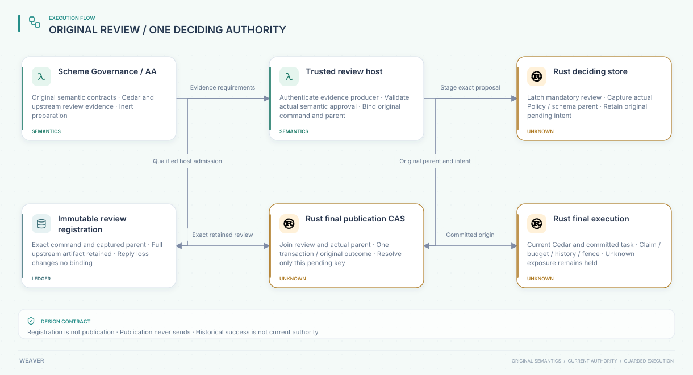

#+TITLE: 59.55 Native Review Admission at the Existing Publication CAS
#+LANGUAGE: en
#+OPTIONS: toc:2

* Architecture allocation and scope

[[file:../../../Project.sysml][Project]] and
[[file:../../../dev/sysml/ControlActivation.sysml][GovernancePolicyProjection]]
allocate this implementation to the existing Rust ledger. It advances the
[[file:59.52-reviewed-publication-cas.org][reviewed publication protocol]] and
[[file:59.53-artifact-registry-recovery.org][registration recovery contract]];
it adds no second ledger, DSL or consensus implementation. Source dependency
pins, Scheme module boundaries and Go/Rust transport remain unchanged.

The concrete new primitive is local trusted-host admission. It can require an
exact persisted review before one original publication commits. It is not yet
the deployed independent-review protocol: ordinary source RPC publication is
still the explicitly retained trusted-source profile. There is no new public
review-registration RPC, and no arbitrary RPC payload can assert approval by
setting a Boolean. The existing source-role counterexample remains applicable.

#+NAME: fig:native-reviewed-publication
#+CAPTION: The existing authority joins the original review and actual parent before publication.
#+ATTR_ORG: :width 1600
#+ATTR_HTML: :width 100% :alt Original proposal mandatory review immutable artifact deciding CAS and final execution

* Native protocol

| Operation | Native behavior |
|-----------+-----------------|
| =stage_reviewed_authority= | Under one IMMEDIATE transaction, bind the exact original command, capture the actual complete Policy/schema head and latch mandatory review with its pending barrier |
| =required_review_parent= | Read the original captured parent; a known absent genesis parent is distinct from an unknown requirement, which errors |
| =register_approved_review= | Trusted host supplies already qualified upstream evidence; persist its complete bounded bytes, exact command/parent and domain-separated digest before acknowledgment |
| Exact registration retry | Return the original digest after equality checks; observation does not append, activate, rebase or require the old parent to remain current |
| Conflicting registration | Refuse artifact or parent substitution; timeout does not authorize a second artifact |
| Existing final =publish_authority= | Read requirement, registration and actual complete parent at the deciding transaction's pre-state; an eligible commit must satisfy the latch |
| Missing review at an eligible parent | Return an error with no decision, Policy change or pending removal; original outcome stays unknown |
| Stale original revision/fence | Persist the original rejection and clear only its own pending row; requiring review before this terminal rejection would strand obsolete intent |
| Lost final reply | Read/retry the exact immutable original outcome; no provider call or budget settlement occurs |

The parent record includes revision, fence, exact Policy digest and optional
schema digest. An absent schema differs from the digest of an empty schema.
Equal revision numbers alone do not establish equal content. Original pending
rows already retain the full candidate Policy/schema command; the review's
publication key commits all its ID/parent/fence/Policy/schema fields.

The review requirement and registration are retained after final resolution.
Ordinary =stage_authority= cannot clear the requirement. Exact reviewed-stage
replay cannot reopen decided pending. A historical unreviewed decision cannot
be relabeled as reviewed. Direct final calls with substituted command fields
continue to fail the original identity binding.

* Trust and recovery premises

The =PublicationReview= record is typed, sealed and bounded. Its artifact field
retains immutable upstream evidence bytes without defining another semantic
language. The native =register_approved_review= caller must authenticate the
producer, validate actual AA/SPEC Delta and replay contracts, bind full semantic
parent/profile/world/source identity and establish relevant current facts.
An arbitrary string, matching digest or successful typed Cedar parse establishes
none of those obligations. This function is not exposed as a source-role RPC.

Current code verifies local persistence and exact byte binding, not the
artifact's semantic approval. The remaining host admission adapter must use
the real fixed dependency APIs rather than reconstruct an approval schema here.
No claim is made that the full SPEC =PublicationReview.Final= predicate is
implemented: independent registry recovery, registrar incarnation and current
external consumption/history cuts remain mandatory open refinements.

SQLite FULL/WAL supplies this profile's local deciding order. A transaction
rollback leaves the original requirement, pending intent and reservations.
Registration and final CAS do not change account/claim tables or invoke provider
traffic. A consistent whole-store snapshot rollback can remove all these records
without detection; independent authority-prefix retention is still required.
Detecting divergent content within a snapshot is not anti-rollback qualification.

Trusted native =publish_typed= remains a separate administrative host primitive.
It can advance authority while proposals are pending. That does not resolve the
original pending key, authorize its uncommitted task birth or refund its holds.
The original reviewed proposal then resolves through its stale-parent rejection.
This native trust profile must not be confused with an untrusted operation API.

* PBT and concrete failure boundaries

Rust =proptest= owns operation generation, shrinking and replay. The existing
ledger test owner now generates LegacyStage, Register, Publish, AdvanceParent,
Restart and Substitute commands against a separate registration/outcome/head
model. A mandatory initial reviewed stage prevents shrinking away the relevant
admission boundary. Every prefix checks exact outcome and review retention,
stream readiness and the original four-credit unknown hold.

Concrete SQL and concurrent tests additionally check:

- Failed pending insertion atomically rolls back its new mandatory-review latch.
- Failed registration insertion followed by reopen keeps the original pending
  intent and prevents final commit; retry repairs only the exact original review.
- Competing artifacts on independent connections have one immutable winner.
- Reviewed-stage and legacy-final races have one SQLite serialization: either an
  earlier unreviewed decision prevents retrospective review, or the latch wins
  and the unreviewed final cannot commit. There is no guarantee before latch commit.
- Same-revision parent Policy replacement and corrupted artifact commitment block
  eligible final publication without manufacturing rejection or releasing holds.
- A stale original parent can reject without review while sibling intent remains.
- Genesis, historical exact registration and final-decision observations remain
  distinct from unknown state and current authority.

These tests use actual SQLite, including FULL/WAL reopen, IMMEDIATE transactions
and injected SQL failures. They do not simulate a power-cut filesystem flush,
independent storage authority or malicious in-process code controlling SQLite.
The new local lost-observation fixtures discard a committed method result and
reopen the ledger. They are not new RPC reply-drop evidence for reviewed calls;
the existing unreviewed transport-reply tests retain their separate scope.

* Quint and Lean allocation

The existing =PublicationRecovery.qnt= ledger now carries a monotone mandatory
review set. The existing native-publication action honors it, while the stronger
reviewed action retains independent registry/current-registrar/source-cut guards.
New witnesses check legacy downgrade refusal, lost replies, stale rejection with
sibling retention, retrospective relabel refusal and same-ordinal content change.
Unsafe omitted-latch and local-review-with-stale-independent-cut examples remain
explicit counterexamples. Native local review must not be reported as the full
independent protocol merely because both use one model owner.

The existing Lean State/Step/Run gains the same latch and guarded commit premise.
=latched_new_commit_requires_original_local_review= connects a fresh committed
record to the actual pre-state's exact command/parent/fence review.
=recovery_cannot_remove_review_requirement= proves latch retention over arbitrary
finite existing Runs. =native_review_recovery_composes_without_releasing_unknown=
combines that law with original pending-intent, immutable outcome and accounting
preservation. No second activation/publication state machine is introduced.

Native refinement still must connect concrete command/head/artifact bytes to
these abstract commitments, prove same-transaction evaluation and supply actual
producer qualification. Lean does not prove SQLite or the cryptographic hash.
Quint checks bounded schedules; PBT checks actual code; neither replaces those
explicit host premises or the SPEC semantic proof.

* Runtime and benchmark boundary

The review lookup executes on administrative publication, not on every stream
range. It reuses the already computed original command digest. Existing final
execution guards still check current Cedar, original committed task birth,
pending proposals, claim, budget and fence after waits. Publication stays inert.

The contracts package measures exact review commitment; the ledger package
measures trusted-host registration plus final CAS, with stage/parent fixture
setup outside timing. Criterion settings remain thirty samples, one second of
warm-up and two seconds of requested measurement. The Go benchmark inventory
also now requires the previously omitted existing stage-and-decide case, so a
missing measurement cannot silently qualify the package matrix.

No existing performance regression is waived. New benchmark cases measure this
local primitive only, not an end-to-end latency, solver, producer-authentication
or independent-anchor service. Full production-path performance remains open.

The first optimized local measurements, on the current twelve-CPU unreserved
host, retain the following Criterion intervals. Both use thirty samples without
changing the configured timing or available machine parallelism.

| Timed case | Lower / estimate / upper | Outliers |
|------------+--------------------------+----------|
| Contracts review commitment, 17 KiB artifact | 50.583 / 52.349 / 54.485 microseconds | 5 of 30 |
| Ledger trusted-host registration and final CAS, 22 KiB artifact | 801.30 / 869.69 / 968.02 microseconds | 2 of 30 |

Criterion warned that thirty ledger samples required an estimated 3.1184 seconds
at the unchanged two-second requested measurement target. No setting was widened.
These are new workloads with no matched prior baseline; they neither explain the
earlier default-path regressions nor establish a production acceptance threshold.

* Validation and retained failed controls

Validation receipts are recorded after execution below. Raw transient output is
not a tracked product artifact. Framework regression corpora remain legitimate
test data. No dependency pin, watchdog or cleanup rule is relaxed.

- Initial storage test compilation failed because =u64= is not a rusqlite
  =FromSql= type; the row count oracle was corrected to =i64=.
- The sandboxed ledger run passed 48 integration cases and failed three existing
  loopback-socket fixtures with =PermissionDenied=. The authorized host rerun
  passed all 65 ledger tests, including the new SQL/concurrency cases and ASP deny.
- Initial new Quint refusals placed =expect= after =fail=, leaving no assigned
  next-state variable. Assertions now precede the terminal refused action; native
  behavior and guards were not weakened.
- Initial Lean elaboration exposed a multiline record-layout error and an
  incomplete rejection case. Both were repaired; no =sorry= was added.
- Adding a mandatory partial-write prefix exposed an incorrect PBT oracle:
  =Register(0), Publish= shrank to a two-operation trace where the oracle expected
  stream reacquisition after publication. The actual existing Runtime correctly
  refuses custody for an unknown/incomplete original prefix. The oracle now
  requires no new owner, no old-owner tail consumption, unchanged unknown message
  and the original four-credit hold. Seed
  =96866c062daa6abdcf1ee2b6c67f827c5432313d6ace3e3b71a77e559dc51373=
  is retained in the framework's regression corpus. This is a test-model defect,
  not evidence of a production duplicate send or budget release.
- The first sampled local-review schedule used the composite registration-plus-
  recovery action inside a nondeterministic choice. Its disabled first phase
  raised =QNT513=. Sampling now schedules the existing atomic registration and
  projection-recovery actions separately, preserving intervening failure states.

The focused corrected partial-write PBT passed, including replay of its retained
seed. Both full PublicationRecovery and the dependent authority test selection
passed after model changes. Default recovery and the explicit local-review
schedule each passed 1,000 sampled runs of up to 60 steps with seed 293; sampling
is not exhaustive verification. The new Lean proofs elaborate with only
=propext= and, for finite-run composition, =Quot.sound=; no =sorryAx= remains.
The local OpenSysML/project trace checks, Go development-runner tests, and D2
rendering/visual inspection passed. The final local workspace run passed 114
tests with one existing ignored helper, including ASP deny; affected contracts
and ledger all-target Clippy passed with warnings denied. The Go development
runner tests passed after registering the explicit local-review schedule and
the complete 29-case benchmark inventory. These receipts precede reconciliation
with any later concurrent PR1 changes and do not claim reviewed RPC integration.

The full project objective remains open. The next required native boundary is
authenticated semantic artifact admission plus the required reviewed RPC path,
joined to current registry/source authority. Higher-order context admission and
the independent anti-rollback protocol are not qualified by this local primitive.
