# SPDX-FileCopyrightText: 2026 hardenedlinux Linux Team and Contributors
#
# SPDX-License-Identifier: LGPL-2.1-or-later AND Apache-2.0

#+TITLE: 59.56 Runtime Assets and Persistent Source Authority
#+LANGUAGE: en
#+OPTIONS: toc:2

The subsequent [[file:59.60-persistent-source-key-custody.org][source-key implementation]]
adds a local durable key floor and final transaction checks. Its explicit handoff
blocks the earlier startup-pin rollback path. The independent source-recovery
contract below remains stronger; consistent whole-store rollback is not prevented.

* Authoritative boundaries

[[file:../../../Project.sysml][Project]] owns =ProductionAssetBoundary= and the
declared =RuntimeBoundary= inventory. Verification allocation remains its existing
=AssuranceResponsibilities=; this review adds no other allocation or semantic
model. [[file:../../../dev/sysml/ControlActivation.sysml][GovernancePolicyProjection]]
binds the persistent source-authority join to final publication.

#+NAME: fig:runtime-assets-and-authority-floor
#+CAPTION: Production owns deployed artifacts; the live authority owns current permission and recovery.
#+ATTR_ORG: :width 1600
#+ATTR_HTML: :width 100% :alt Production asset promotion and persistent authority floor at final publication

* Development cannot become a runtime dependency

Production imports, compilation, startup and packaging must not depend directly
on =dev/= content. Runtime-consumed Cedar policies, schemas and manifests belong
under =prod/= and must be declared in Project Layout. Production aliases cannot
resolve back into development. The directory classification is necessary for
deployment ownership; it establishes no current Policy approval or send right.

| Material | Maintained owner and use |
|----------+--------------------------|
| Lean/Quint sources, proof bridges, solver diagnostics and raw replay receipts | Development verification; unavailable to the production dependency graph |
| Deployable Cedar Policy/schema/manifest bytes | Explicitly owned production assets, validated and promoted before deployment |
| Rust/Go/Scheme runtime modules and protocol source | Existing Project runtime owners; no imports of development-only packages or artifacts |
| Go verification command, Gerbil toolchain and test fixtures | Development graph; may read production assets and verification inputs |
| Current epoch, revocation, registration, consumption and budget state | Configured durable authority/ledger storage; live state is not a versioned =prod/= configuration value |

Promotion is a concrete ownership step: freeze the deployable bytes, validate the
schema/format, bind their digest and source/profile/world commitments, register
the production asset and package those exact bytes. Do not ship a pointer to
=dev/proofs=, a generated development path, a cache or a symlink to it. The
generator and its proof sources remain verification inputs. Runtime consumes the
reviewed production output through its established interface.

The current source audit found no production-to-=dev/= reference requiring a
move. Existing deployed-policy examples and schemas already live in =prod/policies=.
The =dev/proofs/cedar= bridge is a verification consumer, not a runtime library.
No blanket copy of its sources or diagnostics into =prod/= is warranted.

* Executable architecture gate

=TestProjectArchitectureRuntimeAssetBoundary= reads its roots, entries and
forbidden references from SysML. Rust source/build inputs derive from the existing
RustPackage inventory. Go source inputs derive from the declared runtime entry's
actual dependency closure, including imports, string references and embed
directives. Development commands are separately classified, so the verification
runner is not mistaken for a production entry or granted a runtime exemption.

The same gate checks Scheme/protocol inputs and declared production data. Path
normalization and symlink resolution reject production aliases into development.
JSON/YAML scalars are decoded, so unquoted YAML and escaped JSON values are not
treated as safe merely because a quoted-string scan misses them.
The existing =check-architecture= test selection includes the new test by its
=TestProjectArchitecture= prefix; no parallel command, script or CI entry is added.

Adversarial fixtures reject Go imports/read paths/embed directives, Rust includes,
Scheme module/path references, build input references, runtime configuration
references and a =prod/= symlink into =dev/=. A normal production path and ordinary
Go documentation comment are positive controls.

This is a maintained import/literal-reference and layout gate, not a proof of all
computed paths or native IO. Dynamic/generated loaders still need their runtime
format, confinement and provenance validation. Passing layout checks cannot
replace Cedar admission, artifact review or a current authority read.

* Persistent authority cannot be restored from configuration

Reuse SPEC's existing =RegistrarAuthority.admitted= meaning and the existing
publication/recovery protocol. No new identity rules or downstream Lean state
machine are introduced. The protocol's source observation contains only qualified
references and authority-owned epoch/owner, revocation/issuance prefix, artifact
registry and publication parent/fence. These fields identify the deciding cut;
they do not reinterpret subject/key/scope/audience or signatures.

The critical contract is the final atomic join:

1. Read a qualified source-use observation from the authority and bind the exact
   command purpose and artifact reference.
2. Recover the local registry/image from that authority. A restored startup file,
   old credential connection or cached read cannot lower its persistent epoch or
   remove its revocation set.
3. At artifact registration or final publication, join the captured observation,
   local image and actual current authority cut in the same deciding order.
   An append, handoff, revocation or parent/fence change requires a new join.
4. If the authority is unavailable, retain original pending and unknown holds.
   A missing reply cannot establish abort, authorize cache fallback or settle
   budget. A later exact committed outcome remains historical observation.
5. After successful publication, Rust still performs fresh actual-effect
   admission. Publication/recovery never reconsumes the original task or grants
   permission to replay an uncertain provider request.

Administrative CAS may resolve its own staged intent while siblings remain;
provider effects retain their separate pending barrier. Rejoining an image is
not permission to change the parent, artifact, original family or budget/history
domains. The independent authority's own full rollback remains outside the safe
protocol premise and requires its previously specified prefix-retention evidence.

* Executable schedules and real recovery

The existing Quint owner now exposes read, image restore, authority availability
and final-join microsteps. Observations also retain an opaque observer/channel
context; reconnect requires a fresh observation even if the authority epoch did
not change. The adapter supplies non-reused channel context and verified
possession; no cryptographic implementation is inferred from the model integer.
New schedules cover configuration-image rollback after
epoch/revocation changes; unknown authority reads; late reads after handoff;
registration/publication reply loss; registry append between read and CAS; an
exact positive continuation; and a cached-revocation-view-only counterexample.
The recovery sampling relation excludes the deliberately unsafe cached-only path.
Semantic binding and crypto remain SPEC/adapter premises, not another evaluator.

=TestProviderSourceRollbackLostReplyRetainsUnknownConsumption= reuses the actual
partial-request disconnect fixture and publication reply-loss relay. Its two cases
lose the staging reply or the final commit reply after real durable source work.
It rotates the source certificate, restores the prior startup credential config,
reconciles the exact original outcome and retries the consumed request. The
unknown state, original reservation/hold, single provider invocation and absence
of fallback remain unchanged. The commit/publication phase sends no provider
traffic itself.

This is a real SQLite/gRPC recovery receipt for the existing consumption boundary,
not proof of a deployed persistent registrar epoch. The earlier concrete
counterexample still applies: restoring a retired startup certificate pin can
restore source-role access. The existing
[[file:59.55-evidence-reviewed-publication.org][local reviewed-publication admission]]
retains its exact parent/evidence latch. It does not supply the independent
source-epoch/revocation and authoritative artifact-registry recovery adapter.
Those production gaps remain explicit; this review changes no production runtime
code to conceal them.

* Acceptance and comparison metric

Require separate native receipts for the runtime asset boundary, qualified
artifact promotion, independent epoch/revocation prefix recovery and final
publication join. The new tests establish current ownership checks and specific
recovery behavior. Expected unsafe cases remain counterexamples, not prevented
production attacks. Project trace-name checks are structural.

No shared Box/OpenShell throughput or compression experiment is run here. The
evidence gain is an executable production/development dependency boundary and
additional source read/use recovery coverage. The remaining cost is the native
authority adapter and its independent persistence evidence. CI is not awaited;
dependency pins remain unchanged and raw logs stay temporary.

* Executed evidence

- The OpenSysML Go API Project/trace checks and production boundary gate pass. Negative
  fixtures cover imports, reads, embeds, build inputs, Scheme references,
  JSON/unquoted YAML references and a production alias into development. The
  gate is included in the existing architecture command by its test prefix.
- The unchanged =weaver-dev check-architecture= entry passes all three stages:
  project architecture, workflow contract and source currentness. Initial runs
  failed on sandbox DNS and then dependency preparation exceeding the existing
  helper deadline. Their temporary receipts remain available. After preparing
  only the locked modules from the existing local module cache, the same entry
  passes with unchanged deadlines. This is not a cold-network performance claim.
- After integrating the concurrent local-review admission work, the existing
  PublicationRecovery owner passes 97 executable schedules (90 before that
  integration). Its
  recovery relation passes 1,000 sampled runs of 60 steps, seed 293. Sampling is
  not exhaustive verification and unsafe cases count as expected counterexamples.
- GatewayComposition passes 70 executable witnesses; imported coverage overlaps
  and counts are not additive independent proofs.
- Eleven real =-race= Go/Rust tests pass, including both staging/commit reply-loss
  subcases of the new partial-request/configuration-rollback fixture. Original
  deadlines, queue bounds and natural cleanup requirements are retained.
- D2 renders and the SVG is embedded above. No new SPEC identity predicate,
  downstream Lean state machine, production runtime implementation or dependency
  pin change is introduced by this round.
