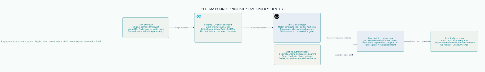

#+TITLE: 59.57 Schema-Bound Candidate Replay and Policy Identity
#+LANGUAGE: en

The [[file:59.61-authority-bound-replay-pair.org][authority-bound replay pair follow-up]]
extends the candidate adapter to actual captured predecessor binding. Existing
candidate-only receipts remain finite genesis evidence; revision admission now
requires the exact before image and the supported common-schema profile.
#+OPTIONS: toc:2

* Architecture and implemented boundary

[[file:../../../Project.sysml][Project]] and
[[file:../../../dev/sysml/ControlActivation.sysml][GovernancePolicyProjection]]
allocate candidate evidence checking to =weaver-policy= and deciding publication
to the existing ledger. This extends [[file:59.55-native-reviewed-publication.org][local
review admission]], without adding a second Policy engine, ledger or DSL.

The production adapter now invokes the actual SPEC Rust runtime's
=ValidatedManifest=, =SchemaBoundReceipt=, =render_validated_policy_sources= and
=verify_validated_replay_receipts=. Its dependency inherits the workspace and
uses the same exact SPEC revision as the existing Lean bridge. No existing
dependency version, source revision or pin changes; Cargo adds only the two
required SPEC packages and this workspace edge. The upstream runtime enables
Cedar's standard IP, decimal and datetime features; the Cedar version is unchanged.
Existing text, typed schema, FFI and execution tests cover the resulting build.

#+NAME: fig:schema-bound-candidate-replay
#+CAPTION: Exact candidate replay joins the original deciding parent; it grants no execution authority.
#+ATTR_ORG: :width 1600
#+ATTR_HTML: :width 100% :alt SPEC candidate replay exact Policy identity local registration and final execution

The registered artifact still requires trusted-host semantic qualification.
There is no public reviewed-registration RPC and ordinary source-role publication
retains its explicit trust profile. This round does not claim full
=PublicationReview.Final= or thirteen-scenario Governance adapter qualification.

* The Policy identity defect to avoid

SPEC's full-file text renderer preserves original Policy IDs in comments for
readers. Cedar reparsing assigns new IDs. Treating that text as the same compiled
PolicySet would silently change reasons and diagnostic identities even when
decision bodies look equivalent. The existing producer explicitly documents
that it is unsuitable for an identified handoff.

The unified immutable-source parser now accepts Cedar text and the official
materialized PolicySet JSON. JSON is duplicate-checked before SPEC's native
loader checks materialization and the actual loaded ID set. Text comments have
no identity meaning. All current authorize/provider/stream/FFI users share this
parser and exact-source compilation cache; no allow decision is cached.

The artifact's selected candidate must match the actual publication's complete
normalized PolicySet, including IDs, bodies, annotations and materialization.
Its full schema must also match. The publication key independently binds the
exact raw original bytes, parent, fence and ID. Equivalent object key order in
JSON does not permit replacing an already staged raw command.

* Concrete evidence protocol

The sealed transport envelope contains =manifest= and =receipts= in their actual
upstream types, plus =candidate_case= selecting the candidate. It does not define
another Policy or approval language. Unknown approval fields and duplicate JSON
keys are refused. Existing artifact size limits remain; at most sixty-four cases
are admitted and receipt count must equal case count.

1. Validate the exact review/publication key before interpreting evidence.
2. Select an actual unique candidate, check strict schema, entities and declared
   Policy IDs through SPEC, and compare its actual PolicySet/schema with the command.
3. Recompute all supplied cases through official Cedar and require the exact
   schema-bound receipts, including decisions, reasons, errors and content bindings.
4. Return finite observation metadata. The selected revision's case count is
   distinct from total manifest cases; metadata is not an approval capability.
5. =register_replay_checked_review= performs this check, then invokes the existing
   immutable local registration transaction. That transaction rechecks captured
   actual parent and original pending identity. An earlier successful replay does
   not authorize registration after parent advancement.
6. Existing final CAS rechecks registration and current complete parent at its
   deciding cut. Failed replay leaves pending and outcome unknown; a stale original
   CAS may record its own immutable rejection. Neither step sends or settles usage.

Replaying outside the IMMEDIATE registration transaction keeps this expensive
deterministic check off the deciding lock. Its exact immutable evidence/key is
joined again under that transaction; currentness is never inferred from the
earlier calculation. Producer authentication, semantic parent/Profile/world
binding, actual Delta no-gain and independent registry-prefix recovery remain
separate Host obligations. The lower-level trusted-host registration primitive
remains explicit; an untrusted caller must never receive that primitive.

* Real producer and finite evidence boundary

The complete namespaced-enum fixture comes from the standard SPEC
=caseManifestsNative namespaced-enum-validated= producer after its standard build.
Its four Lean-computed cases cover two revisions; only two cover the selected
=scoped-public= candidate. Actual fixed-pin Rust replay checks all four.
[[file:../../../prod/policies/review/README.org][Asset provenance]] records the separate
producer revision and exact digest. This is a scoped producer/consumer observation,
not admission of all candidate SPEC APIs or a dependency-pin migration.

An attempted complete country-approval manifest was 70,526 bytes before transport
wrapping, exceeding the existing 65,536-byte artifact contract. It is not trimmed,
sampled or treated as admitted. The separate complete namespaced-enum producer is
a supported smaller fixture. Larger artifacts require a separately designed
bounded content/prefix protocol; this implementation does not enlarge the bound.

Schema-bound receipt equality is finite replay. It cannot prove no-gain outside
observed requests, authenticate a source subject or establish current history.
The existing Lean owner's =finite_replay_does_not_certify_no_gain= constructs an
unseen request that gains permission while every observed decision stays equal.
Its hypothesis is explicit non-coverage of that request; no new Cedar semantics
or solver is defined in Weaver.

* Verification allocation

| Owner | Concrete evidence |
|-------+-------------------|
| Rust PBT | Native SPEC replay refuses mutated schema, selected case, Policy IDs, receipt content/count and original command, even when outer digests are recomputed |
| Rust ledger | Actual verified registration, lost-observation reopen and exact final CAS; failed replay keeps pending; earlier replay cannot cross a changed parent or refund original holds |
| Scheme FFI boundary | Existing byte ABI accepts official named JSON and refuses duplicate Policy keys; preflight remains inert |
| Go integration | Existing complete control fixture uses JSON/YAML source configuration, named materialized PolicySet, real TLS provider SSE, mid-stream revocation and both process restarts |
| Quint | Existing PublicationRecovery owner receives native check qualification, explores failed check/pending retention, delayed observation and changed-parent registration; it does not reimplement Cedar |
| Lean | Existing original-intent/outcome/latch/accounting composition remains in force; finite replay's non-implication of no-gain is an explicit constructive counterexample |

The new Go tests preserve denied routes, invalid-body/route controls, original
claimed roots and four-credit unknown hold. They do not exercise a nonexistent
reviewed RPC or authenticated Delta producer. Source-role and startup-pin rollback
counterexamples remain. Full producer-incarnation and independent recovery gates
must be closed before that stronger deployment claim.

* Performance and package ownership

Replay runs during administrative host preparation, not every provider range.
Compilation reuse caches exact immutable source; every execution still makes a
fresh current-Policy/claim/budget/fence decision. Candidate evidence never creates
a queue entry, connection, SDK retry or send capability.

Each affected package owns benchmarks: Policy has named JSON/schema validation
and actual SPEC candidate replay; ledger has replay plus registration/final CAS.
Criterion settings remain thirty samples, one-second warm-up and a two-second
requested measurement target. The Go required inventory now contains thirty-two
Rust cases. New focused measurements do not qualify the complete matrix, original
Runtime regression attribution, concurrent p99 or independent storage service.

First focused optimized measurements on the unreserved twelve-CPU host:

| Case | Lower / estimate / upper |
|------+--------------------------|
| Named JSON schema validation | 196.20 / 269.35 / 342.16 microseconds |
| SPEC four-case replay and selected candidate binding | 2.9820 / 4.1959 / 5.5963 milliseconds |
| Replay, local registration and original final CAS | 6.3353 / 9.9051 / 14.252 milliseconds |

All retain thirty samples. The replay case estimated 2.7540 seconds to collect
at the unchanged two-second requested measurement target; the ledger case
estimated 2.3513 seconds and reported five outliers. These are new administrative
workloads, not matched speedups, warmed provider-range costs or performance
acceptance. The wide observed intervals are retained rather than rerun to select
a favorable result.

* Retained failures and receipt scope

- The first fixed-package =lake env= attempt tried resolving a missing inherited
  dependency in the existing installed cache and failed DNS before compilation.
  No pin changed. The complete separate producer checkout was then built through
  its standard target; source and consumer cohorts are recorded separately.
- Clippy rejected returning a large upstream PolicySet error from a closure.
  The adapter now maps it at the call boundary into the existing typed Error;
  no lint allowance or ASP gate relaxation was introduced.
- First JSON/YAML integration trials reached the wrong allowed fixture route:
  the new permit asset had omitted the original denied-route =forbid=. Both
  reported =prefix=false err=nil=. The asset now retains that actual prohibition;
  denied-route candidates, assertions, workload and deadlines remain unchanged.
- Rust workspace passed 120 tests before the additional FFI JSON boundary test;
  affected all-target Clippy and the corrected real Go integration passed.
  Final source receipts are recorded after the remaining gates complete.
- The final Rust workspace passed 121 tests with one existing ignored service
  helper, including the added FFI JSON case and unchanged ASP deny gate. Project
  and SysML trace checks passed; the core D2/SVG was rendered and visually inspected.
- An additional actual Scheme runtime trial, concurrent with other verification,
  reached the existing fifteen-second failed-bootstrap deadline and reported
  =failed bootstrap did not exit naturally= followed by an ambiguous RPC-count
  diagnostic. This is retained as a failure, not an automatic-retry finding.
  The fixture now reports bounded control logs and exact inspect/stage/final
  counts, distinguishing missing calls from repeated calls without relaxing
  any assertion or deadline. The current FFI library was explicitly rebuilt
  before the separate replay; no causal attribution is inferred from one run.
- The independent replay after current FFI-library rebuild passed the actual
  Scheme Governance/source-assets → Cedar FFI → Go publication → Rust reply-loss
  and restart integration in 34.690 seconds. This reused the existing installed
  Scheme prefix; it is not a new cold SDK/package qualification or a causal
  explanation of the preceding fifteen-second bootstrap failure.
- The existing recovery model passed all 89 named witnesses and the dependent
  authority selection passed. Explicit local-review sampling retained 1,000 runs
  of up to 60 steps with seed 293. The new Lean finite-observation counterexample
  compiled with only =propext=; existing conditional recovery laws still compile.
  Imported/model counts overlap and are not additive independent proofs.
- The complete new Go JSON/YAML integration passed under =-race= in 35.443 seconds,
  and Go development-runner tests passed. Current FFI preflight, exact-ID refusal,
  actual SPEC replay and deciding parent joins are native test evidence;
  authenticated semantic approval remains an explicit unimplemented boundary.

The full project goal remains open: actual semantic approval, authenticated
reviewed RPC, complete source/Profile/fact/history materialization, independent
anti-rollback authority and production-path performance still need native evidence.

* Merged source acceptance

The source cut =37bc412ae71d83a80017d26cbde9ed04c10daa72= retains concurrent
=d1fc00a= production-asset-boundary and source-recovery work. This document uses
59.57, preserving that work's separate 59.56 identity and all its model witnesses.
Rust production code and its 121-test/ASP receipt are unchanged by the merge.

At this merged source, standard clean-source =check-go= passed twenty of twenty
stages, including the new SysML runtime asset boundary and complete real provider
suite. This verifies that runtime code does not import the development proof
bridge/runner: it consumes the actual packaged SPEC Rust library and owned
production manifest bytes. Existing original claims, denied routes, budget holds,
reply loss/restart and named JSON/YAML execution remain under the same checks.

The merged recovery owner passed 101 named Quint witnesses; the dependent
AuthorityPublication selection also passed. Local-review and source-recovery
schedules each passed 1,000 sampled runs of up to 60 steps with seed 293. These
receipts neither prove all schedules nor convert expected unsafe counterexamples
into native enforcement. The original pinned Lean bridge and dependency pins
are retained; no new complete candidate SPEC or cold Scheme build is claimed.
Rendered Org/D2, structural SysML traces, local native tests, model/proof and
scoped optimized measurements remain distinct evidence layers. CI is not awaited.
