#+TITLE: 59.58 Independent Source Authority Recovery
#+LANGUAGE: en

The subsequent [[file:59.60-persistent-source-key-custody.org][local source-key implementation]]
adds persistent explicit handoff, SPKI non-reuse and actual-caller checks at the
deciding SQL transaction. It closes startup-pin rollback after a durable handoff;
it does not supply the independent root or complete recovery coverage specified
here. Retain the whole-store rollback counterexamples and current-incarnation gap.
#+OPTIONS: toc:2

* Authority and scope

[[file:../../../Project.sysml][Project]] remains the sole responsibility registry.
This review refines =ControlActivation.GovernancePolicyProjection=, reuses SPEC's
existing semantic contracts and extends the existing recovery schedule owner.
It adds no production authority service, downstream identity evaluator or second
assurance allocation. [[file:59.42-independent-commit-floor.org][The independent commit floor]],
[[file:59.53-artifact-registry-recovery.org][artifact registry]] and
[[file:59.56-runtime-assets-and-authority-floor.org][production asset boundary]]
remain prerequisite contracts.

#+NAME: fig:independent-source-recovery
#+CAPTION: Retained authority prefixes govern recovery; historical acknowledgments do not refresh permission.
#+ATTR_ORG: :width 1600
#+ATTR_HTML: :width 100% :alt Independent source prefix recovery and final publication join

* A recoverable prefix is more than an epoch number

The deployment must identify its independent authority namespace/generation and
the retained committed prefix. The epoch, owner, credential issuance decisions,
revocation tombstones, immutable original-command artifact bindings and exact
publication outcomes must inherit that prefix together. A maximum epoch loaded
from two stores does not establish completeness: it can conceal a missing
revocation or registration at the same epoch. Prefix length alone also does not
authenticate its contents. Recovery requires the already specified authority's
authenticated prefix identity and retention evidence, not a newly invented
consensus implementation in Weaver.

Trust anchors and the retained recovery floor must survive independently of the
gateway's configuration and local database rollback domain. Merely placing two
services in different processes or Kubernetes Pods does not establish this
property. The operator must demonstrate how restored authority replicas obtain
the current prefix and how obsolete credentials are prevented from activating a
replacement authority namespace. Resetting a namespace or restoring its trust
anchor is an explicit administrative recovery boundary, never automatic startup
fallback. No physical-isolation requirement is introduced.

Deployment can use one logical authority owner with an independently retained
floor or an existing replicated authority implementation meeting the prior
contract. A failover candidate cannot become current because it has a higher
local epoch. It first establishes prefix inheritance, serializes ownership and
revocation at that authority, and makes the resulting cut available to final
admission. Until then, registration and publication remain unavailable while
original pending intents, claims and unknown budget exposure remain retained.

* Durable operation and recovery contract

| Boundary | Required durable meaning | Lost reply and recovery |
|----------+--------------------------+-------------------------|
| Epoch/owner or revocation decision | Commit in the inherited authority order before acknowledgment; retries bind the same original operation and payload | Query exact outcome; no reply proves neither abort nor permission to restore an old credential |
| Artifact registration | Immutable command, parent/profile, full qualified artifact and source-cut binding, with its exact outcome | Read authoritative registration first; absent local projection is not authoritative absence |
| Projection recovery | Reconstruct the full required registry prefix and verify its identity | A complete-looking but old SQLite image cannot activate the source owner |
| Observer activation | Fresh authenticated observer/channel context bound to the recovered authority cut | Restart or reconnect invalidates earlier read capability even at an unchanged epoch |
| Final publication CAS | Join current source admission, recovered registry, exact parent/evidence and existing pending constraints in one deciding order | Historical success remains queryable; never rebase, re-register replacement evidence or resubmit effects because delivery was uncertain |

Register and publish have distinct transcript purposes. A source-role TLS
connection supplies transport authentication but cannot mint an incarnation,
advance an epoch, erase a revocation or attest to registry completeness.
Acknowledgment is emitted only after the authority's configured durable commit
criterion is met. If its independent floor cannot establish the outcome, the
caller retains the original intent and exposure rather than committing locally
and planning to repair the join later.

The final authority decision records its exact guard cut and outcome. Local
SQLite materialization is an idempotent projection of that decision, not another
place to authorize publication. A remote precheck followed by an independent
SQLite transaction is not the required join, and no cross-storage atomicity is
inferred from two successful writes.

A committed registration may be observed after handoff even when the original
registrar is revoked. This is observation of immutable history, not acceptance
of a new privileged mutation by that registrar. A current qualified registrar
can continue the exact original registration and command after fresh recovery;
it cannot change the original artifact, parent, family, claim, budget or history
domains. Partial projection, an old read, unavailable authority, or a changed
parent/fence blocks final use. A revision number alone does not bind Policy and
schema bytes.

Revocation and publication have two legal serial orders. If revocation wins,
the old binding cannot pass final admission. If publication commits first, its
receipt remains history after revocation; it conveys no further send capability.
Rust's final transport admission still checks the current execution authority.
Neither administrative outcome nor receipt recovery sends provider traffic.

* Source-grounded semantic reuse

** Recovery qualification is not a saved Boolean

Reconstruction, qualification and final use are separate protocol steps. Copying
rows completes only reconstruction. Qualification must bind the authenticated
authority identity/generation, exact inherited committed prefix, complete registry
content, current source cut and observer context. An adapter must not serialize
a =recovered=true= flag and restore it as permission after restart. Its final
transaction rechecks the qualified references and actual projection together.

Registry append, owner/epoch transition, revocation, changed publication parent,
observer restart/reconnect or projection loss invalidates the relevant join.
Qualification may be recomputed for the new cut without changing the original
command or artifact. Failure to qualify keeps the original unresolved; a stale
=NotFound= never licenses replacement evidence, a fresh logical key or budget
refund. This conservative whole-prefix binding trades additional revalidation
for a simple deciding contract. A future key-local optimization needs its own
noninterference evidence; equality of epoch numbers is insufficient.

The authority identity/generation and prefix authenticity still come from the
existing Host boundary. Quint's opaque references do not implement that trust
root. If all authoritative state and its trust reference roll back consistently,
a saved qualification cannot detect or repair the rollback. The retained unsafe
snapshot counterexamples remain applicable; a new Boolean guard is not an
independent persistence service.

** Existing SPEC contract

The target adapter discharges SPEC's =Host.registryRecovered= at the actual
deciding view with complete prefix reconstruction and current recovery
qualification. It must not identify that premise with the temporal model's
row-equality check alone. Qualification does not replace =Final.durable=,
=Final.fenced=, continuous authorization, pending admission or the commit witness.

The reviewed SPEC checkout's =CedarPooSpec/Gateway/PublicationReview.lean= provides
=RegistrarAuthority.admitted=: issued binding, allowed role, exact current
binding, scope/audience, nonrevocation and command possession. Its
=registrar_admission_retains_exact_binding= and revoked/substituted/unbound
refusal lemmas already own that meaning. =PublicationReview.Final= retains
registration commitment, recovered registry, current registrar, continuous
authorization, command-specific pending admission and the Host commit witness.
This review does not copy those definitions into Quint or Weaver Lean.

Weaver's existing =dev/proofs/cedar/ZeroTrustEnrichment.lean= theorem
=registrar_binding_reaches_final_cas= applies that admission meaning to the
existing recovery state and retains consumption/unknown-exposure requirements.
Its =meaning= equation and the Host's actual deciding-view/atomic-commit witness
remain premises. No theorem here proves cryptographic possession, persistent
prefix retention, failover linearizability or that the current RPC supplies such
a witness. The local ledger's trusted-host review latch and the source RPC
certificate pins do not discharge those premises.

* Temporal checks and concrete recovery tests

** Qualification ordering extension

The existing owner now records =registryQualifications= as opaque observations.
=qualifyRegistryRecovery= requires the current joined observation and complete
projection; =publishAtQualifiedRegistry= joins that qualification with the existing
source-use and final publication guards. =restartSourceObserver= discards local
qualification. Cut/context equality and the final projection check prevent old
qualification from surviving a concurrent append, handoff or projection loss.
The strict sampled recovery relation uses the qualified final action. Existing
lower-level actions remain available to their original witnesses and explicit
unsafe counterexamples; they are not silently certified by the stricter wrapper.

Nine additional witnesses cover copied rows without qualification, missing
projection, exact positive progress, restart, handoff, late qualification after
append, append after qualification, new-owner requalification and projection loss
after qualification. These are protocol-order checks; neither identity admission
nor Cedar/Delta meaning is duplicated.

The publication envelope retains an existing fixed unknown hold. Its four-unit
hold is a frame condition, not a newly proved account-arithmetic or settlement
model. Those obligations stay with their existing owners; the native test below
checks a concrete retained reservation, hold and unresolved range together.

A tenth witness deliberately restores the independent deciding authority's old
registry, epoch and revocation view while retaining a matching saved
qualification. Final publication can then succeed under the resurrected old
binding. This expected counterexample makes the trust-root retention premise
checkable: qualification is useful against stale projections and scheduling
races, but cannot authenticate its own fully rolled-back authority. The unsafe
restore is excluded from the strict recovery sampling relation.

** Real stale-read recovery

=stale_registry_read_and_reopened_worker_preserve_unknown_provider_exposure=
uses an actual SQLite WAL read transaction pinned before artifact registration.
The reader continues to report zero rows after another connection commits the
original registration and even after exact publication. A worker opened before
registration nevertheless consults the deciding store, sees the original full
record and refuses replacement. Ending the old read transaction exposes the
committed registration to the reader.

Before staging the reviewed change, this test reserves and consumes the original
provider request, burns dispatch once and creates an unresolved response range.
Pending review blocks response release. After the exact reviewed revocation
commits, the old permit cannot dispatch or complete. Close/reopen retains the
original artifact, unknown provider/range state and four held budget units;
the original reservation also remains four units. Resumed,
foreign or already-consumed permits cannot repeat the request. The send callback
count remains one. The review is an explicitly trusted fixture, not a fabricated
Delta proof, and no independent authority is mocked into the production API.

This establishes the local deciding-store response to a stale observation and
ordinary restart. It does not establish recovery from a consistent rollback of
that deciding store. A pre-registration snapshot can still erase its only
artifact record, as the separate retained counterexample demonstrates. Native
authority identity/prefix verification, external qualification and their atomic
final-use adapter remain outstanding acceptance evidence.

** Earlier recovery evidence

The existing =PublicationRecovery.qnt= adds =restartSourceObserver=, which clears
old observations and advances an opaque adapter context while preserving durable
authority. Existing =restart= remains a durable-store stutter; it no longer has
to stand for observer capability recovery. The context integer is not a
cryptographic incarnation implementation or proof against whole-authority
rollback. Its nonreuse is a Host premise.

New schedules reject an old read after observer restart; recover the original
registry and progress after a fresh read; reject a missing registry projection
even with an otherwise exact source cut; preserve registration across handoff;
and observe a committed publication after revocation without restoring authority.
An explicitly unsafe independent snapshot restore demonstrates resurrection of
the old credential. That action is excluded from the safe sampling relation.
These checks cover protocol order, not a second credential or Policy semantics.

=TestProviderSourceLateCommitReplyAfterRotationRemainsHistorical= executes a real
partial provider request, holds application delivery of its later publication
reply, rotates the source certificate and restarts the Rust service. A retained
old client/channel cannot reconnect as the retired key. A new source commits
the next revision before the old result is delivered. The old result remains
revision-one history; it cannot replace revision two or reopen the uncertain
request with either old or current routing metadata. Another restart preserves
the original unknown reservation/hold and exactly one provider invocation with
no fallback. This is a deterministic application-delivery barrier around a real
gRPC result, not a packet-delay or independent-authority failover experiment.

=consistent_snapshot_rollback_can_replace_local_registered_artifact_counterexample=
uses the actual Rust ledger. Ordinary close/reopen retains the original artifact
and refuses replacement, including a lost-reply recovery. Restoring a consistent
pre-registration database snapshot makes the registration disappear. The missing
review still blocks final publication and retains the original pending barrier;
the trusted-host registration API can nevertheless accept a different artifact
and commit. All SQLite owners are closed before snapshot copying/restoration.
This expected counterexample exposes the absence of independent registry prefix
recovery. It does not claim live-file rollback, multi-host SQLite safety or an
implemented epoch service.

* Executed evidence and remaining acceptance

The initial Quint test draft attempted to continue after =action.fail()=; Quint
does not retain a successor state for that negative terminal. The failing runs
were retained under temporary storage. Negative refusal and positive recovery
were separated without weakening the refusing guard. An initial Rust command
selected the external test target and executed zero matching cases; it is not a
test pass. The corrected library target executes the private storage tests.

Executed results:

- The unchanged Go-managed =weaver-dev check-rust= entry passes architecture,
  workflow, formatting, default-profile build, complete Rust tests, Clippy and
  source-currentness checks. The same entry passes again after integrating the
  concurrent named-Policy replay work. Existing ASP Rust deny gates remain in
  that full test run.
- =PublicationRecovery= now passes 118 executable schedules, including ten
  recovery-qualification witnesses added to the previous 108. Expected unsafe
  restores are counterexample witnesses, not successful production prevention.
  The strict recovery relation passes 1,000 sampled runs of
  60 steps, seed 293, including observer restart. Sampling is not exhaustive
  verification; unsafe snapshot actions are excluded.
- =GatewayComposition= passes its existing 70 witnesses after integration.
  Imported coverage overlaps; these counts are not additive independent proofs.
- The selected real Go/Rust =-race= suite passes 12 top-level tests, including the
  new delayed-result test and the existing stage/commit reply-loss subcases.
  The library storage target executes five review recovery tests, including the
  new expected snapshot counterexample; the full Rust entry includes them too.
- This follow-up also executes the real external-target WAL reader test. It
  establishes late-absence behavior with an actual retained read transaction,
  immutable registration, original unknown range, one dispatch callback and four
  held budget units after ordinary process recovery. The full Go-managed Rust
  entry passes with this test included; the unchanged real gRPC regression suite
  again passes 12 top-level tests. No additional gRPC scenario is claimed here.
- D2 renders and its SVG is embedded above. No downstream Lean semantic
  definition, production runtime implementation or dependency pin is changed
  by this review. Concurrent upstream changes are preserved, not attributed to
  these additions. Remote CI is not awaited.

Raw logs stay in temporary storage or ignored latest-run caches. Limits and pins
remain unchanged. Production code must not reference =dev/=; deployable Cedar,
schema and manifests belong to declared =prod/= assets. Proof/model sources and
test-only failure fixtures are not promoted merely to satisfy that rule. Current
epoch/revocation and registry records belong to configured durable state, not Git
configuration under =prod/=.

Before claiming production closure, the independent adapter must demonstrate:

1. Publication/registration mutation and exact-outcome lookup through the same
   independently retained prefix, including a lost commit acknowledgment.
2. Failover with unavailable or stale replicas: no activation before prefix
   inheritance, no old-worker mutation and no silent replacement namespace.
3. Credential revocation and final CAS racing in both orders, including retained
   connections, process restart and delayed callback delivery.
4. Rollback of local registry/config independently, then simultaneous snapshot
   recovery, with missing/partial projections kept unavailable and original
   artifact/pending/unknown-exposure records preserved.
5. Evidence connecting SPEC's deciding view to the actual authority transaction
   and Rust's later final transport admission. A mock floor is insufficient.

No new common Box/OpenShell performance or compression measurement is claimed.
The measurable change is recovery-scenario coverage and an executable local
rollback counterexample; production authority recovery remains the gap. Reusing
SPEC semantics and the existing ledger avoids a parallel Policy engine, while
the remaining deployment cost is independently retained state and its adapter.
Remote CI is nonblocking.
