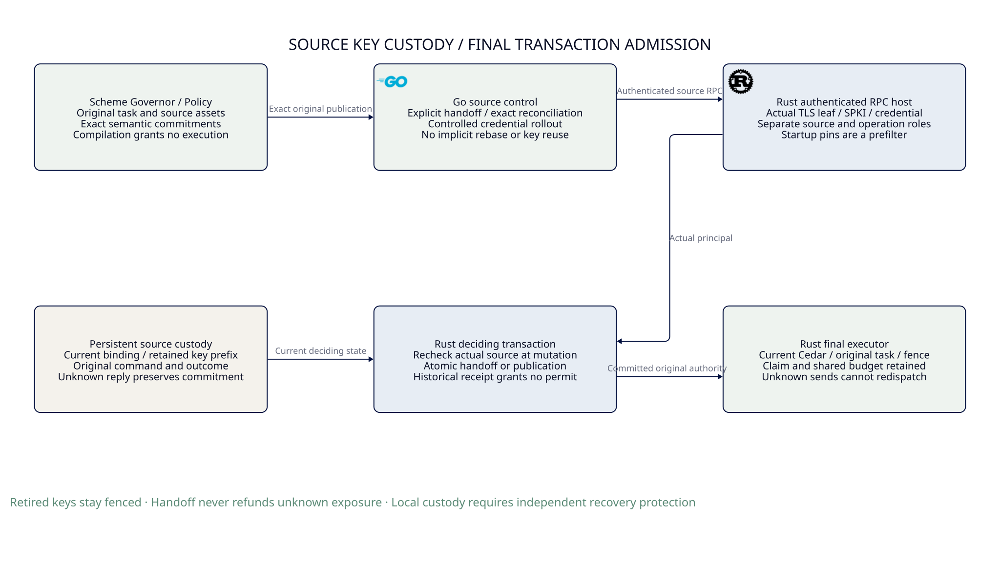

#+TITLE: 59.59 Persistent Source Key Custody and Final Transaction Admission
#+LANGUAGE: en

* Architecture and exact implementation boundary

#+ATTR_HTML: :width 1500

The Rust source RPC host now binds every administrative call to the actual
authenticated mTLS leaf certificate, its DER SubjectPublicKeyInfo digest and
the source-role credential digest. The existing ledger owns a persistent current
binding and a complete non-reusable key prefix. Restoring an old startup
certificate pin does not restore source write authority after an explicit durable
handoff. The static TLS/token configuration remains an additional transport
prefilter, not the persistent authority record.

This is a local durable key-custody profile. It does not implement independently
issued subject identity, unique process incarnation, semantic no-gain review or
an independent rollback-resistant authority. The native consistent-store rollback
counterexample remains executable. The stronger independent recovery contract in
[[file:59.58-independent-source-recovery.org][the independent-source recovery chapter]] is a distinct remaining requirement.

* Owners and protocol

| Owner | Responsibility | Authority it does not gain |
|-------+----------------+----------------------------|
| Scheme | Existing Governor selection, typed original task and exact Policy/source-assets projection through the existing Agentic AI Lab interfaces | No transport identity issuance, handoff or final-send capability |
| Go | Inspect the current source binding, submit one explicit exact handoff, reconcile its result, and perform controlled transport configuration rollout | No automatic retry with a new ID, epoch rebase, key restoration or execution |
| Rust RPC host | Authenticate actual TLS/bearer input, derive leaf/SPKI identity, enforce separate source/operation roles and reject an exact operation certificate or token as successor | No caller-supplied actor labels or cached view as write authority |
| Rust ledger | Enroll once, serialize actual source checks with each mutation, atomically retain current binding, all used keys and immutable handoff outcomes | No authority outside its durable store or over arbitrary trusted in-process callers |
| Rust final executor | Keep current Cedar, original task, claim, pending, budget and final-send checks | A source handoff is not business Policy revocation or budget settlement |

An empty, unowned ledger may enroll the first authenticated source once. A ledger
with existing business records but no source binding rejects automatic enrollment.
Missing source history is not permission to bootstrap again. Do not clear state
or discard unknown reservations to force enrollment. Existing unenrolled stores
need an explicitly designed migration; no migration shim is supplied here.

The caller submits an immutable SourceRotation containing an operation ID,
expected current epoch and exact successor identity. The successor identity is
derived from its actual certificate bytes and credential digest, not an asserted
subject string. The deciding IMMEDIATE transaction does the following:

1. Read the current binding and check its complete contiguous key-history prefix.
2. Reconcile an existing exact operation result without changing authority.
3. For a new operation, require the actual caller to equal the current binding.
4. Compare the expected epoch and reject every previously used SPKI or leaf
   certificate. A certificate reissue with the old SPKI is still the old key.
5. Atomically append the key, replace the current binding and retain the original
   command, proposer and committed/rejected outcome in the same SQLite transaction.
6. Return only after commit; loss of the reply does not undo the handoff.

The original proposer may retrieve its exact result after retirement. This is
historical observation, not a current source permit. The current successor may
also reconcile it. An unauthorized third party cannot create or observe a new
decision merely by guessing an operation ID. A changed command under the original
ID conflicts; rejection is immutable rather than an implicit epoch rebase.

Every ordinary source mutator rechecks the actual caller inside its own deciding
transaction. A preauthenticated connection, earlier InspectSourceAuthority result
or successful channel admission cannot bypass a handoff by another ledger
connection. The source context is scoped and removed during both normal return
and panic unwinding. The native trusted-host API remains explicit: arbitrary
in-process code is outside the RPC identity boundary.

After a committed handoff, the successor needs a controlled update of the static
transport certificate/token pins and a server restart. Until then the old source
is fenced locally and the new source may be blocked by the old transport pin.
This deliberate administrative availability gap cannot be repaired by accepting
the retired source. The operation data plane retains its existing authority.

* Failures and recovery

| Schedule | Required native behavior |
|----------+--------------------------|
| Commit reply lost | Exact replay returns the original result; no second epoch change |
| Old source already passed TLS authentication | Transaction-local source check rejects its new mutation |
| Old source configuration restored after restart | Transport may authenticate, but the durable key floor denies source mutation |
| Receipt insert fails after binding update | The entire transaction rolls back; original exact retry remains possible |
| Key-prefix row or current head missing | Reject prefix mismatch or occupied-store enrollment; never recreate ownership |
| Old certificate reissued using the same key | SPKI non-reuse rejects the handoff and preserves the epoch |
| Policy publication reply lost before handoff | The successor reconciles that original command; unknown send exposure remains held |
| Whole ledger restored to a consistent old snapshot | Local floor can roll back; retained executable counterexample, not an admitted recovery profile |

Identity uses the exact DER SPKI representation accepted by the TLS parser. A
canonical issuer/key representation is a premise: this implementation does not
prove equivalence of every mathematical-key encoding. Successor parsing checks
certificate structure, not independent enrollment or successor possession.
Possession and certificate-chain validation occur when that successor establishes
the actual mTLS connection. Per-use PKI expiry, CA revocation, session lifetime
and issuer/realm provenance remain separate obligations. Exact role aliases are
rejected; the system does not infer unique subjects from a shared Kubernetes
service account or from differently issued certificates.

* Native code, PBT and formal correspondence

| Contract | Maintained source / evidence |
|----------+------------------------------|
| Typed identity and exact command commitment | =crates/contracts/src/source_authority.rs= and its native unit/proptest suite |
| Atomic binding, key prefix and handoff outcome | =crates/ledger/src/source_authority.rs= and =source_rotation.rs= |
| Source check after a stale precheck | Native ledger test using a second connection to hand off before mutation |
| SQL partial-commit protection and damaged prefix | =crates/ledger/tests/unit/source_authority_storage.rs= fault injection |
| Unknown exposure and original command retention | Native stateful proptest with independent scalar/map/key-set oracle, 64 generated schedules |
| Actual mTLS identity and no provider effect | Real Go/Rust RPC test in =go/dev/provider_source_authority_test.go= |
| Restored old pin denied, historical lost result retained | =go/dev/provider_policy_pending_test.go= and source handoff integration |
| Logical source key non-reuse and old-worker denial | Existing Quint =PublicationRecovery= source transitions and witnesses |
| Arbitrary finite-run epoch/key-prefix preservation | Existing Lean =PublicationRecovery.Step= / =Run= composition |

Quint extends the existing source decision with an actual-key reference. A
handoff requires the current source and a fresh key; publication requires the
current source cut. Historical observation is inert. Concrete witnesses cover
an old preauthenticated worker, lost handoff reply, reissued old key and successor
continuation of an original pending command without resetting its budget.
This abstract reference must refine actual authenticated SPKI in the host; Quint
does not parse X509 or supply a second identity semantic evaluator.

Lean extends the existing Step relation with a fresh-key handoff and proves that
source epochs are monotone and the complete source-key list is retained across
arbitrary finite runs. A retained key cannot satisfy the fresh-key premise. The
existing original-outcome and pending-intent preservation theorems compose through
the added constructor. These are conditional protocol proofs. SQLite atomicity,
TLS possession, parser/hash assumptions and native refinement are premises; the
proof does not turn local storage into independent anti-rollback authority.

Native PBT remains package-owned through workspace proptest. Go integration uses
the ordinary testing framework and actual Rust gRPC service. The Go runner only
orchestrates; no script-owned random generator or second property engine exists.

* Focused evidence and retained failures

Before merging concurrent work, the full native Rust workspace passed 130 tests
with one intentionally ignored process helper. Affected all-target Clippy passed
with warnings denied and ASP deny gates retained. The real provider integration
suite passed in 82.862 seconds; the later expanded source-handoff test passed in
11.726 seconds. PublicationRecovery passed 105 Quint witnesses and 1000 sampled
60-step runs with fixed seed 293. These are focused source-checkout observations;
the final merged source still requires its own standard verification receipt.

Development failures were corrected without weakening the properties: an
ambiguous PBT oracle map needed explicit types; ASP required contract documentation
and a smaller named publication helper; a shared unused source fixture tripped
Clippy and was moved to its owning support module; the Go reissue fixture treated
DER as PEM and panicked; a Quint seed omitted its new key field; Lean rejected a
reserved binder name. A sandboxed Go socket check was denied by the environment;
it is not a passing runtime result. Historical failed runs are not overwritten
as passes by subsequent successful tests.

| Package-owned benchmark | Observed interval | Scope |
|-------------------------+-------------------+-------|
| contracts/source_rotation_commitment | 4.8696–7.3904 microseconds | Exact command hashing |
| ledger/source_key_handoff | 288.77–413.59 microseconds | Local durable key/outcome transaction |
| ledger/source_authenticated_publication | 1.3063–1.8696 milliseconds | Existing publication with actual-source context |
| server/source_certificate_spki_identity | 3.3850–7.2385 microseconds | Pure certificate/SPKI fact extraction |

These thirty-sample unreserved-host observations include outliers. They are not
matched speedup evidence, TLS handshake benchmarks or production latency
acceptance. Existing benchmark admission now includes all four owned cases.

* Remaining architecture work

The required reviewed-publication RPC, producer authentication, actual semantic
no-gain qualification, independent authority prefix recovery and independently
issued subject/incarnation remain open. Do not replace those requirements with
the local source floor. In particular, an authorized raw source publication is
still a trusted administrative profile; a source credential is not Cedar proof.
