# SPDX-FileCopyrightText: 2026 hardenedlinux Linux Team and Contributors
#
# SPDX-License-Identifier: LGPL-2.1-or-later AND Apache-2.0

#+TITLE: 59.59 Retained Root and Complete Recovery Coverage
#+LANGUAGE: en
#+OPTIONS: toc:2

* Authoritative design and outcome

[[file:../../../Project.sysml][Project]] remains the sole responsibility registry;
=ControlActivation.GovernancePolicyProjection= now explicitly joins root identity,
retained commit confirmation and registry recovery qualification. This review
extends the existing temporal owner and real recovery tests, reusing SPEC's
semantic predicates. No new production authority or second Lean model is added.

#+NAME: fig:retained-root-and-recovery-coverage
#+CAPTION: Retained identity and complete recovery coverage constrain qualification and actual use.
#+ATTR_ORG: :width 1600
#+ATTR_HTML: :width 100% :alt Retained root, complete security state and fail-closed recovery

Two concrete counterexamples sharpen the prior
[[file:59.58-independent-source-recovery.org][registry recovery review]]. First,
an unchanged full prefix can coexist with loss of its separately stored one-use
transport burn, allowing another actual dispatch after both stores roll back.
Second, a retained authority can prevent another dispatch while the restored local
ledger has forgotten its original unknown reservation. Prefix equality alone
establishes neither affine send retention nor a correct budget projection.

* Trust-root ownership and prefix confirmation

The expected root is an authenticated authority namespace bound to the original
tenant/task/profile and security domains. It is not whichever certificate, URL,
Kubernetes service account or root ID appears in restored configuration. An old
key or worker cannot enroll a replacement namespace to obtain an empty registry.
Deployment must demonstrate how that identity and its retained generation survive
the gateway's restore domain, including administrative trust-anchor recovery.
Separate processes, files or Pods do not establish that property. No physical
isolation or HSM requirement is introduced.

Same-root failover inherits the complete retained decision prefix and recovery
coverage before activating. A higher local epoch or a valid old signature does
not prove inheritance. Key/root rotation requires an explicit authorized
continuity decision preserving the original domains, complete prefix and unresolved
obligations; it is not automatic fallback after a failed read. This review defines
no key issuer, consensus/reconfiguration implementation or automatic root rollover.

Reuse the existing independent commit protocol from
[[file:59.42-independent-commit-floor.org][the commit floor]]:

1. Accept and durably retain the exact original intent before treating it as a
   submitted mutation. Source bodies and pure prepare remain inert.
2. Decide under the authority's existing serialization boundary, retaining the
   immutable command, full result and predecessor binding. Its durability
   criterion includes the independently retained prefix, not only local WAL.
3. A confirmation binds the expected root, retained generation and complete
   deciding content. An exact retry after a lost reply returns the same decision;
   it does not advance a generation or replace the original artifact.
4. Reconstruct the required domain bodies and verify recovery qualification.
   Join current root/prefix/observer references at registration and final CAS.
5. Recheck the later actual-effect boundary with retained one-use admission and
   the existing claim, budget and history guards. Publication performs no send.

There is no inferred distributed transaction between a new root service and a
SQLite projection. The root/prefix confirmation is an authenticated witness of
the existing authority's committed decision. Local materialization is a projection,
not another deciding store. A producer cannot sign or acknowledge a durable
decision and promise to retain its prefix later. Unknown commit/confirmation
outcomes retain the original intent and exposure; timeout, absent local rows or
restored flags cannot certify abort, no-execution or refundable funds.

* Complete recovery coverage

| Retained material | Why source-prefix equality is insufficient | Activation requirement |
|-------------------+-------------------------------------------+------------------------|
| Expected root identity and retained generation | A consistent restored trust root can authenticate its own obsolete view | Authenticated continuity outside the restored gateway domain; no silent namespace reset |
| Issuance, revocation, original artifact and publication decisions | A higher epoch or same-length registry can omit or replace a committed body | Preserve ordered original bindings and monotone revocation; compare full commitments |
| Original claims, reservations and account/history bodies | A prefix may be present while the local ledger reports held zero or lacks the original receipt | Reconstruct and validate domain projections with their existing owners before activation |
| Affine dispatch/range burns and owner fencing | A burn can disappear without changing any of the four reference prefix bodies | Retain one-use execution state with the independent transport owner, or commit an authenticated burn reference in the retained recovery image |
| Pending/outcome identities and reconstructible bodies | A retained hash or old success does not resolve an unknown operation | Recover exact decisions and required bodies; missing data stops progress without releasing exposure |

The domain inventory must cover every field consulted by actual admission and
settlement, including records stored outside the nominal log prefix. A checkpoint
or backup manifest that lists only publication/consumption/account/history
ordinals is insufficient if burn or unknown-exposure state lives elsewhere.
Reference digests require authenticated canonical full-content commitments and
available reconstructible records, not merely lengths or file names.

Retaining a root reference cannot recreate missing bodies. Quarantine is a safe
outcome: Go readiness stays closed, Scheme cannot advance Session from a recovery
receipt, and Rust performs no new effect until the original domain projections
and current admission are qualified. A stale worker's queue or socket handle
does not override the independent final owner. Bytes admitted before a fence
may already be in flight; receipt loss cannot prove they were never sent.

* SPEC reuse and explicit Host premises

SPEC's =ZeroTrust.Framework= already separates =authenticated=, =authorized=,
=currentAtUse=, =consumptionCommitted=, =unknownRetained=, revocation and mediation.
Its =Observation= binds a non-reused generation and attributes. The existing
=Gateway.PublicationReview= Host supplies the authoritative parent, evidence,
registry recovery and commit meanings, while =Final= retains the existing
LeanPoo Contract invocation and all required final-use witnesses. Weaver continues
to consume those interfaces; no replacement semantic predicates are introduced.

The target operational refinement of =Host.registryRecovered= requires both
complete reconstruction and qualification against the authenticated retained root.
=Framework.unknownRetained= additionally requires the original exposure, not an
interpretation of local held zero as unused funds. Current root confirmation
cannot substitute for that separate predicate or for actual transport mediation.

The existing Weaver Lean application remains conditional on trusted readers,
the deciding-view/atomic-commit witness and the domain-preserving recovery Step.
This review does not prove quorum durability, cryptographic root continuity,
trusted bootstrap, backup independence, or a deployed root-to-broker protocol.
Native acceptance must establish these premises. A new Boolean, an opaque model
integer or the test-only Floor must not be represented as such evidence.

* Temporal extension of the existing owner

=PublicationRecovery.qnt= adds an opaque root reference, retained source cut and
confirmation generation to its existing protocol envelope. Full-value prefix
inheritance retains issuance/registry records, revocations and monotone deciding
coordinates. =retainSourcePrefix= represents verified commit confirmation; exact
duplicate confirmation is generation-stable. It is not a two-store persistence
implementation or permission to discard an unresolved prepared intent.

=registerAtRetainedSource= checks the current retained reference before changing
the registry. =qualifyRetainedRegistry= binds root/generation to the already
qualified current observer and reconstructed registry. =publishAtRetainedRegistry=
rechecks those references and invokes the existing source/Policy/final-CAS guards.
The root-aware schedule uses only those final register/publish paths. Lower-level
historical and deliberately unsafe paths remain explicit in their existing tests.

Fourteen added witnesses cover exact registration/publication, missing
confirmation, unavailable or substituted root reference, consistent source rollback
after confirmed revocation/handoff, truncated and same-length substituted registry,
lost confirmation reply, observer restart, exact continuation by the new owner
and deliberate rollback of the retained root itself.
The protected retained witness stays outside the deliberately restored source
image. If that witness and its expected trust root roll back too, the protection
premise fails. The new root-aware counterexample explicitly restores that witness
and demonstrates replay of its saved qualification; it is excluded from the safe
sampling relation.

The model's root reference is supplied by the Host. It neither authenticates a
key nor models root enrollment or migration. The retained source view is a
publication-protocol projection, not a second budget/history/transport model.
Its fixed unknown hold is a frame condition. Pending-intent persistence before
submission and committed-root confirmation before acknowledgment remain native
refinement obligations of the existing independent commit protocol.

* Real restore evidence

Both new cases reuse =crates/ledger/tests/unit/commit_floor.rs= and its existing
SQLite Floor reference with the actual Rust ledger callback. No parallel fixture
authority, production service or gateway dependency is introduced. Two files
define only this experiment's restore boundary; they do not prove operational
failure-domain independence.

=identical_prefix_after_whole_store_restore_can_replay_dispatch_counterexample=
snapshots the gateway after reservation and the reference authority after
consumption commitment but before dispatch burn. The first call burns and sends.
All owners close before both complete database files are restored. The restored
prefix bytes and epoch still match the saved projection; the burn table is empty.
The same qualified reference envelope admits a second actual Rust dispatch.
The callback count is two, and the original per-image reservation/hold is still
four. This expected duplicate is a concrete coverage gap, not a successful safety
test or a deployed authority exploit claim.

=prefix_qualification_does_not_reconstruct_rolled_back_budget_counterexample=
keeps the authority and its burn intact while restoring a gateway snapshot from
before reservation. Reference prefix qualification remains true, but the actual
local ledger reports held zero and no original provider receipt. The retained
burn still prevents a second callback, so calls remain one. There is no refund
or account-settlement API exercised: the evidence is a missing budget projection,
not a proved financial transfer. Activation must remain unavailable until the
domain owner reconstructs the original unknown exposure.

Existing positive cases still exercise gateway-only restore with retained burns,
lost replies, exact full-body repair, competing workers, fencing and real TCP
admission. Their ordinary restart guarantees must not be broadened into whole
authority rollback safety. The prior immutable-artifact and stale-WAL-reader
tests remain complementary evidence for the local deciding-store boundary.

* Acceptance and execution receipts

The first broader reference-suite attempt executed both new restore cases, but
three existing TCP cases failed with sandbox =PermissionDenied: Operation not
permitted=. The original log remains temporary. The unchanged command reruns with
local-listener access; no deadline or guard is relaxed. Results are recorded
after verification, with raw transcripts only in temporary or ignored caches.

Executed evidence:

- =PublicationRecovery= passes 132 executable schedules, including fourteen
  new retained-root witnesses. Unsafe restoration witnesses are successful
  reproductions of missing premises, not prevented attacks.
- =retainedSourceRecoverySchedule= passes 1,000 sampled runs of 60 steps, seed
  293, against the existing =sourceDecisionSafe= invariant. The relation uses
  root-aware registration/publication and excludes deliberate root rollback.
  This is bounded sampling, not exhaustive verification or an account proof.
- =GatewayComposition= passes its existing 70 witnesses. Imported coverage
  overlaps; the counts are not additive independent proofs.
- The unchanged broader commit-floor test selection passes 11 real SQLite/TCP
  cases after local-listener access is available, including both new expected
  restore counterexamples. The same tests are included in the complete Rust run.
- The Go-managed =weaver-dev check-rust= entry passes architecture, workflow,
  formatting, default-profile build, Rust tests with existing ASP deny gates,
  Clippy and source-currentness. The existing real Go/Rust =-race= regression
  suite passes 12 top-level credential/reply-loss/partial-write recovery tests.
  No new gRPC authority adapter is implied by those regressions.
- An initial same-length substitution fixture used Set =map= on a List and
  failed typechecking. Reusing the existing List =foldl= pattern fixes the
  fixture without weakening its refusal check. The failure and sandbox-denial
  transcripts remain temporary; no raw logs enter Git.
- D2 renders and the SVG is embedded above. Production runtime modules, SPEC
  semantics, existing Lean proof owners and dependency pins are unchanged.

Production closure still requires actual deployment evidence for retained root
continuity, complete domain/burn coverage, immutable pending/outcomes, body
availability, same-root failover and final transport serialization. Tests and
conditional models specify these obligations; they do not implement that adapter.
No common Box/OpenShell latency or compression comparison is measured. The
benefit here is concrete restore coverage and fewer hidden trust assumptions;
the remaining cost is the independent persistence/transport adapter and its
operational proof. Remote CI remains nonblocking.

Runtime-consumed Cedar/schema/manifests belong to declared =prod/= assets and
cannot import or load =dev/=. Proof sources and test-only references remain
development assets. Live root, epoch, revocation, consumption and retention state
belongs to configured durable authority storage, never a versioned production
configuration file. This review changes neither production code nor dependency
pins and adds no duplicate Lean model.
