# SPDX-FileCopyrightText: 2026 hardenedlinux Linux Team and Contributors
#
# SPDX-License-Identifier: LGPL-2.1-or-later AND Apache-2.0

#+TITLE: 59.61 Authority-Bound Predecessor and Candidate Replay
#+LANGUAGE: en

* Core architecture

#+ATTR_HTML: :width 1500

This implementation advances the existing reviewed-publication adapter. It binds
finite replay to both the original candidate and the actual predecessor captured
by the Rust ledger. It reuses the fixed SPEC runtime, official Cedar PolicySet
and existing review requirement/registration/CAS. It adds no Policy language,
approval Boolean, alternate ledger or runtime dependency pin.

The prior candidate adapter checked the candidate Policy IDs/bodies, schema and
all upstream receipts, but did not bind replay's predecessor to the captured
authority. A real ledger regression test reproduced acceptance of candidate-only
replay for a non-genesis proposal before the fix. That is a missing review-input
binding, not evidence that finite replay proves semantic approval.

* Actual source and ownership

| Owner | Concrete responsibility |
|-------+-------------------------|
| Agentic AI Lab / Scheme | Existing Governor selection, original semantic task and exact Policy/source-assets projection; provide evidence inputs without execution rights |
| Go | Existing typed source publication/routing and immutable outcome reconciliation; no local approval inference or provider send |
| Rust ledger | Stage exact original command and capture the actual complete parent; read that immutable requirement for replay and retain final same-transaction checks |
| Rust Policy adapter | Check actual parent/candidate bytes and official Policy identity against upstream replay; perform expensive validation outside the ledger lock |
| SPEC runtime | Validate manifest/revision consistency and recompute schema-bound concrete Cedar receipts |
| Rust executor | Enforce current Cedar, original task/claim, pending, budget and fence at actual dispatch/release; publication never invokes it |

SPEC's existing runtime already rejects conflicting Policy output under one
manifest revision. Weaver reuses that check rather than implementing a second
cohort evaluator. Revision labels and case names select evidence; they are not
ledger revision numbers, authority namespaces or authenticated producer identity.

* Exact replay envelope

The existing bounded evidence envelope retains manifest, receipts and
=candidate_case=. For a revision it additionally contains =predecessor= with
the selected =case= and original full =policy= and =schema= strings. This is a
transport envelope around existing upstream types, not a governance DSL.

The native policy API now requires an explicit authority-owned captured parent.
The ledger reads it through =required_review_parent=; it does not pass the
candidate's asserted parent as the expected authority. The adapter requires:

1. Exact original publication key and expected revision match the captured parent.
2. Review metadata equals that captured parent, including fence and both digests.
3. Known genesis has no predecessor; a revision has one. Missing/unknown required
   parent state cannot select genesis.
4. Original predecessor bytes hash to the captured Policy/schema commitments.
5. The predecessor schema and candidate schema both equal the manifest schema.
6. Each selected case's full official PolicySet identity matches its bound image.
7. Actual upstream strict validation and recomputed receipts pass for the complete
   manifest. Case counts are retained separately for parent and candidate.

The supported profile uses one common Cedar request schema. A legacy parent with
no stored schema and schema evolution are unsupported here and fail closed.
Do not invent an empty/default schema, erase the parent, trim manifest cases or
relabel a revision as bootstrap to obtain admission. The existing total artifact
bound remains in force, including the full predecessor bytes.

Policy equality uses official parsed PolicySet JSON and original IDs/bodies;
raw predecessor bytes additionally match the actual captured digest. Semantically
equivalent whitespace cannot replace those committed bytes under the same key.
Candidate renderer comments do not preserve native Policy identity. No custom
Cedar evaluator, general mathematical hash proof or universal identity-alias
canonicalizer is introduced.

* Transaction, restart and historical observation

The immutable stage requirement survives the current head advancing, which
allows exact historical replay to be rechecked after restart. Registering a new
artifact still joins that requirement, original pending command and actual
current complete head inside the existing IMMEDIATE transaction. Successful
prevalidation reserves neither the parent nor source rights.

If another connection advances Policy/schema/fence between prevalidation and
registration, registration refuses. The original proposal may resolve only its
own stale-parent rejection through the existing final CAS. Its original hold
remains. A first successful registration followed by lost response can be read
or retried exactly after restart. Replacing its artifact or parent conflicts.

After commit or a later administrative head advance, exact original registration
and decision replay remain historical. They cannot move the current head back,
refresh an old source key, reopen a consumed claim or refund unknown exposure.
Final publication still checks the actual parent for a new eligible commit.
Independent registry/root retention and whole-store anti-rollback remain separate
requirements; local digest consistency does not supply them.

* Native properties and formal correspondence

| Evidence | Covered behavior |
|----------+------------------|
| Failing baseline ledger test | Candidate-only evidence was accepted for a real predecessor before the fix |
| Rust proptest | Missing/replaced predecessor, valid whitespace drift, schema/case substitution, changed claimed parent, genesis downgrade and unsupported approval labels reject |
| Positive real SPEC test | Both selected cohorts bind to actual named PolicySets and recomputed receipts |
| Real SQLite restart test | Exact revision pair survives lost observation, commits its original result and remains historical after a later head |
| Existing held-stream test | Parent advancement after successful prevalidation blocks registration and preserves the original four-credit hold |
| Quint | Missing/replaced before/candidate/schema refuses; original pair can recover and commit; omitted pair binding remains an expected unsafe witness |
| Lean/SPEC bridge | Existing PublicationContext includes predecessor/candidate images; actual BoundOperation matching preserves both, and a changed predecessor rejects reuse |

PBT uses workspace proptest with generation, shrinking and replay. It is not a
custom random script. Quint extends the existing recovery owner; opaque image
references stand for actual native commitments, not a second Cedar semantic
engine. Lean extends the existing context and reuses actual SPEC BoundOperation
matching. Native digest/serialization, authority capture, storage durability and
correct refinement of those references remain explicit premises. These context
theorems do not prove universal no-gain or SQLite's implementation.

The first positive Quint fixture incorrectly required the stronger reviewed
invariant for its deliberately unreviewed bootstrap. It failed. The corrected
fixture uses the existing local-review invariant and explicitly requires the
new revision's exact review, committed head and unchanged hold/call count. No
production guard or invariant definition was weakened. Clippy also rejected a
duplicated test fixture module; the revision fixture now transforms the existing
fixture value rather than loading that module twice. No lint allowance was added.

* Performance and verification scope

The policy package owns a parent-bound replay benchmark; the ledger package
owns replay/registration/final CAS with parent publication and staging outside
timing. Both use the existing thirty samples, one-second warmup and two-second
requested measurement. They extend the declared matrix to 38 Rust cases.
Neither a compilation nor a focused measurement qualifies that complete matrix.
Expensive replay remains administrative work outside the SQL lock; no runtime
authorization decision is cached or weakened.

Full-source verification receipts and focused measurement intervals are recorded
after execution. Failures remain distinct from subsequent passes, and no timeout,
dependency pin, ASP deny or cleanup limit is relaxed.

The first optimized focused measurements used the unchanged thirty-sample
configuration on the unreserved twelve-CPU host:

| Owned case | Lower / estimate / upper | Outliers |
|------------+--------------------------+----------|
| Policy parent-bound revision replay | 1.5180 / 1.7736 / 2.0289 milliseconds | 3 of 30 |
| Ledger revision replay, registration and final CAS | 1.9150 / 1.9670 / 2.0331 milliseconds | 5 of 30 |

Criterion warned that the ledger case could not collect thirty samples within
the requested two seconds and estimated 3.6622 seconds for collection. No sample
count or requested time was changed to remove that warning. These are focused
administrative costs with different boundaries, not a matched speedup or a
complete-matrix/performance admission result.

* Verification receipt

The failing baseline used production source =53a1633= with only the new native
=candidate_only_replay_cannot_register_for_a_real_predecessor= regression added.
The focused Cargo test exited 101 at the assertion that candidate-only replay
must not qualify a non-genesis predecessor: the original call had returned
success. The same regression now passes without changing that assertion.

At committed implementation source =28bdd73=:

- Standard clean-source =check-rust= passed all 10 stages: complete workspace
  tests, default profile, formatting, ASP deny and all-target warnings-as-errors.
- Standard clean-source =check-go= passed all 21 stages, including native Go PBT
  and the complete real mTLS provider streaming/recovery suite. The provider
  stage took 68.076 seconds with output SHA-256
  =c7338acd9b4e693fac3309f30e7e762803d02f02f8102d648377a47b8ce8a828=.
- Standard clean-source =check-policy= passed all 44 stages. The existing
  PublicationRecovery owner now passes 142 named witnesses, including all six
  new pair-binding witnesses. Expected unsafe witnesses count as test successes,
  not prevention by deployed code. Existing sampled schedules retain their own
  unchanged scope; they do not become universal semantic Delta evidence.
- The actual fixed-SPEC Lean bridge built with the two added context laws and
  only its existing logical assumptions; no sorryAx was introduced. This does
  not qualify separate candidate-library enrichment files against a new pin.
- After explicitly rebuilding the current FFI library, the installed-prefix
  Scheme Governance/source-assets → Cedar FFI → Go publication → Rust execution
  lost-reply/restart integration passed in 34.861 seconds. This is runtime
  integration evidence, not fresh cold Scheme package qualification or evidence
  that a reviewed RPC has been implemented.

The first broader sandbox test attempt failed three real transport checks at
loopback binding; the host gate supplies separate actual transport evidence.
A test initially tried equality on MessageReceipt without PartialEq; its corrected
assertion compares every serialized receipt field without changing the runtime
type. These failed development checks, the initial duplicate-module lint and
the invalid Quint fixture remain failures in this record. Subsequent passes do
not retroactively qualify them or explain the earlier unrelated backpressure
failure retained in the source-custody chapter.

* Still required for the complete architecture

The native source RPC remains the explicit trusted administrative profile. A
required reviewed RPC needs authenticated semantic producer admission, actual
Delta/error-free no-gain evidence, complete Profile/source/world commitments and
independent registry recovery. The fixed SPEC Rust API currently supplies replay,
not those complete Host obligations. Do not expose arbitrary replay JSON as an
approval RPC or promote a signed true label into a semantic proof. Full higher-order
Governance adapter acceptance remains unqualified until those real contracts and
fault scenarios are implemented. This change closes one required input binding;
it does not redefine the target as replay-only publication.
