# SPDX-FileCopyrightText: 2026 hardenedlinux Linux Team and Contributors
#
# SPDX-License-Identifier: LGPL-2.1-or-later OR Apache-2.0

#+TITLE: 59.62 Burn and Original Exposure Recovery
#+LANGUAGE: en
#+OPTIONS: toc:2

* Authoritative contract

[[file:../../../Project.sysml][Project]] owns the responsibility allocation.
=ControlActivation.GovernancePolicyProjection= now requires one retained recovery
cut covering burn, original reservation and unknown exposure, not just registry
rows and prefix ordinals. This review extends the existing temporal owner and
test-only Floor. SPEC semantics, Lean owners, production modules and pins remain
unchanged. The existing
[[file:59.59-retained-root-and-recovery-coverage.org][whole-store rollback counterexamples]]
are retained and still reproduce the unenriched reference profile's limitations.

#+NAME: fig:burn-exposure-recovery
#+CAPTION: An admission decision retains one-use consumption and original exposure before the actual send.
#+ATTR_ORG: :width 1600
#+ATTR_HTML: :width 100% :alt Retained admission record, exposure projection and one-use actual send

* The retained admission record

The same deciding authority transaction must retain the one-use burn and a
complete recoverable obligation body. That body binds the original logical
family/node, profile/task commitments, reservation identity and bound,
unknown-exposure identity, current owner/epoch, predecessor cut and exact outcome.
Existing domain owners supply the meaning and validity of these fields. An
application ID, ordinal, local held counter or digest without its authenticated
binding and reconstructible body is insufficient.

The original reservation remains consumed while the effect or usage is unknown.
A later send handle, SDK attempt, root generation or recovered worker cannot
turn it into a fresh reservation. Any definitive settlement or release must use
the existing domain evidence and once-only account application contract. This
review adds no independent refund rule, token counter or balance algorithm.

| Boundary | Required deciding evidence | Failure interpretation |
|----------+---------------------------+------------------------|
| Before burn | Current root/cut, qualified original scope and existing live execution owner | Cached source/recovery approval alone cannot send |
| Burn commit | One transaction retains the one-use record and full reservation/exposure commitment | A partial or definitively aborted write cannot leave an independently reusable burn or detached receipt |
| Commit reply loss | Exact original committed outcome and retained body | Unknown delivery is not abort, no-execution, refund or permission to create another logical key |
| Projection recovery | Domain-validated original hold/receipt and matching burn projection | Local zero/absence denies qualification and never certifies free budget |
| Actual admission | Fresh whole-cut/root qualification and the existing affine live ticket, owner/fence and current Policy guards | A crash may omit the send permanently; record repair cannot recreate a ticket |

Cross-storage materialization remains a projection. It is not a distributed
transaction inferred from two successful writes. The authority retains the
outcome before acknowledgment; local ledger recovery then reconstructs and
validates against that immutable result. A fault after the deciding commit may
leave a valid burn with no callback. It must retain unknown exposure, and recovery
must not synthesize an execution ticket from that record.

Whole-store recovery must include burn records and original obligations in its
authenticated manifest. If only a denormalized burn table is lost while the
retained prefix still records admission, the original key stays spent. If the
local budget projection rolls back to held zero, the retained obligation remains
authoritative and readiness stays closed. If the root and all deciding copies
roll back together, the independent-retention premise still fails; the previous
counterexample is not repaired by another local flag.

* Temporal refinement without new budget semantics

=PublicationRecovery.qnt= extends its existing =SourceCut= with
=ExecutionRetention=: the four existing cuts, burn set, owner/epoch and opaque
original reservation/exposure references plus the fixed unknown-hold frame.
The retained root and its generation now cover that complete temporal envelope.
Prefix inheritance refuses removal of burns or substitution of the original
obligation. This is preservation of already qualified data, not authorization,
settlement or conservation arithmetic implemented again in Quint.

The local =exposureProjection= is separate from retained state. Qualification and
actual use compare the complete projection with the deciding cut. A projection
whose held field is zero is a valid failure schedule, not a zero-valued discharge
of the independent unknown obligation. =repairExposureProjection= reconstructs
inert data only. It neither recreates Floor handles/tickets nor changes the
existing owner/fence rules.

=burnAtRetainedExecution= consumes through the existing Floor burn owner. The
changed cut invalidates prior root/observer qualification. Until the new burn is
retained, its full projection repaired and a fresh observation qualified,
=admitAtRetainedExecution= refuses the callback. Even afterward, the existing
live owner and one-use ticket guard must pass. A lost live ticket stays lost.

Nine new executable schedules cover unconfirmed burn, exactly one admission,
lost confirmation with stable generation, zero-held projection, cached approval
after projection loss, repair without ticket recreation, removal of a retained
burn, substituted reservation reference and execution-owner handoff. The new
sampling relation separates repair, read, qualification, burn and admission into
individual steps so concurrency can occur between them. Its initialized state
uses the existing committed publication and Floor consumption protocol.

SPEC's =ZeroTrust.Framework.consumptionCommitted= and =unknownRetained= remain
separate actual-use obligations. =currentAtUse= and mediation still constrain the
actual sender; =Gateway.PublicationReview.Final= and the existing LeanPoo Contract
application retain their original meaning. The new temporal references do not
authenticate a producer, prove durable root custody or discharge the Host's
deciding-transaction refinement premise. No new Lean semantic model is created.

* Concrete SQLite recovery experiments

The existing test-only Floor gains a retained-exposure entry in its existing
prefix. =send_with_retained_exposure= stores the burn and the canonical typed
=ProviderReceipt= tuple in one SQLite transaction before the existing bounded
callback. =qualified_exposure= checks the full retained body, burn projection and
actual ledger receipt/hold. This is a focused reference refinement using the
actual Rust ledger, not a deployed root service or a new governance DSL.

The deciding transaction stays in =commit_floor.rs=. The cohesive
=retained_admission.rs= child module owns typed exposure projection checks and
the four retained-admission cases, using that same transaction owner. This avoids
turning one test source into a combined lifecycle/transport/budget test framework.

The full typed receipt preserves original family/node, request digest, target,
unknown state, reservation and hold. It is supplied by the actual local ledger
in the test, not a forged Delta or authenticated upstream producer proof. The
reference covers one stable unknown scope. Multi-message aggregate balances,
mutable stream progress, terminal usage and settlement continue to require their
existing domain owners; byte equality in this fixture is not their general law.

Four real cases extend that same owner:

1. =retained_admission_reply_loss_and_gateway_restore_do_not_release_exposure=
   discards a completed response after actual dispatch, restarts the deciding
   Floor and recovers its retained body. Exact retry does not send again. A
   pre-reservation gateway snapshot then reports held zero, but exposure
   qualification refuses it while the retained reservation/hold stays four and
   state stays unknown. Handoff cannot grant another send. Calls remain one.
2. =retained_admission_prefix_failure_atomically_rolls_back_burn= injects a real
   SQLite trigger failure between the two writes inside the deciding transaction.
   Restart finds neither admission prefix entry nor burn; no callback occurred,
   and the original local unknown hold remains four. Removing the fault permits
   the same original live continuation once. No new key or budget is created.
3. =retained_prefix_without_burn_projection_cannot_repeat_admission= removes the
   denormalized burn row while retaining the committed admission prefix/body.
   Prefix-only qualification still passes, but full exposure qualification
   refuses. The retained admission key prevents reinserting a new burn and
   repeating dispatch. Calls remain one and the original hold stays four.
4. =retained_burn_fenced_before_callback_keeps_original_unknown_exposure=
   changes the execution epoch after burn/body commit but before callback.
   Restart recovers the complete body, yet cannot mint another admission.
   No callback occurred, but the unknown reservation/hold stays four; observing
   a committed burn is not proof that the live continuation can be recreated.

The older unenriched send path remains solely for its existing protocol tests
and explicit unsafe restore counterexamples. Its continued existence in this
test-only fixture does not certify it as an alternate production admission path.
The enriched reference does not repair a missing production projection adapter,
and two SQLite files still establish only an experimental restore boundary.

* Target default and storage ownership

The target default is the Rust embedded Turso engine, consumed through a narrow
data-layer admission persistence adapter. Weaver owns the original domain
contract, authorization, exact command/outcome identity, fencing and final use.
It should not grow a general DB backend, ORM, query engine or independent
connection/migration framework alongside the ecosystem's data layer. An embedded
adapter need not require another database server process or cloud service.

On 2026-10-31, the official
[[https://github.com/tursodatabase/turso/releases/latest][latest stable release]]
resolves to [[https://github.com/tursodatabase/turso/releases/tag/v0.8.3][v0.8.3]].
The [[https://github.com/tursodatabase/turso/releases/tag/v0.9.0-pre.2][v0.9.0-pre.2]]
entry is a prerelease and is not silently substituted for that default.
[[https://github.com/tursodatabase/turso][Turso's Rust engine]] is distinct from
the older libSQL implementation. Version evidence belongs here, not in the core
diagram. A future implementation should select a reviewed exact release at
qualification/build time, not resolve a floating latest version during startup.
This review changes no dependency pin or production driver.

** MRR Data PR 12 is the storage reuse baseline

The main-only inspection was insufficient. The latest open
[[https://github.com/tao3k/mrr-data/pull/12][MRR Data PR 12]], branch
=feat/mrr-property-source-port=, does contain the reusable database backend.
Its exact inspected head is =8e3384c7f2a257b37319927206d756d989e08dac=, fetched
into an isolated review checkout. Main at =55285d5= lacks that implementation;
it must not be used to conclude that the PR has no backend.

| Public source/API in PR 12 | Concrete reuse | Remaining Weaver binding |
|---------------------------+----------------+--------------------------|
| =mrr-data-backend= with only =turso= | Shared bounded lifecycle and Turso physical provider; default features are empty | Select the minimal backend, not the umbrella query/analytics stack |
| =mrr_data_backend::turso_driver= | Existing public physical-driver export for hosts with their own schema | Weaver retains admission/schema/transaction policy; it does not add another general DB wrapper |
| =Backend/ProfilePort= and =with_authorities= | Stable profile/namespace/scope, mandatory transactional authority expectations | Authenticated original root/profile assignment and current Policy interpretation remain Host-owned |
| =advance_authority= and =AuthorityState= | Exact generation CAS, terminal retirement and commitment binding | Semantic enrollment, root custody and whole-store rollback protection are explicit Host premises |
| =ConditionalContentCommitPort=, exact operation recovery and publication delivery | Head, operation result and outbox retained under the shared transaction; replay is historical | Bind the whole original admission/exposure commitment and later actual transport guard |
| =MetadataTransaction/TransactionProvider= and =TursoProvider= | Provider-held validation/commit isolation; COMMIT ambiguity becomes Unknown | A multi-record Gateway profile must use one supported deciding transaction, not chained independent port calls |
| =mrr-data-commerce::commit_shared_reservation= and =claim_dispatch= | Existing source-grounded reservation/consumption protocol and refusal to mint a permit on replay | Payment mandate/purchase semantics are not LLM token units; reuse compatible contracts and ports without pretending those schemas are interchangeable |

Source entrypoints:
[[https://github.com/tao3k/mrr-data/blob/8e3384c7f2a257b37319927206d756d989e08dac/crates/mrr-data-backend/src/lib.rs][public backend/driver exports]],
[[https://github.com/tao3k/mrr-data/blob/8e3384c7f2a257b37319927206d756d989e08dac/crates/mrr-data-backend/src/transaction.rs][shared transaction engine]],
[[https://github.com/tao3k/mrr-data/blob/8e3384c7f2a257b37319927206d756d989e08dac/crates/mrr-data-backend/src/providers/turso.rs][Turso provider]],
[[https://github.com/tao3k/mrr-data/blob/8e3384c7f2a257b37319927206d756d989e08dac/crates/mrr-data-commerce/src/consumption.rs][consumption adapter]].

Prefer the shared profile/transaction port when it can cover the complete
admission tuple. For the current custom Gateway schema, the already public
=turso_driver= is the narrow physical entrypoint; it explicitly leaves connection
lifetime, admission and transaction policy with the host. Reusing it does not
require implementing a competing provider. Any missing atomic Gateway profile
belongs as a narrow extension of that existing data-layer seam, reviewed against
the complete burn/reservation/exposure contract, rather than another storage
engine inside Weaver. No new adapter package is fabricated by this review.

The authoritative original-task registry assigns the stable profile/namespace/
scope. Callers cannot pick another home on reconnect to reset authority guards,
reservation or history. MRR's mandatory authority set protects one home; it does
not authenticate a caller's choice of a different home. Shared original budget
domains must remain in the same deciding scope until a separate cross-scope
protocol is qualified. Guarded ProfilePort and host-schema driver modes cannot
silently fall back to one another on refusal; each needs the same final semantic
and recovery contract. Host ownership of a concrete handle/schema is compatible
with driver reuse, without adding a general connection framework.

The backend's =arrow-query=, =duckdb=, graph publication, Turso FTS/sync and
=mrr-data-turso-query= are optional capabilities, not dependencies needed merely
to persist admission. Avoid enabling them by default. Connection counts, binary
size, allocations, fsync latency and final-gate contention still need measurement;
no footprint or speedup is inferred from the shared package name.

The exact PR head's minimal =mrr-data-backend --no-default-features --features
turso= normal dependency closure contains 241 unique package/version entries,
including the root package. It contains no DataFusion, DuckDB, GraphAr or
=mrr-data-turso-query= package. This was checked with the locked offline Cargo
tree, normal edges and package identities; it is not a binary-size, startup or
resident-memory measurement. Feature minimization avoids the full analytics
stack but does not by itself prove an acceptable gateway footprint.

PR 12 currently pins =turso =0.8.1=, while the reviewed latest stable engine is
=0.8.3=. Its commerce adapter also has its own exact SPEC cohort. The intended
release update should be qualified in the owning MRR Data PR and then consumed
coherently; Weaver must not silently add a second Turso version or rewrite SPEC
pins. This round changes neither repository's production source or pins.

Immutable snapshots, derived facts and generic publication receipts still do
not establish root independence or final socket fencing. The backend already
states that the Host protects storage against replacement/rollback. Thus its
existing transactional APIs solve real reuse gaps without proving the separate
independent-retention deployment premise.

This separates the optional Ascent/MRR derived-evidence path from required
durable admission. Go remains cloud/protocol ingress; it does not write around
Rust's deciding authority. Rust's final owner consumes domain-specific committed
evidence, not a raw SQL connection or a reusable storage success token. A remote
store is an option only when its actual final-admission and fencing protocol is
qualified; changing the driver or adding RPC does not supply that proof.

** Current implementation and comparison scope

These are current validation-baseline descriptions, not target-default choices.
The target remains MRR Data's backend with the reviewed latest stable Turso
release, pending coherent upstream release qualification and later authorized
implementation.

Weaver currently uses =rusqlite= with =bundled= and a single-host SQLite ledger
configured for WAL, =synchronous=FULL= and foreign keys. It compiles/links SQLite's
C implementation through =libsqlite3-sys=; this is a Rust API, not a SQLite engine
rewritten in Rust. See [[file:../../../Cargo.toml][workspace dependency ownership]]
and [[file:../../../crates/ledger/src/store.rs][the deciding store]].

The inspected OpenShell checkout, commit
=3a5dfcd2f1afd9c7376b07b11036265bbb68453c=, defaults to SQLite through =sqlx=
and also implements PostgreSQL persistence. Its =sqlx-sqlite= dependency likewise
uses =libsqlite3-sys=. The async Rust driver does not make the SQLite engine pure
Rust. Sources: [[file:../../../.data/OpenShell/crates/openshell-server/src/defaults.rs][database default]],
[[file:../../../.data/OpenShell/crates/openshell-server/src/persistence/sqlite.rs][SQLite store]],
[[file:../../../.data/OpenShell/crates/openshell-server/src/persistence/postgres.rs][PostgreSQL store]]
and [[file:../../../.data/OpenShell/Cargo.lock][resolved driver dependencies]]. This
is a local source comparison, not a claim about an unrefreshed upstream HEAD.

Driver choice and async integration are separate from snapshot rollback safety.
Switching =rusqlite= to =sqlx= alone cannot preserve a burn or reservation erased
with the entire deciding database. No DB migration, pin change or comparative
throughput claim is made here. The relevant difference is a qualified logical
execution/retention boundary, whose production adapter remains outstanding.

* Evidence and remaining native obligations

The MRR Data PR source review was followed by actual isolated native tests at
=8e3384c7f2a257b37319927206d756d989e08dac=, with its unchanged =0.8.1= Turso pin.
The existing =backend_consumer= target, =--no-default-features --features turso=,
passes four =authorities::= cases and five =outbox::= cases. The latter include
process death at each tuple write and after commit. These are baseline backend
receipts, not new Weaver-to-Turso integration or latest-release qualification.
The first offline attempt could not fetch the locked =cedar-poo-commerce=
revision; the same selected test target then ran with locked network dependency
preparation. No lockfile or source changes were made to MRR Data.

Executed Weaver evidence:

- Before integrating concurrent persistent-source-custody work, the existing
  PublicationRecovery owner passes 141 schedules. After preserving that work and
  its key-uniqueness references, it passes 145. The nine new execution-retention
  witnesses preserve the prior owner; no second budget or authorization model
  is introduced. Expected older unsafe witnesses are retained as counterexamples.
- The new =executionRecoverySchedule= passes 1,000 sampled runs of 60 steps,
  seed 293, initialized through the original committed-publication/consumption
  path. Repair, read, qualification, burn and admission remain separate schedule
  steps. Sampling is not exhaustive proof or general settlement verification.
- GatewayComposition passes its existing 70 witnesses. Imported coverage overlaps
  and counts are not additive independent proofs.
- The actual SQLite/TCP Floor selection passes 15 tests, including all four
  enriched burn/exposure cases and the retained unsafe profiles. These are
  protocol-reference tests, not Turso production acceptance.
- The Go-managed =weaver-dev check-rust= entry passes architecture, workflow,
  formatting, default-profile build, all Rust tests with the existing ASP deny
  gates, Clippy and source-currentness, before and after integrating concurrent
  source custody. Its real Go/Rust =-race= recovery suite passes 13 top-level tests with the original
  deadlines, queue limits and cleanup; source custody coverage is included in
  the merged selection. No production change from that concurrent work is
  attributed to this test/model review.
- The final merge also preserves the concurrent authority-captured replay-pair
  review and its six additional witnesses. At =6334774=, PublicationRecovery
  passes 151 schedules, the execution recovery sampling still passes 1,000 by
  60 steps, and the unchanged complete Go-managed Rust entry and 13-case real
  recovery selection pass again. This final receipt supersedes the earlier
  145-case merged snapshot without changing the retained execution contract.
- The MRR Data receipts above separately establish existing Turso backend
  authority/outbox behavior. They are not a composed Weaver-to-MRR admission
  test, independent-root durability evidence, or a v0.8.3 release qualification.
- D2 renders and the SVG is embedded above. There is no runtime dependency
  addition, dependency pin update, new production Gateway code or duplicate Lean
  semantic model in this review.

An intermediate full Rust run correctly failed ASP =RUST-MOD-R002= because
=commit_floor.rs= had grown to 1025 lines. Its failure receipt is retained in
temporary storage. Splitting the retained-admission profile/tests into their
owner module reduces that file to 685 lines and creates a 351-line child module;
no ASP threshold, deny mode, source workload or test case is removed.
The unchanged complete Go-managed Rust entry then passes, including the same ASP
deny gate and all 15 Floor cases after modularization.

Raw logs remain temporary or in ignored latest-run caches. The new reference schema/data is test-only;
runtime Cedar/schema/manifests remain declared =prod/= assets and production
cannot depend on =dev/=. This round introduces no production source change.

Native acceptance still needs a real root-to-broker protocol that atomically
retains admission and obligation bodies, authenticated exact-outcome recovery,
validated exposure projection repair, complete backup/checkpoint coverage and
same-root handoff before the actual owner admits a send. It must exercise both
orders of concurrent revocation, root/owner changes and uncertain persistence,
including the case where a burn commits but no callback occurs. Reconstruction
alone cannot turn an unknown into a release or a persisted burn into a ticket.

No common Box/OpenShell compression or performance run is added. The measurable
gain is executable atomicity/recovery coverage; the remaining cost is the actual
independent retention and projection adapter. CI remains nonblocking.
