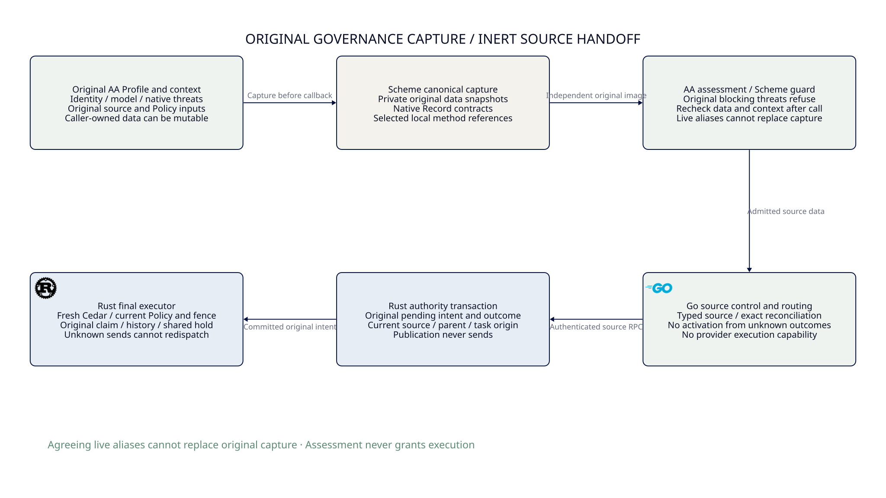

#+TITLE: 59.63 Original Governance Capture and Mutable Alias Refusal
#+LANGUAGE: en

* Architecture and implemented boundary

#+ATTR_HTML: :width 1500

The existing Scheme Governance owner now captures independent canonical data
before invoking an Agentic AI Lab assessment method. It compares that original
image with the actual post-call Profile, context and returned assessment context.
Two live aliases that mutate together cannot substitute for the original image.
This guard reuses native POO Record contracts and actual AA assessment dispatch;
it does not add a governance DSL or another evaluator.

The gap was concrete: original Profile identity and assessment-context identity
could share one mutable string. An override could change that string, return an
otherwise ready assessment, and satisfy the old live-to-live equality checks.
An isolated copy of the prior function returned =accepted= for this stimulus.
The fixed owner retains an independent pre-call string and refuses the change.

* Capture and responsibility allocation

| Owner | Responsibility |
|-------+----------------|
| Scheme Governance capture helper | Build typed original metadata/threat projections and private canonical JSON; compare data and local method references around one callback |
| AA Profile / ThreatModel | Existing generic assessment dispatch and native threat semantics; blocking original threats refuse before an override executes |
| Scheme Gateway / Policy owners | Existing exact task/Governor source binding and original Policy/source-assets projection checks; a successful local assessment remains inert |
| Go control | Decode source data, stage/reconcile original publication and propose routes; no assessment result authorizes an external effect |
| Rust ledger / executor | Current source identity, original publication CAS, claim, budget, history/fence and actual send/release guards |
| Native PBT / Quint / Lean | Framework-owned implementation generation/replay, bounded protocol witnesses and conditional binding laws, respectively |

The capture helper lives in =scheme/governance/capture.ss=. Native Record
descriptors remain in =types.ss=; =func.ss= owns AA dispatch and refusal. The
root package, public module selection and FFI library boundary are unchanged.
There is no new direct Yuanxu dependency: the existing AA dependency provides
the native contracts and property-testing framework.

The selected data image includes Profile identity/revision/owner, ThreatModel
identity, every native threat's identity/severity/phase, all preconditions and
their observed/evidence values, mitigations and acceptance authority. A separate
typed context image includes the original source, Policy inputs and all existing
context coordinates. Policies and source-assets retain the Gateway's separate
before/after projection checks. Unsupported ontology remains unsupported.

Canonical strings are newly allocated inside the owner before the callback and
are not passed to it. They are bounded by the existing eight-MiB source limit.
They are byte snapshots, not a general cryptographic identity or portable grant.
Method comparison pins the actual selected procedure objects locally; it does
not hash closures, authenticate source code or prove captured ambient state pure.

* Native property framework and concrete integration

The Scheme suite now uses =:clan/poo/testing/property=, its public generators and
its standard =property/test= assertion adapter. No application PRNG, shrink loop
or script-based property engine is introduced. The framework owns reports,
counterexamples, shrinking and replay; every non-passing status fails a normal
=:std/test= assertion.

The generated property uses seed 293, 128 cases and a finite shrink budget of 64.
It varies the field, character position, replacement character and whether to
mutate. Eight field classes include nested precondition evidence and threat
identity, alongside Profile/model/context coordinates. Required classification
coverage includes every field plus mutated and stable cases. Stable cases must
still return acceptance, so denying every call cannot satisfy the property.
Mutated cases require the exact source-change refusal, not an arbitrary exception.

The integration fixture adds an AA override that mutates the shared Profile
identity before constructing its assessment. The real Go/Rust harness requires
natural Scheme refusal, no emitted artifact and zero provider calls. Its original
fifteen-second deadline and cleanup semantics are unchanged. The existing normal
Scheme publication/restart scenario remains the positive cross-language control.

Standard =gerbil build= rebuilt the changed libraries, and =gerbil test= owns
native suite discovery and execution. This SDK's test command can return process
zero even after a TestError: actual case/module/harness verdicts must be inspected.
The maintained Go gate also checks the SDK's returned test verdict explicitly.
An exit code or isolated success marker alone is not native acceptance.

* Quint and Lean correspondence

The existing =LlmPolicyContinuation= owner already requires the original Profile,
captured environment and source image at the boundary. New witnesses cover
coordinated live labels and the expected unsafe omitted-snapshot path. The latter
is an executable counterexample, not a deployed guard. An identical nested-value
witness was removed in favor of reusing the existing environment-change check.
The standard Policy plan now executes this owner and samples its existing
=boundaryStep= relation; no parallel lifecycle/CAS model is added.

The fixed-SPEC Lean bridge reuses =BoundaryContext=, =CaptureDependency= and its
existing changed-capture law. Its assessment-snapshot corollary rejects a changed
captured environment against the independently retained expected environment.
Native refinement must map the canonical selected data and admitted source/method
context into that reference. The proof does not make a live pointer immutable,
prove the JSON encoder or establish external fact truth.

* Failure evidence and limits

The isolated baseline retains the previous =assess-governance!= body, changing
only its import path and exported function name. It accepted the shared-string
mutation. The new regression requires the exact changed-source refusal. An early
fixture accidentally shadowed a POO slot and produced CyclicSlot; a generic
exception assertion also lacked causal precision. Neither qualified the alias
guard. The corrected baseline and framework property use precise outcomes.

The first real new negative integration printed the correct refusal but exceeded
its original fifteen-second natural-exit deadline and was killed by the test
watchdog. It remains a failed trial. A paired run with the old assessment-revision
refusal passed: the old case exited naturally in 6.20 seconds and the new one in
5.85 seconds. That later pass does not explain the first process's delayed exit
or establish that host jitter caused it. No timeout or exit path was changed.

These are selected-data, single-callback guards. They do not prove an atomic
snapshot against concurrent writers, detect a fully restored A-B-A mutation,
sandbox arbitrary Scheme code or detach every returned Gateway object from every
caller alias. The admitted Scheme runtime remains trusted. Durable Rust-owned
capture, authenticated callback/producer issuance, general Profile/configuration
schema admission and external source-cut recovery remain required.

The inherited JsonSchema public scope was inspected: contract admission rejects
unsupported constraints, while its default object schema is unconstrained. It
cannot be selected as Gateway admission by default. This change uses the existing
native Record schema for selected metadata; it does not claim to implement the
full dual JSON/Scheme configuration-schema pipeline. Higher-order Governance's
thirteen complete acceptance scenarios remain unqualified.

* Verification receipt

Focused native PBT and complete standard native suites passed before the final
source freeze. The semantic-boundary owner passed 165 named Quint witnesses and
1000 sampled 60-step runs with seed 293. The actual fixed-SPEC Lean bridge built
its new corollary with only the existing logical assumptions and no sorryAx.
Final committed-source gate and integration results are recorded after execution.
No dependency pin, source limit, ASP deny rule or resource cleanup is relaxed.

The first merged clean-source gates at =c8e4a83= failed the architecture trace
because the new witness regular expression omitted escaping its literal opening
parenthesis. Go's ordinary suite failed for the same trace error. Runtime Rust
tests, Clippy, real provider integration and all formal stages passed, but those
whole gate receipts remain failed. The trace expression was corrected without
changing its intended definition match or weakening the checker. The original
blocking-threat fixture now also requires zero callback invocations.

After correcting the trace, the focused architecture test passed and the complete
Governance suite passed, including the 128-case framework property and the zero
callback assertion. The combined real Scheme integration invocation remained
failed (240.858 seconds): the publication/reply-loss/restart case observed zero
source calls before its bootstrap deadline; the existing deny and assessment-threats
negative cases printed refusals but exceeded their fifteen-second natural-exit
deadlines. These are retained failures, not evidence of successful restart or
complete Scheme integration. Their causes remain unclosed; neither the timeout
nor the exit behavior was relaxed. Framework PBT acceptance is a separate receipt.
